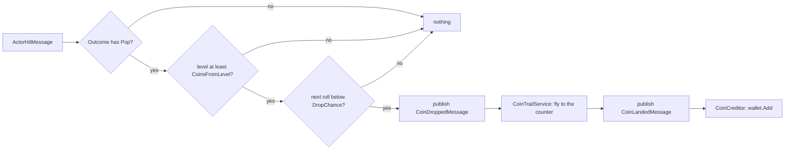

# Coins

A saved currency the player earns deep in a run: from level `CoinsFromLevel` (10) on, each pop
has a `DropChance` (5 %) of dropping a coin. Coins carry over between runs and app restarts.
They will be spent on the game-over screen for a card that helps the retry (not built yet; see
`Plans/PLAN-Coins.md`).

A dropped coin flies from its pop to the coin counter (bottom left, `UI/Coins/`) and counts
when it lands, as score does: the balance never runs ahead of what the player saw arrive.

## Contents

| File | What it does |
|---|---|
| `CoinDropController` | Subscribes `ActorHitMessage`. On a hit whose outcome includes `Pop`, at level ≥ `CoinsFromLevel`, rolls against `DropChance`; on a drop it publishes `CoinDroppedMessage(1, worldPosition)`. It never touches the wallet |
| `CoinTrailService` | Subscribes `CoinDroppedMessage` and flies a pooled coin trail (`Prefabs/Coins/CoinTrail.prefab`) from the pop to the counter; on arrival it publishes `CoinLandedMessage`. The counter's view registers itself as the target (`RegisterTarget`); until one has, a coin lands at once, so a scene without the HUD (and the tests) still credits every coin. Coins fly on real time, so they keep moving through the level-up popup's pause and the loss's slow motion. Coins still flying when the run resets or the board changes (a level-up, or the loss's camera-down) land at once. Only closing the game mid-flight loses a coin |
| `CoinCreditor` | Adds coins to the wallet when they land, on `CoinLandedMessage` |
| `ICoinCounterVisibility` / `CoinCounterVisibility` | Whether the counter shows. It turns on the first time the run reaches `CoinsFromLevel` or the wallet holds coins (a returning player sees it from level 1, since they can spend at any loss), and then stays for the session. Evaluated at initialization, before the views start, so a returning player's counter doesn't fade in |
| `ICoinBalance` | The balance alone, `IReadOnlyReactiveProperty<int> Balance`: what views and the playtest bot read |
| `ICoinWallet` / `CoinWallet` | `ICoinBalance` plus `Add(int)` and `TrySpend(int)`. Loads from `ICoinStore` once, at construction, and clamps a negative saved value to 0. `Add` ignores amounts of 0 or less; `TrySpend` refuses a negative amount or more than the balance, so neither can mint coins. Earned coins wait for a save point; a successful spend is saved at once, because a spend lost to a crash would refund the purchase |
| `ICoinWalletPersistence` | `Save()`: writes the balance if it changed since the last write. Only `CoinWalletSaver` uses it |
| `ICoinStore` / `PlayerPrefsCoinStore` | Where the balance is kept between sessions: the `Coins` key in `PlayerPrefs`, beside `RunMeta`'s best level and score. The seam lets tests use an in-memory store |
| `CoinWalletSaver` | Saves at the save points: on `GameOverMessage`, on `RunResetMessage` (catching coins that dropped after the game over), when the app may be about to stop, and when the game scope is disposed. Not on every coin, because `PlayerPrefs.Save` is slow on mobile |
| `IAppSuspendSignal` / `AppSuspendSignal` | Fires when the app loses focus (on mobile, sent to the background, where the OS can kill it without warning) or quits |

Settings live in `RunConfig` as the `Coins` block (`CoinSettings`, read through `ICoinSettings`
in `Shared/`): when coins drop, and the trail's flight time and pool size. The messages are
`Shared/Messages/CoinDroppedMessage` (a pop dropped a coin) and `CoinLandedMessage` (it reached the
counter). One `CoinWallet` singleton is registered as all three wallet interfaces.

A crash or a hard kill with no focus change first loses the coins earned since the last save
point. That is the price of not writing on every coin.

**One wallet only.** The wallet lives in the Game scope, which is loaded once and reset in place
for every run, so there is one wallet for the session. If the balance is ever needed outside the
Game scope (on the launch screen, say), move the wallet, its store and the suspend signal to
`AppLifetimeScope`: two wallets would each hold their own unsaved balance, and the last one to
save would wipe the other's coins.

## How a drop is decided

Every hit dispatched through the hit pipeline counts: a balloon or a gatekeeper popping, and an
item's blast rolls once per balloon it pops. The board clear at a level-up does not dispatch
hits, so it can't farm coins. Dev cheats that pop balloons do dispatch hits and can earn coins.

**Every attempt at a level drops the same way for the same pops.** The rolls come from a random
stream seeded with the level's seed (`ILevelPacingConfiguration.SeedForLevel`, mixed with a salt
so it doesn't repeat the level generator's stream). The stream restarts whenever the level
changes and on every run reset. The level's seed doesn't change between runs either, just as the
level's board doesn't. Only pops consume a roll; a deflect or an absorb doesn't, so bouncing more
on a retry doesn't shift which pops drop. The reset runs at `RunResetOrder.Score + 15`, after the
level is set back.

## Telemetry

`CoinDroppedMessage` feeds the `coins_earned` metric (summed per level; see
`Game/Telemetry/README.md`). The metric is a copy for analysis, not the wallet: the wallet is
progression and stays on the device. A coin that drops after the game over (a straggler pop)
still goes into the wallet but is not counted, because the level's record is already closed.
The metric counts drops, not landings: every drop lands, at once if it must, so the two only
differ for coins in the air when the app is closed.

The playtest bot (`Tools/playtest/`) prints the balance on every tick and reports coins earned
per run and per level.
