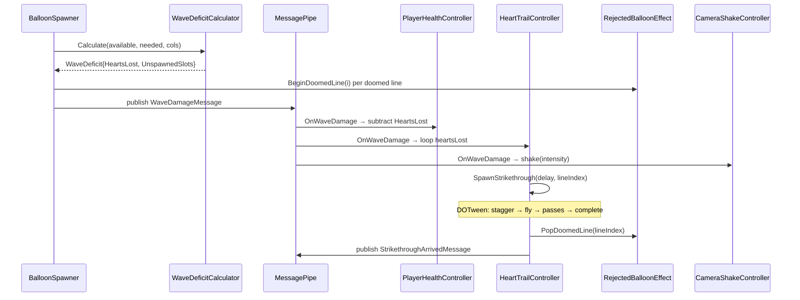
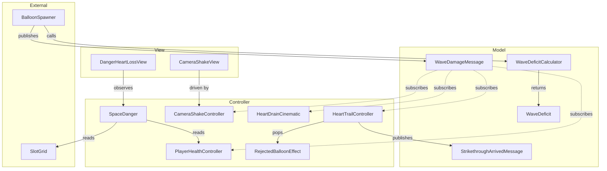
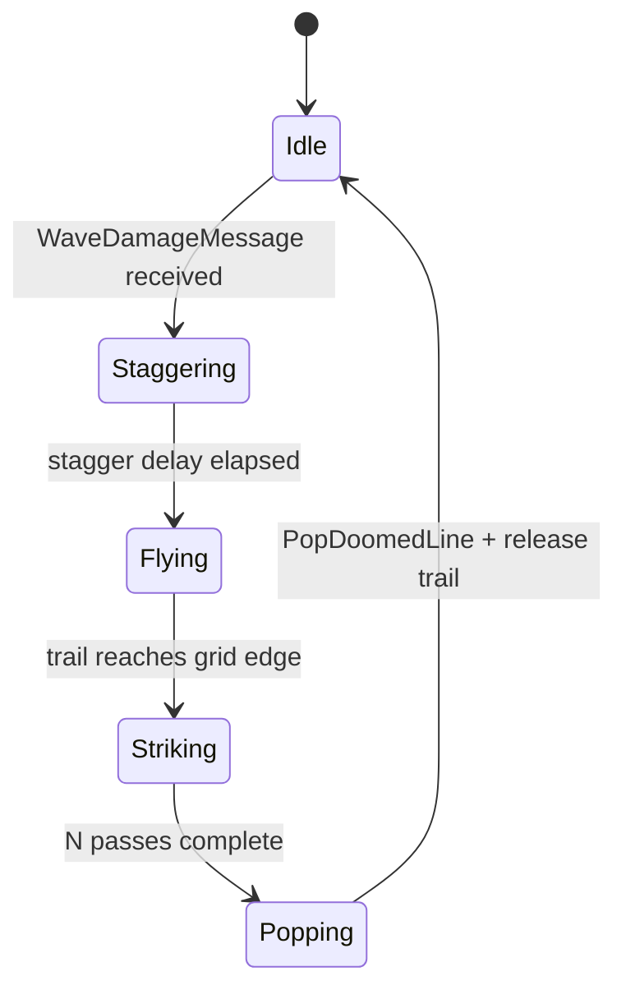

# Health

The player's **hit-point pool** — the only loss trigger under the line-based spawn-saturation
model. Each heart represents one full spawn line. When the board can't absorb all the lines in
a spawn wave, the player loses one heart per full line of deficit; partial-line shortfalls are
forgiven. Reaching zero hearts ends the run. Hearts come back on a level-up (`LevelUpHeartRefill`) and
when the player pops a heart balloon (`Balloon/Reward/`). On a purple level that pop can go past the
starting hearts: an extra heart, with no cap, which a level-up refill keeps and a run reset (a retry
included) takes back to the starting hearts. The counter shows them as a higher number.

## Contents

| File | What it does |
|---|---|
| `PlayerHealthController` | Plain C# entry point (`IStartable`, `IRunResettable`, `IDisposable`). Holds `ReactiveProperty<int> Current`, initialised and reset to `IRunConfig.StartingHitPoints` (clamped to a hard internal cap of 999). Subscribes to `WaveDamageMessage`; each message spends `HeartsLost` points in one shot. Gives back `IRunConfig.LevelUpHeartRefill` points on every `ScoreLevelUpMessage`, never past the starting points (1 in the shipped config, so hearts lost in one level carry into the next; set it to the starting points to refill to full). `IPlayerHealing`: `Heal` tops up to the starting points and never trims extra hearts; `HealPastMax` adds past them (a purple level's heart balloon). Neither revives a player at zero. When `Current` crosses to zero it publishes `EndRunRequestedMessage` exactly once. |
| `IPlayerHealth` | Read-only seam (`Current`, which extra hearts can take past `Max`, and `Max`, the cap a heal stops at) — what UI binders and `SpaceDanger` inject instead of the concrete controller |
| `IPlayerHealing` | `Heal(amount)`, up to `Max`, and never for a player already out (a pop can land after the killing hit): the reward balloons' payout (`Balloon/Reward/RewardBalloonPayout`) |
| `WaveDeficitCalculator` | Pure static function: `Calculate(availableSpace, neededSlots, rowLength) → WaveDeficit`. The core formula: `heartsLost = floor(max(0, needed - available) / rowLength)` |
| `WaveDeficit` | Readonly struct result: `HeartsLost` (full lines of deficit) and `UnspawnedSlots` (total shortfall) |
| `ILossForecast` / `LossForecast` | Loss is imminent when HP is already at zero (damage is immediate under the line model, no pending charges) |
| `HeartTrailTracker` | The heart trails currently in flight (health UI → grid area), launch order preserved. `HeartTrailController` (`UI/Health/`) adds/removes them; the heart-drain cinematic frames the hearts in this set |

## How it works

```
BalloonSpawner (wave start)
  ├─ CountEmptySlots()
  ├─ WaveDeficitCalculator.Calculate(available, spawnLines×columns, columns)
  │       → WaveDeficit { HeartsLost, UnspawnedSlots }
  │
  ├─ if HeartsLost > 0:
  │       publish WaveDamageMessage ──► PlayerHealthController.Damage(HeartsLost)
  │                                          │  Current == 0
  │                                          ▼
  │                                 EndRunRequestedMessage
  │                                          │
  │                                          ▼
  │                                 RunController.EndRun()
  │
  └─ Spawn only (spawnLines - HeartsLost) effective lines
         └─ blocked columns → RejectedBalloonEffect.Play() [visual only]
```

## Damage formula

- `deficit = neededSlots - availableSpace` (clamped ≥ 0)
- `heartsLost = deficit / rowLength` (integer division — only full lines count)
- Partial remainders (< one full line) are simply not spawned, costing no heart.

Example (6 columns, 4 spawn lines = 24 needed):
- 18 available → deficit 6 → 1 heart lost
- 21 available → deficit 3 → 0 hearts lost (partial line forgiven)
- 12 available → deficit 12 → 2 hearts lost

## Registration

`GameLifetimeScope`: `RegisterEntryPoint<PlayerHealthController>().AsSelf().As<IRunResettable>().As<IPlayerHealth>()`.
The deficit computation lives in `BalloonSpawner`; visual feedback (camera shake, heart trails,
cinematic) subscribes to `WaveDamageMessage` independently.

## Architecture

### Spawn Wave → Damage → Strikethrough → Pop



### MVC Layers & Message Flow



### Strikethrough Lifecycle



The trail is a pencil (`HeartTrail` prefab, from **Tools > BalloonParty > HeadsUp > Pencil the
Strikethrough**): a pencil tip for its head and vermilion graphite (`BalloonParty/Sprite/PencilLine`) for its
ribbon. It flies to the row lifted off the paper and only draws while striking, and its ribbon lasts the
whole scribble, so every pass stays drawn until the row pops.
