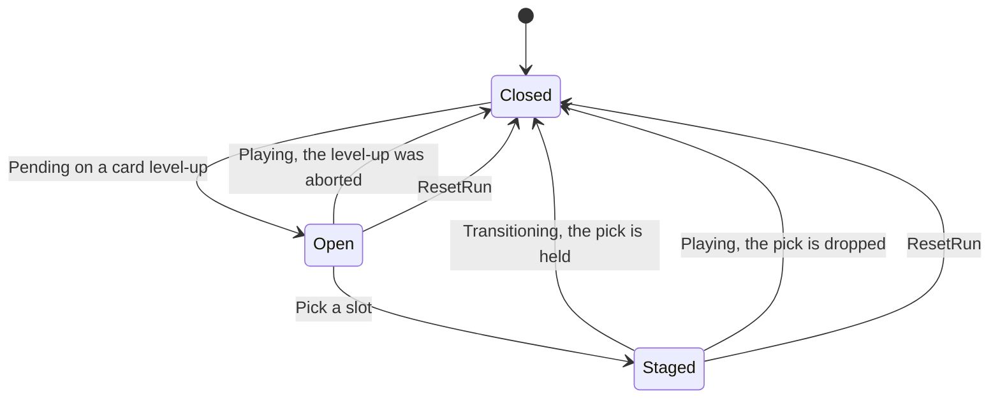

# Game/Upgrades

Upgrade cards: the run's source of power. Every few level-ups the level-up popup deals a hand of
cards, the player picks one, and it stays for the rest of the run. Pressure grows with level (the
spawn clock, the level budget); power grows only with the player's picks. The ball cap in
particular never rises with level, only through a card.

## Components

| File | Responsibility |
|---|---|
| `IWeaponStats` | The run's weapon after its cards: `MaxBallsInFlight`, `ReloadSeconds`, `StartingShields`, `ExtraItemChance`. Each value is the configured base (`IProjectileFlightConfig`) plus every card held. Read these, not the flight config, wherever a card can change the value |
| `IUpgradeDraft` | The cards side: `Offer` (the hand of the level-up being presented, empty when none is pending or it deals none), `BonusCard` (the current attempt's bonus card, or null), `StacksOf(card)`, and `Pick(slot)`, which stages a card of the hand as the level-up's pick |
| `RunUpgrades` | Implements both, plus `Game/Run`'s `IBonusCardSource`, `IRunResettable` and `IStartable` (it follows `ILevelProgress.Phase`). Holds the stack count per card and the bonus card, and recomputes the weapon when either changes |

The deck and its rules are `IUpgradeSettings` (authored in `RunConfig` as `Upgrades`, and registered
on its own so `RunUpgrades` depends on the deck alone): `CardEveryLevels` (2), `CardsOffered` (3)
and `Cards`, each with a kind, title, description, a per-stack `Amount`, `MaxStacks` and a deal
`Weight`.

## The cards

| Kind | What one stack does | Read by |
|---|---|---|
| `BallCap` | +`Amount` balls in flight at once (rounded) | `ThrowerReload.HasFreeSlot`, and the projectile pool, which `ThrowerController` tops up on the next load |
| `FasterReload` | Reload time × (1 − `Amount`); stacks multiply, and the total never drops below 10% of the base | `ThrowerReload.Restart` |
| `Shield` | +`Amount` starting shields on every ball (rounded) | `ThrowerController.LoadProjectile`, the shield-chain planner in `ItemAssigner`, and the shot solver (`ShotBoardGather.Gather`'s `startingShields`, passed by the Fire Best Shot cheat and the Shot Solver window) |
| `ItemOdds` | +`Amount` extra items per item roll, the initial board fill included. The whole part always lands; the fraction is a chance | `ItemAssigner.ExtraItems` |

All four are read live, so a held card applies from the next ball loaded and the next item roll.

## A level-up's hand

The hand follows the level-up phase (`Game/Level/README.md`):

| Phase change | What happens to the hand |
|---|---|
| `→ Pending` | Opens: deals the hand for entering `Level + 1`, or nothing on a level-up that deals no cards |
| `Pick(slot)` | Stages that card. Rejected when no hand is open, a pick is already staged, or the slot is outside the hand |
| `→ Transitioning` | The level has advanced: the staged card is held, and the hand closes |
| `→ Playing` | Reached from `Pending` only when the level-up is aborted (a loss became certain mid-beat): the hand and any pick are void |
| `ResetRun` | The hand and any pick are void |

So a card is held only once the level that dealt it is completed. That is what lets a retry keep
"the cards held when the level started" without a snapshot: the cards held at a loss are always the
ones held when the lost level began.

A level-up deals cards when `(newLevel − 1)` is a multiple of `CardEveryLevels`: with 2, entering
levels 3, 5, 7 and so on. Every other level-up passes with no screen (see `UI/LevelUp/README.md`).
0 turns cards off.

The hand is drawn by weight (`WeightedPickExtensions.PickWeightedIndex`), without repeats, from the
cards not yet maxed and not zero-weight; fewer are dealt when fewer are left, and none once every
card is maxed. The draw is seeded from the level's seed (`ILevelPacingConfiguration.SeedForLevel`,
salted), so reaching the same level-up with the same cards held deals the same hand, including the
re-detected level-up after an abort.

## Run scope and retries

`ResetRun` drops every card on a fresh run and keeps them on a retry (`IRetryState.RetryLevel > 0`).
It runs at `RunResetOrder.Counters`, before `RetryTracker` consumes the staged retry level.

## The bonus card

The game-over screen can offer a retry with a bonus card, bought with a rewarded ad
(`IFailureOffers.TryBonusRetryAsync`, see `Game/Run/README.md`). When that retry's reset runs
(`IRetryState.RetryWithBonusCard`), `ResetRun` deals one card by weight and publishes
`BonusCardDealtMessage`; the on-screen tooltip names it once play resumes (see `UI/Tooltip/README.md`).

| Rule | Why |
|---|---|
| Never an Extra Ball | An ad never buys the ball cap (`Plans/PLAN-FastPaced.md` §8) |
| Never a maxed card | So a bonus never takes a card past its max |
| Applied on top of the held cards, not counted in `StacksOf` | It isn't a pick: it doesn't fill a card's stacks or change the next hand |
| Dropped when the attempt ends: on `Transitioning` (the level is won) and on any reset | The advantage is per attempt, so repeated ads never stack power. An aborted level-up doesn't end the attempt, so it keeps the bonus |
| Seeded by the level and the retries used | Each bought retry of a level can deal a different card |

`CanDealBonus` (its `IBonusCardSource` side) is false once only Extra Ball and maxed cards are
left, and the screen then hides the bonus button.

## Not built yet

- **A pick for the bonus card.** It's dealt at random and named in the tooltip; a quick pick screen
  (three cards, as at a level-up) is banked for later.
- **Stable card ids.** Held stacks are keyed by the card's settings object, which is enough while
  nothing persists or reports cards. Saving a run, per-card telemetry or staging a card across a
  reset will need an id on `IUpgradeCardSettings`.
