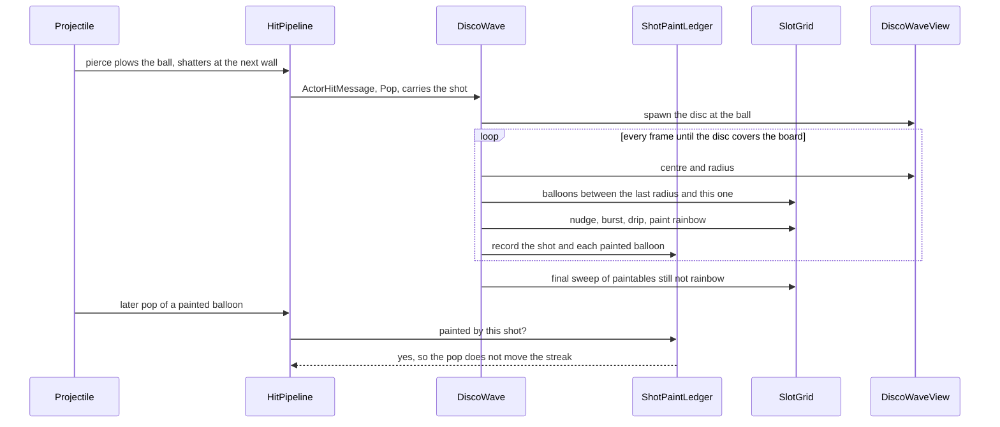

@page plan_disco_balloon Disco Balloon

# Disco Balloon

> A rare third reward balloon: a **disco ball**. It is plated with mirror tiles that catch the scene light
> and reflect the board, and rainbow god rays turn behind it. Like the golden balloon, only a piercing shot
> or a laser beam breaks it. Broken, it sends a disc out across the board, and every balloon the disc's edge
> reaches is nudged, gives a small burst, and is painted rainbow. Balloons that resist paint keep their colour.
>
> **No changes until this plan is actioned.**

---

## Goals

1. **A third reward balloon**, placed by `RewardBalloonService` and never by a level's mix, like the golden
   and heart balloons (`Plans/PLAN-RewardBalloons.md`). It is rare, and there is at most one on the board.
2. **It breaks like the golden balloon.** An ordinary hit from the shot bounces off it. A piercing shot plows
   it, and it shatters at the shot's next wall. A laser beam breaks it at once. Nothing else touches it: a
   bomb, lightning or paint has no effect. It has no colour and no score of its own, resists paint, and
   carries no item.
3. **Its pop paints the board rainbow, as a wave.** A disc grows out from where the ball was. Each balloon
   the edge reaches is nudged away from the ball, gives a small pop burst, plays the paint drip, and is
   painted rainbow. Paint-immune balloons are nudged and play the drip, but the paint runs off and their
   colour stays, exactly as under the Paint item.
4. **The wave never feeds its own shot.** The shot that broke the ball is often still flying when the board
   turns rainbow. It must not climb its own streak on balloons it just painted (see
   *Self-feeding check*).
5. **The look:** a mirror ball that reflects the board, its tiles flashing as they turn through the light,
   lit by the scene light (bright at noon, dim and tinted at night), with rainbow god rays behind it.

## How it fits

The disco balloon is the golden balloon with a different payout. Almost every piece already exists. The new
code is the model, the wave, the ledger that guards the streak, and the look.

| Piece | Where | What |
|---|---|---|
| `BalloonType.Disco` | `Balloon/Type/BalloonType.cs` | Appended after `Heart`. The enum's names are a telemetry wire contract, so it is append-only |
| `IsReward()` | `Shared/Extensions/BalloonTypeExtensions.cs` | Covers `Disco`, so a level's pick list skips it |
| `PlatedBalloonModel` (new, abstract) | `Balloon/Model/` | Moves the golden balloon's hit rules out of `GoldenBalloonModel`: a `Beam` pops; a hit with both `Piercing` and `DirectHit` pops; any other shot hit deflects; an item hit is `HitOutcome.None`. It also takes `IHasDeflectStamp`, `IResistsPaint`, `IDeflectsShots` and the nudge overrides. `GoldenBalloonModel` and `DiscoBalloonModel` both extend it, so the two rules can't drift apart. `IsTough` already covers any `IDeflectsShots`, so the pierce plows it with no change |
| `DiscoBalloonModel` (new) | `Balloon/Model/` | An empty subclass. It gets its own type so the payout, the solver and the sound can tell it apart |
| `BalloonModelFactory` | `Balloon/Model/` | Maps `Disco`. This has to land before the catalogue entry does: the factory throws for an unmapped type after `Placed` has run, which would leave the balloon counted on the board for the rest of the run (the trap noted in the reward plan) |
| `RewardBalloonService` / `IRewardBalloonSettings` | `Balloon/Reward/`, `Configuration/Balloons/` | Decides when a disco balloon is due (*When it comes*) and tracks the one on the board through the leave callback |
| `BalloonSpawner.AddRewardBalloon` | `Balloon/Spawner/` | Today a ternary picks the golden or heart entry. It becomes a lookup by type, so a third reward type doesn't add a third branch. The disco entry is prewarmed to one, like the other two |
| `DiscoWave` (new) | `Balloon/Reward/` | Plain C#, `ITickable` and `IRunResettable`. It reads the ball's pop from `ActorHitMessage` through `RewardBalloonPop.TryGet`, the same gate `RewardBalloonPayout` uses, so only a real pop starts a wave, never a board clear or a level change. It runs the disc: the radius each frame, which balloons the edge has crossed, and what happens to each (*The wave*). One wave at a time, since there is never more than one ball on the board |
| `DiscoWaveView` (new) | `Balloon/View/` | A pooled `MonoBehaviour` quad drawing the disc. The wave pushes the centre and radius to it each frame, so what you see and what gets painted can't drift apart. Its `CompositeDisposable` is cleared and its tweens are killed in `OnDespawned` |
| `PaintTargets` (new, static) | `Item/Paint/` | Moves `PaintItemHandler.TryClassify` out so it can be shared. Accept: paintable and not already that colour. Reject: `IResistsPaint`, or a rainbow balloon hit by concrete paint. Ignore: anything else. The Paint item and the wave both classify through it, so a balloon immune to the Paint item is immune to the wave |
| `ShotPaintLedger` (new) | `Projectile/Controller/` | Remembers which balloons a given shot's effects painted rainbow. `ProjectileHitResolver` asks it before marking a wildcard pop. Entries are cleared when the shot ends (*Self-feeding check*) |
| `NudgeType.Wave` (new flag) | `Nudge/NudgeType.cs` | The wave nudges each balloon on its own with `NudgeMessage(actor, ballPosition, NudgeType.Wave, overrides)`. `NudgeService.HandleSingleActor` already supports exactly that. A separate flag lets a prefab's `NudgeOverrides` tune the wave's push apart from a deflect or a neighbour hit. `Shockwave` doesn't fit, because it nudges the whole board at once |
| `GodRaysLook` | `Balloon/Type/` | Used as it is, on a `DiscoRays` material and palette entry (*The look*) |
| `CombatSoundRouter`, `GameSoundId` | `Audio/` | `BalloonDeflectDisco`, `BalloonPopDisco`, and the wave's cue, appended |
| Solver | `Solver/` | `ShotBalloonSnapshot.ForDiscoTarget`, with the golden balloon's hit rules. The simulator applies the ledger rule, and the ranking values a disco pop (*Phases*) |
| Spawn-balloon cheat | `Cheats/` | Sends `Disco` through the service, as the golden balloon already does |

## When it comes

It comes **reward-style**, through `RewardBalloonService`. It does not come from a level-mix weight.

A weight in the level's mix would bring the ball back again and again on any level that allows it, and the
mix's caps count balloons, not jackpots. The service already does what this balloon needs: at most one on
the board, per-level rolls, a completion threshold, and a guaranteed first meeting. A level that rolls one
sees it at most once.

Proposed defaults (all tuning lives in `IRewardBalloonSettings`):

| Setting | Default | Why |
|---|---|---|
| `DiscoFromLevel` | 8 | After the golden balloon's introduction on level 5, so the player already knows "only a pierce breaks the plated ones" |
| `SureDiscoLevel` | 10 | Every player meets one, with no roll, early in the level (`SureDiscoAtCompletion` 0.15), with the level still ahead of them |
| `DiscoChance` | 0.2 | After that, each ordinary level rolls once, on its first line |
| `DiscoAtCompletion` | 0.35 | A won roll places the ball once the level is 35% done. Later than that, the rainbow pays out goals the level is nearly finished with (Open questions, 1) |
| Purple levels | off | Purple levels already carry the golden and heart rolls, and on paper the rays and mirror have little light to work with. Revisit after a playtest |

When more than one reward is due on the same line, the golden balloon goes first (it already beats the
heart), then the disco balloon, then the heart. A reward that is due but finds no room on its line stays
owed to the next line, as the other two do.

## Breaking it

These are the golden balloon's rules, through the shared `PlatedBalloonModel`:

- **The shot's ordinary hit** deflects: `BalloonDeflectedMessage`, the deflect nudge, and the deflect stamp.
- **A piercing shot** (a pierce earned in cruise, or a Snipe lance) plows it. It pops at the shot's next
  wall discharge, as the golden balloon does, and the wave starts from the ball's slot at that moment.
- **A laser beam** pops it at once (`DamageFlags.Beam`).
- **A bomb's blast** carries `Piercing` but never `DirectHit` or `Beam`, so it does nothing. Lightning,
  paint and snipe blooms do nothing either. A board clear or a level change takes the ball away with no
  wave: only a pop pays, as with the other rewards.

Its pop scores nothing and leaves the streak alone, because the ball has no colour. Everything it gives
comes from the wave.

## The wave

**Shape and timing.** The disc is centred on the ball's position at the moment of the pop. It does not
follow the board afterwards, so a balloon line arriving mid-wave doesn't drag the disc with it.

- `R_max` is the distance from that centre to the farthest corner of the board's slot bounds, plus one
  balloon radius. So a ball in a corner still covers the whole board, and the wave lasts the same time
  wherever the ball was.
- `R(t) = R_max × EaseOutQuad(t / T)`, with `T` = `DiscoWaveSeconds` (0.9 s by default). It starts fast,
  so the balloons beside the ball turn almost together, then slows, so the far edge of the board reads as
  a ripple travelling outward. A fixed duration keeps the wave short on a big board and makes it easy to
  tune.
- Each frame, the wave visits every occupied slot whose centre falls between last frame's radius and this
  frame's. It keeps a set of the models it has already visited, so a balloon that moves between frames is
  never painted twice.
- When `t` reaches `T`, a **final sweep** paints every paintable balloon still on the board and not yet
  visited. This covers balloons that spawned or slid outside the edge mid-wave. The spec is "every balloon
  on screen", and the sweep is what makes that true.

**What each reached balloon gets.** The checks are the Paint item's, through `PaintTargets`:

| The balloon | Nudge | Burst | Drip | Painted |
|---|---|---|---|---|
| Paintable, any concrete colour | yes | yes, its old colour | rainbow | **rainbow** |
| Already rainbow | yes | no | no | stays rainbow |
| `IResistsPaint` (tough, tougher, unbreakable, golden, heart) | yes | no | yes, the paint runs off | no |
| Not a balloon (gatekeeper, bush and other grid actors) | only if it is `IHasNudge` | no | no | no |
| Leaving the board (mid-pop, pooled) | no | no | no | no |

- **Nudge:** `NudgeMessage(actor, centre, NudgeType.Wave)`. The direction comes out from the centre, and
  the distance and duration come from a `Wave` override on `DiscoWaveSettings`, which a prefab's own
  overrides can beat. It uses no falloff: every balloon gets the same push as the edge passes, so the
  ripple reads the same right across the board.
- **Burst:** a small cosmetic burst in the balloon's old colour, as if that colour pops off and leaves the
  rainbow underneath. The balloon is **not popped**: nothing is scored, it doesn't leave the grid, and no
  `ActorHitMessage` is sent. It needs a new `BalloonView.PlayRecolourBurst(Color)` that plays the pop's
  particle at a smaller scale, plus a `DisturbanceField` stamp (`StampSource.Paint`) like the Paint
  item's blob landing. Using the real pop path is ruled out: `BalloonPopPresenter.Present` drives the
  outcome VFX of an actual pop.
- **Drip:** `IPaintReactive.PlayPaintDrip`, resolved from the grid as `PaintItemHandler.ApplyPaint` does.
  The colour is committed first, so the drip reads as paint settling. Today a rainbow drip is white
  (`GamePalette.GetColor` returns white for the wildcard). Phase 4 gives the `PaintDrip` shader the
  rainbow bands (`Include/RainbowBand.cginc`, the level's own colours), so it matches the body underneath.
- **Paint:** `IPaintable.Color.Value = GamePalette.RainbowColorId`. Then `BalloonView.ApplyColorMode`
  swaps the body to the rainbow material, as for any balloon painted rainbow. The wave records each one in
  `ShotPaintLedger` against the shot that broke the ball.

**A level ending mid-wave.** `DiscoWave` is `IRunResettable` and cancels the wave on a run reset, a level
change or a game over. It despawns the disc and paints nothing more. A balloon the wave already painted
stays rainbow.

**Time scale.** The wave runs on scaled time, so a slow-motion beat (the pierce discharge's slow-mo, if
it overlaps) slows the ripple too and keeps it in step with the rest of the board.

## Self-feeding check (the rainbow multiplier trap)

The known trap: a shot's own effect paints balloons rainbow, and then the same shot pops them. Each pop
is a wildcard pop (`CarryStreak`, or `DeferredStreak` for a colourless shot), and
`ColorStreak.RecordWildcard` raises the streak with no cap. This has been fixed twice already: once for the
side neighbours in `ProjectileHitResolver`, and once for the forward exclusion in `SnipeDischargeBloom`.
The disco ball is the worst case yet, because it paints the whole board.

**Does the same shot hit what it painted? Yes, on every way it can break:**

1. **Pierce.** The ball pops at the shot's next wall, and the shot then bounces straight back into a board
   that is turning rainbow in front of it. If a Snipe charge was banked, the shot even re-arms its pierce
   at that moment and plows through it.
2. **Laser.** The beam's own pops are item hits, with no `DirectHit`, so the beam can't climb the streak.
   But the shot whose hit fired the laser keeps flying, and it is the one that would harvest. The laser's
   `DamageContext.Projectile` names that shot.
3. Several shots can be in flight at once (rapid fire). The shot that broke the ball is the one to guard.
   Any *other* shot, and every later throw, pops the rainbow board as it is meant to. That is the reward.

**Why the earlier fixes don't carry over.** Both of them worked by geometry: they skipped balloons ahead
of the shot. A whole-board wave has no "behind": the shot is inside the disc, and the bounce can send it
anywhere.

**The guard: `ShotPaintLedger`.** For each conversion the wave records the pair (the shot that broke the
ball, the balloon painted). The shot comes from the pop's `DamageContext.Projectile`, which may be null for
a cheat, in which case nothing needs guarding. In `ProjectileHitResolver`, when `isWildcardPop` is true and
the ledger holds (this projectile, this balloon):

- it adds neither `CarryStreak` nor `DeferredStreak`, and arms no carry;
- the pop scores at whatever multiplier is already live, and the streak neither climbs nor breaks. It needs
  a new `DamageFlags.OwnPaint`, read by `ScoreController.RecordStreakMultiplier` as "return the current
  multiplier, change nothing". The `Log.Assert` that guards against items authoring streak flags covers it;
- the balloon still pays its rainbow attribution to every allowed colour. Goal progress is not the trap:
  progress is still earned one pop at a time. The guard is only about the uncapped multiplier.

A shot carrying the rainbow buff (`isRainbowBuff`) climbs on any pop anyway. That comes from the buff, not
from the disco ball, so the ledger doesn't change it.

The ledger lives in one place for any shot that paints, and it is keyed by model reference (models are
built fresh for each spawn, never pooled). It drops a shot's entries when the shot despawns. Retrofitting
the two existing guards onto it is a possible follow-up, but **not** part of this plan: they work, and they
keep the board's colour for the shot's next hit.

The solver has to mirror the rule (`ShotSimulator`), or it will rate a disco shot by a streak it can never
cash in.

## The look

**The body: `Balloon/DiscoBall.shader`.** It starts from `GoldenBalloon.shader`'s structure (the sphere
projection, the scene light helpers in `Include/SceneLight.cginc`, and the glint-gated glitter), on a prefab
built from the golden balloon's, so it keeps the knot and reads as a balloon.

- **Tiles.** A latitude–longitude grid of small square mirrors over the sphere, with thin dark grout
  between them. The tiles get narrower toward the poles, as on a real disco ball. The grid turns slowly
  around the vertical axis (`_SpinSpeed`), so tiles slide across the face and over the limb. Each tile is
  flat: its normal is the sphere normal at the tile's centre, quantized. That one choice is what makes it
  read as a mosaic and not as chrome.
- **Reflection.** Each tile samples `_SceneCaptureTex`, the board as `SceneCaptureService` renders it, which
  the unbreakable balloon already uses. The sample is offset by the tile's flat normal, so each mirror
  shows its own flat piece of the board, and the pieces jump from tile to tile. The variant calls
  `Acquire()` and `Release()` on the capture when it is enabled and disabled, as `UnbreakableBalloonVariant`
  does, so the capture camera only runs while a ball is on screen. A cheaper fallback, if the capture costs
  too much on device: reflect the golden balloon's horizon gradient instead (Open questions, 4).
- **Lit by the scene light.** Each tile's colour is multiplied by the light field sampled at the ball
  (`*At(worldPos)`), so the ball is bright at noon, dim at night, and takes on the colour of the local light
  from a nearby pop or the unbreakable's glow. Each tile also gets a sharp specular toward
  `SceneLightDirection()`. As the grid turns, single tiles pass through the light angle and **flash**. Those
  flashes are the disco-ball sparkle, and they follow the time of day. The glitter is gated on the same
  flash, so it only sparkles where the light catches, as on the golden balloon.
- **A variant `DiscoBallVariant`** (`Balloon/Type/`, `IBalloonVariant` and `IBalloonViewBinding`) pushes the
  sphere centre and a random spin phase through a `MaterialPropertyBlock`, and handles the capture
  ref-count. GPU instancing is off on the material, as on the unbreakable, because the properties are set
  per instance.

**The god rays: rainbow.** A `GodRays` child on the root, as on the golden balloon, driven by
`GodRaysLook`, sorted at -1 on the `Balloons` layer (below every balloon), on `TransparentFX`.
`GodRays.shader` gets a `_RainbowRays` toggle. When it is on, each ray's colour is
`RainbowBandColor(rayIndex)`, the **level's own allowed colours**, the same bands as the rainbow balloon's
body, so the rays show exactly what the ball will turn the board into. The `DiscoRays` material holds the
shape: more rays than the golden balloon's, narrower, and spinning faster. A new `DiscoRays` palette entry
holds the strength in its alpha.

**The disc: `Sprite/DiscoWave.shader`** on `DiscoWaveView`. A quad covering the board, with the centre and
radius pushed each frame. It draws a soft wash inside the disc that fades as the disc grows, and a bright
edge band whose colour runs through `RainbowBandColor` by angle, turning slowly. It sorts with the god rays,
below the balloons, so it sweeps through the gaps, and the balloons themselves show the edge as they flip to
rainbow. A short `SceneLightFieldService.Flash` at the pop (as the rainbow balloon's pop already does) lights
the board for a beat.

**Its pop.** The ball shatters into mirror tiles: `PSVFX_DiscoPop`, which is the golden balloon's shatter
using a `disco_parts` sheet cut from a capture of the ball by `Tools/art/shatter`, lit through
`Particle/SceneLit`.

**Sound.** `BalloonDeflectDisco` (a glassy tick), and `BalloonPopDisco` (the golden balloon's chime layered
with a shimmer). The wave gets a rising glissando through the board's key, and each balloon it paints gets a
quiet tick pitched by its distance from the centre, capped for each frame so a full board doesn't stack
fifty clips. All of these are layered from clips already in the sound bank, as the golden balloon's cues are.

## Open questions

1. **How big is the jackpot?** A rainbow pop pays its full score to *every* allowed colour
   (`BalloonModel.ResolveRainbowAttribution`). A whole board turned rainbow lets the next two or three shots
   fill most of a level's goals. The ledger stops the streak trap but deliberately leaves this alone. Is a
   near-level-skip what you want from it? The levers, if not: place it earlier in the level (so there's more
   left to fill), make it rarer, or have the wave skip a share of the board. Skipping goes against the spec,
   so the plan doesn't propose it. The bot measurement in Phase 6 is the evidence.
2. **The next throw's streak.** Every later throw climbs one step per rainbow pop, with no cap. The streak
   resets on each load, so it is bounded by a single shot, but a pierce through a rainbow board will set a
   record multiplier. The streak cap was tried and reverted (score is not difficulty), so the plan accepts
   this as the reward unless you say otherwise.
3. **Items on painted balloons.** An item hosted on a balloon the wave paints becomes the rainbow version
   (a rainbow bomb converts its survivors, a rainbow laser, a rainbow Snipe lance blooms). The board's items
   all go rainbow together and can cascade. Do you want that, or should a hosted item keep its concrete
   version?
4. **Reflection cost.** `SceneCaptureService` renders a second camera while a ball is on screen. The
   unbreakable balloon already pays this cost, and the two share one capture. If a device build shows the
   cost, fall back to the golden balloon's horizon reflection.
5. **The silhouette.** The plan keeps the balloon outline and knot, as the reward plan decided for the golden
   balloon, so it reads as a balloon. The alternative is a true sphere, like the unbreakable, which looks
   more like a disco ball but less like a balloon.
6. **Dancing lights on the board.** A real disco ball throws moving specks of light around the room. Two or
   three tagged scene lights orbiting the ball while it's on the board would do that. They are left out of
   the phases as a stretch goal, because the light field is shared and busy.
7. **Purple levels**, where paper is now the scenario: off for now. Turn them on after a look on paper?

## Phases

Each phase follows the per-phase review: implement; then architect, test-everything and reviewer; then
fixes; then your sign-off.

1. **Plated base and model.** `PlatedBalloonModel` taken out of `GoldenBalloonModel` (no behaviour change,
   and the golden balloon's existing tests keep passing), `DiscoBalloonModel`, `BalloonType.Disco`, the
   factory mapping, `IsReward`, `GetPopColorId`'s heavy list, the solver snapshot. Tests for every hit
   path (shot, pierce, beam, bomb, lightning, paint) on both plated balloons.
2. **Spawning.** The settings, the service's disco rules and their order against the golden and heart
   balloons, the spawner lookup by type, the prewarm, and the cheat. A placeholder prefab (the golden
   balloon's, retinted silver). Tests for the level gate, the sure level, a single one per level, and the
   owed line.
3. **The wave, without the look.** `PaintTargets` taken out of `PaintItemHandler`, `DiscoWave`,
   `NudgeType.Wave`, the per-frame visit, the final sweep, cancellation on reset, the recolour burst, and
   the drip. A placeholder disc (a plain ring). `ShotPaintLedger`, `DamageFlags.OwnPaint`, and the
   resolver and score changes, with the solver mirroring them. Tests: the wave paints every paintable and
   none of the immune; a balloon is painted once; the final sweep; the cancel; and, written first, **the
   breaking shot's later pop of a painted balloon leaves its streak unchanged while another shot's pop
   climbs**.
4. **The look.** `DiscoBall.shader`, `DiscoBallVariant`, the prefab built from the golden balloon's, the
   rainbow `GodRays` toggle and `DiscoRays`, `DiscoWave.shader`, the rainbow `PaintDrip`, and the shatter
   sheet and `PSVFX_DiscoPop`. **Shaders: `dotnet build` doesn't check them.** Checked in the Editor at
   noon and at night with `Tools/stage/stage.py`, and frames sent to you for sign-off.
5. **Sound.** The three cues, layered in `SoundBankConfiguration`.
6. **Docs and measuring.** READMEs (Reward, Type, Nudge, Paint, Projectile), plus the playtest bot on a
   forced disco level against the same seed without one: level time, shots to clear, and peak multiplier.
   This is the evidence for open questions 1 and 2. Then a device build for the capture cost.
