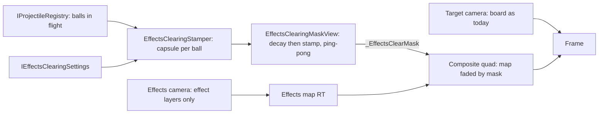

@page plan_effects_layer_clearing Effects Layer Clearing

# Effects Layer Clearing

> Working plan for keeping every ball in flight readable: the effects drawn above the board render into their
> own layer (a render target, the "effects map"), and that layer is laid over the frame through a clearing
> mask that opens a hole around each ball. The hole lingers and shrinks after the ball has gone by.

---

## Orientation

A shot is hard to follow once the board gets busy. Score shapes tumble over the balloons, trails stream to
the score bar, heads-ups flash up, and item effects bloom. The ball, and the balloons it is hitting, vanish
under all of it.

Earlier attempts changed the objects themselves. They pushed score shapes away from the ball, bent trails
around it, faded effects inside a small circle and moved the ball's sorting layer up and down. None of it
read on a phone, and all of it was removed. This plan doesn't touch any object. It changes how the frame is
put together:

- The **board** (the backdrop and ground, balloons, obstacles, balls and the thrower) renders as it does
  today.
- Everything **above** the board is **effects**. Effects stop drawing straight into the frame. They draw into
  an **effects map**, a render target of their own.
- The effects map is laid over the board through a **clearing mask**: a small screen-space texture holding a
  clearing value at every point. Where the mask is clear, the effects are see-through.
- Every frame, each ball in flight stamps the mask with a soft disc along the path it just covered. Stamps
  decay over time. Because a stamp is strongest at its centre, the cleared region shrinks inward as it
  decays: a clearing lingers behind the ball and closes up after it.

"Ball" here is the projectile (`Projectile/`), the thing the player fires. The score formations' glowing
trail heads are also called pens in `Game/Score/Behaviours/`. They are effects, and get cleared like any
other.

| Piece | Kind | Does |
|---|---|---|
| `IEffectsClearingSettings` / `EffectsClearingSettings` | read-only interface + SO | radius, linger, edge, strength, resolutions, shaders, on/off |
| `EffectsClearingStamper` | plain C# | turns ball positions into one stamp per ball, a capsule from last frame's position to this one's, in viewport space. Pure, so EditMode tests cover it |
| `EffectsClearingController` | plain C#, run-scoped, ticks | reads `IProjectileRegistry` every frame, runs the stamper and hands the stamps to the mask view |
| `EffectsClearingMaskView` | MonoBehaviour on the persistent camera | owns the two mask targets and runs one small blit a frame: decay the previous mask, then stamp. Binds `_EffectsClearMask` globally |
| `EffectsMapCompositor` | MonoBehaviour, one per camera that has effects | creates the effects camera and its target, takes the effect layers out of its own camera's mask while a map is live, and draws the composite quad |

---

## The layer split

The board is the set of physics layers that are the board today: `Scenario`, `Balloons`, `Grid`, `Projectile`,
`Thrower`, `Items` (the badges on balloons) and `Limits`. Effects are what draws above it. They sit on two
cameras, and that decides how they split:

- The **main camera** draws the board and some effects, and then post-processes: bloom, then the tonemapper.
- The **HUD camera** (`Display/HudCamera`) draws on top of the finished, tonemapped frame. It draws the
  canvases, heads-ups and the score, heart and highlight trails.

An effect has to be composited where it draws today. If a HUD effect moved into the main camera's map, the
tonemapper would recolour it, which is what the HUD camera exists to stop. So there are two maps, one per
camera, both read through the same mask.

### HUD effects map (phase 2)

| Family | Today | In the map |
|---|---|---|
| Score shapes, score trails (`ShapeFormationTicker`, `FlyingTrail`, `ScoreTrail.prefab`) | `Trail` layer, UI 3300 (set by `ScoreTrailService`) | yes |
| Heart trail, highlight trail, item-preview pens | `Trail` layer, UI 100 (`FlyingTrail`'s default) / ScoreTrail 0–1 | yes |
| Heads-ups (`HeadsUps.prefab`) | `UI` layer, UI 0/1 | **not yet**: open question 4 |
| Game canvas, hearts counter, launcher canvas | `UI` layer | **no**: that's the HUD, not effects |

The `Trail` layer already holds the HUD's trails, so this phase needs no new physics layer. The composite
quad draws at UI 3300, where the score trails draw today: above the canvases and popups (UI 3000), so trails
still fly over the score bar, and under the card reveal (UI 31998). Inside the map the effects keep their own
order. While the map runs, a heart or highlight trail sorts at 3300 instead of 100: over a popup, if one is
open while a clearing is.

### Main effects map (phase 3, open)

| Family | Today | In the map |
|---|---|---|
| Item range previews (`Item/Preview/`) | `Items`, PowerUps 0–100 | yes |
| Item VFX: paint splash and drip, flying blob, shield gain | `Items`, PowerUps | yes |
| Shield bounce/gain/lose VFX | `Projectile`, PowerUps 20 | yes |
| Dust speck field (`SpeckField`) | `Field`, Sky 0 | yes |
| Balloon pop VFX (`PSVFX_*Pop`) | `Default`, Default 0 / Balloons 199–200 | **open question 1** |
| Nuke cloud, disc wave, bubble merge cue, paint drip overlay | Balloons layer, various | open question 1: these are pop-like |
| Ball trail (`ProjectileTrail`), snipe lance line, trace prediction | `Projectile` / `TracePrediction` | no: they *are* the ball's readout |
| Danger walls (`Limits`), clouds, bushes, puffs, the wall net | board layers | no: gameplay information |
| Screen-space light quad (`ScreenSpaceLightService`) | `TransparentFX`, Sky 32000 | no: it lights the board, and the composite sorts below it |

The main camera's effects live on several physics layers that also hold board pieces (`Items` holds the
badges as well as item VFX, `Projectile` the ball as well as the shield VFX). So this phase needs a new
physics layer, `Effects`, which **the owner adds in the Editor** (`TagManager.asset` is never edited by
hand). The effect prefabs above then move to it. The composite collapses these effects to one sorting
position: Sky −1, below the danger walls and the light quad. One visible change comes with that: item VFX on
PowerUps draw under bushes and puffs (GridActors) today, and would draw over them.

---

## The clearing mask

One low-resolution, single-channel target: `R8`, screen size divided by `MaskDownscale` (default 8, so
135 × 300 on a 1080 × 2400 phone). Two of them ping-pong. Once a frame, from `LateUpdate` (blits stay outside
URP's RenderGraph, as `Display/README.md` requires), one blit:

1. **Decay**: `mask = max(0, previous − Δt / LingerSeconds)`.
2. **Stamp**: for each of up to `MaxStamps` capsules (8, the shader's fixed array),
   `mask = max(mask, profile(d / Radius))`, where `d` is the distance from the fragment to the capsule's
   segment, and `profile(x) = 1 − x²` inside the radius, 0 outside.

The composite reads the mask bilinearly and fades the map by
`fade = 1 − Strength × smoothstep(EdgeLow, EdgeHigh, mask)`. Because the stamp peaks at the centre and the
decay is uniform, the visible edge (where `mask` crosses `EdgeLow`) moves inward over time. That is the
decaying radius. The clearing's visible radius at age `t` is about
\f$R\sqrt{1 - E - t/L}\f$, with \f$E\f$ the edge and \f$L\f$ the linger time, so it closes up at
\f$t = L(1 - E)\f$.

How the stamps are fed:

- `EffectsClearingController` loops `IProjectileRegistry.InFlightCount` / `InFlightPositionAt(i)` every
  frame. The registry already exists, is run-scoped and is cheap to walk.
- `EffectsClearingStamper` remembers each ball's last position, keyed by its registry model, so a stamp is a
  capsule from last frame's position to this frame's. A fast ball leaves an unbroken corridor instead of a
  row of dots. A ball seen for the first time stamps a disc. A ball that retired drops out.
- Positions go to viewport space through the main camera. The radius is in world units
  (`ClearRadius`) and converted with the camera's orthographic size, so a cinematic zoom scales the clearing
  with the board.
- The radius is deliberately large: the default is about two balloon widths, to be tuned on the phone. The
  rejected attempt used a circle a little wider than the ball, and it read as nothing.
- Δt is **game time** (`Time.deltaTime`) while a ball flies: slow-mo stretches a clearing along with the
  ball, and a pause holds it. Once no ball is in flight it's real time, so a freeze that starts after the
  shot can't hold a clearing open. `UseUnscaledTime` puts the flight on real time too.

`MaxStamps` caps the uniform array. It's a constant, not a setting: a shader array's size is fixed when it compiles. More balls than that in flight (a split shot, say) keep the nearest
`MaxStamps` to the screen's centre. Nothing in today's shots comes close.

---

## Compositing

The effects camera is a runtime child of the camera it serves, like `SceneCaptureService`'s capture camera.
It has the same projection, mirrored every frame, culls only the effect layers, clears to transparent black
and has post-processing off. Its target is the map: `ARGB32` for the HUD and `ARGBHalf` for the main camera,
whose colour buffer is HDR and so keeps values above 1 for bloom.

Effects render into the map *premultiplied*, with correct coverage in alpha. Most shaders already do that:
URP's sprite shaders blend alpha with `One OneMinusSrcAlpha`, the built-in `Sprites/Default` and TMP are
premultiplied, and `Particle/Glow` and `Particle/SceneLit` set alpha blending of their own. Shaders that
write `Blend [_SrcBlend] [_DstBlend]` with no alpha term (`Particle/LightResponsive`, `Particle/SpecularDrop`,
`Display/TraceGlitterLine`) would leave the wrong coverage. Each gets an explicit alpha blend: `One
OneMinusSrcAlpha` when alpha-blended, `Zero One` when additive, so additive light adds no coverage.
Phase 2 audits the materials actually in the HUD map. Phase 3 does the same for the main map.

The composite is one camera-fitted quad (built with `QuadRendererBuilder`, like the light overlay) with
`Blend One OneMinusSrcAlpha`, returning `map × fade`. With the mask empty, `fade` is 1 and the result is
the effects exactly as they drew before, the same blend into the same frame.

### Idle

While no ball is in flight and the mask has fully decayed, a map would only reproduce the frame. So the
compositor turns it off: the effect layers go back into the camera's own mask, the effects camera stops and
the quad hides. The first ball fired turns it back on. The mask is empty on that frame, so the switch can't
be seen. Aiming, the level-up and menus cost nothing extra.

---

## Mobile cost

Measured against a 1080 × 2400 panel at 60 fps (2.6 M pixels). Real numbers come from the device, not from
this table.

| Item | Per frame while live | Notes |
|---|---|---|
| Mask blit | 40 k fragments, 8 capsule tests each | negligible |
| Mask sample in the composite | 1 bilinear tap per pixel from a 40 kB texture | stays in cache |
| HUD map, `ARGB32` | about 10 MB stored + 10 MB read back ≈ 1.2 GB/s | `MapDownscale` 2 quarters it, at the cost of softer lines. Default 1 |
| Main map, `ARGBHalf` | about 2.4 GB/s at full size | the expensive one, which is one reason phase 3 is gated |
| Extra camera per map | one cull and one RenderGraph setup on the CPU | effect layers only, so few renderers |
| Effects no longer drawn by their own camera | a saving | they draw once, into the map |

The idle rule means none of this is paid while aiming. The HUD stack already pays one full-screen copy (see
`HudCamera`). The HUD map is a second one of about that size, so the expected cost is "one more HUD camera"
for the time a ball is in flight. Phase 2 measures it on the phone with the profiler before phase 3 is
started.

Rejected on cost:

- **Re-rendering the board** without effects and blending it back in around the ball. That's exact, but it
  doubles the board's draw cost (the sky scatter, the grass, every lit balloon) for every frame a ball flies.
- **Masking inside every effect shader** with no map: the cheapest on the GPU, but every effect shader,
  including the stock sprite, particle and TMP ones, would need a project copy that samples the mask. Every
  future effect would have to remember to opt in. It also isn't the layered composition asked for.

---

## Phases

Each phase follows the per-phase review protocol: implement, review, curate, owner signs off.

### Phase 1: the clearing mask

- `IEffectsClearingSettings` + `EffectsClearingSettings` SO (under `Configuration/Effects/`), registered in
  `AppLifetimeScope`: `Enabled`, `ClearRadius`, `LingerSeconds`, `EdgeLow`, `EdgeHigh`, `Strength`,
  `MaskDownscale`, `MapDownscale`, `UseUnscaledTime`, mask and composite shaders.
- `EffectsClearingStamper` (pure) + EditMode tests: a first sighting stamps a disc, a moving ball a capsule
  from its last position, retired balls drop out, the radius scales with orthographic size, the cap keeps the
  most central balls.
- `EffectsClearingController` (run-scoped) feeding `EffectsClearingMaskView` (persistent camera) and the
  `EffectsClearingMask` shader. The mask shows in `Editor/Maps/GameRenderMapsWindow`.
- Nothing on screen changes yet. The mask can be watched in the maps window during a run.

### Phase 2: the HUD effects map

- `EffectsMapCompositor` + `EffectsMapComposite` shader, on the HUD camera, reading the `Trail` layer.
- An alpha audit of the HUD map's materials, then an in-editor A/B with the mask forced empty: the frame
  must match the one without a map.
- A `stage.py` command to hold a ball mid-flight (`ball x,y --from x,y --seconds s`), so a still can show a
  ball inside a burst of score shapes, with the clearing on and off.
- A phone check: does the shot read now? And a profile of the cost.

### As built (phases 1 and 2)

- **Alpha audit.** The HUD map draws `Sprites/Default` (the trail heads; premultiplied, correct coverage),
  URP `Unlit` set to alpha blending with `One OneMinusSrcAlpha` on alpha (the highlight trail) and the
  project's `PencilLine` (premultiplied). The score trail's ribbon material (`TrailMaterial_ScoreTrail`) was
  on the built-in `Mobile/Particles/Alpha Blended`, which writes no correct coverage. It moved to
  `Sprites/Default`, which draws the same colour (texture × vertex colour, the material's tint white) and
  writes its coverage, so it looks the same drawn straight in.
- **Heads-ups stayed on the `UI` layer.** Moving them to `Trail` would also put them in the GI scene capture,
  which renders `Trail`: heads-up text would start to shade the board under it. Open question 4.
- **The composite sorts at UI 3300**, where the score trails are set, not at 100 as first planned.
- **The decay clock.** Game time while a ball flies (slow-mo stretches the clearing, a pause holds it),
  real time once none does. Otherwise a freeze that starts just after a shot, the level-up's, would hold
  the hole open through the cinematic. `UseUnscaledTime` puts the flight on real time too.
- **Update order.** The mask view runs after every `LateUpdate` that moves the camera
  (`[DefaultExecutionOrder]` 1000), and the compositor right after it, so the stamps frame the view this
  frame renders and the map turns on in the same frame as the first stamp.

### Phase 3: the main effects map (gated)

Only if phase 2 reads well on the phone and its cost leaves room, and after open questions 1 and 2 are
answered. The owner adds the `Effects` physics layer. Effect prefabs move to it, and the main camera gets
its own `EffectsMapCompositor` (`ARGBHalf`, composite at Sky −1). Its alpha audit covers the particle
shaders.

The main camera's culling mask has two writers then: `NavigationCameraReveal` replaces the whole mask on
each navigation change, and the compositor takes `Effects` out while it runs. A navigation change while
live would put `Effects` back (drawn twice), or leak it into the launch screen at idle. So the mask gets
one owner first, the way `TimeScaleService` owns the time scale: navigation sets the base mask (the game
mask *includes* `Effects`), compositors claim the layers they suppress, and the camera draws the base mask
minus the claims. The compositor's mask writes are already in one method, `SuppressEffectLayers`.

---

## Out of scope

- Anything that moves, bends or fades individual objects. That approach was tried and removed.
- Clearing the HUD itself: the canvases, the score bar and the hearts counter.
- Clearing board pieces: clouds, bushes, puffs, danger walls, the wall net.
- Sorting-layer reshuffles.
- Other sources of clearings (impacts, items going off). The stamp list is the seam for them later.
- Per-device resolution tiers for the maps. `MapDownscale` is a single setting for now.

---

## Open questions for the owner

1. **Pops.** Balloon pops draw over the balloons, so they hide what the ball just hit, but they are also the
   feedback that it hit. Should pops (and the pop-like nuke cloud, disc wave and merge cue) clear around the
   ball, or stay?
2. **Phase 3 at all.** The score shapes and trails are the HUD map. Should item VFX, range
   previews, shield VFX and the dust specks clear as well, at roughly twice the HUD map's cost?
3. **How clear is clear.** Should effects vanish inside a clearing (`Strength` 1), or keep a faint trace
   (about 0.85) so the burst still reads as being there?
4. **Heads-ups.** They are on the `UI` layer with the canvases, so the HUD map can't take them alone. One
   way is an `Effects`-style physics layer for them, which you'd add in the Editor (the same one phase 3
   needs). The other is the `Trail` layer, which needs no new layer but puts their text into the GI capture,
   so it shades the board a little under each line. Which one, or should they stay as they are?
