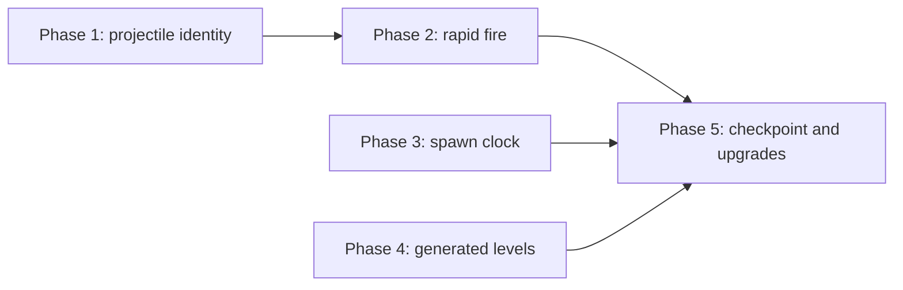

@page plan_fast_paced Fast-Paced Endless Mode

# Fast-Paced Endless Mode

Turn BalloonParty from a turn-based puzzle shooter into a fast, endless arcade game, while
keeping the balloon grid, the items, the grid actors and the visual language it already has.

**Status:** all decisions settled. Phase 1 (projectile identity) is built. Phase 2 (rapid fire) is
implemented, pending the owner's playtest at cap 3. Phase 3 (spawn clock) is implemented, pending the owner's playtest. Phase 4 (generated levels) is implemented, pending the owner's playtest. Phase 5 is split: 5a
(unlimited retries and the ad seam) is built, pending playtest; 5b (upgrade cards and the level-up
change) is built, pending playtest; 5c (the rewarded bonus card and the tooltip) is implemented,
pending review and playtest. Items marked
**DECISION** are settled: don't re-derive them. §10 records the owner's answers.

---

## 1. Why

Two problems block shipping the game as it is:

| Problem | Where it comes from |
|---|---|
| **Levels don't scale.** Levels 1–15 are authored one entry per level (`LevelPacingConfiguration.asset`, ~9,900 lines); level 16 onward is the single `-1` fallback, so the content mix stops changing. | `LevelRangeEntry` ranges are one level wide; nothing generates a mix. |
| **The game waits for the player.** One shot is one turn. Lines spawn, items roll and level-ups resolve only when the shot dies (`ProjectileDestroyedMessage`). | `BalloonSpawner.OnProjectileDestroyed`, `ThrowerController` reloads on death only. |

The model to copy is NewMoonShooter (*Lunar Deploy*): nothing there is authored per round.
Every round is a formula over the previous one: +2 enemies, 12% faster, a growing share of
flank entries, targets that grow per win, kills that pay more per round. A win is a
checkpoint you continue from; a loss replays the same target.

## 2. The game after this plan

- **Rapid fire.** The thrower reloads on a cooldown. Several balls fly at once, up to a cap.
- **A spawn clock.** New balloon lines arrive on a timer that shortens each level, no longer
  per shot. The existing failure condition (a heart lost per full line that can't fit,
  `Game/Health`) becomes real-time pressure.
- **Generated levels.** Every level, level 1 included, is generated from a catalogue of
  content pieces and a budget that grows by formula. The first levels are simple because the
  budget is small and little is unlocked, not because they're authored.
- **Checkpoint retry.** Losing replays the level you reached, with the same seeded mix.
- **Incremental power.** The ball cap, the reload, the shields per ball and the item odds are the
  "weapon level"; they grow only through upgrade cards picked at level-ups (§13 run modifiers in
  @ref plan_future_ideas).

## 3. Phases

| Phase | Changes behaviour? | Depends on | Size |
|---|---|---|---|
| 1. Projectile identity | No: cap stays 1 | — | L |
| 2. Rapid fire | Yes | 1 | L |
| 3. Spawn clock | Yes | — (better after 2) | M |
| 4. Generated levels | Yes | — | M |
| 5. Checkpoint and upgrades | Yes | 2, 3, 4 | M |

Phases 3 and 4 touch different files from 1 and 2 and can run in parallel with them. Each phase
follows the per-phase review protocol (implement → architect + test-everything + reviewer →
curate and fix → owner signs off) and needs an in-editor playtest; `dotnet build` can't judge feel.

---

## 4. Phase 1: projectile identity (no behaviour change)

**Root cause.** No projectile message says *which* projectile it is about.
`ProjectileDestroyedMessage` has no fields at all; `Fired`, `Doomed*`, `Cruise*`, `ShieldLost`,
`PierceDischarged`, `ActorHit`, `BalloonDeflected` and `ForceDestroy` don't either. About 15
systems also treat `ProjectileLoadedMessage` as "the flight starts" and cache the last-loaded
ball as *the* ball. With a cooldown reload, the next Load lands while earlier balls still fly,
and every one of those systems switches to the held ball and resets its state.

**DECISION: a flight is one ball.** Per-flight state (stats, streak, buffs, pierce, telemetry
flight scope, audio pitch ramps) is keyed by the ball, not by a volley. A volley has no
mechanical meaning and would need its own start/end rules.

**DECISION: Fired starts a flight, Destroyed ends it; Load only means "in the thrower".**

**DECISION: one lifetime for per-ball state, owned by the registry.** A ball leaves in two
steps. *Land* (right before its Destroyed is published): it is no longer loaded or in flight,
so every query sees it gone. *Retire* (right after that dispatch): the registry fires
`Retired` and every per-ball store drops it. Every exit retires, including the ones with no
Destroyed (game over, reset, a replaced held ball). Values folded over all balls (any
airborne, any piercing, any doomed) are read from the registry, not tracked from messages, so
nothing goes stale when a ball leaves without its paired message.

**DECISION: a late item reward isn't lost.** Items activate a frame after the pop. If the ball
that popped a Shield or Snipe holder is already gone, the reward goes to the current ball
(latest in flight, else the held one), as it always went to the next shot.

| Change | Files |
|---|---|
| Add the projectile (`ProjectileModel` or a small id) to every projectile message, and to `ActorHitMessage`'s context and `ItemActivationContext` so items know which ball hit them | `Shared/Messages/Projectile*`, `ActorHitMessage`, `Item/ItemActivationContext.cs` |
| `IProjectileRegistry`: the loaded ball plus the set of balls in flight, with add/remove events. Replaces the single `ProjectilePositionProvider` transform and the last-loaded caches | new, `Projectile/`; `ProjectilePositionProvider.cs` |
| `ThrowerController`: one loaded ball + a list in flight. Destroyed returns *that* ball to the pool; ForceDestroy, game over, board clear and reset kill every ball | `Thrower/ThrowerController.cs:74-75, 173, 181, 192-195, 318-360, 387-401` |
| Per-ball state instead of last-loaded singletons | `FlightStatsService`, `ActiveProjectilePierce`, `ProjectileBuffService`, `WallBounceEndCondition`, `ProjectileFacingSource`, `ProjectileFacingRotator`, `ColorStreakTracker` |
| Items act on the ball that hit them, not the held ball | `ShieldItemHandler`, `SnipeItemHandler`, `LightningItemHandler`, `Solver/ShotItemLayer.cs` |
| Telemetry: a flight scope per ball | `GameplayMetricsService.cs:368-407, 745, 894` |
| Audio: per-ball loops and ramps (cruise, pierce, wind, colour pitch) | `CombatSoundRouter`, `WindSoundRouter`, `ProgressionSoundRouter`, `ItemSoundRouter` |
| Counts instead of bools: in flight, doomed | `LevelController._projectileInFlight`, `BalloonSpawner._doomedActive`, `ProjectileDoomedTimeScaleController`, `MusicSoundRouter` via `IsAirborne` |
| Readers of the single position | `LevelUpCinematic`, `BushRustleController`, `ShotSolverWindow`, `AddShieldCheat` |

Already fine with N balls: `ProjectileHitResolver`, `ProjectileMotionResolver`,
`ProjectileTapResolver` (stateless), per-ball views (`ProjectileShieldView`, trail, light),
`PierceDischargeEffects`, Bomb/Laser/Paint handlers, `CameraShakeController`, `ThrowerView`.

**Done when:** the game plays exactly as today with the cap at 1, and an EditMode test
drives two concurrent balls through the registry, stats and streak without cross-talk.

**Check the rainbow self-feeding pattern** (a shot that rainbow-converts balloons then re-pops
them farms uncapped streak multiplier). Per-ball streaks must not let ball B re-pop what ball A
converted for A's multiplier.

---

## 5. Phase 2: rapid fire

**Implemented, pending the owner's playtest at cap 3.** The rows below keep the original design
wording; the built behaviour lives in `Thrower/README.md` (Rapid fire), `Game/Level/README.md`,
`Balloon/Spawner/README.md` and `Shared/Pause/README.md`. Differences and open items:

| Item | State |
|---|---|
| Pool prewarm | `2 * MaxBallsInFlight + 1`, not cap + 1: a dead ball stays out of the pool until its disappear animation finishes. |
| Reload | The held ball slides pivot to muzzle over `max(ProjectileLoadDuration, ReloadCooldownSeconds)`, advancing only while a slot is free (`ThrowerReload`). `ThrowerReadyMessage` marks "a release now fires" and drives the reload sound and the handwritten `+1` ready notice (`UI/Notices/ReloadNotice`). Since playtest the shipped cooldown is 0.9 s (was 0.5 s): a slower reload makes each shot count. |
| Level-up with balls in flight | After the beat plus `LevelCompleteFlightGrace`, remaining balls are force-destroyed once. Pierce toughs already plowed through still discharge and score; progress past the cap is banked. So "no score" in the row below is not literal. |
| Spawning | Was per ball death with an interim queued wave; Phase 3's spawn clock replaced it (§6). |
| Shorter flights (open) | No lever left: starting shields are already 1, so a ball cannot be made shorter. |
| Pierce-discharge time dip (open) | Still world-wide: one ball's discharge dips time for every ball. |
| Shield HUD (open) | Built as the held ball's shields (bind on load, unbind when that ball dies). Held-ball vs ball-count/cooldown meter is for the playtest. |
| Rapid-fire feedback (later) | First playtest: rapid fire works but doesn't read as rapid fire. The only cues are the held ball's slide and the reload sound; the player can't see the cap, how many balls are out, or that the next release counts. Needs its own visual pass; it blocks no phase. |
| Hold-to-speed-up | Deleted, with its config fields and `TimerId.Hold`. The `Tooltip` object is still nested, inert, in GameCanvas; remove it in the editor. |

| Change | Notes |
|---|---|
| Reload on a cooldown: `ReloadCooldownSeconds`, `MaxBallsInFlight` | Config on `IProjectileFlightConfig` (or a new `IRapidFireConfig`), never hardcoded. Pool prewarm becomes cap + 1 (built as 2 x cap + 1, see above). |
| **DECISION: release to fire** | Kept from today: hold to aim (with the trace), release fires one ball. Aiming is allowed while balls fly. A release with no ball ready (cooldown running, or cap reached) fires nothing and isn't queued; the thrower shows the reload so the player knows when the next release counts. |
| **DECISION: remove hold-to-speed-up** | `HoldSpeedUpController`, `HoldSpeedUpTooltip`. It fights aiming the next ball (same button, `ConsumedInput` blocks aim) and would speed up the spawn clock too. Rapid fire replaces the need for it. |
| **DECISION: shorter flights** | Lower starting shields per ball so balls die sooner and the screen stays readable. Tune in the playtest. |
| **DECISION: no world-wide effects from one ball** | Doomed (last-shield) slow-mo and the balancer's doomed board freeze only play when the doomed ball is the *only* ball in flight. Otherwise the doomed look is per-ball visual only. |
| Level-up with balls in flight | On `Completing`: block firing, play the slow-mo beat, then retire the remaining balls with a pop (force-destroy all, no score) after a short grace. `PresentLevelUp` then sees zero in flight. The 15 s watchdog stays. |
| Shield HUD | Shows the held ball's shields, or becomes a ball-count/cooldown meter. Decide in the playtest. |
| Aim trace | Stays. It's a static prediction; with spawns mid-flight it's only a guide (`Solver/ShotBoardDynamics.cs:61` assumes no spawns). |
| Carried over from Phase 1 (exact at cap 1, global with N balls) | Telemetry flight scope per ball (`GameplayMetricsService` keeps one scope and seals it with the dying ball's stats). Per-ball pitch cursors in `CombatSoundRouter` (colour-pop ramp) and `ItemSoundRouter` (pickups this flight), both still reset on every Loaded. The doomed slow-mo follows the latest doomed ball and `BalloonSpawner` holds lines while any ball is doomed; apply the "only ball in flight" rule above to both, as `BalloonBalancer` already does. |
| Thrower load semantics | `LoadProjectile` replaces a held ball, and every death reloads. With a cooldown the cooldown alone loads, and a load with a ball already held does nothing; otherwise each death throws away the aimed ball. |
| `IsLoaded` stops meaning "a flight is on" | The thrower always holds a ball once reloads run on a cooldown, so `IFlightScope.IsLoaded` stays true and `GameplayMetricsService.ActiveScope` routes everything to the flight scope. Settle it with the per-ball telemetry scope. |
| `StreakChangedMessage` names its ball | Today it carries only colour and count, so with two balls a reset of one reads as "the streak broke" to audio and telemetry. |

**Done when:** a playtest at cap 3 feels fast and readable, level-up and game over clean up
every ball, and nothing waits on a single flight.

---

## 6. Phase 3: spawn clock

**Implemented, pending the owner's playtest.** The rows below keep the original design wording; the
built behaviour lives in `Balloon/Spawner/README.md`, `Game/Danger/README.md`,
`Game/Cinematics/README.md`, `Shared/Pause/README.md` and `Diagrams/arch_turn_pipeline.md`.
In short: `SpawnClock` publishes one `SpawnBalloonLineMessage(1)` per interval of scaled time (2 s at
level 1, x0.96 per level, floor 1.25 s, after a 4 s grace; all in `LevelPacingConfiguration`'s
`_spawnClock` block), holding through pauses, the level-up, off the `Game` screen and while a lone
doomed ball glides. **DECISION (owner):** firing feeds the clock. A ball fired while another is still
flying pulls the next line 35% of an interval sooner (`OverlapShotPull`); one ball at a time is free, so
rapid fire trades board room for firepower. **DECISION (owner):** board tension feeds it too. The clock
runs up to 8x faster on an empty board (`SparseBoardSpeedup`), easing to normal pace as the board reaches
both the level's starting fill and half occupancy (`TargetOccupancy`, blended by `OccupancyWeight`), so a cleared board never lingers. Balls in the air add pace on top, by their summed flight time (`FlightSpeedup`, `FlightPressureSeconds`), so long flights and rapid fire refill the board while they clear it. `BalloonSpawner` no longer spawns on ball death; every line is the synchronous
`SpawnLine()`. Lines group into waves of `LinesPerWave` (3): a wave's first line rolls quotas and
relocates roamers, its last publishes the item check. Differences and open items:

| Item | State |
|---|---|
| Tuning (open) | Interval, decay, floor, grace and heart-drain gap/cap are first guesses; tune in the playtest. First pass after playtest (too easy, no pressure): interval 2 → 1.7 s, decay x0.96 → x0.95, floor 1.25 → 0.9 s, grace 4 → 2.5 s, `OverlapShotPull` 0.35 → 0.5, and `TargetOccupancy` 0.5 → 0.7 so the clock keeps refilling until the board is fuller. |
| `LinesPerWave` = 3 (open) | Keeps the per-turn tuning (wave-quota curves, item cadence, roamer jumps) meaningful instead of re-tuning it now. Drop it to 1 and re-tune per line once the clock feels right. |
| Strikethrough on leftover rejects (open, P2) | The heart strikethrough can cross a row of rejects left from an earlier line. Visual only. |
| Danger signal fires late (open, P2) | `SpaceDanger` only goes non-zero when the board is 100% full (one line overflows only then), so it warns one interval ahead, not earlier. |
| Pulse rebalance off the Game screen (open, P2) | The balancer's pulse now runs all through play, including when the navigation state is not `Game`. |
| Aim trace (open) | Stays static: it predicts the board as it is at fire time, but lines now land mid-flight. A guide only. |
| Overflow lock | Gone, as designed: `PauseSource.Overflow` is removed (other members keep their numbers). `RejectedBalloonEffect.IsOverflowActive` (pile non-empty) still holds the level transition. |
| Heart-drain cinematic | At most one per `HeartDrainMinGapSeconds` (10, real time, reset per run), ending at `HeartDrainMaxSeconds` (4) at the latest, since the pile may never empty on a full board. |
| Danger UI | The heart-loss shine quickens toward the next line via `ISpawnClock.NextLineProgress`. |
| Shot solver | Pulse timing starts from the balancer's `SecondsUntilNextPulse` (`ShotBoardGather.Gather`, `ShotBoardDynamics`). Shot Solver window and Fire Best Shot cheat pass it. |
| Pop-spawn cap | One line's worth (one row of columns), no longer a wave's. |

| Change | Files |
|---|---|
| `SpawnClock` replaces `_turnCount` and `OnProjectileDestroyed` spawning; grace becomes seconds | `Balloon/Spawner/BalloonSpawner.cs:140, 158, 193-207` |
| Collapse the async multi-line wave into the synchronous `SpawnLine()` path, which already does deficit and doomed lines. Avoids overlapping waves sharing `_spawnBatch` / `_batchCursor` | `BalloonSpawner.cs:354, 595-674` |
| Item cadence counts spawn waves, not turns | `Item/ItemAssigner.cs`, `ItemCheckMessage.Wave` |
| Balancer: roamers and the heavy-step budget refresh per wave; the pulse runs all the time, not only during a flight | `Balloon/Controller/BalloonBalancer.cs` |
| Overflow no longer locks the thrower (`PauseSource.Overflow`), and `BeginSpawnSequence` no longer locks firing | `RejectedBalloonEffect.cs`, `BalloonSpawner.cs` |
| Heart-drain cinematic throttled (minimum gap) and capped | `Game/Cinematics/HeartDrainCinematic.cs` |
| Danger UI gains a time-to-next-line cue | `Game/Danger/SpaceDanger.cs`, `UI/Danger/*` |
| Config: `SpawnClockSettings` (interval, decay, floor, grace, `LinesPerWave`) replaces `SpawnLines`, `FirstSpawnTurn`; `ItemCadence` counts waves; wave-quota curves keep their authored values | `ILevelParameters`, `RangedLevelParameters`, `LevelParameters`, `BalloonTypeWeight`, `BalloonPrefabEntry` tooltips, `Editor/LevelPacingWindow.cs` |
| Docs | `Balloon/Spawner/README.md` (its stale claim that `SceneTransition` publishes `SpawnBalloonLineMessage` is fixed: only `SpawnClock` and the cheat do) |

**Done when:** lines arrive on the timer whatever the player does, overflow costs hearts in
real time without freezing the thrower, and the danger UI warns ahead of the next line.

---

## 7. Phase 4: generated levels

**Implemented, pending the owner's playtest.** The rows below record what was decided and built; the
built behaviour lives in `Configuration/README.md`, `Game/Level/README.md` and `Editor/README.md`.

**DECISION: generate a `RangedLevelParameters`, don't replace it.** Spawning, items and
balancing already consume `RangedLevelParameters.Resolve(...)`. A generator that *outputs*
one leaves every consumer untouched.

| Piece | What it is |
|---|---|
| `LevelGenerationSettings` (a `_generation` block on `LevelPacingConfiguration`) | **DECISION: a block on the pacing asset, not a separate `ContentCatalog` SO.** It holds two budget formulas, the featured-levels count, level-stepped colours and board lines, item-count curves, the item cadence, a seed salt, and three catalogues (balloons, items, grid actors). One authoring surface, one asset. |
| Catalogue entries | `BalloonContentEntry`, `ItemContentEntry`, `GridActorContentEntry`. Each has an `UnlockLevel`, a `Cost`, a `ContentRole` (items are always Aid, actors always Threat; balloons choose), a `ContentWeightRamp` (early range to late range over `RampLevels`, with an optional intro weight on the unlock level) and intro/regular guaranteed counts. |
| Budgets | **DECISION: separate threat and aid budgets, plus featured levels and weight ramps.** Staples (cost 0) and pieces inside their featured levels (the unlock level and the next one by default) are always in; each role's budget then buys a cost-weighted pick of the other unlocked pieces. Threats get a growing budget so depth reliably means more threats; aids get a small one so they rotate. |
| Colours | **DECISION: level steps, not a "one more colour" catalogue piece.** `IntLevelStep[]`: a count that holds from its level until the next step. Board lines use the same shape. |
| Spawn interval | **DECISION: not part of this phase.** It already lives in Phase 3's spawn clock (`_spawnClock`). |
| `LevelGenerator` (pure C#) | `Generate(settings, level, seed) -> RangedLevelParameters`. Pure and seeded, so it's EditMode-testable. |
| `LevelDifficultyResolver` | **DECISION: no authored levels.** Every positive level comes from the generator. Only the negative debug presets (`-100`, `-101`, `-102`, reached through the start-level cheat with a negative level) stay authored; the `-1` fallback and the level 1-15 entries are deleted. `ILevelPacingConfiguration.Ranges` became `DebugPresets`; `ParametersForLevel` and `SeedForLevel` were added. `LevelRangeEntry` lost `Contains`, `PositionOf` and `IsOpenEnded`, and `IsFallback` became `IsPreset`. |
| The opening | Level 1 is not "no items": today's level 1 gives 12 guaranteed Shield items and Tough balloons, and the generator keeps that through the unlock-level intro guarantees. A test pins levels 1-3 of the real asset to that shape. |
| What else read the ranges | `ThresholdForLevel` divides by `ColorsForLevel`, and `MaxConcurrentBalloons` (pool prewarm) scanned every range; both now read the generation settings (colour count from the steps; prewarm from the catalogue's caps and the tallest board), plus the presets. `LevelPacingValidator` now checks presets only; the catalogue validates itself (`LevelGenerationSettings.Validate`). |
| Seed | `SeedForLevel(level)`: a hash of the level and a salt, so a retry replays the same mix. The resolver rolls counts from a separately salted, level-seeded rng instead of a per-run one. |
| Score targets | No change: `LevelScoringCurve` already extrapolates forever. |
| Editor | `LevelPacingWindow` has a "Level Generation" foldout (the settings) and a "Generated Levels" preview table (per level: budgets, board, colours, balloons, items, actors, new pieces starred, play button), drawn by `LevelGenerationPreview`. The range table edits debug presets only; "+ Add Preset" picks the next free negative ID. |

**Adding content later** means one catalogue entry with an unlock level and a cost, not a new
level entry.

**Done when:** levels 1-50 resolve without error, every catalogue piece appears by its unlock
level, and a test pins that the same seed gives the same mix.

Open items for the playtest. All tuning numbers are first guesses read off the authored levels:

| Item | State |
|---|---|
| Shield caps (open) | Flat 8; the authored levels ran 11 down to 5. |
| Helper items (open) | They no longer fade as hard at L8-11 as the authored ones did. |
| Puff counts (open) | Ramp 7-9 up to 10-13 instead of the authored breathers. |
| L16+ board and rare balloons (open) | The board is 4 lines (the old fallback was 3), and Gold/Silver weights are far lower than the old fallback's. |
| Same mix every run (open) | Every run's level N is now the same mix (seeded by level). That is by design, but a feel change. |
| Depth after L7 (open) | From L7 all threats are in, so depth after that comes from weight ramps, colours and the spawn clock. |
| Telemetry (open) | It doesn't yet record the level seed or the included pieces. |
| Tuning (open) | Budgets, costs, unlock levels, weights and ramps are first guesses; tune in the playtest with the Generated Levels table. First pass after playtest (items everywhere): a wave's item roll can now be zero and stops at 3 (weights 0.3/0.45/0.3/0.1, about 1.2 items a wave, down from about 3-4), the shield cap drops 8 → 4 and its regular guarantee 2 → 1, and Lucky Find gives +0.25 a stack, down from +0.5. Item rolls still ride the waves, so a faster clock still means more items; if that snowballs, roll items on time instead. |

---

## 8. Phase 5: checkpoint and upgrades

Built in three parts, each reviewed and playtested on its own. **5a:** unlimited retries and the ad
seam. **5b:** upgrade cards and the level-up change (§10 question 5). **5c:** the rewarded bonus card
and the tooltip.

| Change | Notes |
|---|---|
| **DECISION: unlimited retries from the level reached** | **Built in 5a.** `IRunConfig.MaxRetries` of 0 or less means unlimited, and the asset is 0. The game-over screen always offers Retry (same level, same seeded mix) beside a fresh run from level 1. `RetryTracker` still counts retries used, since the ad gate reads the count. |
| ~~Deeper levels pay more~~ | Dropped: already true. Points are capped at each level's threshold (`ILevelProgress.ClaimProgress`), so a run's score is the sum of each completed level's threshold across its colours, plus the losing level's partial progress. That grows per level, and is fixed per level reached. Score and level progress are the same number, so a per-level score multiplier would only make deeper levels shorter. |
| Upgrades at level-up (5b) | **Built in 5b** (`Game/Upgrades/`). A pick of cards every N level-ups (§10 question 5): `IRunConfig.Upgrades.CardEveryLevels`, 2 in the asset, so entering levels 3, 5, 7. Three cards are dealt by weight from the ones not maxed, seeded by the level so a retry is dealt the same hand. First deck: Extra Ball (+1 cap, 3 stacks), Quick Hands (reload 15% faster, 4 stacks), Thick Skin (+1 shield per ball, 3 stacks), Lucky Find (+0.25 extra items per item roll since the first tuning pass, 4 stacks). `IWeaponStats` is the weapon the thrower and the item assigner read: the configured base plus the cards. A pick is held only once its level-up advances the level, so an aborted level-up grants nothing. Run-scoped: a fresh run drops the cards, a retry keeps them. With the pick screen on, every other level-up passes in play: the hit beat and the Ascent, no popup and no freeze. The picks are dealt into `UpgradeCardView` slots on the level-up popup, which need laying out in the editor; until they are, Continue takes the first card dealt. **Since playtest the popup is off** (`LevelUpPopUp._pickScreen`): it stopped play, so every level-up passes in play and a card level-up takes its first card dealt (a draw by weight), named in the tooltip as `Level N: Card`. A pick screen that doesn't stop play is banked for later. |
| Rewarded advantage (5c) | **Built in 5c.** A second game-over button, "Retry + bonus card (ad)", plays a rewarded ad (`IFailureOffers.TryBonusRetryAsync`) and retries with one bonus card, dealt at random and named in the on-screen tooltip. Never an Extra Ball (an ad never buys the cap) and never a maxed card; it lasts that attempt only, dropped when the level is won or the run resets, so repeated ads never stack power. A reward needs its ad watched: a skip, no fill or an SDK error stages nothing. The one ad also pays a gated retry. A pick for the bonus card (three cards, as at a level-up) is banked for later. |
| Tooltip (5c) | The old speed-up hint prefab is now a general tooltip (`UI/Tooltip/TooltipBanner`, `TooltipMessage`). It names a bought retry's bonus card, and a level-up shows `Level N` as it passes in play, or `Level N: Card` with the card it took. |
| **DECISION: ads only on failure, behind a seam** | The game's only monetization will be ads at game over. Not built now, but the failure flow must leave room for it, with no ad SDK in the code yet. Two uses: a **rewarded** ad buys a small advantage (a revive with one heart, or one extra card for the retry); a **required** ad gates a retry once `RetriesUsed` reaches a configured N. Shape: `IFailureOffers` decides what the game-over screen offers (plain retry, ad-gated retry, rewarded advantage) from `IRetryState`; an `IAdService` with a no-op implementation (always "watched") stands in for the SDK. Keep `RetryTracker`'s used-retry counter even though retries are unlimited; it's what the gate reads. Never let an ad buy the ball cap or score: the advantage is small and per-attempt. The same shape applies to NewMoonShooter's game over. **Built in 5a:** the ad-gated retry (`IRunConfig.RetriesBeforeAd`, 0 in the asset, so no gate until an SDK lands) and the seam (`IFailureOffers.TryRetryAsync` settles the ad and stages the retry in one step; `IAdService` reports `Watched`, `Skipped` or `Unavailable`; `NoAdService`). Only a skip costs the retry: no fill or an SDK error grants it. The rewarded advantage waits for 5b, since its natural form is an extra card; it will widen the staged retry from a level to a level plus an advantage. Ad readiness (so the screen can show a loading state) waits for a real SDK. |
| **DECISION: the ball cap grows through cards only** | The configured `MaxBallsInFlight` is the run's starting cap and never rises with level; only a card raises it. Pressure grows with level (spawn clock, budget), power grows with the player's picks, which keeps the choice meaningful. A retry keeps the cards held when the level started. |

Telemetry stays telemetry: nothing here persists metrics client-side as progression.

---

## 9. Risks

| Risk | Mitigation |
|---|---|
| Balloons move under balls in flight | Already normal (flight pulses, pressure shoves). Only the doomed glide assumes a still board; Phase 2 limits it to the single-ball case. |
| Global time-scale stacking (doomed, heart drain, level-up beat) | Ref-counted claims on `TimeScaleService`; per-ball events don't claim global slow-mo when other balls fly. |
| Screen readability with N balls | Shorter flights, cap starts low (2–3), playtest before raising it. |
| Phase 1 is a wide refactor with no visible payoff | It's the only way rapid fire works; keep the cap at 1 so behaviour is unchanged and existing tests stay valid. |
| Generated levels feel samey | New pieces keep arriving only until every one is unlocked (all threats are in by L7); after that depth comes from weight ramps, colours, board lines and the spawn clock, and the per-level seed means every run's level N is identical. Watch this in the playtest; the catalogue is where future variety lands. |

## 10. Open questions

1. ~~**Firing input.**~~ Answered: release to fire (Phase 2).
2. ~~**Retry rules.**~~ Answered: unlimited retries from the level reached (Phase 5).
3. ~~**How many authored levels stay.**~~ Answered: none; generated from level 1 (Phase 4).
4. ~~**Ball-cap growth.**~~ Answered: cards only (Phase 5).
5. ~~**Does the level-up screen stay?**~~ Answered: a card-pick screen stops the game every N
   level-ups (configurable, starting at 2); every other level-up passes as a short in-play beat
   with no screen (Phase 5b).

All questions are answered.
