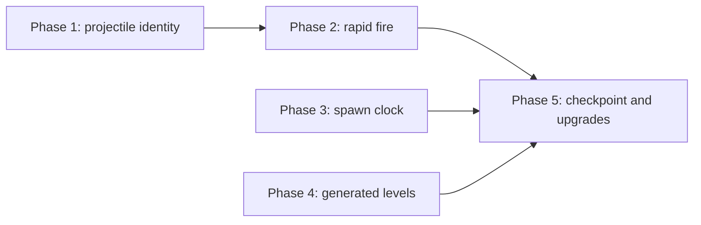

@page plan_fast_paced Fast-Paced Endless Mode

# Fast-Paced Endless Mode

Turn BalloonParty from a turn-based puzzle shooter into a fast, endless arcade game, while
keeping the balloon grid, the items, the grid actors and the visual language it already has.

**Status:** design, all decisions settled. Nothing is built. Items marked **DECISION** are
settled: don't re-derive them. §10 records the owner's answers.

---

## 1. Why

Two problems block shipping the game as it is:

| Problem | Where it comes from |
|---|---|
| **Levels don't scale.** Levels 1–15 are authored one entry per level (`LevelPacingConfiguration.asset`, ~9,900 lines); level 16 onward is the single `-1` fallback, so the content mix stops changing. | `LevelRangeEntry` ranges are one level wide; nothing generates a mix. |
| **The game waits for the player.** One shot is one turn. Lines spawn, items roll and level-ups resolve only when the shot dies (`ProjectileDestroyedMessage`). | `BalloonSpawner.OnProjectileDestroyed`, `ThrowerController` reloads on death only. |

The model to copy is NewMoonShooter (*Lunar Deploy*): nothing there is authored per round.
Every round is a formula over the previous one: +2 enemies, 12% faster, a growing share of
flank entries, targets that grow per win, kills that pay more per round. A win is a
checkpoint you continue from; a loss replays the same target.

## 2. The game after this plan

- **Rapid fire.** The thrower reloads on a cooldown. Several balls fly at once, up to a cap.
- **A spawn clock.** New balloon lines arrive on a timer that shortens each level, no longer
  per shot. The existing failure condition (a heart lost per full line that can't fit,
  `Game/Health`) becomes real-time pressure.
- **Generated levels.** Every level, level 1 included, is generated from a catalogue of
  content pieces and a budget that grows by formula. The first levels are simple because the
  budget is small and little is unlocked, not because they're authored.
- **Checkpoint retry.** Losing replays the level you reached, with the same seeded mix.
- **Incremental power (later).** The ball cap and the reload cooldown are the "weapon level";
  they grow through level-up rewards (§13 run modifiers in @ref plan_future_ideas).

## 3. Phases

| Phase | Changes behaviour? | Depends on | Size |
|---|---|---|---|
| 1. Projectile identity | No: cap stays 1 | — | L |
| 2. Rapid fire | Yes | 1 | L |
| 3. Spawn clock | Yes | — (better after 2) | M |
| 4. Generated levels | Yes | — | M |
| 5. Checkpoint and upgrades | Yes | 2, 3, 4 | M |

Phases 3 and 4 touch different files from 1 and 2 and can run in parallel with them. Each phase
follows the per-phase review protocol (implement → architect + test-everything + reviewer →
curate and fix → owner signs off) and needs an in-editor playtest; `dotnet build` can't judge feel.

---

## 4. Phase 1: projectile identity (no behaviour change)

**Root cause.** No projectile message says *which* projectile it is about.
`ProjectileDestroyedMessage` has no fields at all; `Fired`, `Doomed*`, `Cruise*`, `ShieldLost`,
`PierceDischarged`, `ActorHit`, `BalloonDeflected` and `ForceDestroy` don't either. About 15
systems also treat `ProjectileLoadedMessage` as "the flight starts" and cache the last-loaded
ball as *the* ball. With a cooldown reload, the next Load lands while earlier balls still fly,
and every one of those systems switches to the held ball and resets its state.

**DECISION: a flight is one ball.** Per-flight state (stats, streak, buffs, pierce, telemetry
flight scope, audio pitch ramps) is keyed by the ball, not by a volley. A volley has no
mechanical meaning and would need its own start/end rules.

**DECISION: Fired starts a flight, Destroyed ends it; Load only means "in the thrower".**

**DECISION: one lifetime for per-ball state, owned by the registry.** A ball leaves in two
steps. *Land* (right before its Destroyed is published): it is no longer loaded or in flight,
so every query sees it gone. *Retire* (right after that dispatch): the registry fires
`Retired` and every per-ball store drops it. Every exit retires, including the ones with no
Destroyed (game over, reset, a replaced held ball). Values folded over all balls (any
airborne, any piercing, any doomed) are read from the registry, not tracked from messages, so
nothing goes stale when a ball leaves without its paired message.

**DECISION: a late item reward isn't lost.** Items activate a frame after the pop. If the ball
that popped a Shield or Snipe holder is already gone, the reward goes to the current ball
(latest in flight, else the held one), as it always went to the next shot.

| Change | Files |
|---|---|
| Add the projectile (`ProjectileModel` or a small id) to every projectile message, and to `ActorHitMessage`'s context and `ItemActivationContext` so items know which ball hit them | `Shared/Messages/Projectile*`, `ActorHitMessage`, `Item/ItemActivationContext.cs` |
| `IProjectileRegistry`: the loaded ball plus the set of balls in flight, with add/remove events. Replaces the single `ProjectilePositionProvider` transform and the last-loaded caches | new, `Projectile/`; `ProjectilePositionProvider.cs` |
| `ThrowerController`: one loaded ball + a list in flight. Destroyed returns *that* ball to the pool; ForceDestroy, game over, board clear and reset kill every ball | `Thrower/ThrowerController.cs:74-75, 173, 181, 192-195, 318-360, 387-401` |
| Per-ball state instead of last-loaded singletons | `FlightStatsService`, `ActiveProjectilePierce`, `ProjectileBuffService`, `WallBounceEndCondition`, `ProjectileFacingSource`, `ProjectileFacingRotator`, `ColorStreakTracker` |
| Items act on the ball that hit them, not the held ball | `ShieldItemHandler`, `SnipeItemHandler`, `LightningItemHandler`, `Solver/ShotItemLayer.cs` |
| Telemetry: a flight scope per ball | `GameplayMetricsService.cs:368-407, 745, 894` |
| Audio: per-ball loops and ramps (cruise, pierce, wind, colour pitch) | `CombatSoundRouter`, `WindSoundRouter`, `ProgressionSoundRouter`, `ItemSoundRouter` |
| Counts instead of bools: in flight, doomed | `LevelController._projectileInFlight`, `BalloonSpawner._doomedActive`, `ProjectileDoomedTimeScaleController`, `MusicSoundRouter` via `IsAirborne` |
| Readers of the single position | `LevelUpCinematic`, `BushRustleController`, `ShotSolverWindow`, `AddShieldCheat` |

Already fine with N balls: `ProjectileHitResolver`, `ProjectileMotionResolver`,
`ProjectileTapResolver` (stateless), per-ball views (`ProjectileShieldView`, trail, light),
`PierceDischargeEffects`, Bomb/Laser/Paint handlers, `CameraShakeController`, `ThrowerView`.

**Done when:** the game plays exactly as today with the cap at 1, and an EditMode test
drives two concurrent balls through the registry, stats and streak without cross-talk.

**Check the rainbow self-feeding pattern** (a shot that rainbow-converts balloons then re-pops
them farms uncapped streak multiplier). Per-ball streaks must not let ball B re-pop what ball A
converted for A's multiplier.

---

## 5. Phase 2: rapid fire

| Change | Notes |
|---|---|
| Reload on a cooldown: `ReloadCooldownSeconds`, `MaxBallsInFlight` | Config on `IProjectileFlightConfig` (or a new `IRapidFireConfig`), never hardcoded. Pool prewarm becomes cap + 1. |
| **DECISION: release to fire** | Kept from today: hold to aim (with the trace), release fires one ball. Aiming is allowed while balls fly. A release with no ball ready (cooldown running, or cap reached) fires nothing and isn't queued; the thrower shows the reload so the player knows when the next release counts. |
| **DECISION: remove hold-to-speed-up** | `HoldSpeedUpController`, `HoldSpeedUpTooltip`. It fights aiming the next ball (same button, `ConsumedInput` blocks aim) and would speed up the spawn clock too. Rapid fire replaces the need for it. |
| **DECISION: shorter flights** | Lower starting shields per ball so balls die sooner and the screen stays readable. Tune in the playtest. |
| **DECISION: no world-wide effects from one ball** | Doomed (last-shield) slow-mo and the balancer's doomed board freeze only play when the doomed ball is the *only* ball in flight. Otherwise the doomed look is per-ball visual only. |
| Level-up with balls in flight | On `Completing`: block firing, play the slow-mo beat, then retire the remaining balls with a pop (force-destroy all, no score) after a short grace. `PresentLevelUp` then sees zero in flight. The 15 s watchdog stays. |
| Shield HUD | Shows the held ball's shields, or becomes a ball-count/cooldown meter. Decide in the playtest. |
| Aim trace | Stays. It's a static prediction; with spawns mid-flight it's only a guide (`Solver/ShotBoardDynamics.cs:61` assumes no spawns). |
| Carried over from Phase 1 (exact at cap 1, global with N balls) | Telemetry flight scope per ball (`GameplayMetricsService` keeps one scope and seals it with the dying ball's stats). Per-ball pitch cursors in `CombatSoundRouter` (colour-pop ramp) and `ItemSoundRouter` (pickups this flight), both still reset on every Loaded. The doomed slow-mo follows the latest doomed ball and `BalloonSpawner` holds lines while any ball is doomed; apply the "only ball in flight" rule above to both, as `BalloonBalancer` already does. |
| Thrower load semantics | `LoadProjectile` replaces a held ball, and every death reloads. With a cooldown the cooldown alone loads, and a load with a ball already held does nothing; otherwise each death throws away the aimed ball. |
| `IsLoaded` stops meaning "a flight is on" | The thrower always holds a ball once reloads run on a cooldown, so `IFlightScope.IsLoaded` stays true and `GameplayMetricsService.ActiveScope` routes everything to the flight scope. Settle it with the per-ball telemetry scope. |
| `StreakChangedMessage` names its ball | Today it carries only colour and count, so with two balls a reset of one reads as "the streak broke" to audio and telemetry. |

**Done when:** a playtest at cap 3 feels fast and readable, level-up and game over clean up
every ball, and nothing waits on a single flight.

---

## 6. Phase 3: spawn clock

Lines enter from below and rise to the topmost free slot (`BalloonPlacementResolver`); rejects
fall into the overflow pile and cost hearts (`WaveDeficitCalculator`). None of that changes.
What changes is *when* a line arrives.

**DECISION: one line per tick, on scaled game time.** A `SpawnClock` (`ITickable`,
`IRunResettable`, generation guard like `BalloonSpawner.cs:153`) counts down and requests one
line. Scaled time means slow-mo slows the clock with everything else; pauses
(`PauseService`, `Transitioning`, `Completing`) stop it.

| Change | Files |
|---|---|
| `SpawnClock` replaces `_turnCount` and `OnProjectileDestroyed` spawning; grace becomes seconds | `Balloon/Spawner/BalloonSpawner.cs:140, 158, 193-207` |
| Collapse the async multi-line wave into the synchronous `SpawnLine()` path, which already does deficit and doomed lines. Avoids overlapping waves sharing `_spawnBatch` / `_batchCursor` | `BalloonSpawner.cs:354, 595-674` |
| Item cadence counts spawn ticks, not turns | `Item/ItemAssigner.cs:84-108, 332-336`, `ItemCheckMessage.TurnCount` |
| Balancer: roamers and the heavy-step budget refresh per spawn tick; the flight pulse runs all the time, not only during a flight | `Balloon/Controller/BalloonBalancer.cs:209, 436-470, 497` |
| Overflow no longer locks the thrower (`PauseSource.Overflow`), and `BeginSpawnSequence` no longer locks firing | `RejectedBalloonEffect.cs:305-325`, `BalloonSpawner.cs:595` |
| Heart-drain cinematic throttled (minimum gap), or kept only for the last heart | `Game/Cinematics/HeartDrainCinematic.cs:62-76` |
| Danger UI gains a time-to-next-line cue | `Game/Danger/SpaceDanger.cs`, `UI/Danger/*` |
| Config: `SpawnIntervalSeconds` and `GraceSeconds` replace `SpawnLines`, `FirstSpawnTurn`; `ItemCadence` in ticks; pop-spawn `waveCap` per tick; wave-quota curves re-tuned | `ILevelParameters`, `RangedLevelParameters`, `LevelParameters`, `BalloonTypeWeight`, `BalloonPrefabEntry` tooltips, `Editor/LevelPacingWindow.cs:57, 77` |
| Docs | `Balloon/Spawner/README.md` (also fix its stale claim that `SceneTransition` publishes `SpawnBalloonLineMessage`) |

**Done when:** lines arrive on the timer whatever the player does, overflow costs hearts in
real time without freezing the thrower, and the danger UI warns ahead of the next line.

---

## 7. Phase 4: generated levels

**DECISION: generate a `RangedLevelParameters`, don't replace it.** Spawning, items and
balancing already consume `RangedLevelParameters.Resolve(...)`. A generator that *outputs*
one leaves every consumer untouched.

| Piece | What it is |
|---|---|
| `ContentCatalog` (SO) | One entry per content piece: a balloon type, an item, a grid actor, or "one more colour". Each has `UnlockLevel`, `Cost`, and a weight range. Ordered by the introduction order in @ref plan_future_ideas §4.3. |
| `LevelFormula` (on the same SO) | Budget per level, spawn interval per level (`max(floor, base × decay^level)`, NewMoonShooter's "12% faster" with a floor), board and spawn lines, item cadence. |
| `LevelGenerator` (pure C#) | `Generate(level, seed) → RangedLevelParameters`: always-on basics, then spends the budget on unlocked pieces by weight. Pure and seeded, so it's EditMode-testable. |
| `LevelDifficultyResolver` | **DECISION: no authored levels.** Every positive level comes from the generator. Only the negative debug presets (`-100`, `-101`, `-102`, reached through the start-level cheat) stay authored; the `-1` fallback and the level 1–15 entries are deleted. |
| The opening | Level 1 must come out as today's level 1 does: one colour, simple balloons, no items or grid actors, a slow clock. Encoded in the formula, not in data: the colour count, the budget and every unlock start at their minimum. A test pins levels 1–3 to that shape. Before deleting the 1–15 entries, read off when each piece first appears and at what weight: that's the starting tuning for the catalogue's unlock levels and costs. |
| What else read the ranges | `ThresholdForLevel` divides by `ColorsForLevel`, and `MaxConcurrentBalloons` (pool prewarm) scans every range; both move onto the generator (colour count from the formula; prewarm from the catalogue's caps). `LevelPacingValidator`, `LevelPacingCurvePanel`, `LevelPacingMigrationTool` and their tests shrink to the debug presets or go. |
| Seed | `hash(level, a fixed salt)`, so a retry replays the same mix. |
| Score targets | No change: `LevelScoringCurve` already extrapolates forever. |
| Editor | `LevelPacingWindow` gets a preview column for generated levels so they can be eyeballed without playing. |

**Adding content later** means one catalogue entry with an unlock level and a cost, not a new
level entry.

**Done when:** levels 1–50 resolve without error, every catalogue piece appears by its unlock
level, and a test pins that the same seed gives the same mix.

---

## 8. Phase 5: checkpoint and upgrades

| Change | Notes |
|---|---|
| **DECISION: unlimited retries from the level reached** | The retry path already exists: `GameOverScreen` → `RetryTracker.PrepareRetry(level)` → `RunController.RestartRun`. Today `RetryTracker` caps it at `IRunConfig.MaxRetries`; make `MaxRetries <= 0` mean unlimited and set the asset to 0, so the cap stays available for a later mode. The game-over screen always offers Retry (same level, same seeded mix) beside a fresh run from level 1: `GameOverScreen.cs:89` shows the button only while `RetriesRemaining > 0` and `:117` prints the count, so both read an `IsUnlimited` flag on `IRetryState`. |
| Deeper levels pay more | Score multiplier per level, like NewMoonShooter's `scoreBonusPerRound`, so score stays a meaningful best-run number. |
| Upgrades at level-up | A pick of cards at the level-up popup (§13 run modifiers in @ref plan_future_ideas). First cards: +1 ball cap, faster reload, +1 shield per ball, item odds. Run-scoped (`IRunResettable`). |
| **DECISION: ads only on failure, behind a seam** | The game's only monetization will be ads at game over. Not built now, but the failure flow must leave room for it, with no ad SDK in the code yet. Two uses: a **rewarded** ad buys a small advantage (a revive with one heart, or one extra card for the retry); a **required** ad gates a retry once `RetriesUsed` reaches a configured N. Shape: `IFailureOffers` decides what the game-over screen offers (plain retry, ad-gated retry, rewarded advantage) from `IRetryState`; an `IAdService` with a no-op implementation (always "watched") stands in for the SDK. Keep `RetryTracker`'s used-retry counter even though retries are unlimited; it's what the gate reads. Never let an ad buy the ball cap or score: the advantage is small and per-attempt. The same shape applies to NewMoonShooter's game over. |
| **DECISION: the ball cap grows through cards only** | The configured `MaxBallsInFlight` is the run's starting cap and never rises with level; only a card raises it. Pressure grows with level (spawn clock, budget), power grows with the player's picks, which keeps the choice meaningful. A retry keeps the cards held when the level started. |

Telemetry stays telemetry: nothing here persists metrics client-side as progression.

---

## 9. Risks

| Risk | Mitigation |
|---|---|
| Balloons move under balls in flight | Already normal (flight pulses, pressure shoves). Only the doomed glide assumes a still board; Phase 2 limits it to the single-ball case. |
| Global time-scale stacking (doomed, heart drain, level-up beat) | Ref-counted claims on `TimeScaleService`; per-ball events don't claim global slow-mo when other balls fly. |
| Screen readability with N balls | Shorter flights, cap starts low (2–3), playtest before raising it. |
| Phase 1 is a wide refactor with no visible payoff | It's the only way rapid fire works; keep the cap at 1 so behaviour is unchanged and existing tests stay valid. |
| Generated levels feel samey | Budget plus unlock order guarantees new pieces keep arriving; the catalogue is where future variety lands. |

## 10. Open questions

1. ~~**Firing input.**~~ Answered: release to fire (Phase 2).
2. ~~**Retry rules.**~~ Answered: unlimited retries from the level reached (Phase 5).
3. ~~**How many authored levels stay.**~~ Answered: none; generated from level 1 (Phase 4).
4. ~~**Ball-cap growth.**~~ Answered: cards only (Phase 5).

No questions are open; every phase can start.
