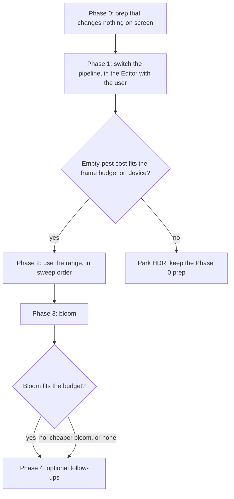

@page plan_hdr HDR Rendering

# HDR rendering — where the range goes, and how to switch it on

> Turn on HDR rendering in the URP pipeline and use the range where the game already wants it:
> pops of light on lit surfaces, glitter, shine and specular sweeps, item glows, the level-up.
> Written 2026-11-10 from an audit of the pipeline assets, the runtime render targets, every
> shader under `Assets/Shaders/BalloonParty/` and every material under `Assets/Materials/`.
> **Nothing is switched yet.** The decisions taken after the audit are at the end.
>
> This plan replaces the HDR part (Wave B) of @ref plan_hdr_color_pipeline. That plan made the
> switch to Linear colour space a prerequisite, because it read URP as refusing HDR colour
> grading in Gamma space. URP 17.6's source says otherwise (see *Gamma colour space* below),
> so HDR can ship first and Linear stays a separate, later choice.

---

## What HDR buys this game

Today every colour is clamped to 0–1 when it is written to the screen buffer. Three kinds of
content lose something to that clamp:

1. **Light that is already brighter than 1.** The scene-light field adds up to
   `AccumulationCeiling` (3) on top of the ambient light (about 1) around a pop or an item, so
   `SceneLightTintAt()` reaches about 4×. Every shader that multiplies a surface by it clips
   the middle of the pop to flat white. The water shader eases it by hand
   (`light /= 1 + max(light - 1, 0) * 0.7`) because the pale water clipped worst.
2. **Additive highlights on a bright base.** A shine band, a glint or a glitter speck added to
   a sprite that is already near white clips at once, so the highlight has no core.
3. **Darkening after brightening.** The screen-space light overlay multiplies the finished
   frame (`Blend DstColor SrcColor`). A shadow that falls across a clipped white pop darkens
   the clipped value, not the real one.

HDR keeps those values above 1 until the end of the frame. **On a normal (SDR) phone screen,
range above 1 only becomes visible through something that reads it**: a tonemapper that rolls
it off smoothly instead of clipping, bloom that spreads it into a glow, or a darkening pass
that brings it back into range. HDR with post-processing off costs a full-screen copy each frame
and shows nothing, so this plan always pairs HDR with post-processing.

---

## The pipeline today (verified 2026-11-10)

| Piece | State | What HDR changes |
|---|---|---|
| `Assets/Settings/URP/GameURP.asset` | `m_SupportsHDR: 0`, `m_HDRColorBufferPrecision: 0` (32-bit), `m_ColorGradingMode: 0` (LDR), LUT size 32, MSAA off, render scale 1, `m_UseFastSRGBLinearConversion: 0` | The switch itself: Supports HDR on, precision, grading mode HDR. Editor-only edit. |
| `GameURP_Renderer` | URP **2D Renderer** (`Renderer2DData`), no renderer features, `m_UseNativeRenderPass: 0`. No `Light2D` in any scene or prefab, so `m_HDREmulationScale` does nothing. | Nothing to change on the renderer. An On-Tile Post Processing feature is an option (see *Cost and trade-offs*). |
| Colour space | **Gamma** (`m_ActiveColorSpace: 0`) | HDR works in Gamma; see *Gamma colour space* below for what that means for thresholds and precision. |
| `Assets/Prefabs/Game/Main Camera.prefab` | Orthographic, size 4.75. `m_HDR: 1` (the camera already allows HDR; the pipeline has it off). `m_RenderPostProcessing: 0`, dithering off, `m_AllowHDROutput: 1` (but the player has HDR display support off: `allowHDRDisplaySupport: 0`). | Post-processing must stay on all the time (today `ScenarioGradeView` turns it on only while a grade is active). Dithering on. |
| Graphics APIs | Android: Vulkan, then OpenGL ES 3 (min SDK 26). iOS: Metal (iOS 15). Windows: D3D11/D3D12. WebGL: automatic (WebGL 2). | Format fallback per device is automatic; see *Platforms* below. |
| UI canvases | `GameCanvas` and `LauncherCanvas` are **Screen Space – Camera**; `CanvasCameraBinder` binds them to the main camera. Score, hearts, shields, level and popup canvases are World Space. | **All UI goes through the camera's post-processing**: the scenario grade already reaches it, and a tonemapper or bloom would too. |

### Offscreen cameras and render targets

URP gives an offscreen camera the format of its target texture
(`UniversalRenderPipelineCore.CreateBackbufferInfo`: `format = camera.targetTexture.graphicsFormat`),
so turning HDR on in the pipeline does **not** change any of these. Plain blits never go through
the pipeline at all.

| Target | Owner | Format | What its alpha holds | Under HDR |
|---|---|---|---|---|
| `SceneCapture` (camera) | `Display/SceneCaptureService` | ARGB32 + 24-bit depth, mips | Sprite coverage, read by the screen-space light | Unchanged; post stays off. Set `allowHDR = false` on the camera anyway, so nothing depends on that inheritance. An `ARGBHalf` capture would let the chrome balloon reflect a pop's real brightness (Phase 4). `B10G11R11` is ruled out: no alpha. |
| Light buffers (blits) | `Display/ScreenSpaceLightService` | ARGB32 | Shadow amount | Unchanged. |
| Bush branch and leaf bakes (cameras, editor) | `Editor/Bush/BushBranchBaker`, `BushLeafBaker` | ARGB32 + depth | Leaf/branch coverage | Unchanged. Set `allowHDR = false` for the same reason. |
| Shadow bakes, sprite combiner (blits, editor) | `Editor/ShadowBake/*`, `Editor/SpriteCombine/*` | ARGB32 | Coverage | Unchanged. |
| Water caustics | `Scenario/View/WaterCausticBuffer` | R8, mips | — | Unchanged (a light mask, 0–1). |
| Water ripples | `Scenario/View/WaterRippleBuffer` | ARGBHalf | Simulation state | Unchanged (data, not colour). |
| Grass wake | `Scenario/View/GrassWakeBuffer` | ARGBHalf | Simulation state | Unchanged. |
| Scene-light field | `Shared/SceneLight/SceneLightFieldResources` | ARGBHalf (ARGB32 fallback) | Palette index of the local light | Unchanged. **This is already HDR data**: R holds the local boost, up to 3. |
| Disturbance field | `Shared/Disturbance/DisturbanceFieldResources` | ARGBHalf (ARGB32 fallback) | Data | Unchanged. |
| Smoke field | `Scenario/SmokeFieldResources` | ARGBHalf (ARGB32 fallback) | Smoke opacity | Unchanged. |
| Background (cloud) field | `Scenario/BackgroundFieldService` | RG16 (ARGB32 fallback) | — | Unchanged. |

The only render target HDR changes is the main camera's own colour buffer.

---

## Where the range goes — the asset sweep

Ranked by visual payoff against risk. "Clips today" names the line or value that is lost.
Shaders are under `Assets/Shaders/BalloonParty/`, materials under `Assets/Materials/`.

### Tier 1 — large payoff, little or no new authoring

| # | Effect | Clips today | Payoff | Risk |
|---|---|---|---|---|
| 1 | **Pops and item lights on lit surfaces**: `SceneLightTintAt()` / `SceneLightTintAtLOD()` (`Include/SceneLight.cginc`) multiplied into `Balloon/RainbowBalloon`, `Scenario/Ground`, `Scenario/GrassBlades`, `Sprite/SpriteDiffuse`, `Sprite/SpriteLightDriven` (glints), `Scenario/Water` | The field already reaches about 4× (ambient + boost up to `AccumulationCeiling` 3, soft-clamped in `Display/SceneLightAccumulate`); the buffer clips the centre of every pop to white. `Water.shader:349` eases it by hand. | High. Pops get a hot core that keeps its palette colour instead of a white disc, on every surface at once, with no shader change. | Low. Remove the water's hand-made ease once a tonemapper is in, or the water rolls off twice and reads dull next to the meadow. |
| 2 | **Glitter**: `Include/Glitter.cginc` through `Sprite/SpriteGlitter`, `Sprite/SpriteGlitterSwirl`, `Display/TraceGlitterLine`, and the glitter layer in `Balloon/RainbowBalloon` | The speck colour is already `[HDR]`. Some materials were authored to overdrive the clip, so they look right only *because* it clips: `Items/AppearGlitter` 16 × brightness 3, `UI/NightGlitterLevelCounter` 16 × 3, `Items/PickupInSightGlitter` (191, 74, 53) × 1.25, `Items/Laser/LaserGlitter` (1.09, 0, 0) × 3, `Balloon/UnbreakableFormationGlitter` 1.5 × 2.5. | High. These are the effect HDR and bloom were made for: tiny additive specks. | **Medium.** Under bloom the overdriven materials flare huge (48× and 240× before bloom's own intensity). Re-author them to a sane peak (about 2–8) in the same step that turns bloom on; Bloom's `clamp` is the backstop. `NightGlitterLevelCounter` is UI. |
| 3 | **Shine sweeps and specular**: `Sprite/SpriteShine`, `Sprite/SpriteShineShadow`, the shine in `Balloon/RainbowBalloon`, `Balloon/UnbreakableBalloon` (specular streak, rim, rim sweep, `_DeflectFlash`), `Balloon/UnbreakableBalloonRim`, `Paint/PaintBlob`'s specular, `Particle/SpecularDrop`, the water's glints (`color += _HighlightColor.rgb * glint`) | Each is added onto a base that is often already near white. Metal colours on the unbreakable materials are authored just above 1 (`_MetalTopColor` 1.05, `_MetalCenterColor` 1.10). | Medium–high. Highlights get a core; the chrome balloon reads as metal rather than grey-white. | Low. Additive terms stay the same; only what happens above 1 changes. |

### Tier 2 — good payoff, needs authoring or a small shader change

| # | Effect | Clips today | Payoff | Risk |
|---|---|---|---|---|
| 4 | **Item and projectile glows**: `Display/PierceConeSpiral` (`Items/Snipe/Snipe` has `_Color` 2), `Display/EMShieldField` glow, `Scenario/WallNet` (`[HDR]` net colours: 1.4–1.7 default, `_DisturbedColor` (2.12, 3.23, 3.69) in `Scenario/WallNet.mat`) | Already authored above 1, so already clipping. | Medium. The net's disturbed flash and the snipe cone become real glows. | **Medium.** These change look the most visibly the day HDR goes on, because their authored values above 1 stop clipping. Check each against the Phase 0 baselines. |
| 5 | **Additive particles**: bomb sparks, lightning sparks, score-trail sparks (built-in `Mobile/Particles/Additive`), and the alpha-blended pop, shield and lightning-line particles (`Mobile/Particles/Alpha Blended`), `Particle/LightResponsive` | Sprite, particle, trail and line colours reach the shader as 8-bit vertex colours, so a single particle can't exceed 1; only overlapping additive particles stack above it. `LightResponsive` also `saturate()`s its light factor, so night dims it but a pop can't brighten it. | Medium. Dense bursts get a hot centre. | Low for stacking (free). Per-particle brightness above 1 needs an `[HDR]` intensity on the material: add `[HDR] _Color` (or an `_Intensity`) to `LightResponsive`, and move the built-in mobile particle materials that should glow onto it. |
| 6 | **Level-up cinematic**: score trails (`UI/ScoreTrail` on `Sprite/SpriteShadow`, `UI/TrailMaterial_ScoreTrail` additive), the flying orbs, `UI/ShineLevelUpFill`, `UI/PSMaterial_LevelUpFill`, `UI/LevelUpRays` (`PicoTanks/UI/Rays`, an imported shader) | The fill shine and trails are additive on bright UI. | High as a **showcase**: the moment the player is meant to feel rewarded. | Medium. Mostly on the Screen Space – Camera canvas, so it shares the UI's tonemapping question. Fragile area (the trail path); look-only changes, no timing changes. |
| 7 | **Screen-space light overlay**: `Display/ScreenSpaceLightOverlay` (`Blend DstColor SrcColor`, 0.5 is neutral) | A shadow over a clipped pop darkens white, not the pop; bounce above 0.5 brightens and clips. | Medium, mostly correctness: shadows keep the ratio over bright light. | Low. Re-check `_BounceStrength` against the HDR frame; the bounce now lifts values above 1 instead of clipping. |
| 8 | **`fixed` precision on paths that carry values above 1** | 42 shaders under `Assets/Shaders/BalloonParty/` have a `fixed4` fragment function. Vulkan and Metal compile `fixed` at half precision, but OpenGL ES may use `lowp`, which only has to reach ±2, so values above 2 can clip inside the shader on GL devices even with an HDR buffer. | Enables 1–6 on the OpenGL ES fallback. | Low. Change to `half` only on the paths that carry range (glitter, shine, the unbreakable, rainbow, `SpriteDiffuse`, `SpriteLightDriven`, `EMShieldField`, `PierceConeSpiral`, `TraceGlitterLine`, `WallNet`, `SpriteShine*`). A blanket conversion is churn. |

### Tier 3 — leave alone, or watch for damage

| Effect | Why |
|---|---|
| **UI and the heads-up text** (`Text/PencilText`, TMP SDF fonts, every canvas) | Must look exactly as now. They sit at 0–1, so bloom with a threshold above 1 leaves them alone, but a tonemapper does not (see the tonemapper decision). |
| **Soft gradients**: `Display/SkyScatter`, `Scenario/GroundMist`, `Scenario/BackgroundCloud`, `Grid/PuffCloud`, `Scenario/SmokeTrailDisplay`, the camera clear colour | Nothing above 1 to gain. These are where the 32-bit format bands first; see *Format* below. |
| **Data shaders**: scene-light field passes, disturbance, smoke, water ripple and caustics, grass wake, background density | Not colour. |
| **Editor bake shaders** (`Grid/Editor/*`) | Render to their own ARGB32 targets; unaffected. |

---

## Cost and trade-offs

### Format

URP picks the camera colour format in `MakeRenderTextureGraphicsFormat`: `B10G11R11` (32-bit)
when the precision is 32-bit and the device can blend into it, else `R16G16B16A16` (64-bit)
when it can blend into that, else whatever the device calls its HDR default (possibly
8-bit, so effectively LDR). The fallback is automatic.

| | `B10G11R11` (32-bit) | `R16G16B16A16` (64-bit) |
|---|---|---|
| Bandwidth | Same as today's RGBA8 | Twice: each full-screen read or write of the colour buffer costs double, which matters on a fill-rate-bound tile GPU |
| Alpha | None (fine for the main camera; the game reads no alpha from it) | Yes |
| Precision | Floats with 6-bit (R, G) and 5-bit (B) mantissas. Between 0.5 and 1 the steps are 1/128 (R, G) and 1/64 (B), against 1/255 today. | 10-bit mantissa: finer than today everywhere |
| Range | 0 to about 65000, no negatives | ±65504 |

Because the game renders in **Gamma**, the buffer holds gamma-encoded values, and the bright
half of every gradient is exactly where `B10G11R11` is coarsest. The sky's clear colour has blue
at 0.92, so the sky, the mist and the water are the first places to band. Camera dithering
(on with post) hides most of it.

### Fixed cost of HDR

- HDR forces an intermediate colour target and a final pass to the screen every frame.
- Post-processing must be on all the time: without it the HDR buffer is copied out and clipped
  with no dithering. With it, URP runs its uber post pass (grading, tonemapping, dithering, and
  bloom's composite if bloom is on): one full-screen read and write. Today that pass only runs
  while `ScenarioGradeView` holds post-processing on.
- Measure this "empty post" cost on device first (Phase 1). It is the go/no-go number for the
  whole plan, against the 8.33 ms frame budget at 120 Hz (see @ref plan_performance_recovery).

### Bloom

URP 17.6's Bloom has the mobile knobs: `filter` (Gaussian, **Dual**, **Kawase**), `downscale`
(Half, **Quarter**), `maxIterations` (2–8), `highQualityFiltering` (keep off), `threshold`,
`clamp`. A mobile starting point is Dual or Kawase, Quarter, 4 iterations, threshold above 1.
Bloom's down-and-up chain is the second-largest new cost after the post pass. It is also the
only way an SDR phone shows range above 1 as *glow* rather than just less clipping.

### On-tile post-processing

URP 17.6 ships an **On-Tile Post Processing** renderer feature (`OnTilePostProcessFeature`)
built for tile GPUs: grading LUT, tonemapping, vignette and film grain in one on-tile pass, **no
bloom**. If the decision is "tonemap without bloom", it is the cheap path. Untested on the 2D
renderer; check before relying on it.

### Platforms

- **Android, Vulkan** (primary): both formats are widely supported for rendering and blending.
- **Android, OpenGL ES 3** (fallback): float render targets need `EXT_color_buffer_float`;
  without it URP falls back to the HDR default, possibly LDR. `fixed` may run at `lowp` here
  (item 8).
- **iOS, Metal** (iOS 15, A9 and later): both formats supported.
- **WebGL 2** (the web demo): float render targets need `EXT_color_buffer_float`, which most
  desktop browsers have; the demo may fall back. Check it in the web build before shipping.
- HDR *display* output (HDR10 panels) is a different feature and stays out of scope.

### Gamma colour space

URP 17.6 handles HDR in Gamma: `UberPost.shader` converts sRGB to linear before grading and
tonemapping and back after (`#if UNITY_COLORSPACE_GAMMA`), and `Bloom.shader` squares on the way
in and takes the square root on the way out. Grading mode depends only on
`settings.supportsHDR` (`UniversalRenderPipeline.CreatePostProcessingData`), not on colour space.

What that means in practice:

- Every authored value above 1 is in **gamma units**. A stored 2.0 is about 5× in the linear
  units the tonemapper and bloom work in, so effects look hotter than URP's docs suggest.
  Tune thresholds and intensities by eye.
- Blending is still in gamma, as now: the look of every alpha and additive blend stays the same.
  That is what lets HDR ship without the art re-tune a Linear switch needs.
- Linear stays available as its own later step (@ref plan_hdr_color_pipeline Wave A). Doing it
  after HDR means re-tuning HDR values once more; doing it first means re-tuning every colour
  before getting any HDR payoff.

### What happens to the scenario grade

`ScenarioGradeView` drives one global Volume (Color Adjustments, White Balance, Shadows Midtones
Highlights) blended between the sky's and the surface's grade by `BackdropMix`. Today it runs
in **LDR grading mode**: the LUT grades the clamped 0–1 frame.

With HDR on, URP switches the LUT to **HDR grading mode**: the frame is encoded in a log curve
before the lookup, contrast pivots around mid-grey in a log space, white balance and
shadows/midtones/highlights act on the unclamped range, and the tonemapper runs inside the same
LUT. **The same `ScenarioGrade` numbers give a different picture**, so every grade (sky, meadow,
water) needs re-tuning after the switch. Two consequences:

- `Exposure` starts to mean something: a negative exposure now pulls highlights back from above
  1 instead of greying a clipped white.
- `ScenarioGradeView` must stop being the thing that turns post-processing on and off; under
  HDR post is always on, and the view only drives its Volume.

Tune the grades once, after the HDR decision. Tuning them in LDR now and again in HDR later is
double work.

---

## Phases

### Phase 0 — prep that changes nothing on screen

| Task | Detail |
|---|---|
| 0.1 Pin the offscreen cameras to LDR | `allowHDR = false` on the capture camera (`SceneCaptureService.CreateCaptureCamera`) and the two bush bake cameras. No visual change; removes the reliance on URP inheriting the target's format. |
| 0.2 `fixed` → `half` on the paths that carry range | The shader list in item 8. No change on Vulkan or Metal. |
| 0.3 Baselines | Screenshots of each scenario (sky, meadow, water) at day and night, a busy pop frame, the level-up, a heads-up, plus a device profile. Reuse the `Baselines~` drill from @ref plan_hdr_color_pipeline. |
| 0.4 An HDR view in the Render Maps window | An exposure slider and a "values above 1" highlight in `Editor/ChannelPreview`, so Phase 2 can see what it's doing. |

### Phase 1 — switch the pipeline (Editor, with the user)

Project settings are Editor-only edits, done together with the user.

1. `GameURP.asset`: Supports HDR on; precision 32-bit; Color Grading Mode **HDR**; LUT 32.
2. Main camera: post-processing on, dithering on.
3. The global Volume gets Tonemapping: ACES, with an exposure lift. `ScenarioGradeView` stops toggling
   post-processing.
4. Measure the empty-post cost on device. **Gate:** if it doesn't fit, park HDR (Phase 0 stays).
5. Compare against the baselines. Expect the Tier 2 item 4 effects (already authored above 1)
   to change first.
6. Re-tune the scenario grades in HDR grading mode.

### Phase 2 — use the range, in sweep order

1. Pops on lit surfaces (item 1): judge the meadow and the balloons in a pop, then remove the
   water's hand-made ease and match it.
2. Glitter (item 2): re-author the overdriven materials to a sane peak.
3. Shine and specular (item 3).
4. Item glows, particle intensity, overlay re-check (items 4, 5, 7).
5. The level-up showcase (item 6).

### Phase 3 — bloom (if chosen)

A Bloom override on the same global Volume: threshold above 1 (tuned in gamma units), Dual or
Kawase filter, Quarter downscale, about 4 iterations, a `clamp` as a backstop against an
overdriven material. Tune per effect, then measure on device. Fallback ladder: fewer iterations
→ tonemap only → no bloom.

### Phase 4 — optional follow-ups

- An `ARGBHalf` scene capture so the chrome balloon reflects a pop's real brightness (alpha
  required, so not `B10G11R11`).
- Linear colour space (@ref plan_hdr_color_pipeline Wave A).
- HDR display output on HDR10 panels.

---

## Decisions (2026-11-10)

Taken by the user after this audit.

| Decision | Choice | Notes |
|---|---|---|
| Bloom | **Yes, gated** | Phase 3, after the switch. Dual or Kawase at quarter resolution, threshold above 1. Ships only if the device measurement fits the frame budget; otherwise follow the fallback ladder. |
| Tonemapper | **ACES** | See below: the switch is no longer look-neutral. |
| Format | **32-bit `B10G11R11` + dithering** | Move to 64-bit only if the sky, mist or water band visibly on device. |
| First effects | **Pops on lit surfaces, then glitter** (items 1 and 2) | The level-up (item 6) is the showcase once those read well. |

### What ACES means for this plan

- **Phase 1 is a look change, not a silent switch.** ACES darkens the whole 0–1 range and adds
  contrast, and it shifts the hue of saturated colours. Expect an exposure lift on the global
  Volume, and check the balloon palette for identity: gameplay colours must stay easy to tell
  apart. The Phase 0 baselines are what this is judged against.
- **Grading runs in ACES colour spaces.** With ACES selected, URP does every grading operation in
  ACES spaces, so the scenario grades are re-tuned under ACES, in the same pass as the exposure
  lift.
- **No extra per-pixel cost against Neutral.** In HDR grading mode the tonemapper is baked into
  the grading LUT, so ACES and Neutral cost the same lookup per pixel.
- **The UI is tonemapped too.** The game and launcher canvases are Screen Space – Camera, and
  score, hearts and heads-ups are World Space, so all of them go through the post pass. In a URP
  camera stack post-processing runs once at the end of the stack, so a separate UI camera does
  not escape it. To settle in Phase 1, by eye: either re-tune the UI colours under ACES, or move
  the screen-space canvases to Screen Space – Overlay (drawn after post), which changes how world
  sprites such as score trails layer with the UI.
