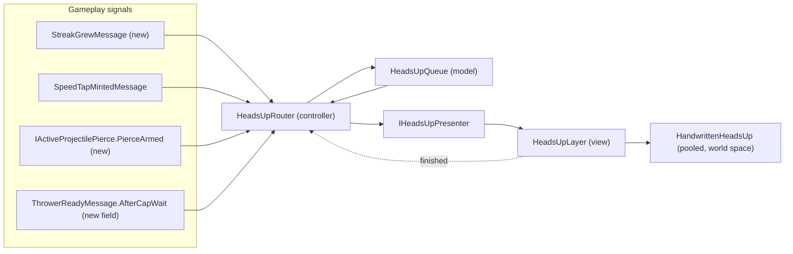

@page plan_headsup Handwritten Heads-Ups

# Handwritten Heads-Ups

> Working plan for short, handwritten heads-ups that tell the player what just happened on
> the board, written on as if by a pencil, plus pencil lines drawn over the board.

**Status:** Phase 2 built on 2026-11-10: the four signals of §5 (`StreakGrewMessage` from `ScoreController`,
`IActiveProjectilePierce.PierceArmed`, `ThrowerReadyMessage.AfterCapWait` recorded by `ThrowerReload.WaitedAtCap`,
and `TrailEndpointKeys.Cannon` on the cannon's pivot), each EditMode-tested; nothing consumes them until the
router of Phase 3. `StreakGrewMessage` announces streaks from two up, so the router's own threshold (§6) picks
which ones to write. Two facts for the router: a pop no tracked ball caused (a late pop from a ball
already retired) grows the shared streak, so its `StreakGrewMessage.Projectile` is null and its merge key must
allow that; and at a ball cap of 1 the shot fills the only slot, so every ready has `AfterCapWait`. Phase 1, as
built: the Patrick Hand font file (`Assets/Fonts/`, with its OFL
licence), `UI/HeadsUp/WriteOnText` (the slanted soft wipe on the stock shader, EditMode-tested reveal
maths), `TooltipBanner` writing through it, the TMP font asset, and two early heads-ups written
through plain `HandwrittenHeadsUp` lines, ahead of the router and queue of Phase 3: `ReloadHeadsUp`
writes `ready` beside the cannon for as long as it's ready, and `BounceHeadsUp` writes `+n bounce` where a
ball picks up a shield and `-1 bounce` where a wall spends one. Those lines moved off the canvas into world
space on 2026-11-09 (the `HeadsUps` prefab), as §3 always had it. The pencil text shader
(`BalloonParty/Text/Pencil`: the grain and the ragged edge, on the font's own material) and the pencil tip
sprite on every heads-up line were built on 2026-11-10, awaiting the owner's in-editor look; with that,
Phase 1 is done. §10's open questions 2-4 matter from Phase 3.

---

## 1. Why

The fast-paced mode (`PLAN-FastPaced.md`) made the board busy: several balls in flight, lines
landing on a clock, items going off. Playtests found the player can't read what is happening:

| What happens | How the game says it today | The problem |
|---|---|---|
| The cannon has reloaded | The held ball slides to the muzzle; a reload sound | Easy to miss with several balls out; you can't tell it's ready without looking at the cannon |
| A colour streak grows | A small `x3` held at that colour's progress bar (`UI/Score/ProgressNotice`) | It's at the bar, far from the pop that earned it |
| A shot earns a speed tap off a wall, or starts piercing | The shot dips and winds up faster; a rising note | No text; the player doesn't learn the rule |
| A blocked spawn line costs a heart (strikethrough) | A heart trail flies to the row, scribbles across it, then the row pops (`UI/Health/HeartTrailController`) | Reads as an effect, not as "you lost a heart because this row had no room" |
| A level-up passes in play | A `Level N` line in the top tooltip (`UI/Tooltip`) | Fine, but a different look from everything else |

A single **heads-up** language fixes all of them: one or two handwritten words, written on where the
thing happened, gone a second later. It fits the game's paper look, and a pencil writing on reads as
"the game is telling you something", not as one more effect.

## 2. What the player sees

- **Heads-Ups.** A word or two in a handwriting font, written on left to right, with a small pencil
  tip moving along the line and a soft scratch sound. It holds briefly, then fades. Examples: `x4!` at
  the pop, `tap!` at the wall, `pierce!` when a shot starts piercing, `ready` by the cannon,
  `Level 5: Quick Hands` at the top.
- **Pencil lines.** The strikethrough's scribble across a blocked row becomes a pencil stroke, and a
  heads-up that matters (a big streak) gets a pencil underline.

Heads-Ups are short, never cover the aim line for long, and run on unscaled time so they keep writing
through slow-motion beats; under the pause menu they freeze with the game (§10).

## 3. Architecture

Same shape as the audio routers (`Audio/Routing/*SoundRouter`): a plain C# router listens to gameplay
messages and calls one injected presenter interface, the way the sound routers call `ISoundPlayer`.
No presentation message bus.

| Piece | Layer | What it does |
|---|---|---|
| `HeadsUpRouter` | Controller, `Game/HeadsUp/` | Entry point (`RegisterEntryPoint`, like the sound routers). Turns gameplay signals into heads-up requests by the rules in §6, asks `HeadsUpQueue` whether to show each, and calls `IHeadsUpPresenter`. Pure C#, tested with NSubstitute like the sound routers |
| `HeadsUpQueue` | Model, `Game/HeadsUp/` | Owned by the router. At most `MaxConcurrent` heads-ups, lowest priority dropped first, merge-key rewrites, per-style cooldowns. Takes the current unscaled time as an argument so it stays plain C#. Frees a slot when the presenter reports a heads-up finished |
| `IHeadsUpPresenter` | `Game/HeadsUp/` | `Show(request, onFinished)`, `Rewrite(handle, arg)`, `ClearAll(animated)`. Implemented by `HeadsUpLayer` |
| Heads-Up request | `Game/HeadsUp/` | A struct: style id, an `int` argument, an anchor (a world position, or a `TrailEndpointRegistry` key) and an optional merge key. No `string`: the view formats with `TMP_Text.SetText(format, arg)`, so a heads-up on every pop allocates nothing |
| `HeadsUpLayer` | View, `UI/HeadsUp/` | Registered with `RegisterComponentInHierarchy<HeadsUpLayer>().As<IHeadsUpPresenter>()`. Resolves anchors, takes `HandwrittenHeadsUp` from `PoolManager` (prewarmed with `PrewarmAsync`) and returns it. Plays the scratch sound for heads-ups actually shown, rate-limited |
| `HandwrittenHeadsUp` | View, `UI/HeadsUp/` | One heads-up: a world-space `TextMeshPro` on a sorting layer above the balloons, plus `WriteOnText` and the pencil tip |
| `WriteOnText` | View, `UI/HeadsUp/` | The reveal (§4.1) as a standalone component on any `TMP_Text`, so `TooltipBanner` uses it too |
| `IHeadsUpSettings` | `Configuration/` | Styles (format, size, colour, write speed, hold, fade, priority, cooldown), `MaxConcurrent`, thresholds, the tip sprite. Injected read-only; added to the CLAUDE.md list of config interfaces |

**The top banner stays outside the queue.** `TooltipBanner` keeps its own replace-on-new behaviour
and its own handling of `BonusCardDealtMessage` (held until play resumes, since the card is dealt
behind the game-over screen). Under the queue a level-up line could be dropped in a burst. Phase 1
only gives its label the write-on reveal and the handwriting font. Its one `TooltipMessage`
publisher stays `LevelUpPopUp`.

**Board heads-ups live in world space.** A canvas position converted once (`RectAnchorMath`) wouldn't
follow the camera rig's zoom and shake, and the pencil strokes are world-space trails anyway. Only
the top banner stays on the UI canvas.

**Clearing.** All heads-ups clear on `RunResetMessage`, game over and the level-up transition, the
way `ProgressNoticePresenter` dismisses its notices (animated when there's time, instant otherwise).

## 4. Rendering

### 4.1 Write-on text

**DECISION (owner): a ragged pencil wipe.** Of four styles demoed (a plain letter wipe, a ragged
wipe, tracing the outline then filling, true stroke order with a single-line font), the owner picked
the ragged wipe: a left-to-right wipe whose edge is soft, grainy and slightly slanted, with a pencil
grain through the letters. Real stroke order would need stroke data for every glyph (or a thin,
plotter-like single-line font) and isn't worth it: at game speed (about 0.25-0.35 s a word) a good
wipe reads as writing.

How it's built:

- TMP lays the text out once. Each reveal frame sets the vertex alpha of the glyph being written,
  from its left edge to its right (a 4-vertex gradient), with every earlier glyph opaque and every
  later one hidden, then pushes colours only (`UpdateVertexData(TMP_VertexDataUpdateFlags.Colors32)`).
  A few hundred colour writes a frame: cheap for several heads-ups at once.
- A pooled heads-up is set up with `SetText`, `ForceMeshUpdate()` and every glyph hidden **in the same
  call**, or it flashes fully drawn for a frame. Not `maxVisibleCharacters`: it re-lays out the text
  on every step.
- The tick follows `UI/Score/ProgressNotice`: hand-ticked appear, hold and exit on unscaled time,
  writing nothing once settled.
- The pencil tip (a small sprite) follows the write head on the baseline, with a little wobble.
- The ragged edge and the grain need a small custom text shader: a copy of TMP's SDF shader with a
  noise texture that roughens the wipe's edge and multiplies a grain into the face. The plain wipe
  above is its first step and can ship on the stock shader if the custom one takes longer.
- The top banner is UGUI. A `RectMask2D` whose right padding animates, with softness, is a cheaper
  wipe there (no mesh pushes, joined-up script stays continuous), but its edge is straight. Use it only
  if the banner can't take the custom shader.
- Handwriting fonts overlap their joining strokes, so a per-glyph step can show seams. Check in the
  playtest; the font choice (§10) matters here.

### 4.2 Pencil lines

No new stroke system. Two existing pens already leave a line behind them:

- **The strikethrough** is already a pooled `FlyingTrail` ribbon that flies to the blocked row and
  scribbles across it in jittered passes (`HeartTrailController`, `StrikethroughPasses`,
  `StrikethroughJitter`), then pops the row. It gets a pencil material and a pencil-tip head. It
  owns the row geometry and the timing, so nothing else needs to know where the row is.
- **The underline** reuses the item preview's pen (`Item/Preview/HighlightTrail`): a pooled head
  sprite pulling a `TrailRenderer`, driven by a ticker, with a pencil material.

## 5. New signals

The heads-ups need three facts the game doesn't publish yet. Each has one owner that already holds the
data, and each gets EditMode tests.

| Signal | Owner | Why the existing one isn't enough |
|---|---|---|
| `StreakGrewMessage(Projectile, Color, Streak, WorldPosition)` | `ScoreController.PublishAttributionGroup`, when the ball's streak goes up | `ScorePointsGroupMessage.Multiplier` isn't the streak: night doubles it, item pops repeat it without growth, it goes quiet once a bar is full, and a multi-colour pop sends one per colour. `StreakChangedMessage` has no position |
| `IActiveProjectilePierce.PierceArmed` (an `IObservable<IProjectileModel>`) | `ActiveProjectilePierce`, on each ball's `IsPiercing` going false to true | It only exposes "any ball piercing", which stays true when a second ball arms. Counting taps double-fires after a Snipe re-arm and misses a Snipe arm with no tap |
| `ThrowerReadyMessage.AfterCapWait` | `ThrowerController`, set when the thrower had no free slot at any tick since the last ready | Working it out in the router would copy the thrower's slot rule and its resets (level-up, un-fire, a cap card) |

The cannon gets a `TrailEndpointRegistry` key, so the ready heads-up anchors there.

## 6. What gets a heads-up

| Event | Signal | Heads-Up | Rule |
|---|---|---|---|
| Streak grows | `StreakGrewMessage` | `x{0}!` at the pop | From a configured streak up (say 3). Merge key (ball, colour), so a growing streak rewrites itself and two balls don't overwrite each other. An underline from a higher streak (say 6) |
| Speed tap | `SpeedTapMintedMessage` | `tap!` at the wall contact | `TotalTaps <= N` only, so a long cruise doesn't spam |
| Pierce | `PierceArmed` | `pierce!` at the ball | Once per arming, a Snipe arming included (§10) |
| Cannon ready | `ThrowerReadyMessage` | `ready`, beside the cannon, held while it's ready | **Built early, on every ready** (`ReloadHeadsUp`), cleared when the ball fires or play stops, and the reload is now near-instant with nothing flying but 2 s while a ball flies, so a ready cannon under fire is a beat worth marking. If it reads as noise, narrow it to `AfterCapWait` |
| Shield picked up | `ShieldGainedMessage` | `+{n} bounce` at the shield's balloon, n counting the ball's pickups this flight | **Built early** (`BounceHeadsUp`), on every pickup |
| Wall spends a shield | `WallHitMessage` | `-1 bounce` at the wall contact, kept on screen | **Built early** (`BounceHeadsUp`), on every bounce; quiet graphite, vermilion when it leaves the last shield |
| Ricochet | `DeflectChainMessage` | `x{n} ricochet` at the deflecting balloon | **Built early** (`BounceHeadsUp`), from the second deflect in a row without a wall; every third pays `+1 bounce` (`DeflectChainController`) |
| Heart lost to a strikethrough | `StrikethroughArrivedMessage` | `-1` at the heart (`TrailEndpointKeys.Heart`) | Every time |
| Level-up, bonus card | `TooltipMessage`, `BonusCardDealtMessage` | Top banner, as today | Unchanged, outside the queue |

Each row is a style in `IHeadsUpSettings`, so thresholds and wording are tuned without code.

The bar's `x3` stays. It shows the current streak, held until it changes; the pop heads-up marks the
moment it grew. They don't say the same thing.

## 7. Phases

| Phase | Builds | Done when |
|---|---|---|
| 1. Handwritten text | The Patrick Hand TMP font asset, the pencil text shader and material, `WriteOnText`, `TooltipBanner` drawing through it | The top tooltip writes on with the ragged pencil wipe |
| 2. New signals | `StreakGrewMessage`, `PierceArmed`, `ThrowerReadyMessage.AfterCapWait`, the cannon endpoint key, with tests | Each fires exactly when §5 says, under test |
| 3. Heads-Ups | `HeadsUpQueue`, `HeadsUpRouter`, `IHeadsUpPresenter`, `HeadsUpLayer`, `HandwrittenHeadsUp`, `IHeadsUpSettings` | Each event in §6 shows its heads-up by the rules, a burst never shows more than `MaxConcurrent`, and heads-ups clear on reset, game over and level-up |
| 4. Pencil lines | The pencil reskin of the strikethrough trail, then the `HighlightTrail` underline | A blocked row is scribbled through in pencil, and a big streak is underlined |
| 5. Cleanup | Retire anything the heads-ups made redundant, update the READMEs | No two systems say the same thing |

Each phase follows the per-phase review protocol and needs an in-editor playtest; `dotnet build`
can't judge readability. New folders (`Game/HeadsUp/`, `UI/HeadsUp/`) get a README and `.meta` files.

## 8. Tests

- The new signals (§5): `StreakGrewMessage` only on growth, not on night doubling or item pops;
  `PierceArmed` once per arming, including a second ball arming while the first pierces;
  `AfterCapWait` only after a capped wait (`ThrowerControllerRapidFireTests`).
- `HeadsUpRouter`: each rule in §6, with the presenter substituted.
- `HeadsUpQueue`: the cap, the drop order, merge rewrites, cooldowns, freeing a slot on finish.
- The views (reveal, tip, pencil trails) are playtest-only.

## 9. Risks

| Risk | Mitigation |
|---|---|
| Heads-Ups become noise on a busy board | The queue's cap and cooldowns, thresholds in config, short words only. Playtest with rapid fire at cap 3 |
| They cover the aim line | Anchors offset away from the cannon's aim cone; heads-ups are short-lived |
| Cost on the pop hot path | The router allocates nothing per pop (an `int` argument, no strings); mesh pushes only during the reveal; pooled views. The optimizer reviews each phase |
| A canvas heads-up re-batches the whole canvas | Board heads-ups are world space; the banner sits on its own nested canvas, with no layout groups and raycasts off |
| The font lacks a glyph | TMP fallback font; keep heads-up wording plain ASCII |
| Seams in joined-up script during the wipe | Pick the font with the wipe in mind (the soft edge of the ragged wipe also hides small seams) |
| The custom shader is fiddly (TMP's SDF shader is large) | Phase 1 ships the plain wipe on the stock shader first; the shader is a drop-in material swap after |

## 10. Open questions

1. ~~**Font.**~~ **DECISION (owner): Patrick Hand** (SIL Open Font License, Google Fonts). Picked over
   Caveat, Gochi Hand and Kalam: it reads best at phone sizes, and its letters don't join, so the
   wipe shows no seams. Ships with its OFL licence text beside the `.ttf`.
2. ~~**Pierce from a Snipe.**~~ **DECISION (owner): yes.** A Snipe arming a ball writes `pierce!` like a
   tap arming does. A banked charge keeping a ball armed through its discharge is not a new arming, so it
   writes nothing (`PierceArmed` doesn't fire for it).
3. ~~**Under the pause menu.**~~ **DECISION (owner): they freeze with the game.** A heads-up mid-write,
   holding or fading stops while any pause source is held (`PauseService.IsAnyPaused`) and carries on
   where it was. Unscaled time still applies to slow-motion beats, which aren't a pause.
4. **More events.** Anything else worth a heads-up: an item going off (`Bomb!`), the board running low,
   the next line about to land?
