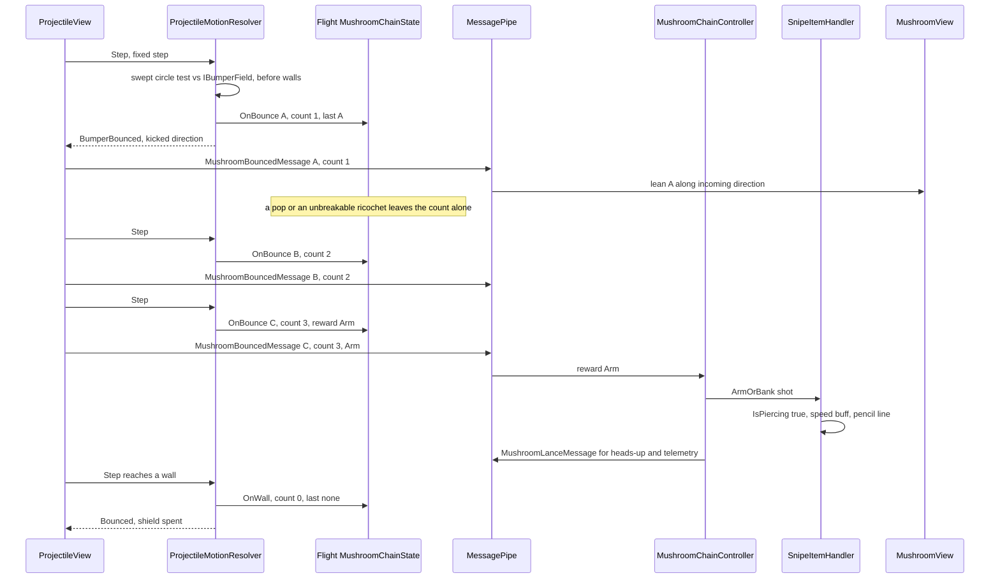

@page plan_meadow_mushrooms Meadow Mushrooms

# Meadow mushrooms: bumpers that earn a lance

> On meadow levels the board grows **mushrooms**: permanent bumpers the ball bounces off, pinball style.
> A ball that hits three of them in one flight, without touching a wall in between, becomes the Snipe lance.
> To make room, the meadow loses its Tough and Tougher balloons, and its unbreakables form only the snake.
> Talked through with the owner on 2026-11-18 and banked; started on 2026-11-19, when he settled the open
> points below and decisions A to F. **Status: building, phase 1. Nothing has been played yet.**

## The owner's direction (verbatim)

2026-11-18, in conversation:

- "Think of a fun mechanic we can add to the meadow levels?"
- "I like the mushrooms bumpers, but we would have to remove the tough/tougher to make more space"
- "And I have been thinking that maybe only allow snake formations in meadow for unbreakable" and "The snake
  only is for meadow only"
- "I think the mushrooms would be permanent but we have to calculate positioning so a projectile can bounce
  of all of them in chain if aim right"
- "Placement would have to be 2-5 probably max? Or 4 max"
- "Now what about winning the snipe discharge after ricochet from mushrooms"
- "Basically after the projectile is in flight it will count how many mushrooms it has hit, pass a threshold
  it activates the lance, the count resets if you hit a wall. So for example ricochet against a unbreakable
  is not a penalty"
- On the threshold: "Not sure, what you recommend, I'm inclined 3"

2026-11-19:

- "Let's start working in the meadow idea"
- "You will need to handle the asset generation and motion reaction of the mushroom heads when hit. They
  should almost feel stringy like a feedback in direction after being hit"

## The rules

| Rule | Value | Who settled it |
|---|---|---|
| Where | Meadow levels (`ScenarioKind.Ground`) only | Owner |
| What a mushroom is | A permanent bumper: never popped, never moved, there for the whole level | Owner |
| How many | 2 on the first level of a meadow stretch, growing to 4 by its last | Owner, 2026-11-19 |
| Placement | A chain must exist: a ball aimed right can bounce off every mushroom in turn | Owner |
| The bounce | A real bounce with a forgiving kick: leaving within a cone of the next mushroom, the ball is bent toward it | Owner, 2026-11-19 |
| The reward | 3 mushroom hits in one flight arm the ball as the Snipe lance | Owner |
| What resets the count | Only a wall. A pop or a ricochet off an unbreakable keeps it | Owner |
| Counting | A mushroom doesn't count twice in a row, but counts again after another one, so 2 mushrooms allow 3 hits | Owner, 2026-11-19 |
| Bushes | Stay, sharing one limit with the mushrooms on how many permanent things take slots | Owner, 2026-11-19 |
| Balloons | No Tough or Tougher on the meadow | Owner |
| Formations | On the meadow unbreakables form only the snake; the sky keeps every shape | Owner |
| Art | Made by us, no painted sprite | Owner, 2026-11-19 |
| Hit reaction | The cap leans away along the ball's direction and springs back, elastic | Owner, 2026-11-19 |

## Decisions A to G

The owner chose each on 2026-11-19 from the options put to him; G is how the work is done, not a choice of his.

| | Question | Decided, and why |
|---|---|---|
| A | Does a lance bounce off mushrooms too? | **Yes.** Today a piercing shot flies on unbent everywhere (the game, the solver and the aim line). A lance that passed through mushrooms would make them vanish from play the moment the reward lands |
| B | Does a 4th hit bank an extra lance charge? | **Yes, one extra a flight at most.** It rewards the full 4-mushroom chain late in a stretch |
| C | Does the aim line show the kick's bend? | **Yes.** The chain has to be readable on a phone, and the line already bends off deflecting things |
| D | Unbreakables past the snake cap on the meadow | **They stay loose.** With only the snake allowed and every snake full, extra unbreakables have no shape to join |
| E | The meadow loses two routes to a lance | **Accepted.** With no toughs the armour need falls, and with no item-cover formation the covered-bomb pity never builds. The mushrooms are the meadow's own route to the lance. Balance is checked with the bot against the level-10 target |
| F | Does a mushroom bounce spend a shield? | **No.** Walls end flights, mushrooms don't. The loop guards under *The forgiving kick* are what stop a flight running forever |
| G | The prefab and settings asset | **An editor menu builds them**, run once by the owner, who also assigns the settings asset on the game scope. Hand-written prefab YAML is too fragile |

## Design

Proposed by the architect on 2026-11-19 from a read of the code. What it verified and what it assumed is
marked under *Risks*.

### Contact is worked out, not left to physics

The live ball only collides with balloons: `ProjectileView.OnTriggerEnter2D` looks for a `BalloonView` and
calls `ProjectileHitResolver`. Bushes have no collider, and the Deflector, Absorber and Gatekeeper actors are
not reachable in play. So a mushroom is not a new collider. There are at most 4 permanent circles, and
`ProjectileMotionResolver.Step` tests the step's segment against them before the walls, then carries the rest
of the step along the new direction, as `Deflect` does for a deflecting balloon.

- No tunnelling, and no physics layer, so no ProjectSettings change.
- The shot solver works event to event, so it mirrors the bounce exactly.
- 4 circle tests a fixed step, nothing allocated.

### Types

| Type | Layer, place | What it does |
|---|---|---|
| `MushroomBumperModel` (new) | Model, `Slots/Actor/Archetype/` | A static slot actor, `GridActorType.Mushroom`. Never hit, never moved |
| `MushroomBoard : IBumperField` (new) | Model, `Slots/Grid/` | The bumper circles (id, centre, radius), rebuilt when the grid changes |
| `MushroomChainState`, `MushroomChainRule` (new) | Model, `Shared/` | The count and the last mushroom hit; `OnBounce` answers none, arm or bank; `OnWall` resets. The state rides on the projectile's flight and on the solver's flight state |
| `IBumperBounceRule`: `ForgivingKickRule`, `TrueReflectRule` (new) | `Shared/` | The one swappable bounce rule, called by the game, the solver and the aim line alike |
| `MushroomLayoutPlanner`, `ChainSlotSelectionStrategy` (new) | `Slots/Actor/` | Seeded placement that guarantees a chain |
| `MushroomChainController` (new) | Controller, `Item/Snipe/` | Hears `MushroomBouncedMessage` and pays the reward through `ISnipeArmer.ArmOrBank`; publishes `MushroomLanceMessage` |
| `IMushroomSettings` / `MushroomSettings` (new) | `Configuration/GridActors/` | Radius, chain target (3), the kick's cone and aim offset, the rule switches, placement limits, the lean's tuning, the prefab |
| `MushroomView` (new) | View | Pooled; the cap's spring |
| `ProjectileMotionResolver` | changed | Takes the field and the rule; a `BumperBounced` step; resets the count where it counts a wall bounce |
| `ProjectileView` | changed | Publishes the bounce; adds the bumpers to the cruise lookahead and the doomed-glide path check |
| `ISnipeArmer` | changed | `ArmOrBank`, the banking branch `SnipeItemHandler.Activate` already has |
| `IContentPiece` | changed | `AllowedOn(ScenarioKind)` replaces `RequiresGround` and `KeptOffWater`; Tough and Tougher become sky only |
| `LevelParameters`, `UnbreakableFormationService.WeightOf` | changed | `AllowedFormationShapes`, set to the snake on the meadow; a shape not allowed weighs 0 |
| `LevelGenerator` | changed | The mushroom count from the stretch; mushrooms forced in like bushes, outside the threat budget; the bush limit capped at the shared limit less the mushrooms |

### The forgiving kick

`c` is the contact point and `r` the true reflection.

- The candidates are the other mushrooms whose bearing from `c` lies within `KickConeDegrees` of `r`, with a
  corridor clear of other mushrooms (balloons are ignored: they pop or are ricocheted off on the way).
- The one at the smallest angle wins. With no candidate the ball leaves along `r`.
- The ball is aimed beside that mushroom's centre, by `KickAimOffset` of its radius, on the side `r` already
  leaned to. Never at the centre: a dead-centre hit reflects straight back, and two mushrooms would trade the
  ball forever with no wall to stop it.
- The kick applies only until the count passes the chain target by one. After that bounces are true, and
  their spread ends any cycle. `MaxBanksPerFlight` caps the reward.

### Placement

- **Inputs:** the slots left empty after the puff clouds, the cannon's origin and aim arc, the walls, the
  count, the radii, the run's seed.
- **Constraints:** the first mushroom is hit by a straight shot inside the aim arc, down a corridor clear of
  the other mushrooms and the bushes; each leg to the next mushroom is clear the same way; the turn at each
  mushroom is between about 40 and 140 degrees, so the hit needed is neither grazing nor dead centre; legs are
  neither too short nor too long; no edge columns and no rows the spawner needs.
- **Search:** depth first, candidates shuffled by the seed, within an iteration budget.
- **When it fails:** try one mushroom fewer, down to 2; then place none and log a warning.
- Mushrooms are placed before bushes, and the bushes keep out of the chain's corridors.

### The mirror and the aim line

Every rule a shot meets is mirrored in `Solver/` and held by mirror tests. A mushroom is a new contact kind
there, and the chain state rides in the solver's flight state. `PredictionTraceCalculator` already reflects
off deflector circles and ignores them while piercing; it takes the same bounce rule (decisions A and C).

### Art and the cap's reaction

- **The body is drawn in a shader** from the quad's own position, as the nuke, the disco ball and the golden
  balloon are: the cap and the stem as distance fields, lit through `Include/SceneLight.cginc`. No painted
  sprite, one renderer. `dotnet build` does not compile shaders, so each change needs a look in the Editor.
- **The shadow** follows the baked-shadow-child convention; a small script under `Tools/art/` writes the
  blurred silhouette, as the heart balloon's script does.
- **The reaction:** `MushroomView` keeps one `DampedSpring2D` (the shield view already uses it). A bounce on
  its own slot adds an impulse along the ball's incoming direction, scaled by its speed; the spring is
  underdamped, so the cap leans away and wobbles back along that same line. Each frame it writes the lean to
  the material, and the shader bends the stem by the square of the height and carries the cap the whole way,
  which is what makes the stalk read as elastic.
- **Nothing ticks at rest:** the view switches itself off once the spring is still and on again at an impulse.
  No tweens, and the spring is reset when the view goes back to the pool.

## Diagrams

```mermaid
classDiagram
    class IMushroomSettings {
        <<interface>>
        +ChainTarget int
        +KickConeDegrees float
        +KickAimOffset float
        +Rules MushroomChainRules
        +Lean MushroomLeanTuning
    }
    class MushroomChainRule {
        <<static>>
        +OnBounce(ref MushroomChainState, int bumperId, MushroomChainRules) MushroomReward
        +OnWall(ref MushroomChainState)
    }
    class IBumperBounceRule {
        <<interface>>
        +Resolve(BumperContact, IReadOnlyList~BumperCircle~, MushroomChainState) Vector2
    }
    class ForgivingKickRule
    class TrueReflectRule
    class MushroomLayoutPlanner {
        <<static>>
        +TryPlan(MushroomLayoutInput, List~Vector2Int~) bool
    }
    class IBumperField {
        <<interface>>
        +Bumpers IReadOnlyList~BumperCircle~
    }
    class MushroomBoard
    class MushroomBumperModel
    class ProjectileMotionResolver
    class MushroomChainController
    class ISnipeArmer {
        <<interface>>
        +Arm(shot)
        +ArmOrBank(shot)
    }
    class MushroomView
    class ShotSimulator
    class PredictionTraceCalculator
    class StaticActorSpawner
    ForgivingKickRule ..|> IBumperBounceRule
    TrueReflectRule ..|> IBumperBounceRule
    MushroomBoard ..|> IBumperField
    MushroomBoard --> MushroomBumperModel : reads grid
    StaticActorSpawner --> MushroomLayoutPlanner : chain placement
    ProjectileMotionResolver --> IBumperField
    ProjectileMotionResolver --> IBumperBounceRule
    ProjectileMotionResolver --> MushroomChainRule : count and reset
    MushroomChainController --> ISnipeArmer : arm or bank
    MushroomChainController --> IMushroomSettings
    MushroomView --> IMushroomSettings
    ShotSimulator --> IBumperBounceRule
    ShotSimulator --> MushroomChainRule
    PredictionTraceCalculator --> IBumperField
    PredictionTraceCalculator --> IBumperBounceRule
```

## Risks

- **Piercing means "unbent" in three places** (the game, the solver, the aim line). Bending a lance off
  mushrooms (decision A, taken) is the largest change to the mirror.
- **Every cast that assumes only balloons block** needs the bumpers added: the cruise lookahead, the doomed
  last-shield glide (or it passes through a mushroom), the tunnelling sweep and the aim fan. Each gets a test.
- **A mushroom bounce spends no shield** (decision F), so the loop guards carry the weight.
- **Balance.** Toughs are dropped before the threat budget is spent, so the budget buys other threats; the
  curves are `LevelGenerationSettings.BudgetForLevel` and `ScenarioScheduleSettings`. The target stands: the
  game picks up after level 10. Compare tunings with the playtest bot before and after.
- **Needs the Editor:** the prefab, the material, the config entries, the settings asset on the game scope
  (decision G), and every look at the shader.
- **Assumed, not verified:** which rows the spawner reserves; that the balancer leaves static actors alone;
  that no shot is in flight while the board ascends between levels; the layer the mushroom should draw on so
  it occludes for the GI as balloons do; the spring's constants.

## Phases

Each is testable by itself and built in this order. Per phase: build, then review, then the owner signs off.

| | Phase | What its tests prove |
|---|---|---|
| 1 | The pure rules: chain rule, both bounce rules, the placement planner, the settings interface | The truth table (arm at 3, bank at 4, a wall resets, a pop and a ricochet don't, the same mushroom twice in a row doesn't count); the kick never aims at a centre; over 500 seeds the planner's constraints hold, it is deterministic and its fallback works |
| 2 | Generation: `AllowedOn`, the mushroom gate, the shared limit, snake only | Sky and meadow stretches come out right; the formation service picks only snakes when masked |
| 3 | The live bounce, headless: the model, the board, the resolver's bumper step | Bounce, carry of the step, no shield spent, the reset at a wall |
| 4 | The reward: the controller, `ArmOrBank`, messages, telemetry counters | The lance arms at 3 and banks at 4; counters fold |
| 5 | The mirror: the solver's bumper contact and chain state, the aim line | The game and the simulator trace the same path and arm on the same hit; for every planned layout on an empty board some aim angle hits all its mushrooms |
| 6 | The view and the art: shader, shadow, the spring | The spring settles and sleeps; staged captures and a playtest in the Editor |
| 7 | Tuning with the playtest bot | Where each bot skill first loses on the meadow, against the level-10 target |

## Not in scope

- The dandelion (liked, not chosen).
- Anything on the sky or the water.
- Wind: nothing in the game shows a readable wind, so nothing here depends on one.
