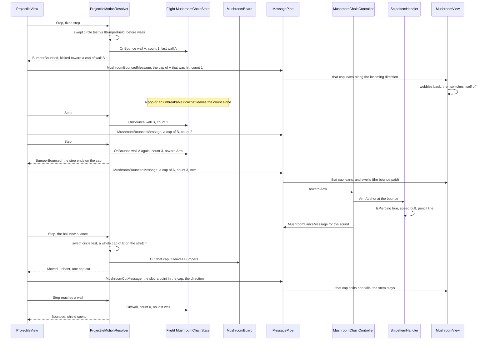

@page plan_meadow_mushrooms Meadow Mushrooms

# Meadow mushrooms: bumpers that earn a lance

> On meadow levels the board grows **mushrooms**: permanent bumpers the ball bounces off, pinball style.
> A ball that hits three of them in one flight, without touching a wall in between, becomes the Snipe lance.
> To make room, the meadow loses its Tough and Tougher balloons, and its unbreakables form only the snake.
> Talked through with the owner on 2026-11-18 and banked; started on 2026-11-19, when he settled the open
> points below and decisions A to F. **Status: phase 1 (the pure rules) is built, with the kick amended to look
> one mushroom ahead (decision H, taken for the owner and waiting for him to confirm). Phase 2 (generation) is
> built: meadow levels have no toughs, allow only the snake and carry a mushroom count. Phase 3 (the live bounce)
> is built headless: the ball bounces off mushroom models, and the spawner knows how to place a chain. Phase 4
> (the reward) is built: a chain pays the Snipe lance, with its sounds and its counters, and its review's
> fixes are in (one extra charge a flight, whatever walls it meets; the step ends at the bounce that
> pays). Phase 5 (the mirror and the aim line) is built: the shot solver and the aim line bounce off the
> mushrooms as the ball does, held by mirror tests. Phase 6 (the view and the art) is built: mushrooms now
> appear on meadow levels, drawn by a shader with no painted art, and the cap leans away from a hit and wobbles
> back. The owner rejected its first look, a toadstool seen from the side, and it was redrawn as the board is
> seen, from above: a cap over the circle the ball bounces off, its stem showing only when it is knocked
> (*Phase 6, the top view*). They have been seen in the Editor, in staged scenes and a filmed chain, and not yet
> played by a person or run on a device. One choice made in phase 3 is open for the owner: what a mushroom bounce does to a shot's run
> of wall bounces (below, after decision H). Two in phase 6 are his to look at: the cap's colour and the shadow
> (see *Phase 6 as built* and *Phase 6, the top view*). Since then the owner chose walls with a kick (decision I):
> 2 to 4 walls of caps a level, dealt from a baked catalogue, the kick bending only toward another wall and one
> hit counting per wall. It is built and replaces the planned chain; where the sections on phases 1 to 5 and on
> the spacing speak of the planner and its chain, they are the record of what was built then (*Walls with a kick
> as built*). Last, he asked that a lance cut the caps instead of bouncing off them, which replaces decisions A
> and B (decision J). Both halves are built: the rule (*The lance cuts caps: the rule as built*) and what a cut
> looks like (*The lance cuts caps: the view*).**

## The owner's direction (verbatim)

2026-11-18, in conversation:

- "Think of a fun mechanic we can add to the meadow levels?"
- "I like the mushrooms bumpers, but we would have to remove the tough/tougher to make more space"
- "And I have been thinking that maybe only allow snake formations in meadow for unbreakable" and "The snake
  only is for meadow only"
- "I think the mushrooms would be permanent but we have to calculate positioning so a projectile can bounce
  of all of them in chain if aim right"
- "Placement would have to be 2-5 probably max? Or 4 max"
- "Now what about winning the snipe discharge after ricochet from mushrooms"
- "Basically after the projectile is in flight it will count how many mushrooms it has hit, pass a threshold
  it activates the lance, the count resets if you hit a wall. So for example ricochet against a unbreakable
  is not a penalty"
- On the threshold: "Not sure, what you recommend, I'm inclined 3"

2026-11-19:

- "Let's start working in the meadow idea"
- "You will need to handle the asset generation and motion reaction of the mushroom heads when hit. They
  should almost feel stringy like a feedback in direction after being hit"
- "Ideally also the mushrooms are spawn with some distance between apart between them, getting then too close
  might be messy to aim. It should work like pinball machines"
- On the first look, a toadstool drawn from the side: "The art is wrong because the game is seen from the top
  view. So what we could be looking is at the mushroom cap, and the stem would probably only reveal during
  bounces"
- "What if we could put clusters of 1/3 caps together so they form a bouncing area. As is the chain sort of
  predetermined? It's okay we do this but would require a bit more skill it it allowed for more angles outside
  the ensured chain"
- "They should still be 2/4 clusters separated away but we can shape them in a way that benefits ricochets such
  as walls facing each other"
- His choice of the option put to him after the measurements: "2 to 4 clusters, each a wall of 2 or 3 caps, 4
  to 7 caps in all. The bounce bends only toward a cap of another wall, one hit counts per wall, cone narrowed
  to 20 degrees. About 10 to 12% of aim angles arm, in windows about 3 degrees wide."
- After playing the walls on his phone, of a level whose wall of three caps stood low on the board, about 2.7
  units straight above the cannon and side-on to it: "I think it's important to avoid blocking the cannon
  area, here the wall is too close to the cannon and directly facing it"
- "An interesting feat to try would be to have the snipe discharge cut the mushrooms caps, the stem stays after
  it and we see the cap split it two where the snipe cut. Then it falls, fades and scales down away. The cap
  pops again growing with scale up in the same place after n seconds."
- His choices of what was put to him after that: the lance flies straight through and cuts every cap in its
  path; a cut pays nothing, and the extra banked charge is dropped; a cut cap grows back after about 8 seconds,
  on the board's beat (5 beats of 1.7 seconds). While a cap is cut its stem stays and nothing bounces off it.
- On the first films of the cut, where the bare stem was a flat cream disc: "Stem needs texture"
- And of the stem: "Also at the floor level it could extend its rooting like dendrite"
- After playing the cut on his phone: "Bombs a nukes should probably take the caps off as well? But bombs only
  when close, they should also swing back in the direction of the bomb"
- Asked how close: "Close I mean as the unbreakable, direct hit, next to it"
- "Also the mushrooms need a sound when hit, we can look for something fitting, but it has to be short". Of
  five short sounds made for him to hear, he chose the second, the "bop".
- "Make the white part of the cap in the dynamic range during night so it glows"
- "given we have a way to draw smoke... what if we drew some when mushrooms are hit? as a small cone in
  direction of the hit", then "this would fake 'spores'" and "or spawn specks as well, in greenish / blueish
  color"
- "when a mushroom cap is blown that's also a moment to exagerate the spores"
- After the bank had gone with the lance's cut: "I did like the part that we could bank discharges though
  maybe we need a middle ground." Of four ways put to him he first chose a charge for a lance that cuts two
  caps in one flight, once a flight. While that was being built he changed it: "Or why not just add a new
  charge for every cut mushroom", and "This means you could also snipe them for extra charges".
- Of a lance that keeps re-arming itself: "Might end up messy though clearing the board". And, asked whether
  to limit the charges one flight may bank: "Don't cap".

## The rules

| Rule | Value | Who settled it |
|---|---|---|
| Where | Meadow levels (`ScenarioKind.Ground`) only | Owner |
| What a mushroom is | A permanent bumper: never popped, never moved, there for the whole level | Owner |
| How many | 2 walls of caps on the first level of a meadow stretch, growing to 4 by its last. A wall is 1 to 3 caps in neighbouring slots, and a level has 4 to 7 caps in all | Owner, 2026-11-19 (decision I) |
| Placement | Dealt from a baked catalogue of layouts whose walls send the ball to each other, each kept for what it measured: 7 to 16 in 100 aim angles arm the lance, in a window of 2 degrees or more | Owner chose the walls, 2026-11-19; the band is ours, measured (*Walls with a kick as built*) |
| Spacing | Walls stand apart like the bumpers of a pinball table: 1.9 world units or more from the nearest cap of one to the nearest cap of another (two and a half slots) | Owner, 2026-11-19; the distance was measured (*Spacing as built*) |
| The cannon's room | The cannon's area is not blocked: no wall close to the cannon, and none broad in front of it. No cap stands nearer than 3.25 world units to the point the cannon turns about, and a ball's first straight leg meets a cap within 4 units of the muzzle on no more than a fifth of the aim angles | Owner, 2026-11-19: "I think it's important to avoid blocking the cannon area, here the wall is too close to the cannon and directly facing it". The numbers were chosen for him, measured (*Open for the owner: the cannon's room*) |
| The bounce | A real bounce with a forgiving kick: leaving within a cone of 20 degrees of a cap of another wall, the ball is bent toward it. Inside one wall every bounce is a mirror reflection | Owner, 2026-11-19 (decision I) |
| The reward | 3 hits in one flight, wall to wall, arm the ball as the Snipe lance. The chain pays nothing past that: a fourth hit banks no charge | Owner; the fourth hit's charge dropped 2026-11-19 (decision J) |
| A lance and the mushrooms | A lance, however it was armed, bounces off no mushroom: it flies straight on and cuts every whole cap in its path. A cut counts nothing for the chain | Owner, 2026-11-19 (decision J) |
| The bank | Every cap a lance cuts banks that shot one lance charge, whatever armed the lance (a chain in this flight, a Snipe pickup, the card, a charge that re-armed it), with no limit. A cap a bomb or a nuke blows off banks nothing. A charge keeps the shot a lance at a wall where its pierce would end; it is the shot's own and dies with it | Owner, 2026-11-19 (decision K): "why not just add a new charge for every cut mushroom", "you could also snipe them for extra charges", and of a limit on them, "Don't cap" |
| What resets the count | Only a wall of the board. A pop or a ricochet off an unbreakable keeps it | Owner |
| Counting | One hit a wall: a wall doesn't count twice in a row, whichever of its caps is hit, but counts again after another one, so 2 walls allow 3 hits | Owner, 2026-11-19 (decision I) |
| Bushes | Stay, sharing one limit of 9 slots with the caps, and are never left fewer than 2 of them | Owner, 2026-11-19 |
| Balloons | No Tough or Tougher on the meadow | Owner |
| Formations | On the meadow unbreakables form only the snake; the sky keeps every shape | Owner |
| Art | Made by us, no painted sprite | Owner, 2026-11-19 |
| Hit reaction | The cap leans away along the ball's direction and springs back, elastic | Owner, 2026-11-19 |
| A blast and the mushrooms | A bomb blows the cap off each mushroom next to it: the six slots round its own, where it breaks an unbreakable. The other mushrooms its blast reaches sway away from it and spring back. A nuke blows off every cap. A blown cap is a cut cap from there on: the stem stays, nothing bounces off it, and it grows back on the board's fifth beat. A blast pays nothing, counts nothing and breaks no chain | Owner, 2026-11-19: "Bombs a nukes should probably take the caps off as well? But bombs only when close, they should also swing back in the direction of the bomb" and "Close I mean as the unbreakable, direct hit, next to it" (*Blasts take caps off: the rule as built*). How far the sway reaches and the order a nuke takes the caps in were chosen for him (*Open for the owner: what was decided for him in the blasts*) |
| The sound of a hit | The mushrooms' own short bump on every bounce, a whole tone higher with each wall the chain counts | Owner, 2026-11-19: "the mushrooms need a sound when hit ... it has to be short"; he chose the "bop" of five made for him (*The hit's own sound*) |
| A cap a lance cut | Splits in two where the lance cut it; the pieces fall, fade and shrink away and the stem stays; the cap pops back in the same place, growing, after about 8 seconds: on the board's fifth beat after the cut. While it is cut nothing bounces off it, counts it or is kicked toward it | Owner, 2026-11-19 (decision J; *The lance cuts caps: the rule as built* and *the view*) |

## Decisions A to G

The owner chose each on 2026-11-19 from the options put to him; G is how the work is done, not a choice of his.

| | Question | Decided, and why |
|---|---|---|
| A | Does a lance bounce off mushrooms too? | **Replaced by decision J: no, it cuts their caps.** As first chosen: **Yes.** Today a piercing shot flies on unbent everywhere (the game, the solver and the aim line). A lance that passed through mushrooms would make them vanish from play the moment the reward lands |
| B | Does a 4th hit bank an extra lance charge? | **Replaced by decision J: no charge is banked.** As first chosen: **Yes, one extra a flight at most.** It rewards the full 4-mushroom chain late in a stretch. Held in the chain rule itself since phase 4's review: a later chain flown by the lance banks that one charge if it is still to bank, and otherwise pays nothing |
| C | Does the aim line show the kick's bend? | **Yes.** The chain has to be readable on a phone, and the line already bends off deflecting things |
| D | Unbreakables past the snake cap on the meadow | **They stay loose.** With only the snake allowed and every snake full, extra unbreakables have no shape to join |
| E | The meadow loses two routes to a lance | **Accepted.** With no toughs the armour need falls, and with no item-cover formation the covered-bomb pity never builds. The mushrooms are the meadow's own route to the lance. Balance is checked with the bot against the level-10 target |
| F | Does a mushroom bounce spend a shield? | **No.** Walls end flights, mushrooms don't. The loop guards under *The forgiving kick* are what stop a flight running forever |
| G | The prefab and settings asset | **An editor menu builds them**, run once by the owner, who also assigns the settings asset on the game scope. Hand-written prefab YAML is too fragile. As it turned out he has nothing to run or assign: the settings ride on the Level Pacing asset (phase 2), and in phase 6 the menu was run in the second Editor and what it built was committed |

**A and B are replaced (the owner, 2026-11-19).** A lance no longer bounces off mushrooms: it flies straight
through and cuts every cap in its path. A cut pays nothing, so the extra charge of B is dropped. The rows above
are the record of what was chosen first. What replaced them is decision J, below.

### Decision H, taken for the owner: the kick looks one mushroom ahead

Decided by Claude on 2026-11-19 on the owner's behalf while he was away. **He has not seen it; it is his to confirm
or change.** Decision I keeps the lookahead and restates it for walls: the ball is landed for the nearest cap of
another wall, where this decision landed it for the next mushroom of a planned chain.

- **What he chose** (the bounce, in the rules above), as it was described to him: "a real bounce, but the mushroom
  bends the outgoing direction toward the next mushroom when the ball leaves within a cone of it. Aim still
  matters for the first hit; the chain then mostly carries itself."
- **What phase 1 found.** The kick as first designed landed every kicked ball at one fixed offset beside the next
  mushroom's centre. A ball landing at a fixed offset turns by a fixed angle there (151 degrees at an offset of
  0.25), whatever the layout. So the planner's legs and the kick disagreed: the ball mostly went A, B, A instead
  of along the chain, and the chain did not carry itself.
- **What was decided.** The kick looks one mushroom ahead. It lands the ball on the next mushroom at the point from
  which a true reflection sends it on toward the mushroom after that, so each bounce sets up the next. With
  three or more mushrooms the ball moves on; with two it comes back, which is how two mushrooms give three hits.
  Where it may land is kept between two offsets, never the centre and never a thin graze. The planner plans only
  the turns those two offsets can make, and accepts a layout only when the kick flies its chain.
- **Why this and not a tuned fixed offset.** No one offset fits a board: the turn a chain needs differs at every
  mushroom. Looking ahead is the smallest change that makes the sentence he chose true.

### Decision I, chosen by the owner: walls with a kick

Chosen on 2026-11-19, after the spacing, from options measured for him (*Walls with a kick as built* has the
numbers). It replaces the single mushrooms spread over the board and the chain planned through them.

- **What he asked.** Whether the chain was predetermined, and whether clusters of caps could make a bouncing
  area that asks more skill; then that there still be 2 to 4 clusters, apart from each other, shaped to help
  ricochets, "such as walls facing each other".
- **What the measurements said.** The chain was not predetermined, although this plan said so: the kick as
  built in phase 1 already bent the ball toward whichever other mushroom lay nearest its reflection, and the
  planned order only chose where the ball was landed. Flown from every aim angle with the shield a ball
  starts with, 77, 90 and 94 in 100 of the angles that armed the lance (2, 3 and 4 mushrooms) took the
  mushrooms in another order than the planned one, or after a wall. And round caps without a kick are a
  lottery in every shape tried: walls, lanes, funnels and whole boards armed on scattered single angles.
- **What he chose,** in the words of the option: "2 to 4 clusters, each a wall of 2 or 3 caps, 4 to 7 caps in
  all. The bounce bends only toward a cap of another wall, one hit counts per wall, cone narrowed to 20
  degrees. About 10 to 12% of aim angles arm, in windows about 3 degrees wide."
- **How it is built.** A level's walls are dealt from a catalogue of layouts baked ahead of time, each kept
  because of what it measured when flown from every aim angle. Nothing is planned or flown when a level is
  dealt. Decision H's lookahead stands, restated for walls: the ball is landed on a cap for the nearest cap
  of another wall, which between two facing walls is the wall it came from.

### Decision J, chosen by the owner: the lance cuts caps

Chosen on 2026-11-19, after he had played the walls. It replaces decision A (a lance bounces off mushrooms)
and decision B (a fourth hit banks a charge).

- **What he asked.** "An interesting feat to try would be to have the snipe discharge cut the mushrooms caps,
  the stem stays after it and we see the cap split it two where the snipe cut. Then it falls, fades and scales
  down away. The cap pops again growing with scale up in the same place after n seconds."
- **What a cut pays.** Of the options put to him he chose "Nothing, drop the bank": the lance flies through
  and cuts every cap in its path, and no extra charge is paid, by a cut or by a fourth hit.
- **How long a cut cap stays gone.** He chose "About 8 s, on the beat": five of the board's beats (1.7 seconds
  each), so that caps pop back in time with everything else on the board.
- **The rule that follows.**

  | | Rule |
  |---|---|
  | 1 | A lance (any piercing ball: one a chain armed, a Snipe pickup's, the card's) does not bounce off mushrooms. It flies straight on and cuts every whole cap its path enters, once a cap |
  | 2 | A cut cap is no bumper for anything: no bounce, no count, no kick toward it and no landing for it. Its slot stays taken, since the stem stands there, and a wall keeps its number with caps missing |
  | 3 | Nothing the chain counts banks a charge (decision K has since made every cut bank one). The third counted hit arms the ball, as before, the step still ends on that bounce, and from that instant the ball is a lance and rule 1 holds |
  | 4 | A cut cap comes back on the board's beat, at the fifth beat after its cut. A cap with a ball in flight over it waits for the next beat. A level's end, a retry and a reset leave every cap whole |
  | 5 | The solver, the aim line and the Snipe's corridor fly a lance straight through mushrooms, and a cut cap is gone for them in the same frame it is gone for the game |

- **How it is built:** *The lance cuts caps: the rule as built* and *The lance cuts caps: the view*.

### Decision K, chosen by the owner: every cap a lance cuts banks a charge

Chosen on 2026-11-19. It amends decision J, which had dropped the bank with the fourth hit that paid it.

- **What he said.** "I did like the part that we could bank discharges though maybe we need a middle ground."
  Offered four ways, he chose a charge for the second cap cut in a flight, once a flight; then, before that was
  built: "Or why not just add a new charge for every cut mushroom", and "This means you could also snipe them
  for extra charges".
- **His worry, and his answer to it.** "Might end up messy though clearing the board": a lance that keeps
  re-arming plowing the whole board. Asked whether a flight's charges should have a limit: "Don't cap". So
  there is no limit and no setting for one. What the rule amounts to without one was measured for him after he
  had decided (*The bank, as built*).
- **The rule.**

  | | Rule |
  |---|---|
  | 1 | Every cap a lance cuts banks that shot one lance charge. Any lance: one a chain armed in this flight, a Snipe pickup's, the card's, one a banked charge re-armed. No limit to how many a flight banks |
  | 2 | A cap a bomb or a nuke blows off banks nothing |
  | 3 | A charge is what a banked charge has always been in this game (a Snipe taken while the ball already pierces): the shot's own. It is spent at a wall where the lance's pierce would end, and keeps the shot a lance there. It is not carried to the next ball, and a shot that dies takes its charges with it |
  | 4 | A lance's pierce ends only at a wall reached after it plowed a balloon it cannot pop outright: on the meadow, an unbreakable, or a reward balloon that takes more than one hit. With none plowed no wall ends the lance, and no charge is spent |
  | 5 | What bounds a lance that re-arms itself: every wall costs a shield, lance or not, so a flight has one leg more than it has shields; and a cut cap is gone until it grows back, five beats later |

- **How it is built, and what it is worth:** *The bank, as built*.

### Open for the owner: what was decided for him in the bank

Decided on 2026-11-19 while building decision K. **He has not seen these; each is his to keep or change.**

- **What the bank is worth, measured** (*The bank, as built*, the tables). With the one shield a ball starts
  with, a flight spends one charge at the most, whatever it banked: it lives through one wall. A chain's lance
  banks 1.3 charges and spends one in one flight in nine; a Snipe aimed through the most caps banks 4 and
  spends one in a little over half its flights. The board such a flight clears grows by under two parts in a
  hundred. With four shields (the card that adds one, three times) it is more: the same Snipe clears half the
  board where it cleared 39 parts in a hundred.
- **On a board with no unbreakable the bank does nothing at all.** A lance there is a lance to its last wall
  anyway. So on the meadow the bank is a way through the snakes: it is the unbreakables it is spent on.
- **Nothing shows a charge.** The game has never drawn how many charges a ball holds, and still does not. What
  was built is the sound and what a view needs to show it (`MushroomCutMessage.Charges`); the view's part is
  not built.
- **How it sounds.** Each cut's stroke is a whole tone higher than the flight's cut before it, so a lance
  through a wall of three is heard climbing. The Snipe's cue rings once a flight, on its first charge, a whole
  tone above the arming's, which is what a banked charge rang before the bank was dropped. For a chain's lance
  that is nearly always a moment after the arming's own cue: the kick aims the arming bounce at a cap.
- **A cruise's pierce becomes a Snipe's lance once it has cut a cap.** A ball that earned its pierce by
  cruising between empty walls, with no Snipe behind it, cuts caps as any piercing ball does (decision J), so
  under "any lance" its cuts bank too. What happens then: the cruise's pierce is spent at the first wall the
  ball reaches after plowing an unbreakable (or another balloon it cannot pop outright), as it always was;
  with a charge banked the ball stays piercing there, its cruise ends, and the Snipe arms it afresh, with the
  Snipe's speed. From that wall on it is a Snipe's lance until its shields run out, re-armed by a charge at
  each later wall that would end it. Without a plowed unbreakable no charge is spent and nothing changes for
  it. It is what a Snipe picked up during a cruise's pierce has always done, now earned by a cut. **The
  alternative, not built:** bank only for a pierce the Snipe armed (a pickup, the card, a chain, a charge),
  which the flight can tell by the ball piercing without cruising; a cruise's pierce would still cut caps and
  bank nothing. It is pinned by a test as it stands (`MushroomBankTests`), so a change is a decision and not
  an accident.
- **The charge is a plain one,** whatever the lance: a rainbow lance's cuts bank plain charges.
- **A cut nothing flew banks nothing:** the stage's `cut`.
- **`mushroom_charges_banked` runs level with `mushroom_caps_cut`** in play, since every cut banks. It is kept
  apart for the day a limit is tried. Nothing counts the charges that are spent, which is the number that would
  say whether the bank matters in play.
- **The solver banks and gives a charge no value.** For a Snipe's lance it never spends one either, since its
  lance is never spent (an approximation older than the mushrooms).

### Open for the owner: what was decided for him in the lance's cut

Decided on 2026-11-19 while building decision J, each the nearest thing to what he chose. **He has not seen
these; each is his to keep or change.** The first four were decided by the coordinator, the rest while
building.

- **The bounce that arms is still a bounce.** The ball becomes a lance on its third hit and leaves that cap by
  the kick or the reflection, as before, so the cap that armed it is not cut by it. If the lance comes back to
  that cap off a wall, it cuts it then.
- **A lance spent at a wall is an ordinary ball again,** and bounces off the mushrooms again from that wall on.
  A new chain can arm it again (*Open for the owner: a lance spent at a wall can be armed again*).
- **A cap regrows even if its whole wall was cut.** Each cap counts its own beats from its own cut.
- **A cut counts nothing and breaks nothing.** The chain a lance carries is as it was when the ball was armed,
  until a wall clears it; a cut cap is not a hit.
- **Any piercing ball cuts, a cruise's pierce included.** The game has one state for a ball that pierces,
  whatever armed it, and the rule reads that state. A ball that earned its pierce by cruising between empty
  walls cuts caps as a Snipe's lance does. Telling the two apart would need the rule to know where a pierce
  came from, which nothing in a flight says today.
- **Which beat is the first.** The first beat seen to fall after the frame of the cut. So a cap is gone for
  more than four beats and at most five: 6.8 to 8.5 seconds with the beat at 1.7, and always back on a beat.
  Counting five whole beat lengths from the cut instead would bring caps back off the beat.
- **Only a ball in flight holds a cap back.** A cap that is due waits a beat for each beat a ball's centre is
  inside the circle it will have (the cap's radius and the ball's). Balloons do not hold it back: the slot was
  the mushroom's all along, so none stands there.
- **A cut has its own sound, a stand-in:** the stroke of the heart's strikethrough (`Strikethrough`), at 0.8 of
  its volume, at the cap. The bank holds nothing nearer to a blade.
- **No heads-up names a cut,** and none named the chain: there was no text to change.
- **The solver does not model the regrow.** A flight is simulated on the board as it stands: a cap cut before
  the aim stays cut for the whole simulated flight, and one the simulated lance cuts stays cut to its end. A
  flight is seconds long and a regrow is 7 or 8 away, so the two seldom meet.

### Open for the owner: what was decided for him in the blasts

Decided on 2026-11-19 while building *Blasts take caps off*. **He has not seen these; each is his to keep or
change.**

- **"Next to it" was read as the bomb's own rule for unbreakables.** A bomb breaks an unbreakable balloon in
  the six slots round its own, 0.75 world units away. (A rainbow bomb breaks whatever has its centre within its
  kill radius of 1.25; the next slots out are 1.30 away, so on the board those are the same six.) Caps go by
  that rule and by no number of the mushrooms' own, so if the bomb's rule for unbreakables is ever changed,
  the caps follow it.
- **How often that is.** Over the 127 boards of the catalogue, a bomb in each slot that holds no mushroom
  (7554 of them, every slot counted alike): it takes no cap 56 times in 100, one cap 32, two 11, and never
  more, since walls stand 1.9 apart. From the third row from the top to the seventh, two bombs in three take
  a cap; in the top row one in three, and in the two lowest none.
- **The sway was faint as first shipped, and was widened.** At the blast's own reach, the kill radius and
  the cap's own radius, 1.55, the mushrooms that sway are the second ring only, 1.30 or 1.50 from the bomb, at
  strengths 0.31 and 0.06 on a scale where 1 is the distance of the slots next to the bomb. The setting for
  widening it is the sway's share of the kill radius (`IMushroomSettings.Blast`). The view's films settled it
  at 2.4, a reach of 3.3: the second ring sways at 0.78 and 0.71, the third (1.98, 2.25) at 0.52 and 0.41, the
  fourth (2.60 to 3.00) at 0.27 down to 0.12 (*Blasts take caps off: the view* says why).
- **A sway changes nothing in the rule.** The cap is whole: the ball bounces off it and the chain counts it as
  before. Only whole caps sway.
- **A nuke takes every cap, each as the blast's edge reaches it:** near mushrooms first, over the blast's one
  second, each blown away from the nuke. A blast stopped short (a level change, a game over, a reset) has taken
  only the caps it reached.
- **A blown cap grows back as a cut one does,** on the board's fifth beat after it went. So after a nuke the
  caps pop back together, on one beat or two that follow each other, 6.8 to 8.5 seconds later, onto the board
  the nuke emptied.
- **A blast is no hit of anyone's chain and breaks none.** A ball in flight keeps the count it has and finds
  the caps gone. Nothing is paid for a blown cap.
- **A cap that was already cut is left as it is:** not announced again, its wait not started again, no sway.
- **A blown cap has no sound of its own.** It is heard in the blast. The cut's stroke is a lance's alone: a
  bomb taking two caps would otherwise play two strokes on top of its own bang.
- **Blown caps have their own counter,** `mushroom_caps_blown`, so `mushroom_caps_cut` goes on telling how
  much the chain's reward is used.
- **The solver takes a bomb's caps off and knows nothing of a nuke's or of the sway** (*Blasts take caps off:
  the rule as built*, the mirror).

### Open for the owner: what was chosen for him in walls with a kick

Decided by Claude on 2026-11-19 while building decision I. **He has not seen these; each is his to keep or
change.**

- **A wall of one cap** is used only where a board cannot be filled without it. With 4 to 7 caps that is: two
  walls of 2 or 3 caps each; three walls of 2, 2 and 2 or of 3, 2 and 2; four walls of 2, 2, 2 and 1. So a
  level of four walls always has 7 caps and one of them stands alone.
- **The bushes are left 3 slots beside two walls and 2 beside three or four,** of the 9 they share with the
  caps. The level generator does not know which layout a level will be dealt, so it takes the most caps the
  level's walls may hold (6, 7, 7). Before the walls the bushes had 7 down to 5 slots.
- **A bush may stand between two walls, but not on a slot next to a cap.** The ball flies over bushes (they
  have no collider), so a bush in a lane changes no flight; next to a cap it would read as one more piece of
  the wall.
- **The band a layout is kept for:** 7 to 16 in 100 aim angles arm the lance, the widest run of them spans 2
  degrees or more, and at least 20 angles arm. A layout is kept only when it is inside the band with room to
  spare (8 arming angles at each end and 2 angles of window over its floor, twice what a layout is allowed
  to drift between runtimes), so another device's rounding does not find it outside.
- **Four walls arm more often than he was told:** 13.2 in 100 angles on average, where two walls arm on 9.7
  and three on 11.6. A lower top to the band would bring it down and thin the choice of boards of four.
- **The kick's smallest offset is 0.15, down from 0.2.** Two walls trading the ball need the cone wider than
  twice the arcsine of the smallest offset: 23 degrees at 0.2, which a cone of 20 is not, and 17 at 0.15.
  Measured both ways the boards arm alike.
- **A flight that arms goes on to cut a cap** (every arming flight of the catalogue, flown by the solver on
  an empty board: 1.2 to 1.3 caps a flight). The bounce that arms is aimed back at the wall the ball came
  from, which used to be the hit that banked a charge and is now the first cap the lance cuts (decision J).
- **No mirrored layouts.** The slots of odd rows stand half a slot to the side of the even rows', so a board
  mirrored left to right does not land on slots. There are 18, 64 and 45 layouts of 2, 3 and 4 walls instead
  (*Open for the owner: the cannon's room*).
- **When the rows the balloon spawner keeps leave no layout standing,** the level gets one wall fewer, down to
  two, then none with a warning. With the shipped two rows kept, or three, every layout fits; with four rows
  kept 6, 20 and 5 of the layouts of 2, 3 and 4 walls do, and with five one of two and one of three.
- **The walls are placed first, and a cloud does not stand next to a cap.** The clouds and the bushes are
  placed with random numbers a retry does not replay, so the walls go before both: a retry stands them where
  they stood. What is placed after the walls keeps off the slots next to a cap, which used to hold for the
  bushes alone and now holds for the clouds too.

### Open for the owner: the cannon's room

Built on 2026-11-19 from his words (*The owner's direction*); the numbers are ours. **He has not seen them;
each is his to keep or change.**

- **As built.** Two things are asked of a layout before it may be in the catalogue. Nothing close: no cap's
  centre nearer than 3.25 world units to the point the cannon turns about at rest. Nothing broad in front:
  of the 511 aim angles, at most a fifth (102) may have a ball's first straight leg meet a cap within 4 units
  of the muzzle. A cap low by a side wall, or a wall seen end-on, takes few angles and may stand; a wall
  side-on across the cannon's view may not.
- **What that does on the board.** The lowest row a cap may stand in is empty on every layout: its slots are
  2.66 to 2.96 from the cannon, and those of the row above 3.31 to 3.55. The nearest cap of any layout is
  3.31 away, where it was 2.66, and the broadest layout takes 19.8 in 100 of the aim angles within the near
  range, where the old catalogue's broadest took 34. Of the old catalogue's 192 layouts 143 fail the rule,
  the five with a wall of three caps along the lowest row among them, which is the wall in his screenshot.
- **Not the numbers first proposed** (a clear distance of 4.0, a near range of 5.5, a ceiling of 10 in 100).
  With those, 114, 1 and 0 boards of 2, 3 and 4 walls keep the rule, of every board there is, and one of them
  is inside the band with the bake's room: there is no catalogue. A distance of 4.0 clears the two lowest
  rows of the eight a cap may stand in and half the third, and walls 1.9 apart seldom fit in what is left.
  A near range of 5.5 reaches all but the top two of those rows, so nearly every cap on the board counts, and
  one cap alone takes 7 in 100 of the angles from 4 units away. *Walls with a kick, after its review* has the
  table.
- **The catalogue is thinner for it: 18 layouts of two walls, 64 of three, 45 of four,** where there were 64
  of each. The 18 and the 45 are every board of those counts that keeps the rule and is inside the band with
  the bake's room; nothing was left out by choice. Two walls are a meadow stretch's first level, so a run sees
  one of 18 boards there. A ceiling of a quarter of the angles would give 22 and 58; no clearance at all gives
  61 of two walls, never 64.
- **Arming is where it was:** 9.7, 11.6 and 13.2 in 100 angles on average (it was 9.9, 11.8 and 13.9), in
  windows of 3.0, 3.3 and 3.1 degrees, and no layout under 8.6 in 100. Walls higher up the board do not arm
  less often. The band's floor of 7 in 100 turns nothing away; what limits two walls is the window of 2
  degrees, and what limits four is the band's top.

### Open for the owner: a mushroom bounce and the cruise pierce

Built one way in phase 3, where the plan was silent. **He has not seen it; it is his to keep or change.**

- **As built.** A mushroom bounce zeroes an unarmed shot's count of wall bounces, as a balloon contact does. A
  wall bounce counted earlier in the same step (a wall, then a mushroom on the way back off it) is discarded
  with the rest. So a shot that alternates walls and mushrooms never earns the cruise pierce: only a run of
  walls with nothing between them does.
- **The alternative.** A mushroom bounce leaves the wall-bounce count alone, so a shot bouncing between walls
  and mushrooms still builds toward the cruise pierce, and the meadow gets a second route to a piercing ball
  beside the chain.
- **What does not depend on it.** The chain itself (a wall clears it either way), an armed shot's run, and the
  taps a shot has earned.
- **Since decision J** a shot that does earn the cruise pierce is a piercing ball like any lance, so it cuts
  the caps in its way (*Open for the owner: what was decided for him in the lance's cut*).

### Open for the owner: a lance spent at a wall can be armed again

Found by the review of phase 5. **He has not seen it; it is his to keep or change.**

- **As built.** The chain rule does not cap how often a flight is armed. A lance bounces off no mushroom
  (decision J), so its chain never completes, but a lance spent at a wall is an ordinary ball again, the wall
  has cleared its chain, and a new chain arms it again (at most 2 armings with the single starting shield;
  unreachable on the meadow today because a lance only discharges at a wall after piercing a tough).
- **The alternative.** One arming a flight: the rule would remember that it armed the ball, and a later chain
  flown by a ball that is no longer a lance would pay nothing.

### Closed by decision J: the Snipe corridor counted its chain from the host

The corridor is a lance's run, and a lance no longer bounces off mushrooms: it is the straight segment to the
wall again, with no chain to count. What follows is the record of the point as it stood.

Found by the review of phase 5 and not fixed. The Snipe's pierce corridor (`SnipeRangePreview`) starts its
chain at none where the aim line meets the Snipe's host. The ball's own count there is whatever its flight
has: one for each mushroom it bounced off since its last wall, so the corridor is a count behind by one for
each of those. The kick depends on the count (the bounce that reaches the chain target is aimed
differently, and the ones past it are plain reflections), so on a shot that reaches the host off a mushroom
the corridor's later turns can differ from the lance's. The fix is to hand the corridor the chain the aim
line has at that point, which the line does not publish yet.

### Open for the owner: how far apart the walls stand

Built on 2026-11-19 from his words; the distance is ours. **He has not seen it; it is his to keep or change.**

- **As built.** No two walls nearer than 1.9 world units, nearest cap to nearest cap, which on the slots is
  1.98: two and a half slots, a little over three caps across. The distance was measured for single mushrooms
  (*Spacing as built*) and kept for the walls.
- **Wider or nearer** needs the catalogue baked again, and changes which boards are inside the band: facing
  walls measured best at the nearest gap the ball can enter.
- **Not ruled on.** How far caps stand from the board's walls: the kept-clear columns and rows decide it. How
  far they stand from the cannon he ruled on afterwards (*Open for the owner: the cannon's room*).

## Design
### Contact is worked out, not left to physics

The live ball only collides with balloons: `ProjectileView.OnTriggerEnter2D` looks for a `BalloonView` and
calls `ProjectileHitResolver`. Bushes have no collider, and the Deflector, Absorber and Gatekeeper actors are
not reachable in play. So a mushroom is not a new collider. There are at most 7 permanent circles, and
`ProjectileMotionResolver.Step` tests the step's segment against them before the walls, then carries the rest
of the step along the new direction, as `Deflect` does for a deflecting balloon.

- No tunnelling, and no physics layer, so no ProjectSettings change.
- The shot solver works event to event, so it mirrors the bounce exactly.
- At most 7 circle tests a fixed step, nothing allocated.

### Types

| Type | Layer, place | What it does |
|---|---|---|
| `MushroomBumperModel` (new) | Model, `Slots/Actor/Archetype/` | A static slot actor, `GridActorType.Mushroom`. Never hit, never moved |
| `MushroomBoard : IBumperField` (new) | Model, `Slots/Grid/` | The bumper circles (id, wall, centre, radius), rebuilt when the grid changes |
| `MushroomChainState`, `MushroomChainRule` (new) | Model, `Shared/` | The count, the bounces since the board's last wall and the wall of caps hit last; `OnBounce`, told the wall of the cap that was hit, answers none, arm or pass through (the stretch has had its bounces); it is only asked about a ball that is not a lance, since a lance bounces off none (decision J); `OnWall` resets. The state rides on the projectile's flight and on the solver's flight state |
| `IBumperBounceRule`: `ForgivingKickRule`, `TrueReflectRule` (new) | `Shared/` | The one swappable bounce rule, called by the game, the solver and the aim line alike. A `BumperCircle` carries its cap's id and the wall the cap stands in |
| `BumperKick`, `BumperKickTuning` (new) | `Shared/` | The kick's geometry (target, follower, landing point) and its numbers (cone, the two offsets). `ForgivingKickRule` asks it |
| `MushroomWallCatalogue`, `MushroomWallLayout`, `MushroomWallPicker`, `WallSlotSelectionStrategy` (new, decision I) | `Slots/Actor/` | The baked layouts of walls, by how many walls; the pick of one by the level's seed for the slots that are free; the spawner's strategy over it. They replace `MushroomLayoutPlanner` and `ChainSlotSelectionStrategy` |
| `MushroomWallBaker` (new, decision I) | `Editor/` | Bakes the catalogue: draws candidate boards, flies each from every aim angle with the shot simulator, keeps the ones inside the settings' band, and writes the generated file |
| `BumperSweep` (new) | `Shared/` | The swept test of a stretch against the bumper circles, asked by the flight and by everything that looks ahead of the ball |
| `IShotOrigin` (new) | `Shared/` | The point the cannon turns about at rest and the ball's radius, for the board's side; the thrower's origin provider implements it |
| `MushroomChainController` (new) | Controller, `Item/Snipe/` | Hears `MushroomBouncedMessage` and arms the ball through `ISnipeArmer` when the rule answered `Arm`; publishes `MushroomLanceMessage` |
| `MushroomRegrowController` (new, decision J) | Controller, `Item/Snipe/` | Grows a cut cap back on the board's beat, the fifth after its cut, a beat later while a ball is in its way; publishes `MushroomRegrownMessage` |
| `IMushroomRegrowth` (new, decision J) | `Shared/` | The caps a lance has cut, as the regrow controller sees them: how many, each one's beats, circle and slot, and putting one back. `MushroomBoard` implements it |
| `CapCut` (new, decision J) | `Projectile/Controller/` | One cap a lance cut on a fixed step: its id and slot, a point inside it on the line it splits along, the lance's direction, and how many caps the flight has cut with it (decision K) |
| `IMushroomSettings` / `MushroomSettings` (new) | `Configuration/GridActors/` | Radius, chain target (3), the kick's cone and its two offsets, the rule switches, the walls' limits and the band a layout is kept for, the lean's tuning |
| `MushroomView` (new) | View, `Slots/Actor/Archetype/` | A `GridActorView`, pooled: the quad the shader draws the mushroom on, and the cap's answer to a hit. Off while the cap is still |
| `MushroomCapSpring` (new) | `Slots/Actor/Archetype/` | The cap's motion with no engine state: a lean pushed along the ball's way in and a swell when a bounce pays, both sprung back to rest; says when it has come to rest |
| `MushroomLeanTuning` (new) | `Slots/Actor/` | The lean's numbers, authored on `IMushroomSettings.Lean` |
| `MushroomCutMessage`, `MushroomRegrownMessage` (new) | `Shared/Messages/` | The mushroom in a slot lost its cap, and why (`Cause`, a `MushroomCutCause`): a lance cut it (the slot, a point inside the cap on the lance's line, its direction, and `Charges`: which of the flight's banked charges this cut is, decision K) or a blast blew it off (the slot, the cap's centre, the unit direction from the blast to the cap); the cap in a slot grew back. The rule publishes them, `MushroomView` hears them |
| `MushroomSwayedMessage` (new, blasts) | `Shared/Messages/` | A bomb's blast reached the mushroom in a slot without taking its cap: the slot, the unit direction from the blast to the mushroom, and a strength from 0 to 1. The rule publishes it for the view to hear |
| `MushroomBlast : IMushroomBlast` (new, blasts) | Controller, `Item/Bomb/`; the interface in `Shared/` | What a blast does to the mushrooms, told by the bomb's handler and the nuke's blast as they go off: it cuts the caps out of the field and publishes the two messages. It has no tick and keeps nothing |
| `MushroomBlastRule`, `MushroomBlastTuning` (new, blasts) | `Shared/` | The sway's reach, its strength with distance and its direction; the sway's share of the bomb's kill radius, authored on `IMushroomSettings.Blast`. Which caps a bomb takes is not here: it is `BombBlast.Pierces`, the bomb's own rule for what it breaks outright |
| `MushroomCutTimeline` (new) | `Slots/Actor/Archetype/` | What a cut cap is doing, with no engine state: the two pieces parting, falling and fading, the bare stem, the cap popping back; every value a matter of the time passed; says when nothing moves |
| `MushroomCutTuning` (new) | `Slots/Actor/` | The cut's numbers, authored on `IMushroomSettings.Cut` |
| `Grid/Mushroom` shader (new) | `Shaders/BalloonParty/Grid/` | Draws the mushroom, seen from above, and its shadow from the quad's own position; `_Lean` knocks the cap off its foot and tips it, which uncovers the stem |
| `MushroomPrefabBuilder` (new) | `Editor/` | The menu of decision G: the material, the quad, the prefab, the grid actor entry |
| `ProjectileMotionResolver` | changed | Takes the field and the rule; a `BumperBounced` step; resets the count where it counts a wall bounce |
| `ProjectileView` | changed | Publishes the bounce; adds the bumpers to the cruise lookahead and the doomed-glide path check |
| `ISnipeArmer` | changed | `ArmAt(shot, at)`: a lance earned in flight, its line starting where it was earned. (`Bank(shot)` went with decision J and did not come back with K: the flight's step banks a cut's charge itself) |
| `ShotBumperLayer` (new) | `Solver/` | The mushrooms for the shot simulator: the circles as gathered, the game's bounce rule and chain rules, the lance a chain pays |
| `MushroomSoundRouter` (new) | `Audio/Routing/` | The mushrooms' own bump on each bounce, climbing with the count, the Snipe's cue when a chain pays, and a stroke for each cap a lance cuts, a step higher with each cap the flight has cut, with the Snipe's cue once more for the first charge a flight banks (decision K). A cap a blast blew off plays nothing |
| `IContentPiece` | changed | `AllowedOn(ScenarioKind)` replaces `RequiresGround` and `KeptOffWater`; Tough and Tougher become sky only |
| `LevelParameters`, `UnbreakableFormationService.WeightOf` | changed | `AllowedFormationShapes`, set to the snake on the meadow; a shape not allowed weighs 0 |
| `LevelGenerator` | changed | The count of walls from the stretch; mushrooms forced in like bushes, outside the threat budget; the bush limit capped at the shared limit less the most caps the level's walls may hold |

### The forgiving kick

As built in phase 1, after decision H, and restated for walls in decision I. `c` is the contact point and `r`
the true reflection. An **offset** is where a ball lands on a cap: its impact parameter as a share of the radius
it bounces at, 0 dead centre and 1 a graze. A ball landing at an offset turns by 180 degrees less twice the
arcsine of the offset.

- **The target.** The candidates are the caps of other walls whose bearing from `c` lies within the cone
  (`Kick.ConeDegrees`, 20) of `r`, with a corridor clear of other caps (balloons are ignored: they pop or are
  ricocheted off on the way). The one at the smallest angle wins. With no candidate the ball leaves along `r`.
  A cap of the wall just hit is never a candidate: inside one wall every bounce is a mirror reflection.
- **The landing point looks one cap ahead.** The ball is aimed at the point of the target from which a true
  reflection points at a follower's centre. So the ball leaves the target along a reflection that already points
  at the follower, the target's own kick finds the follower dead ahead, and the step repeats: the rally carries
  itself.
- **The follower** is the nearest cap to the target that is not of the target's own wall, the lower id when two
  are as near; where a cap stands in the list handed to the rule does not matter. Two walls that face each
  other are each other's nearest, so the ball is sent back across the gap, which is how two walls give three
  hits. One fits when the offset it needs is within the kick's two, the reflection's way to it is clear and the
  kicked line has a clear corridor; the next nearest is tried when it does not. A contact on a cap that is not
  in the list is not kicked. (Before decision I the follower was the next id along a planned chain. The target
  was any mushroom in the cone even then, which is why most chains were already flown out of the planned
  order.)
- **A kicked line clearly leaves its own cap.** Within 0.06 degrees of the tangent it counts as blocked: a
  rounding error could read such a line as entering the cap again. So does a line that starts inside another
  cap's circle: the caps of one wall overlap, and a ball in the notch between two of them bounces off the
  second at once.
- **Never the centre, never a thin graze.** The offset is kept between `Kick.MinOffset` and `Kick.MaxOffset`
  (0.15 and 0.9). A dead-centre hit reflects straight back, and two caps would trade the ball forever with no
  wall to stop it; a graze too thin is missed on a small error. When no follower fits inside them, the ball is
  landed for the nearest follower as near as they allow.
- **The last kick.** The bounce that brings the count to the chain target aims at the cap the ball would hit
  next (the hit that banked a charge until decision J; now the first cap the lance cuts), which is
  not kicked on. It lands at the smallest offset: a reflection set up to point at a centre, with no kick left to
  correct it, would be the dead-centre hit the rule exists to prevent.
- **It stops.** The kick applies until the count passes the chain target. After that bounces are true, and their
  spread ends any cycle. Since decision J the ball is a lance from the target on and bounces off nothing, so
  there is no bounce past it.
- **And the flight is bounded whatever happens.** The chain rule counts every bounce off a mushroom since the last
  wall, the ones that did not count included, and past `MaxBouncesPerStretch` (12) the mushrooms let the ball
  through until it meets a wall, which spends a shield. The kick cannot hold that by itself: a ricochet off an
  unbreakable can send the ball back to the mushroom it just left, a hit that does not count and is kicked
  again, and true reflections between mushrooms standing too close can trap a ball. A chain is paid in full by
  its fourth bounce, so the cap costs no reward.
- **The cone the composition needs.** Where the follower fits, the reflection points at its centre, so the next
  kick takes hold inside any cone. Coming straight back, the offset is clamped at the smallest, which leaves the
  reflection up to twice its arcsine off the way back: 17 degrees at 0.15. Two walls therefore want the cone
  wider than that, and 20 leaves 3 degrees to spare (`MushroomSettings.Validate` says so when it is not). The
  cone is otherwise the dial for how much skill a rally asks: the owner narrowed it from 30 to 20 in decision I.

### Placement

As built for decision I (*Walls with a kick as built*). Phase 1 planned a chain through single mushrooms with a
seeded search (*Phase 1 as built* is the record of it); that planner is gone.

- **A layout is dealt, not planned.** The catalogue holds 18, 64 and 45 layouts of 2, 3 and 4 walls. The
  level's seed picks where in the list to start, and the first layout from there whose slots are all free is
  the level's.
- **What a layout keeps to by its shape:** 2 to 4 walls; a wall is 1 to 3 caps in neighbouring slots, in a line
  along a row or along a diagonal of the lattice; 4 to 7 caps in all, a wall of one cap only where the board
  cannot be filled without it; the walls 1.9 or more apart, nearest cap to nearest cap; no cap in an edge
  column, the top row or the bottom two rows; and the cannon keeps its room (no cap nearer than 3.25 to its
  pivot, and a cap met within 4 of the muzzle on no more than a fifth of the aim angles).
- **What a layout is kept for:** flown from every angle of the aim grid on an empty board, with the shield a
  ball starts with, 7 to 16 in 100 angles arm the lance, the widest unbroken run of them spans 2 degrees or
  more, and at least 20 angles arm. Shapes are not judged: walls that send the ball to each other are the
  ones that measure inside the band.
- **The bake** is done ahead of time by an editor tool and committed as a generated file; a test flies every
  entry again and another holds the numbers the bake depends on against what ships.
- **Inputs at the deal:** the board's empty slots, the count of walls, the level's seed, and the rows the
  balloon spawner keeps. The walls are placed before anything else, so the seed alone picks the layout.
- **When no layout of the count fits:** one wall fewer, down to 2; then none and a warning.
- Caps are placed before the clouds and the bushes, which keep off the slots next to a cap.
- A cap's place in its layout is the id its bumper carries, and its wall rides with it.

### The mirror and the aim line

Every rule a shot meets is mirrored in `Solver/` and held by mirror tests. A mushroom is a new contact kind
there, and the chain state rides in the solver's flight state. `PredictionTraceCalculator` already reflects
off deflector circles and ignores them while piercing; it takes the same bounce rule (decisions A and C).
Built in phase 5: see *Phase 5 as built*.

### Art and the cap's reaction

- **The body is drawn in a shader** from the quad's own position, as the nuke, the disco ball and the golden
  balloon are: the cap and the stem as distance fields, lit through `Include/SceneLight.cginc`. No painted
  sprite, one renderer. `dotnet build` does not compile shaders, so each change needs a look in the Editor.
- **It is seen from above,** as the board is (the owner, on the first look: *Phase 6, the top view*). The cap
  is a disc over the circle the ball bounces off; the stem stands under it and shows only when a hit knocks
  the cap aside.
- **The shadow** was planned as a baked shadow child, its blurred silhouette written by a small script under
  `Tools/art/`. As built the shader draws it (*Phase 6 as built* says why), and there is no script and no
  texture.
- **The reaction:** `MushroomView` keeps one `DampedSpring2D` (the shield view already uses it). A bounce on
  its own slot adds an impulse along the ball's incoming direction, scaled by its speed; the spring is
  underdamped, so the cap leans away and wobbles back along that same line. Each frame it writes the lean to
  the material. As first built, for the side view, the shader bent the stem by the square of the height and
  carried the cap the whole way. Seen from above it moves the cap off its foot and tips it into the lean, which
  uncovers the stem on the side the ball came from: that, and the wobble back, are what read as elastic.
- **Nothing ticks at rest:** the view switches itself off once the spring is still and on again at an impulse.
  No tweens, and the spring is reset when the view goes back to the pool.
- **A lance cuts the cap** (the owner, 2026-11-19): the same shader on the same quad draws the cap in two
  pieces that part along the lance's line, fall and fade, then the bare stem, then the cap popping back. See
  *The lance cuts caps: the view*.

## Diagrams

```mermaid
classDiagram
    class IMushroomSettings {
        <<interface>>
        +Rules MushroomChainRules
        +ForgivingKick bool
        +Kick BumperKickTuning
        +Radius float
        +Placement MushroomPlacementLimits
        +PermanentSlotLimit int
        +Lean MushroomLeanTuning
    }
    class MushroomChainRules {
        <<struct>>
        +ChainTarget int
        +RepeatHitCounts bool
        +MaxBouncesPerStretch int
    }
    class BumperKickTuning {
        <<struct>>
        +ConeDegrees float
        +MinOffset float
        +MaxOffset float
        +MinTurnDegrees float
        +MaxTurnDegrees float
    }
    class BumperKick {
        <<static>>
        +Resolve(BumperContact, IReadOnlyList~BumperCircle~, MushroomChainState, int chainTarget, BumperKickTuning) Vector2
        +TryFindLandingPoint(Vector2 from, BumperCircle on, Vector2 toward) bool
    }
    class MushroomChainRule {
        <<static>>
        +OnBounce(ref MushroomChainState, int wall, MushroomChainRules, bool isLance) MushroomReward
        +OnWall(ref MushroomChainState)
    }
    class IBumperBounceRule {
        <<interface>>
        +Resolve(BumperContact, IReadOnlyList~BumperCircle~, MushroomChainState) Vector2
    }
    class ForgivingKickRule
    class TrueReflectRule
    class MushroomWallCatalogue {
        <<static>>
        +For(int walls) IReadOnlyList~MushroomWallLayout~
    }
    class MushroomWallPicker {
        <<static>>
        +Pick(MushroomWallPick) MushroomWallLayout
    }
    class MushroomWallBaker {
        <<static>>
        +Measure(caps, board, settings) MushroomWallMeasure
        +Bake(board, settings, perCount, candidates, seed)
    }
    class IBumperField {
        <<interface>>
        +Bumpers IReadOnlyList~BumperCircle~
        +Cut(index)
    }
    class MushroomBoard
    class MushroomBumperModel
    class ProjectileMotionResolver
    class MushroomChainController
    class ISnipeArmer {
        <<interface>>
        +Arm(shot)
        +ArmAt(shot, at)
    }
    class ShotBumperLayer
    class MushroomRegrowController
    class IMushroomRegrowth {
        <<interface>>
        +CutCount int
        +CountBeat(caps)
        +Regrow(index)
    }
    class GridActorView
    class MushroomView {
        +Hit(Vector2 incoming, float speed, bool paid)
        +Tick(float deltaTime)
    }
    class MushroomCapSpring {
        <<struct>>
        +Lean Vector2
        +Pulse float
        +IsAtRest bool
        +Hit(Vector2 incoming, float speed, MushroomLeanTuning)
        +Pay(MushroomLeanTuning)
        +Step(float deltaTime, MushroomLeanTuning) bool
        +Reset()
    }
    class MushroomLeanTuning {
        <<struct>>
        +LeanPerSpeed float
        +MaxLean float
        +Frequency float
        +Damping float
        +RewardPulse float
        +RestLean float
    }
    class ShotSimulator
    class PredictionTraceCalculator
    class StaticActorSpawner
    class WallSlotSelectionStrategy {
        +SelectSlots(emptySlots, walls) List~Vector2Int~
        +WallOf(int placeInSelection) int
        +IsBesideACap(Vector2Int slot) bool
    }
    class BumperSweep {
        <<static>>
        +TryFindFirst(bumpers, from, direction, length, skipId) bool
    }
    class IShotOrigin {
        <<interface>>
        +RestingPivot Vector2
        +ProjectileContactRadius float
    }
    IMushroomSettings --> MushroomChainRules
    ForgivingKickRule ..|> IBumperBounceRule
    ForgivingKickRule --> IMushroomSettings
    ForgivingKickRule --> BumperKick
    IMushroomSettings --> BumperKickTuning
    MushroomWallBaker --> ShotSimulator : flies each candidate
    MushroomWallBaker --> MushroomWallCatalogue : writes the entries
    MushroomWallPicker --> MushroomWallCatalogue : reads
    TrueReflectRule ..|> IBumperBounceRule
    MushroomBoard ..|> IBumperField
    MushroomBoard ..|> IMushroomRegrowth
    MushroomRegrowController --> IMushroomRegrowth : counts beats, regrows
    MushroomBoard --> MushroomBumperModel : reads grid
    StaticActorSpawner --> WallSlotSelectionStrategy : mushroom slots
    WallSlotSelectionStrategy --> MushroomWallPicker : a layout for the free slots
    MushroomBoard --> IShotOrigin : ball radius
    ProjectileMotionResolver --> BumperSweep
    ProjectileMotionResolver --> IBumperField
    ProjectileMotionResolver --> IBumperBounceRule
    ProjectileMotionResolver --> MushroomChainRule : count and reset
    MushroomChainController --> ISnipeArmer : arm
    MushroomChainController --> IMushroomSettings
    MushroomView --> IMushroomSettings
    GridActorView <|-- MushroomView
    MushroomView --> MushroomCapSpring
    MushroomCapSpring --> MushroomLeanTuning
    IMushroomSettings --> MushroomLeanTuning
    ShotSimulator --> ShotBumperLayer
    ShotBumperLayer --> IBumperBounceRule
    ShotSimulator --> BumperSweep
    ShotSimulator --> MushroomChainRule
    PredictionTraceCalculator --> IBumperField
    PredictionTraceCalculator --> IBumperBounceRule
    PredictionTraceCalculator --> BumperSweep
    PredictionTraceCalculator --> MushroomChainRule
```

## Risks

- **Piercing means "unbent" in three places** (the game, the solver, the aim line). Bending a lance off
  mushrooms (decision A, taken) is the largest change to the mirror.
- **Every cast that assumes only balloons block** needs the bumpers added: the cruise lookahead, the doomed
  last-shield glide (or it passes through a mushroom), the tunnelling sweep and the aim fan. Each gets a test.
- **A mushroom bounce spends no shield** (decision F), so the loop guards carry the weight.
- **Balance.** Toughs are dropped before the threat budget is spent, so the budget buys other threats; the
  curves are `LevelGenerationSettings.BudgetForLevel` and `ScenarioScheduleSettings`. The target stands: the
  game picks up after level 10. Compare tunings with the playtest bot before and after.
- **Needs the Editor:** the prefab, the material, the config entries, the settings asset on the game scope
  (decision G), and every look at the shader. Done in phase 6, in the second Editor.
- **Assumed, not verified:** that no shot is in flight while the board ascends between levels (a mushroom's
  circle stands at its slot's resting position). Settled in phase 6: the layer the mushroom draws on (`Grid`,
  with the bushes, which the GI's scene capture reads) and the spring's first constants. Settled in phase 3: which rows the spawner reserves, that the
  balancer leaves a mushroom alone, and where the cannon is when a chain is planned (the point it rests at,
  whatever it is doing; see *Phase 3 as built*).

## Phases

Each is testable by itself and built in this order. Per phase: build, then review, then the owner signs off.

| | Phase | What its tests prove | Status |
|---|---|---|---|
| 1 | The pure rules: chain rule, both bounce rules, the placement planner, the settings interface | The truth table (arm at 3, bank at 4, a wall resets, a pop and a ricochet don't, the same mushroom twice in a row doesn't count); the kick never aims at a centre; over 500 seeds the planner's constraints hold, it is deterministic and its fallback works; the ideal shot flies every planned chain, and a measured share of first hits does | **Built 2026-11-19**: `MushroomChainRule` with its state and rules, `TrueReflectRule`, `ForgivingKickRule` over `BumperKick`, `MushroomLayoutPlanner`, `IMushroomSettings` and `MushroomSettings`, with 140 EditMode tests. Nothing in the game calls them yet |
| 2 | Generation: `AllowedOn`, the mushroom gate, the shared limit, snake only | Sky and meadow stretches come out right; the formation service picks only snakes when masked | **Built 2026-11-19**: `AllowedOn` replaces the two flags and keeps toughs off the meadow; a meadow level carries a `GridActorType.Mushroom` gate of 2 to 4 by its place in the stretch; bushes are capped at the shared limit less the mushrooms; `AllowedFormationShapes` is the snake alone on the meadow. The settings ride on the Level Pacing asset. Nothing places a mushroom yet, and the tests have not been run. See *Phase 2 as built* |
| 3 | The live bounce, headless: the model, the board, the resolver's bumper step | Bounce, carry of the step, no shield spent, the reset at a wall | **Built 2026-11-19**: `MushroomBumperModel`, `ChainSlotSelectionStrategy` and the spawner's three stages, `MushroomBoard`, the swept bumper step in `ProjectileMotionResolver`, `MushroomBouncedMessage` and the lookaheads in `ProjectileView`, with 100 test cases. No prefab entry, so no mushroom in play; the tests ran outside the Editor only. See *Phase 3 as built* |
| 4 | The reward: the controller, the armer, messages, telemetry counters | The lance arms at 3 and banks at 4; counters fold | **Built 2026-11-19**: `MushroomChainController`, `ISnipeArmer.ArmAt` and `Bank`, `MushroomLanceMessage`, `MushroomSoundRouter`, five telemetry counters, with 32 test cases, and its review's fixes with 19 more, run outside the Editor only. See *Phase 4 as built* and *Phase 4, after its review* |
| 5 | The mirror: the solver's bumper contact and chain state, the aim line | The game and the simulator trace the same path and arm on the same hit; for every planned layout on an empty board some aim angle hits all its mushrooms | **Built 2026-11-19**: `ShotBumperLayer` and the simulator's bumper event, the aim line's and the Snipe corridor's bend, with 44 test cases run outside the Editor only. See *Phase 5 as built* |
| 6 | The view and the art: shader, shadow, the spring | The spring settles and sleeps; staged captures and a playtest in the Editor | **Built 2026-11-19**: the `Grid/Mushroom` shader (the body and its shadow), `MushroomView` over `MushroomCapSpring`, the lean block of the settings, `MushroomPrefabBuilder` and what it built (the prefab, its quad, the material, the grid actor entry), and the stage's `chain` and `aim`, with 28 test cases. Mushrooms appear in play. Seen in staged scenes in the Editor; not played by a person. See *Phase 6 as built*. Redrawn as seen from above after the owner's first look: see *Phase 6, the top view* |
| W | Walls with a kick (decision I): the baked catalogue and its baker, the pick at the deal, the kick between walls, the count by wall, the mirror | Every catalogue layout flown again is inside the band; the truth table holds per wall; the kick never targets the wall just hit; the game, the simulator and the aim line agree on layouts of the catalogue; the no-mushroom digest is as pinned | **Built 2026-11-19**, in place of phase 1's planner and its chain: `MushroomWallCatalogue`, `MushroomWallPicker`, `WallSlotSelectionStrategy`, `MushroomWallBaker`, `BumperCircle.Wall`. See *Walls with a kick as built* |
| C | A lance cuts caps, the view: the two messages, the cut drawn in the shader, the timeline, the stage's `cut` and `regrow` | The timeline is the same at any frame rate and ends exactly at rest; the view answers only its own slot, sleeps on a bare stem and is whole again from the pool; staged films | **The view is built 2026-11-19** (*The lance cuts caps: the view*). The rule is row J |
| J | A lance cuts caps, the rule (decision J): the chain rule without the bank, the board's cut caps, the resolver's cut, the regrow on the beat, the solver, the aim line and the corridor, telemetry | A lance cuts and flies on unbent; a cut cap is absent for the next ball, the kick and the lookahead; one cut a cap; regrow on the fifth beat, a beat later under a ball, whole after a reset; nothing allocated while idle; the game and the simulator cut the same caps | **Built 2026-11-19** (*The lance cuts caps: the rule as built*): 4730 of 4730 in the second Editor |
| 7 | Tuning with the playtest bot | Where each bot skill first loses on the meadow, against the level-10 target | Open |

### Phase 1 as built

What the code settled where the design left room. The READMEs of `Shared/`, `Slots/` and `Configuration/` describe
the types.

**Since replaced in part.** The layout planner, its planned chain, the order by ids and the figures measured on
planned layouts below are the record of phase 1. Decision I replaced them with walls dealt from a catalogue
(*Walls with a kick as built*); the chain rule, the reflection, the kick's geometry and the cap on bounces
stand, the count and the kick's follower restated for walls. One thing said here was wrong: that a chain was
flown in the planned order. The kick bent toward whichever mushroom lay nearest the reflection, and most
arming flights took the mushrooms in another order.

- **A bumper's radius includes the ball's.** `BumperCircle.Radius` is how far from the centre the ball's centre is
  at the touch, so every rule works on the path of the ball's centre and a corridor is clear of a mushroom when
  that path stays farther than the radius from it. Phase 3's board adds the ball's radius when it builds the
  circles.
- **A bumper's id is its place in the chain.** The kick finds a follower by the ids, and the planner returns the
  slots in chain order: the board numbers each mushroom's circle by its place in that list. The order of the
  list handed to the rule does not matter. In the editor the kick asserts that the ids are unique and that no
  two contact circles overlap.
- **The bounce rule is asked after the bounce is counted.** `OnBounce` first, then `Resolve` with that state. The
  kick applies while the count is at most the chain target: the bounce that reaches the target is the last kick,
  toward the hit that banks, and from the next one on bounces are mirror reflections.
- **A stretch has at most 12 bounces.** `MushroomChainState.Bounces` counts every bounce since the last wall, and
  past `MaxBouncesPerStretch` `OnBounce` answers `PassThrough`: the mushrooms let the ball through until it meets
  a wall. Measured over the 87,000 flights of the forgiveness sweep: the last reward of any flight comes on its
  fourth bounce; with no cap the longest flight takes 16 bounces; the cap of 12 ends 2 of the 87,000, both
  long after they were paid.
- **`KickAimOffset` is gone.** In its place the settings carry `Kick` (`BumperKickTuning`): `ConeDegrees` (30),
  `MinOffset` (0.2) and `MaxOffset` (0.9). The planner's own turn range is gone too: the turns a chain may make
  are the ones those two offsets give.
- **A wall does not give banks back.** A second chain in one flight arms again, but the flight has one extra
  charge in all.
- **The walls are used for one thing:** no mushroom nearer a wall than its own radius plus the ball's diameter, so
  a ball can always pass between the two.
- **The landing point is bracketed, not iterated to.** It lies on the arc of the circle both ends see, where the
  surface normal turns steadily past the bisector of the two ways out, so halving that arc finds it whenever
  there is one. An answer short of a true reflection (an end a hair off the circle) is refused, never returned.
- **The planner's guards.** A corridor keeps a margin of 0.05 world units beyond touching; a chain must fly from
  the first shots 0.6 of an aim step either side of the ideal one, both inside the aim arc; no two mushrooms
  stand nearer than a ball needs to pass; and every acceptance is held a margin inside its limit. Without the
  first two the planner accepted chains that cleared a mushroom by a rounding error, flown by one shot and lost
  by the next.
- **What the margins do not do.** They make an accepted chain fly on every device. They cannot make two devices
  always accept the same slot: where a number falls within a rounding error of a margin's own edge, one accepts
  and the other moves on, and the two lay out different boards for the seed, each of which flies. Three seeds'
  layouts are pinned in the tests, so a runtime that differs shows up there.
- **A kicked line that is blocked falls back before it gives up:** to the next follower that fits, then to the
  first follower as near as the offsets allow, then to the smallest offset on either side. Only then does the
  ball leave along the true reflection.
- **The search budget covers the whole call,** fallbacks included. A count that fails hands what is left of its
  even share to the next. On the open board a layout takes 5 to 19 iterations on average, and the most over 500
  seeds was 290 of the 2000 (more since the spacing: *Spacing as built*).
- **The settings validate themselves.** `MushroomSettings.Validate` reports a cap on bounces under what a chain
  takes, crossed offsets, a cone too narrow to send the ball back, a shortest leg under two mushrooms across and
  the like, through the Level Pacing asset's own validation.
- **First guesses, to be tuned:** the cone (30 degrees), a mushroom's radius (0.3), legs of 1.2 to 3.2 world
  units (1.9 to 3.2 since the spacing), the budget (2000), two bottom rows and one top row kept clear, and a
  shared limit of 9 slots.

**How forgiving the kick is.** Measured by `MushroomChainFlightTests` outside the game: on every layout the planner
returns over 500 seeds of the shipped board, 61 first shots are swept across the first mushroom's face and flown
by the pure rules. The number is the share of first hits whose flight reaches the chain target, averaged over the
layouts. It is what the cone is tuned against.

| Cone | 2 mushrooms | 3 mushrooms | 4 mushrooms |
|---|---|---|---|
| 15 degrees | 8% | 17% | 24% |
| 20 degrees | 13% | 22% | 31% |
| 25 degrees | 16% | 27% | 37% |
| **30 degrees (shipped)** | **19%** | **32%** | **41%** |
| 40 degrees | 25% | 40% | 49% |
| 50 degrees | 31% | 46% | 55% |
| No kick, true reflections only | 2% | 5% | 8% |

The averages are reported, not held. What the test holds is the least forgiving layout: measured at 8.2% of first
hits (5 of the 61 shots), held to 3 of 61. An estimate of 11%, the share of a mushroom's face whose reflection
falls inside the cone at the gentlest turn the planner allows, is logged beside it for comparison; it is not a
floor, and the least forgiving layouts fall under it. The rows other than the shipped one were measured once, by
hand, and are not held by a test. None of it has been flown in the game: the numbers say how wide the window is on a board
with nothing else on it, not how it feels. These are the figures of phase 1; the spacing moved the shipped row
and the least forgiving layout (*Spacing as built*).

**Whether the bank flies.** The planner's fly-check holds the arm for every layout: the ideal shot reaches the
chain target on all of them. The hit after it, which banks, is held only where it is part of the chain, on four
mushrooms. Measured from the ideal shot over the 500 seeds: the bank flies on 100% of layouts of two mushrooms,
99.2% of three and 100% of four.

### Notes for the later phases

What phase 1's rules ask of the code that will call them.

- **Phase 3, the resolver.** After a bounce, do not test the mushroom just left again on the same step: the ball
  starts on its circle, and a line leaving close to the tangent would be read as entering it again. On
  `PassThrough` do not turn the ball and do not ask the bounce rule; the ball flies on through every mushroom
  until a wall, where `OnWall` clears the tally. Anything that looks ahead of the ball (the cruise lookahead,
  the doomed glide) asks `MushroomChainRule.IsSpent` to know whether a mushroom is in its way.
- **Phase 3, the board.** Number each mushroom's circle by its place in the planner's list, add the ball's radius
  to the mushroom's, and pass `IProjectileFlightConfig.AimAngleStepDegrees` to the planner as the aim step.
- **Phase 4, the reward.** As first written this note asked the armer to take an `Arm` for a ball that is
  already a lance, since a wall starts the count again. The review of phase 4 closed that in the rule instead
  (*Phase 4, after its review*): the rule is told whether the ball is a lance and never answers `Arm` for one.
  `MushroomBouncedMessage` is published from inside the ball's fixed step, before the ball is moved, and a
  bounce that pays is the last thing its step does. The message carries the ball as `IProjectileModel`, as
  every projectile message does.
- **Phase 5, the solver and the aim line.** Call `OnBounce` before `Resolve`, as the game does, and skip
  `Resolve` on `PassThrough`. Seed the aim line's chain state from the live flight, not from an empty one: the
  kick depends on the count, and the cap on the bounces already made. Pass the exact point where the ball's
  centre enters the circle as the contact, not the end of a step. Keep the kick blind to balloons: it tests its
  corridors against mushrooms only, in the game and in the mirror alike. What the game does at a bounce besides
  turning, for the mirror to match: no shield and no wall hit; an unarmed shot's cruise ends and its empty wall
  bounces start again at 0, taps kept; the Sweep segment starts again at the bounce (pops to 0, valid, the
  back-trace's origin moved there); a lance's tunnelling sweep runs leg by leg. The game tests the point the
  walls test, and uses `BumperSweep` for it, which the mirror can call as it is. The flight's chain state lives
  on `ProjectileFlightState.MushroomChain`, an internal field the read-only flight interface does not show.
  `SnipeRangePreview` draws the lance's corridor straight to the wall and wants the same bend as the aim line.
- **Phase 6, the view.** Add the Mushroom entry to the `GridActorConfiguration` asset (see *Phase 3 as built*);
  the prefab needs no collider. The cap leans on `MushroomBouncedMessage`: `Slot` says which mushroom,
  `Incoming` and `Speed` are the ball's as it arrived. A bounce plays the ball's shield squash and nothing of
  the wall's: no bounce VFX, no shield loss, no stamp. Whatever the mushroom should add is the view's to play.

### Phase 2 as built

What the code settled where the design left room. The READMEs of `Configuration/`, `Balloon/Formation/` and
`Scenario/` describe the types.

- **One gate.** `IContentPiece.AllowedOn(ScenarioKind)` is the only thing the generator asks. The bush's serialized
  `_requiresGround` flag is kept and read by it, so no asset changed. Tough and Tougher are off the meadow and the
  water, and allowed on paper as before (the schedule never deals paper).
- **The count is a gate.** A meadow level's parameters carry a `GridActorType.Mushroom` gate with a fixed count,
  appended after the catalogue's gates. Fixed, so resolving it rolls nothing and the level's other counts come out
  as before. `MushroomCountFor` works in whole numbers and rounds a half up: 2, 3, 3, 4 over four levels and
  2, 3, 3, 4, 4 over five. A stretch of one level has 2.
- **No catalogue entry.** The mushrooms come from the stretch and the settings, not from a pick, so they cost no
  budget and need no asset edit. A Mushroom entry in the catalogue is never picked, and the validator reports it.
- **No mushrooms on an extra-colour level,** as with the bushes: that level has no grid actors at all and plays on
  paper. The owner has not been asked; it is one condition in `LevelGenerator.GridActorGates`.
- **The shared limit caps the bush gate everywhere,** at the limit less the level's mushrooms: both ends of its
  range, and the gate is dropped when no slot is left. It is worked out from the count the level asks for; if phase
  3's planner places fewer, the bushes do not grow back.
- **The settings ride on the Level Pacing asset** as the `_mushrooms` block of `LevelGenerationSettings`, not on an
  asset of their own, so decision G's settings asset is not needed: the field initialisers are the shipped values and
  the asset plays them with no edit. `GameLifetimeScope` registers the block as `IMushroomSettings`.
- **Snake only is a set on the level.** `ILevelParameters.AllowedFormationShapes` is `FormationShapes.Snake` on the
  meadow, extra-colour levels included, and every shape elsewhere and on debug presets.
  `UnbreakableFormationService.WeightOf` weighs a shape outside the set as 0, and no cap is lifted (decision D).
- **What that does to a snake.** With no other shape to change to, a snake done holding is planned again as a snake
  (the service's last resort): every `SnakeHoldCycles` it lines up as a row once more and takes in loose
  unbreakables up to `SnakeMaxMembers`. A line left from the sky holds its cycles out, then turns into a snake or,
  at the snake cap, breaks up. None of it has been seen in play.
- **The shipped Tougher loses its introduction.** It unlocks on level 6, which is always the first meadow level, and
  its two featured levels fall inside that meadow. The water that follows keeps it off too, so the player first
  meets it as an ordinary budget pick on the first sky after the water. Not tuned here: it belongs to phase 7.

### Phase 3 as built

What the code settled where the design left room. The READMEs of `Projectile/`, `Slots/` and `Shared/` describe
the types.

**Since replaced in part.** `ChainSlotSelectionStrategy`, the planned flight it traced and the corridors the
bushes kept out of are the record of phase 3; `WallSlotSelectionStrategy` picks a layout of walls from the
catalogue and the bushes keep off the slots next to a cap (*Walls with a kick as built*). The model, the board,
the spawner's three stages and the resolver's bumper step stand, a cap now carrying its wall.

- **A mushroom is solid, like a bush.** `MushroomBumperModel` is a static actor that is not `IPassThrough`: a rising
  balloon stops under it and its column is capped there. The plan did not say; the shared limit on permanent
  things already treats the two alike. It is the owner's to change: a mushroom balloons rise past would cost
  the board nothing but its own slot.
- **The rows the spawner reserves.** The balloon spawner reserves no rows by index. Lines enter from under the
  grid and rise to the highest slot they can reach, and a solid actor caps its column wherever it stands. The
  one count it keeps free is `IBalloonsConfiguration.PopSpawnFreeRows` (2), at the bottom. The planner is given
  that or the settings' own bottom rows, whichever is more; the top row is the settings' alone.
- **The cannon is the point it turns about, at rest.** The muzzle sits half a unit straight ahead of the pivot
  along the aim, so the line of every shot passes through the pivot, and the pivot is what the planner plans
  from. Not the pivot as it stands: the cannon rises half a unit as it enters and is punched back by each
  shot's recoil. The thrower captures the resting point once, when it starts and before its entrance is ever
  played (where its view stands plus the entrance's offset), and that is `IShotOrigin.RestingPivot`. The
  ball's radius is read off the projectile prefab's collider (0.125). Before the thrower starts no chain is
  placed.
- **The layout seed** is the level's seed mixed with the run's: a retry keeps both and replays the layout, a new
  run rolls a new one. The level is `IActiveLevelParameters.Level`, the level `Current` was resolved for, and
  `Current` is where the spawner reads the mushrooms' count: the seed and the count come from one place, so
  they cannot name different levels. (The level in progress, `ILevelProgress.Level`, is set by a different
  message; the two agreed at every point the statics are placed, by reading, but nothing held them to it.)
- **Placement order is the spawner's, not the asset's.** Clouds, then mushrooms, then everything else, whatever
  order the configuration lists them in. (Since the walls' review it is mushrooms, then clouds, then
  everything else: *Walls with a kick, after its review*.)
- **The bushes keep out of the flight, not out of centre lines.** The strategy flies the chain's ideal shot by
  the kick and keeps the path, up to the hit that banks; a slot within the ball's radius, half a slot and the
  corridor margin of it is not offered to anything placed afterwards. On the open board that is 12 to 17 of
  the 66 slots. Measured over 400 seeds from the real cannon: the planner places the count asked for, 2, 3 or
  4, every time.
- **The circles act on the point the walls act on,** the position the step is handed. The ball's collider sits
  0.03 ahead of it along the flight, so the path is the same line and the bounce comes that much late.
- **A step holds its own bounces.** `ProjectileStep.BumperBounces` counts them and the outcome is `BumperBounced`
  only when no wall was met: a step can bounce off a mushroom and still reach a wall, and the wall's outcome
  stands. At most 8 bounces to one stretch.
- **The stretch flown back off a wall is swept too,** in the same step. Without it a ball past four times its
  speed lands inside a mushroom, or beyond it, right after a wall. The stretch is rebuilt forward from the leg
  that met the wall, wall by wall (a corner is two), and each leg is swept: after a corner the step's direction
  is not the direction of its last leg, so the stretch cannot be found by walking back from where the step
  ended.
- **A wall step keeps two directions.** `ProjectileStep.Direction` is where the ball goes next;
  `WallDirection` is how it left the wall, and differs only when a mushroom turned it again on the way back.
  The shield's squash at the wall and the lance's wake take the wall's; the wake then turns at the mushroom
  too. Cruise entry reads `Direction`, and needs no other: after a mushroom an unarmed shot has no wall
  bounces counted, and an armed one never enters cruise. The wall's stamp and light take no direction.
- **A ball found inside a circle bounces where its line came in.** A deflect off a balloon next to a mushroom can
  set the ball down inside the mushroom's circle; the entry is then behind it.
- **The mushroom being left is skipped while the ball flies the direction it left along,** not just for the rest
  of that step: a step can end on the circle. Any turn ends it.
- **What a bounce does to the speed economy.** An unarmed shot's cruise ends and its run of empty wall bounces
  starts again, as on a balloon contact; its taps stay. The Sweep rule's segment starts again at the bounce, as
  at a deflect; its run of sweeps stays. An armed shot's run is not touched. The plan did not say, and the
  first of these is open for the owner (*Open for the owner*, above).
- **What looks ahead trusts the ball's own state for one leg only.** The mushroom being left, and a spent
  stretch's free pass, hold from the ball to its first wall (`BumperLookahead`). On every leg a lookahead
  traces past a wall the mushrooms are in the way: the wall clears the chain.
- **A step's bounces are copied before they are announced.** The resolver's list is one for every ball and the
  next `Step` of any ball refills it; the view copies it into its own before the first message goes out, so
  nothing a subscriber does can change what is being published.
- **Where piercing meant unbent in the live flight,** and what was done: the pierce telegraph ends its run at the
  first mushroom; the tunnelling sweep is run leg by leg, into a mushroom as into a wall; the lance's wake turns
  at the mushroom; and the Snipe pencil line starts its run again there (`SnipeLanceTrace.TurnRun`). The Snipe's
  item preview (`SnipeRangePreview`) still draws its corridor straight to the wall: it belongs with the aim line.
- **Not changed, and they do not know the mushrooms:** the shield planner's own flights (`ShieldChainPlanner`,
  `ShieldReachabilityField`), the shield view's tuck near a wall, and the Sweep rule's back-trace, which probes
  the leg the ball just flew for balloons left on it.
- **The validator** treats a mushroom as meadow only whatever the catalogue says.

**What phase 6 must add for mushrooms to appear in play:** one entry in the `GridActorConfiguration` asset, with
actor type `Mushroom` and the mushroom prefab (a `GridActorView`, no collider on the Balloons layer). Nothing
else: the gate, the planner, the model, the board, the bounce and the message are wired. Until then the spawner
places none, and no level has an invisible bumper.

**How it was checked.** The three projects build and the style audit is clean. The phase's 100 test cases
passed in the Editor with the rest of the EditMode suite (4449 of 4449). `ProjectileView` has no test: the
message and the lance's bookkeeping are untested code.

**That the flight of every other level is unchanged** is held by numbers from the code before the mushrooms
(`ProjectileMotionResolverGoldenTests`). Five scripted flights (walls alone, a corner, a doomed last-shield
glide, a cruise entry and a pierce discharge at a wall) were flown through the resolver as it stood in the
commit before phase 3, compiled beside today's, and every step's position, direction, counters and outcome
written down: 345 rows. Today's resolver, with no bumper field and wired to an empty board, agreed with it to
the bit when they were captured. The capture ran outside the Editor, on .NET and with the speed curves
stubbed to the identity, so the test holds the numbers to 2e-5 and the counters and outcomes exactly.

**The review's fixes** (the resting pivot, the rebuilt stretch, `WallDirection`, the lookahead's legs, the
seed's level, the copy, the golden numbers) carry 32 more cases, run outside the Editor except the three that
need a `GameObject` (`ThrowerOriginProviderTests`). Not run in the Editor, and nothing was played.

### Phase 4 as built

What the code settled where the design left room. The READMEs of `Item/`, `Audio/`, `Shared/` and
`Game/Telemetry/` describe the types.

- **When the ball becomes a lance.** `ProjectileView` publishes each bounce from inside the ball's fixed step,
  after `Step` has resolved the step and before the ball is moved, and messages are delivered at once. A
  bounce that pays ends the step on the mushroom (*Phase 4, after its review*), so the order is: the step is
  flown up to that bounce, the kick off the mushroom included; the bounce is announced;
  `MushroomChainController` arms the ball; the view moves the ball to the bounce point. From there on it is a
  lance: the next step flies at the lance's speed, and whatever it meets is met piercing.
- **The armer does what it is told.** `ISnipeArmer.ArmAt(shot, at)` arms a ball that is not piercing, its
  pencil line starting on the mushroom (the ball has not been moved yet when it is armed, so the point is
  handed over). `Bank(shot)` saves a ball already piercing one plain charge, which re-arms it at the discharge
  that spends the pierce it has. Which of the two a ball gets is the chain rule's to say.
- **The controller maps the rule's answer,** with no judgement of its own: `Arm` to `ArmAt`, `Bank` to `Bank`.
  `MushroomLanceMessage` carries the answer (`Reward`), and `Armed` says the same as a flag.
- **Where the cap lives.** In the chain rule, and nowhere else: `MaxBanksPerFlight` charges a flight. The rule
  never answers `Arm` for a ball that is a lance, but it does not count armings (*Open for the owner: a lance
  spent at a wall can be armed again*). The Snipe has no limit on banked charges and none was added.
- **Safe by keeping nothing.** The controller has no count and no state: the count is the flight's and the
  answer rides on the message. It pays only a ball the registry still has in flight, so a reward for a ball
  that died, or was swept off by a run reset, a level change or the game over, is dropped.
- **A ball that completes a chain and dies at a wall in that same step** cannot happen any more: the step ends
  on the mushroom, and the wall is the next step's, met as a lance.
- **The announcement is the lance's own.** Arming flips the ball's piercing state, and everything that already
  announces a lance follows from that with no new code: `pierce!` at the ball (`CombatHeadsUpRouter`), the
  pierce loop (`CombatSoundRouter`), the spiral and the light (`ProjectileView`), the pencil line
  (`SnipeLanceLines`). What a pickup adds through its item, the Snipe's cue, is played by
  `MushroomSoundRouter` on `MushroomLanceMessage`, a step higher for a banked grant.
- **No heads-up of its own.** `pierce!` is written for every lance, however it was earned: the heads-up has no
  pattern for naming a lance's source, so none was added, and a banked grant writes nothing, as a banked
  pickup writes nothing. A line for the chain itself (as `x3 ricochet` is for deflects) would be a new style in
  the heads-up settings asset; `MushroomBouncedMessage.Count` is there for it.
- **The knock is a stand-in.** Every bounce plays the generic deflect cue at 0.6 of its volume, a whole tone
  higher with each mushroom counted. The bank has no mushroom sound; `MushroomSoundRouter.BounceSound` is the
  one place to point at one.
- **Not done here:** the Snipe item's own effect at the pickup (`ItemEffectPlayer`) is not played at the
  mushroom. What the mushroom shows when it pays is phase 6's.
- **Telemetry counts chains, in five level counters** (ids 37 to 41): `mushroom_bounces`,
  `mushroom_chains_completed`, `mushroom_charges_banked`, `mushroom_chains_broken` (a chain ended at 1 or 2) and
  `mushroom_chains_one_short` (ended at 2: the near miss the cone is tuned against). The plan asked for one
  near-miss counter; the second splits off the ones that say something about the cone from a ball that touched
  one mushroom on its way to a wall. A chain ends at a wall the ball survives or with the ball. Since the
  review: a chain is counted completed from the bounce that brought its count to the target, whatever it
  paid, and a ball the game took off the board (the level-up cap, an emptied board) breaks no chain.

**How it was checked.** The three projects build and the style audit is clean. The phase's 32 test cases were
run outside the Editor against the stubbed copy of the engine assembly, with the Snipe's and the Sharpshooter's
existing tests, unchanged, beside them. Not run in the Editor, nothing was played or heard, and the VContainer
registrations have not been resolved by a running game.

### Phase 4, after its review

Five findings of the review of phase 4, fixed with phase 5 because the first two change the rules the mirror
has to match.

- **One extra charge a flight, truly (decision B).** The rule capped its own `Bank`, but a wall reset
  the count, each later chain answered `Arm` again, and the controller turned an `Arm` on a lance into a charge
  the cap never saw: one lance and a charge for every further chain, bounded only by shields.
  `MushroomChainRule.OnBounce` is now told whether the ball is a lance as it meets the mushroom (armed earlier
  by its mushrooms, by a Snipe pickup or the Sharpshooter card, or by its own cruise), and answers:

  | The count the bounce brings the chain to | The ball | The answer |
  |---|---|---|
  | Under the target | Any | `None` |
  | The target | Not a lance | `Arm` |
  | The target | A lance | `Bank` while the flight has banked fewer than `MaxBanksPerFlight`, else `None` |
  | Past the target | Any | `Bank` while the flight has banked fewer than `MaxBanksPerFlight`, else `None` |
  | No count: the mushroom hit last | Any | `None` |
  | No bounce: the stretch has had its bounces | Any | `PassThrough` |

  So the most a flight's mushrooms bank it, whatever walls it meets, is `MaxBanksPerFlight` (1) charges, and
  a ball is never armed while it is a lance: a ball that left the cannon a lance is paid the one charge
  alone. What the rule does not cap is the armings. A lance spent at a wall is an ordinary ball again and a
  new chain arms it again: nothing overlaps then, and the charges stay the flight's (*Open for the owner: a
  lance spent at a wall can be armed again*).
- **The step ends at the bounce that pays.** `ProjectileMotionResolver.Step` used to fly the whole step as an
  ordinary ball and the view published the bounce afterwards. A wall after the third bounce inside that step
  was settled as an ordinary ball's, and a ball with no shield died there and was then armed and announced.
  Now, when `OnBounce` answers `Arm` or `Bank`, the resolver turns the ball and ends the step on the mushroom:
  what was left of the stretch is not flown, on the way to a wall or on the stretch flown back off one. The
  view needed no change: it publishes the step's bounces, the controller arms, and the ball is moved to the
  bounce point; the next step flies from there as the lance. The ball gives up under one step's length of
  travel, once a reward.
- **A ball the game takes off the board breaks no chain.** `ProjectileDestroyedMessage` carries `Forced` for
  the level-up cap and an emptied board (`ProjectileView.ForceDestroy`), and the telemetry leaves such a
  chain out of `mushroom_chains_broken` and `mushroom_chains_one_short`.
- **The knocks give way to the deflects they borrow their sound from.** The shipped `BalloonDeflect` entry
  has no cooldown, four voices (the fifth steals the oldest of the same sound) and shares the burst gate of
  four plays in 60 ms. A ball can knock every 80 ms or so, so a run of knocks could hold all four voices and
  cut a real deflect's tail with each new one. `MushroomSoundRouter` now keeps at most two knocks sounding
  and ends its own oldest first. The burst gate is left shared: it takes four knocks inside 60 ms to cost a
  deflect its play. On the meadow the generic deflect is rare anyway: no toughs, and the unbreakable has its
  own sound.
- **The tests the review missed** are there: a step that arms with a wall just beyond it, with a shield and
  with none, in the resolver's tests and through the controller with the real Snipe handler.

### Phase 5 as built

What the code settled where the design left room. The READMEs of `Solver/`, `Editor/ShotSolver/` and
`Prediction/` describe the types.

**Since re-measured.** The figures below were measured on planned layouts of single mushrooms. The mirror and
the aim line stand as built and now fly layouts of walls; their figures as they are now are in *Walls with a
kick as built*.

- **The simulator has a fourth event.** Beside the wall, the balloon and the balance pulse: the ball's entry
  into a mushroom's circle, found by `BumperSweep` over the run to the next wall. It is met before the wall
  and before a balloon no nearer than it. At the bounce the simulator makes the live resolver's calls in its
  order (`OnBounce` told whether the ball is a lance, then the bounce rule with the exact entry point and
  the chain as counted, then the turn), with what the view adds (the Sweep segment starts again) and what
  the resolver does to an unarmed shot (its cruise and its run of wall bounces end, its taps stay).
- **The mushrooms are a layer, like the items.** `ShotBumperLayer` is a nullable peer of the dynamics and the
  item layer. On a board without mushrooms there is none, and no line of the mushroom code runs.
  `ShotBoardGather.Gather` takes it with no default, so a caller cannot forget it.
- **The simulated ball becomes the lance at the paying bounce's contact point,** which is where the live
  ball's step now ends and where it is armed. The two rewards are paid as the game's Snipe handler pays them
  (`ShotSimulator.PayMushroomReward`): `Arm` arms the ball with the Snipe's speed buff, `Bank` saves one
  charge and arms nothing, whatever the ball is (*Phase 5, after its review*).
- **What a lance is worth to the solver is unchanged,** and a mushroom's lance gets exactly that: it pops
  everything it touches for the rest of the flight, unbreakables included, and the flight is ranked by the
  score that makes. The ranking has no term for a lance or for a chain. A banked charge is worth nothing to
  it: the simulator does not model a Snipe lance's discharge, so a charge is never spent (an approximation
  older than the mushrooms, in the solver's README).
- **The aim line bends by the same calls.** `PredictionTraceCalculator` sweeps each of its steps with
  `BumperSweep`, counts with the chain rule and turns with the bounce rule. A lance's line bends too; the
  bounce that completes a chain starts the line's pierce; a wall clears the chain. A bounce spends the one
  reflection budget, so at the shipped `MaxReflections` of 1 the line shows the first bend and where it
  leads (the second mushroom, on a chain), not the whole chain. Raising it is a config change for the owner.
- **The chain's count comes from the ball.** `Calculate` takes `ProjectileFlightState.MushroomChain` of the
  loaded ball, which has not flown: the default. So the line is what a fresh flight would do.
- **The Snipe's corridor turns at the mushrooms too,** as one stroke to the first wall after them. It counts
  the chain from the host; a line that reached the host off a mushroom, with no wall since, has a count the
  corridor does not know.
- **What else predicts a path, and what was done.** The cruise lookahead, the doomed glide, the pierce
  telegraph and the pencil line were phase 3's. The scene-view aim fan (`AimFanSceneOverlay`) draws one ray
  an aim angle to its first wall, in the editor, to show how the aim grid lands on the walls: it is a picture
  of the grid and not of a flight, and was left. The shield chain planner and the shield reachability field
  (`ShieldChainPlanner`, `ShieldReachabilityField`) fly their own wall-and-deflector flights to decide where
  shields go: they still do not know the mushrooms, so on a meadow a shield can be planned along a flight a
  mushroom would turn. That is generation, not prediction, and was left for the owner: it wants the bounce
  rule threaded through the planner and its own tests.

**The forgiveness on the real aim grid** (`MushroomAimGridTests`). For each of 500 planned layouts of the empty
shipped board, planned from the cannon's real resting pivot, a ball was simulated from every one of the aim
grid's 511 angles (a third of a degree apart, 5 to 175 degrees) with no shield, so the flight ends at its
first wall. Every layout has at least one angle that hits every one of its mushrooms, and one that completes
the chain.

| Mushrooms | Angles that hit every mushroom: mean, fewest (layout), most | Angles that complete the chain: mean, fewest (layout), most |
|---|---|---|
| 2 | 10.4, 4 (seed 105), 20 | 10.3, 4 (seed 105), 20 |
| 3 | 21.0, 5 (seed 76), 43 | 21.0, 5 (seed 76), 43 |
| 4 | 20.2, 4 (seed 432), 56 | 33.1, 6 (seed 81), 70 |

These are the figures of phase 5; with the spacing every seed's layout is another one, and *Spacing as built*
has the figures as they are now.

Of the angles that complete a chain nearly all go on to bank the charge (means 10.3, 20.9 and 33.0; the least
any layout has is 4, 2 and 6). An angle is a third of a degree, so the least forgiving layout of two is a
window of about 1.3 degrees in all. The playtest bot's average skill aims with an error of 4 degrees standard
deviation and its high skill 1.5: the chain is a shot to mean, which is phase 7's to tune against the cone.

**That a board without mushrooms is untouched.** Eight seeded boards of the shipped grid (colours, toughs,
unbreakables, rainbows; cruise, the sweep and the earned pierce switched on) were flown from all 511 angles
and every flight's result, path and timeline folded into one number: `40BD7F3BA0F6AE8C` over the 4088
flights before the simulator knew the mushrooms, and the same after, on one runtime
(`ShotMushroomFreeBoardTests` holds it since the review: *Phase 5, after its review*). The solver's
and the aim line's existing fixtures, untouched, pass as before (344 cases, with the same 31 that need the
engine). Held by tests: four mushrooms outside the walls change no flight to the bit; a sweep over a planned
chain allocates nothing; with no mushrooms the aim line draws the points it drew, to the bit.

**How it was checked.** The three projects build and the style audit has no error. The phase's 44 test cases
and the review fixes' 19 were run outside the Editor against the stubbed copy of the engine assembly, with the
fixtures they touch. The mirror's game side is the real resolver, chain controller, Snipe handler and buff
service; the view's physics trigger is stood in for by the test harness, which leaves out flights where one
fixed step enters a balloon and then turns, crosses two walls, or deflects into a wall (4.7% and 7.9% of the
ordinary and the lance flights): three places the game and the simulator differed before the mushrooms.
Not run in the Editor, nothing was played, and the aim line has not been seen on a board.

### Phase 5, after its review

What the independent review of phase 5 asked for. It found no change of behaviour on boards without mushrooms.

- **The no-mushroom digest is held, and was cross-checked.** The solver as it stood on main `b85c863c2`, the
  commit before the mushroom work, was built in a worktree of its own (its `Solver/` sources and everything
  they call) and flown over the same eight boards and 4088 flights from a copy of the test's code. On .NET
  it gave `40BD7F3BA0F6AE8C`, board for board the numbers today's simulator gives there. The Editor's Mono
  rounds a flight's arithmetic differently and gives today's simulator `665E2DB291313350`; the old simulator
  flown by that same Mono (the Editor's own `mono.exe`, outside the Editor) gave that number too, board for
  board. `ShotMushroomFreeBoardTests` now asserts the number of the runtime it runs on.
- **The comments that said "armed once at most" were wrong** and are corrected (`MushroomChainRule.OnBounce`,
  `ShotMushroomTally.LancesArmed`, this plan). The rule caps the charges, not the armings: see *Open for the
  owner: a lance spent at a wall can be armed again*.
- **Ending the step at every mushroom bounce was tried, measured and not kept.** In the game a ball that
  enters a balloon and then turns at a mushroom inside one fixed step can skip that balloon, where the
  simulator pops it. The mirror's seeded test leaves such flights out, with the ones a wall does the same to.
  Of 2044 flights each way:

  | Left out by the mirror | Ordinary, as built | Ordinary, step ends at every bounce | Lance, as built | Lance, step ends at every bounce |
  |---|---|---|---|---|
  | A balloon, then a mushroom, in one step | 27 | 3 | 50 | 7 |
  | A balloon, then a wall, in one step | 21 | 23 | 41 | 39 |
  | A balloon, then death at a wall, in one step | 8 | 8 | 18 | 17 |
  | One step across two walls | 37 | 37 | 52 | 51 |
  | A deflect carried into a wall | 4 | 5 | 0 | 0 |
  | All | 97 (4.7%) | 76 (3.7%) | 161 (7.9%) | 114 (5.6%) |

  The mushroom's own share nearly goes (27 to 3 and 50 to 7: what is left is an unbreakable entered before
  the mushroom, which no step order can mend). The whole falls by a fifth and by three tenths: most of what
  the mirror leaves out is the walls', older than the mushrooms. The golden flights
  (`ProjectileMotionResolverGoldenTests`, no mushrooms in them) stayed green untouched. But the rest of the
  suite moved: 13 cases of `ProjectileMotionResolverBumperTests` hold the stretch carried on past a bounce and
  several bounces in one step, and three planned-chain mirror cases fell on a step across two walls once the
  steps' phase shifted. It also costs every bounce up to a step's length of travel, not only the one that
  pays. Reverted. The count by cause stays in the test's log.
- **A `Bank` on a ball that is not a lance** is the same thing on both sides now: a charge saved, and nothing
  armed. That is what the game's `ISnipeArmer.Bank` did; the simulator went through the Snipe pickup's
  arm-or-bank path and would have armed the ball instead. The rule answers `Bank` for such a ball only when
  an arming never landed, so the fourth hit stays what was decided: one extra charge, once a flight.
- **The aim grid test's numbers are checked against what ships** (`TheNumbersFlownWith_AreTheShippedOnes`):
  the thrower's place in the Game scene and its prefab's entrance and muzzle, the ball's collider, the
  flight config's walls and aim grid, the grid's slots and the mushrooms' radius. The sweep itself still
  runs on the numbers written in the test, so it runs outside the Editor too.
- **The seeded mirror cannot pass empty-handed:** it now needs over 100 flights armed by their chain, over 100
  of them held past the arming bounce and over 300 turns held as the lance the chain made (276, 267 and 922
  as measured), and 85% of all flights placed (95% and 92%).

### Phase 6 as built

**The look this section describes, a toadstool seen from the side, was rejected by the owner and redrawn:** see
*Phase 6, the top view* for what a mushroom looks like now, how its cap reacts and where it sorts. What is said
here of the spring, the view, the builder, the shadow being the shader's and the stage still stands.

What the code settled where the design left room. The READMEs of `Slots/`, `Shaders/BalloonParty/`,
`Configuration/`, `Editor/` and `Tools/stage/` describe the parts.

- **What a mushroom looks like.** A chubby toadstool seen from the front, as the balloons are: an orange domed
  cap with cream spots, a slim band of gills under its rim, and a fat cream stem. It is sized to fill the circle
  the ball bounces off (the settings' radius, 0.3), so the ball turns where the mushroom is seen to be.
- **Why orange.** The balloons are green, red, blue and purple, and the reward balloons gold, lead and silver.
  Orange sits in the widest gap between the balloons' hues, red to green, and nothing on the board wears it.
  The red balloon is a tomato red and the golden one a dark plated gold, and the cap stood apart from both in
  the captures at day, dusk and night. The shape does the rest: a cap wider than its stalk with a flat
  underside is no balloon. Where it is weakest: at dusk the meadow and its bare dirt turn a warm brown close to
  the cap, and there the cream stem and spots carry the read more than the cap's colour does. **The colour is
  the owner's to judge**; every colour is a property of the `Mushroom` material.
- **Drawn, not painted.** One quad and one shader (`BalloonParty/Grid/Mushroom`) that reads no texture: the cap,
  the gills and the stem are distance fields. The spots lie on the dome, so they flatten toward its edge, and
  each mushroom's are turned a different way.
- **It takes the light as the balloons do.** The scene light is read once at the mushroom's centre: the lit
  side follows the time of day and any local light, the colour holds at night by the same re-grade as the
  golden balloon's (hue 0.25, dimming 0.4), and it is capped at white so it never blooms. The one exception is
  the flare of the spots when a chain pays.
- **The shadow is the shader's, not a baked child.** The plan asked for the balloons' baked shadow child with a
  silhouette written by a script. The shader draws the shadow instead: the same shape a second time, as far
  down-light as a balloon's shadow lies from a balloon (0.1), soft at the edge, swinging away from a local light
  and fading with the light as theirs do. Three reasons. The shadow leans with the cap. Through a mist reveal
  the mushroom and its shadow fade with the meadow, as the bushes do; a child on the balloons' shadow material
  would have stayed in the mist after its meadow had gone. And with no sprite there is nothing to bake a
  silhouette from, so the script would have had to copy the shader's shape by hand. So `Tools/art/` has nothing
  for the mushroom. One side effect: being drawn by the mushroom's own renderer, the shadow is in the GI's scene
  capture, as a bush's shadow is and a balloon's baked shadow is not. **This is a departure from the plan, and
  the owner's to keep or change.**
- **Where it stands in the scene.** On the `Grid` layer, with the bushes, which the GI's scene capture reads: the
  mushroom occludes and bounces light as its neighbours do (the render maps show it in the capture). On the
  `GridActors` sorting layer, over the balloons and the ball, as the clouds are. No layer was added.
- **The reaction.** A bounce off a mushroom pushes its cap along the ball's way in. The cap leans away, the
  stem bending under it by the square of the height, and wobbles back along the same line. The cap also tips
  into a sideways lean and is drawn out or pressed flat by one along the stem, which is what makes a hit from
  below read. A bounce that arms the lance or banks a charge also swells the cap for a moment and lights its
  spots.
- **The numbers** (`IMushroomSettings.Lean`, on the Level Pacing asset; defaults in code):

  | Setting | Value | What it does |
  |---|---|---|
  | `LeanPerSpeed` | 0.011 | World units the cap leans at its furthest for each unit of the ball's speed: 0.11 for a shot off the cannon, a third of the radius |
  | `MaxLean` | 0.15 | The furthest it ever leans, however fast the ball and however many hits pile up |
  | `Frequency` | 3.6 | Wobbles a second |
  | `Damping` | 0.16 | Low, so the cap swings back past its rest three or four times in about a second |
  | `RewardPulse` | 1 | How far the cap swells when a bounce pays, as a share of the material's swell (22%) and glow |
  | `RestLean` | 0.0015 | Under it a cap that has also stopped is still, and its view switches off |

  On the material: the cap tips 0.9 radians for a lean of one radius, and is drawn out by 0.35 of one upward.
- **A lean is authored as how far, not how hard.** The push that sends the cap to its reach is worked out from
  the frequency and the damping, so retuning the wobble leaves the reach alone.
- **Nothing ticks at rest.** The view is off until a hit and switches itself off once the spring is still, when
  the spring is set exactly to rest. Back in the pool it is at rest, off and unsubscribed. The spring is
  stepped in steps of 1/120 s at most, so it wobbles the same at any frame rate.
- **The swell reads the bounce's own message.** `MushroomBouncedMessage` carries what the chain rule paid, so
  the view needs no second subscription and swells in the frame of the bounce.
- **What changed outside the new files.** `GridActorView`'s pool hooks became virtual, so a view can reset
  something of its own. `ThrowerController` gained `AimHold`, a tooling entry that exists in the Editor only
  (see *Phase 6, after its review*): while set, the thrower aims there and draws its aim line as if the player
  held it.
- **The builder ran.** `Tools > BalloonParty > Meadow > Build Mushroom Prefab` was run in the second Editor and
  what it built is committed: the prefab, its quad, the material and the `Mushroom` entry in the grid actor
  configuration. Nothing is left for the owner to do by hand. The quad is sized from the mushroom's radius and
  furthest lean, so the builder is run again after either changes.
- **The stage can film a chain.** `stage.py chain` asks the shot solver for the angle that flies the chain on
  the board as it stands, and `stage.py aim` holds the aim there and shows the aim line.
- **Where a staged chain is planned from.** A review suspected that a staged scene, which skips the thrower's
  entrance, plans its chain from a cannon half a unit off. It does not. The chain is planned from the resting
  point the thrower captures when it starts, (0, -4.6), and once the stage has dealt a board and let its 1.5 s
  settle run, the cannon stands exactly there: the entrance takes 1 s of game time and plays inside that
  settle. `chain` prints both points. Only a capture taken before any game time has run shows the cannon half
  a unit low, and then no ball is loaded and nothing can be fired.

**Seen on the way.** The first three were left alone; the last was the stage's own and was fixed.

- A staged run's first ball was armed as a lance before it was fired (the heads-up wrote `snipe!`), on the same
  seed each time (a run dealt at level 29, the meadow the stage found from level 7 on that seed). A lance that flies the chain banks a charge and arms nothing, so the chain was filmed with the
  second ball. Whether that first ball should be armed is not a mushroom question and was not looked into.
- The shot solver flies a shot only while a balloon is left on the board. On a board with mushrooms and no
  balloon it answers nothing for every angle; the stage gives it one target far outside the walls. The Fire Best
  Shot cheat already answers "no targets" on such a board.
- `Include/Ground.cginc` warns of a possibly uninitialised value in `GroundCoverageAt` on every target. The
  mushroom's shader includes it, as the bushes' do; the warning is the include's.
- Ending a staged scene left the level its run was dealt at, and the mark that a cheat was used, set
  (`CheatState.StartLevel`, `AnyCheatUsed`). Play mode clears both on its way in, but an EditMode run in the
  same domain read them: 47 tests of the level controller, the difficulty resolver and the telemetry failed
  when the suite was run straight after a staged scene. `SceneStage` now clears both when a scene ends, and the
  suite passes run straight after one.

**How it was checked.** The three projects build and the style audit is clean. The whole EditMode suite ran in
the second Editor, straight after a staged scene: 4604 of 4604, the phase's 28 new cases among them (the spring settles and says so, leans the
way the ball was going, holds its reach at any frame rate and through a hitch; the view wakes on its own slot's
bounce, sleeps when still, and leaves nothing running in the pool). The shader compiles for GLES 3, Vulkan and
Direct3D 11 with no error; its GLES source takes its only derivative before any branch. Captures of staged
scenes are in the phase's hand-over: a meadow board at day, dusk and night; the cap's reaction frame by frame for
a hit from the left and one from below; a chain flown for real from the cannon to the lance; and the render maps
behind one frame.

**Not checked.** Nothing was played by a person and nothing ran on a device: the shader was compiled for the
device's targets, not drawn by them. The fade through a mist reveal was seen only with the reveal's hole
forced open by hand in a staged scene (the bushes outside it gone, a mushroom on its edge half faded), not through
a real change of level. The mushroom's knock is still the stand-in sound of phase 4.

### Phase 6, after its review

Two independent reads of the phase (one for correctness and the project's rules, one for cost) found no defect
that blocks it. What they asked for and what was done:

- **The quad was about seven times what it draws.** The builder sizes it for the largest lean, swell and shadow
  at once and each way: 1.48 units across for a body 0.65 wide, about 159,000 pixels a mushroom on the tablet,
  and every one of them paid for both shapes, the spots, the gills (the side view had them) and the sheen. Two
  changes, the look kept:
  - The vertex stage pulls each corner in to a box about what is drawn this frame (the body where the lean has
    carried it, the same box again where the shadow lies, room for the edges' fade), never past the mesh's own
    corner. At rest that is about a third of the pixels. The mesh stays the builder's, so the renderer's bounds
    are unchanged.
  - The fragment stage works out the coverage first, drops a pixel that is neither mushroom nor shadow, and
    shades each part (dome and spots, gills, stem; in the top view, the cap and the stem) only where that part
    shows.
- **How "the look kept" was checked.** The shader as reviewed and the shader as fixed drew the same mushroom
  into two float targets, 192 cases a pass (eight leans to the furthest reach, with and without the pulse,
  three places on the board, two sizes, at the tablet's pixel density and at the GI capture's), in Edit mode
  and in a staged meadow at day, dusk, night and dawn so the shadow lay each way. The largest difference in any
  channel of any pixel was 0.011, on single edge pixels of the coarse target with the pulse's glow on: what a
  corner snapped to another 1/256 of a pixel does to an edge. No part of a shadow was cut.
- **No vertex colour is read.** The quad has none, and the shader multiplied by it, trusting the default to be
  white on every device. It now uses the material's tint alone.
- **One subscription a spawn.** A spawn that was not preceded by a despawn would have left the view subscribed
  twice, and every bounce would have leant the cap twice. The view clears before it subscribes.
- **`AimHold` is compiled out of a build.** It was inert in play (nothing but the stage sets it); it is now
  inside `#if UNITY_EDITOR`, so nothing in a build can hold the aim.
- **Left as they are.** The spot sizes are still worked out per pixel from `_SpotSize` (now on the dome's
  pixels only); the colour terms keep `float` (no measured need, and a risk of banding on the cap's gradient);
  the view still writes the radius and the seed with every wobble frame (four floats, only while a cap moves).
- **For a look in the Editor or on the device, not settled by reading:** the mushroom's prefab drew on the
  `GridActors` sorting layer, over the balloons' as the clouds are, and nobody had checked a lance's trail, a
  pop's burst or a balloon overlapping a cap by eye. That has since been looked at and changed (*Phase 6, the
  top view*). The side view's cast shadow showed a thin dark whisker beside the rim where the dome's and the
  gills' outlines met; the top view has no gills and no such seam.

### Phase 6, the top view

The owner, on the first look (2026-11-19): "The art is wrong because the game is seen from the top view. So what
we could be looking is at the mushroom cap, and the stem would probably only reveal during bounces". The
toadstool seen from the side was dropped and the shader redrawn; the spring, the view, the builder and the
tests' subjects are the ones of *Phase 6 as built*.

- **What a mushroom looks like now.** Its cap, seen from above: an orange disc that is exactly the circle the
  ball bounces off (the settings' radius, 0.3), lit as a dome. No outline of it lies outside that circle at
  rest.
- **What tells it from a ball or a balloon.** A toadstool's own marking: a darker crown in the middle, eighteen
  ragged pale warts, turned a different way on every mushroom, and a paler margin with forty pleats in it. It
  has no glossy arc, which every balloon has.
- **The stem is under the cap** and hidden at rest. A hit knocks the cap off its foot, by the spring's lean,
  and tips it into the lean, which from above narrows it along that line. Moved off and narrowed, it uncovers
  the stem on the side the ball came from. So the stem shows only while the cap wobbles, and where it shows
  says which way the hit went.
- **It stands on the ground, under what flies.** The prefab drew on the clouds' sorting layer, over
  everything. A staged frame showed the ball going under a cap's rim, and the cap's shadow would have lain over
  the balloons beside it. It now draws at the bottom of the balloons' layer: a balloon overlapping a knocked
  cap, the balloons' shadows, a pop's burst, the ball and a lance's line all draw over it.
- **Removed with the side view:** the gills, the stretch along the stem (`_StretchPerLean`) and the stem's
  bend by the square of the height.

**What the films showed, and what was tuned.** The redrawn shader was filmed in staged scenes as received and
after each change.

| What was wrong | Setting | As received | Now |
|---|---|---|---|
| Twelve round spots read as a polka-dot ball | The warts | 12 discs | 18 ragged patches (`_SpotLumps` 0.45, `_SpotSize` 0.92) |
| The pleats were lost under the rim's darkening | The margin | dark pleats, `_Pleats` 0.5, `_PleatCount` 44, `_EdgePower` 3.5 | a paler band from 0.70 of the radius out (`_MarginColor`), `_Pleats` 0.6, `_PleatCount` 40, `_EdgePower` 10 |
| Nothing in the middle | The crown | none | `_CrownColor`, `_CrownSize` 0.52 |
| Flat as a biscuit once it was no ball | The dome | `_DomeCurve` 0.8, wrapped light | `_DomeCurve` 0.82 and light that lets the far side fall into shade; sheen 0.2 at sharpness 9 |
| The cap's shade was nearly the red balloon's red | The cap's colour | lit 1 / 0.5 / 0.1, shade 0.8 / 0.27 / 0.05 | lit 1 / 0.55 / 0.12, shade 0.8 / 0.3 / 0.05 |
| A knock at cannon speed uncovered about a pixel of stem | The reach | `LeanPerSpeed` 0.011 (0.11 units at cannon speed) | 0.014 (0.14 of the 0.15 most) |
| The same | The tilt | 1.7 radians a radius of lean, cut off at 1.0 | 3.4 while small, easing to 0.9 and never past it, so the cap is never seen under about six tenths of its width |
| The same | The stem | foot 0.50 of the radius, top 0.38 | foot 0.60, top 0.44 |
| The ball went under the cap | The sorting | `GridActors`, order 0 | `Balloons`, order -10 |

With those a shot off the cannon uncovers about four tenths of a radius of stem on its first swing, and a
little on the swing back; `Frequency` 3.6, `Damping` 0.16, `MaxLean` 0.15 and `RewardPulse` 1 are as they were.

**What still reads weak.**

- The pleats are fine lines, about nine pixels apart at the game's size. They show at day and dusk and are
  mostly lost at night; there the warts and the crown carry the read.
- At night the cap is more vivid than the balloons beside it, which lose some colour then and the cap does not
  (it takes the golden balloon's night grade, not the plain balloons').
- At rest a mushroom is smaller than a balloon (0.6 across to about 0.75) and has no knot. Beside red balloons
  it is told apart by its marking and its orange, not by its outline.
- The ball is drawn as a pencil longer than its contact circle, so at the touch its tip lies a few pixels over
  the cap's rim.

**How it was checked.** The shader compiles for GLES 3, Vulkan and Direct3D 11 with no error, and its GLES
source takes its only derivative before any branch. Films of staged scenes in the second Editor: a meadow
board beside red, green and blue balloons, a golden one, an unbreakable and bushes at day, dusk and night; the
cap's reaction frame by frame from the left, from below and for a hit that pays; a chain flown for real from
the cannon to the lance with its aim line; the bumper's circle drawn over a cap with a ball at the touch; and
a knocked cap with a ball and a pop's burst over it. The whole EditMode suite: 4619 of 4619.

**Not checked.** Nothing was played by a person and nothing ran on a device. A real balloon overlapping a
knocked cap was not caught on film (the frame staged for it shows the ball and the burst over the cap, and the
balloon just clear of it). **Seen on the way, and left:** after the stage's `ball` command, `fire` answers "no
ball loaded" until a board is dealt again, because the staged ball is loaded over the thrower's own in the
registry.

### Spacing as built

Asked for by the owner on 2026-11-19, after the phases above: the mushrooms of a level stand apart, like the
bumpers of a pinball table, so that a shot at one is not crowded by the others.

**Since carried over to the walls.** The spacing of 1.9 measured here for single mushrooms is kept as the least
distance between two walls, nearest cap to nearest cap (*Walls with a kick as built*). The planner, the legs
and the figures on planned layouts below are the record of the spacing as it was built.

- **The rule.** No two mushrooms of a layout, next to each other in the chain or not, are nearer than
  `MushroomPlacementLimits.MinSpacing`, centre to centre: 1.9 world units as shipped, two and a half slots.
  Slots stand on a lattice, so two of them are 0.75, 1.3, 1.5, 1.98, 2.25 or 2.6 apart and so on: a spacing of
  1.9 puts every pair 1.98 or more apart. Before it the only rule was the room a ball needs between two
  mushrooms (0.9), and the nearest two of a layout of four were 1.3 apart on most boards.
- **How the planner reads it.** Never as less than the room a ball needs (`EffectiveMinSpacing`). The shortest
  leg is never read as less than the spacing, since two mushrooms next to each other in the chain are a pair
  like any other; as shipped the two are the same number. The spacing and the shortest leg are compared a
  thousandth of a unit generous, where every other limit is held a margin inside: a spacing is authored as a
  number of slots (1.5 is two), and pairs exactly that far apart are meant to pass, on every device.
- **Where it is saved.** Nowhere yet. The mushroom settings are a block of the Level Pacing asset that the
  asset does not hold (nobody has edited it in the Inspector), so the field initialisers are what plays, and
  they say 1.9. Once the block is saved, a spacing of 0 or less still reads as 1.9 (`DefaultMinSpacing`): the
  rule cannot be lost to an empty field or to a block saved before the field existed.
- **`Validate`** reports a spacing under two mushrooms across, a shortest leg under the spacing, and a longest
  leg not over the shortest a leg can be.

**The value was measured.** Each row is 1500 seeds of the empty shipped board, planned from the cannon's
resting pivot (0, -4.6) with the shipped walls, aim arc and aim step, the longest leg at its shipped 3.2. First
hits are the 61 shots swept across the first mushroom's face and flown by the pure rules
(`MushroomChainFlightTests`); aim angles are the 511 of the aim grid, flown by the simulator with no shield
(`MushroomAimGridTests`). Distances are centre to centre, in world units; the search is in iterations of its
budget of 2000.

| Spacing | Mushrooms | Places the count asked | Different layouts | Nearest pair: least, median | Legs: shortest, median, longest | First hits that fly the chain: mean, least | Angles that complete the chain: mean, fewest | Angles that hit every mushroom: mean, fewest | Search: mean, most |
|---|---|---|---|---|---|---|---|---|---|
| None (the ball's room, legs from 1.2) | 2 | 100% | 262 | 1.30, 1.98 | 1.30, 1.98, 3.00 | 19.0%, 11.5% | 10.5, 4 | 10.6, 4 | 5, 32 |
| | 3 | 100% | 996 | 1.30, 1.50 | 1.30, 1.98, 3.00 | 31.5%, 8.2% | 21.1, 5 | 21.0, 5 | 9, 58 |
| | 4 | 100% | 1307 | 1.30, 1.30 | 1.30, 1.98, 3.00 | 40.5%, 11.5% | 33.0, 6 | 20.3, 2 | 19, 201 |
| 1.5 (two slots) | 2 | 100% | 223 | 1.50, 1.98 | 1.50, 1.98, 3.00 | 19.1%, 11.5% | 10.6, 4 | 10.7, 4 | 6, 32 |
| | 3 | 100% | 844 | 1.50, 1.50 | 1.50, 1.98, 3.00 | 32.6%, 8.2% | 22.7, 5 | 22.7, 5 | 11, 56 |
| | 4 | 100% | 1074 | 1.50, 1.50 | 1.50, 1.98, 3.00 | 42.1%, 13.1% | 34.7, 7 | 21.9, 4 | 27, 190 |
| **1.9 (two and a half, shipped)** | 2 | 100% | 168 | 1.98, 2.25 | 1.98, 2.25, 3.00 | 19.7%, 11.5% | 10.6, 5 | 10.7, 5 | 9, 72 |
| | 3 | 100% | 612 | 1.98, 1.98 | 1.98, 2.25, 3.00 | 36.1%, 13.1% | 24.7, 7 | 24.7, 7 | 16, 82 |
| | 4 | 100% | 584 | 1.98, 1.98 | 1.98, 2.25, 3.00 | 44.7%, 13.1% | 37.2, 10 | 21.4, 4 | 61, 464 |
| 2.25 (three slots) | 2 | 100% | 99 | 2.25, 2.60 | 2.25, 2.60, 3.00 | 20.6%, 11.5% | 10.0, 5 | 10.2, 5 | 16, 101 |
| | 3 | 100% | 227 | 2.25, 2.25 | 2.25, 2.60, 3.00 | 38.4%, 13.1% | 26.5, 8 | 26.5, 8 | 32, 236 |
| | 4 | 92.1% (one fewer on 119) | 61 | 2.25, 2.25 | 2.25, 2.60, 3.00 | 50.1%, 14.8% | 44.6, 24 | 27.7, 9 | 248, 844 |

No row left a board without mushrooms, and no layout of any row is without an aim angle that completes its
chain.

- **Why 1.9.** It is the widest of the three that places the count asked for on every board. It costs no
  forgiveness: mushrooms further apart leave more room around each leg, so more first hits and more aim angles
  fly the chain than with no spacing, not fewer, and the least forgiving layouts gain the most (4 angles to 5,
  5 to 7 and 6 to 10).
- **Why not 2.25.** With four mushrooms it places only three on 8 boards in 100, and the 1500 seeds give 61
  different layouts of four: the usable slots are four columns by eight rows, and four mushrooms three slots
  apart with legs of at most 3.2 fit in few ways. The search also spends thirteen times what it did.
- **What 1.9 costs** is variety and search. The 1500 seeds give 584 different layouts of four where they gave
  1307, and a layout of four takes 61 iterations on average, 464 at the most, of the 2000.
- **How far from the walls and the cannon,** at 1.9, measured and not ruled on. A mushroom's centre is never
  nearer a wall than 0.94, which is a side wall from the outermost usable column (the kept-clear edge columns
  see to that) and leaves 0.64 between its rim and the wall, two and a half balls. The median mushroom is 1.31
  from its nearest wall with two and three mushrooms and 1.03 with four. From the cannon's pivot a centre is
  2.66 at the nearest, 4.7 to 4.8 at the median and 7.32 at the furthest.

**What moved with it.** Every seed's layout is another one, so the three pinned layouts were re-pinned and
the figures measured in the earlier phases over 500 seeds read as follows now.

| Figure | Before | With the spacing |
|---|---|---|
| First hits that fly the chain, 2, 3 and 4 mushrooms (`MushroomChainFlightTests`) | 19%, 32%, 41% | 20%, 36%, 45% |
| The least forgiving layout's first hits | 8.2% (5 of 61) | 11.5% (7 of 61); still held to 3 of 61 |
| Layouts whose ideal shot banks the charge | 100%, 99.2%, 100% | 100%, 100%, 100% |
| Angles that hit every mushroom: mean, fewest, most (`MushroomAimGridTests`) | 10.4, 4, 20; 21.0, 5, 43; 20.2, 4, 56 | 10.6, 5, 20; 24.6, 8, 42; 21.3, 4, 46 |
| Angles that complete the chain: mean, fewest, most | 10.3, 4, 20; 21.0, 5, 43; 33.1, 6, 70 | 10.6, 5, 20; 24.6, 8, 42; 37.0, 10, 62 |
| The seeded mirror, ordinary: flights left out, armed, held past the arming, turns held as the lance | 97, 276, 267, 922 | 98, 281, 265, 828 |
| The seeded mirror, lance: flights left out | 161 | 177 |
| Search iterations a layout: mean for 2, 3, 4; the most | 5, 9, 19; 290 in 500 seeds | 9, 16, 61; 464 in 1500 seeds |

The least forgiving layout of two is now a window of five angles, about 1.7 degrees. The mirror's floors (over
100 flights armed, over 100 held past the arming, over 300 turns as the lance, 85% of flights placed) hold as
they were set, with room.

**How it was checked.** The three projects build and the style audit has no error. The planner's, the
settings', the mirror's, the aim grid's and the aim line's fixtures, with the generator's and the live
bounce's, were run outside the Editor and pass. Seven planner cases expect a logged warning, which only the
Editor's test runner can hold: outside it they were run once with that expectation taken out, and passed.
Not run in the Editor, and nothing was played: whether mushrooms 1.98 apart feel like a pinball table is the
owner's to say.

### Walls with a kick as built

Decision I, built on 2026-11-19. The single mushrooms spread 1.9 apart and the chain planned through them are
gone; the art, the cap's spring, the reward, the telemetry and the sounds are as they were.

This section is the record of the first build. Its review changed three things written here (*Walls with a
kick, after its review*): the walls are placed before the clouds, a layout must leave the cannon its room,
and the catalogue was baked again with more room inside the band, to 18, 64 and 45 layouts. The tables
below are the first bake's.

- **Layout.** A level has 2 walls on the first level of a meadow stretch, growing to 4 by its last
  (`LevelGenerator.MushroomWallsFor`; the mushroom gate counts walls). A wall is 1 to 3 caps in neighbouring
  slots, in a line along a row or along either diagonal of the slot lattice. Walls stand `MinSpacing` (1.9)
  or more apart, nearest cap to nearest cap, off the edge columns, the top row and the bottom two rows.
- **Dealt, not planned.** `MushroomWallCatalogue` holds 64 layouts for each count of walls, in a generated
  file. `MushroomWallPicker` starts at an entry chosen by the level's seed and takes the first whose slots
  are all free and allowed. It flies nothing: the most a deal walks is 192 entries of at most 7 caps.
  Measured outside the Editor, a deal takes 0.2 microseconds on an open board and 7 when the whole
  catalogue is walked and nothing fits, against the hundreds of flights a planned or measured board would
  take.
  `WallSlotSelectionStrategy` hands the spawner the caps and says which wall each belongs to.
- **Baked by measurement.** `MushroomWallBaker` (`Tools/BalloonParty/Bake Mushroom Wall Catalogue`) draws
  candidate boards to the limits, flies each from all 511 aim angles with the shot simulator, on a board with
  nothing else on it and the one shield a ball starts with, and keeps the ones inside the settings' band. The
  catalogue records the numbers it was baked with (the walls, the cannon's pivot and muzzle, the aim grid,
  the ball, the shields, the slots, and every mushroom setting); a test holds that line against what ships
  and another flies every entry again, so a change to any of them fails until the catalogue is baked again.
  It was baked outside the Editor, on the numbers the tests write out; the Editor's test compares those with
  the shipped assets.
- **The bounce.** The kick bends a ball only toward a cap of another wall inside the cone (20 degrees), never
  a cap of the wall just hit: inside one wall every bounce is a mirror reflection. Caps of one wall stand so
  near that their contact circles overlap, which `BumperKick` now takes as given for caps that share a wall.
  A ball in the notch between two such caps bounces off the second at once, and the kick treats a line that
  starts there as blocked.
- **The lookahead, restated.** The ball is landed on its target for a follower, as in decision H. The
  follower is no longer the next id: it is the nearest cap to the target that is not of the target's own wall
  (the lower id when two are as near). Two facing walls are each other's nearest, so the ball is sent back
  across the gap. Measured on the catalogue: of the flights that crossed from one wall to a second, 100, 98
  and 97 in 100 (2, 3 and 4 walls) made the third hit, and 99 in 100 of those the fourth.
- **The count.** One hit a wall. `MushroomChainState` remembers the last wall, not the last cap, and
  `MushroomChainRule.OnBounce` is told the wall of the cap that was hit: a rattle along one wall is worth one
  hit, and a crossing between two walls is what counts. Three arm, four bank once a flight, a wall of the
  board resets, a pop or an unbreakable's ricochet does not. `MushroomBouncedMessage` still names the cap, so
  its view leans.
- **The mirror.** The simulator, the aim line and the Snipe's corridor ask the same rule with the same wall,
  so they changed by one word each. The no-mushroom digest is as pinned.

**What the candidate boards measured,** flown by the simulator at a cone of 20 degrees and offsets of 0.15 to
0.9. The band is 7 to 16 in 100 angles, a window of 2 degrees, 20 angles.

| Walls | Boards flown | Arming share, %: 5th, median, 95th, most | Widest window, degrees: median, 95th, most | Inside the band | With the bake's room | Kept (caps) |
|---|---|---|---|---|---|---|
| 2 | 2452 | 2.2, 4.7, 9.2, 14.9 | 1.7, 2.7, 4.0 | 274 (11%) | 81 (3%) | 64 (4 to 6) |
| 3 | 3828 | 6.7, 11.5, 18.4, 28.2 | 2.7, 4.3, 7.0 | 2779 (73%) | 1454 (38%) | 64 (6 or 7) |
| 4 | 3467 | 11.9, 17.2, 23.7, 28.8 | 3.3, 6.0, 9.0 | 1177 (34%) | 708 (20%) | 64 (7) |

With the kick switched off the same kind of boards arm on 0.9, 2.9 and 4.7 in 100 angles on average and none
is inside the band: the kick is still wanted. A board of two walls is inside the band about one time in nine,
which is the walls that face each other; nearly every board of four is over its floor, and half are over its
top.

**What the shipped catalogue measures,** every layout flown from all 511 aim angles by the game's own resolver
in fixed steps, on an empty board, with one shield.

| Walls | Layouts | Caps | Arms, % of angles: mean (least to most) | Before / after a wall | Banks, % | Arming angles whose two neighbours arm, % | Widest window, degrees: mean (least to most) | Fewest arming angles |
|---|---|---|---|---|---|---|---|---|
| 2 | 64 | 4 to 6 (5.3) | 9.9 (7.6 to 14.9) | 4.3 / 5.6 | 9.9 | 55 | 3.1 (2.7 to 4.0) | 39 |
| 3 | 64 | 6 or 7 (6.6) | 11.8 (7.6 to 15.5) | 4.0 / 7.8 | 11.8 | 51 | 3.2 (2.7 to 5.3) | 39 |
| 4 | 64 | 7 | 13.9 (8.6 to 15.5) | 3.8 / 10.1 | 13.8 | 49 | 3.2 (2.7 to 5.0) | 44 |

No flight was trapped, and under one flight in a thousand reached the cap of 12 bounces. The simulator gives
the same arming angles as the resolver on every entry.

**What moved with it.**

- `MushroomLayoutPlanner` and its tests are gone, with the leg lengths, the aim step share, the corridor
  margin and the search budget of `MushroomPlacementLimits`. The limits now hold the walls (2 to 4), the caps
  (4 to 7), the spacing, the rows and columns kept clear, and the band.
- The bushes no longer keep out of a planned flight: they keep off the slots next to a cap.
- The mirror's seeded test flies layouts of the catalogue: of 2044 ordinary flights 1929 mirror turn for turn
  (115 the harness cannot place), 288 are armed by their walls and 279 of those are held past the bounce that
  arms, over 1022 turns; of 2044 lance flights 1883 mirror. Its floors stand as they were set. The aim line
  holds 10,305 and 10,738 corners on 1610 lines each way, 522 of them armed on the way.
- A rally is many bounces off round caps, and each multiplies the rounding the game and the simulator start
  apart by. The mirror therefore holds a flight up to a real graze and no further: a ball that passes a
  cap's edge, or sits in the notch between two caps of a wall, by less than fifty times how far apart the two
  sides already are.

**How it was checked.** The three projects build and the style audit has no error. The mushroom fixtures were
run outside the Editor as the earlier phases were, then the whole EditMode suite in the second Editor
(4629 of 4629 pass, among them the ones that only run there: the catalogue's numbers held against the
shipped assets, and the warnings and asserts the Editor's log holds). The Editor's runtime rounds a flight
differently from the one the catalogue was baked on: 5 of the 192 layouts arm on other angles there, by 3
angles at the most, where the test allows 4. Nothing was played: whether walls with a kick feel like a bouncing area that asks skill is the
owner's to say, and phase 7's bot has not been run on them.

### Walls with a kick, after its review

2026-11-19. The independent review found no blocker in the count rule, the kick or the mirror, and asked for
seven things. While they were being made the owner played the build and added a rule (*The cannon's room*,
below), which went into the same bake.

- **The stage's `chain` answered by a rule that was gone.** `SceneStage.Chain()` looked for the angle whose
  flight hit every mushroom. It now answers by the rule the game pays by: the middle of the widest run of
  angles whose flight arms the lance (or banks the charge, for a ball loaded as a lance), and it says how
  many angles do, how many bank the charge too, and how many caps stand in how many walls. With that,
  `IShotOrigin.RestingPivot` lost its last reader: nothing in the game or the editor reads it (the baker
  reads the cannon's resting place off the scene and the prefab), only `ThrowerOriginProviderTests`. It was
  left in place.
- **The bake kept less room than the tests allowed a layout to drift.** A layout was kept half a point of
  arming share (under 3 angles) inside the band, while the test let an entry measure 4 angles off what was
  baked: an entry could drift as far as allowed and be outside the band. The baker now keeps a layout only
  with 8 arming angles to spare at each end and 2 angles of window over its floor (`ArmingMarginAngles`,
  `WindowMarginAngles`); the test allows an entry 4 arming angles and 1 of window, and two tests hold that
  the room is wider than the allowance and that every entry is still inside the band with its whole
  allowance spent, either way. More window room was measured and not taken: 8 angles leave no board of two
  walls, and no layout's window has moved by an angle between runtimes on any bake.
- **The mirror's graze rule reached too far.** A flight is held only up to a real graze, within fifty times
  how far apart the game and the simulator already are. That gap is now capped at a tenth of a millimetre
  before it is multiplied, so the reach is never over half a centimetre, and only the cap the two sides
  differ on is looked at, not any cap whose rim the turn happens to lie near. A new test hands both sides
  the same contact, between two facing walls and at the notch between two caps of one wall, and holds that
  they count it alike and send the ball on to the same cap at the same point.
- **A retry did not always replay the walls.** The clouds were placed before the walls, with random numbers
  a retry does not replay, so a retry's clouds could stand on a slot of the seed's layout and the level got
  another one. The spawner now places the walls first, then the clouds, then the rest, and a test deals one
  level twice with the engine's generator in two states: the same caps in the same slots, and other clouds.
- **The kick's tests kicked with numbers that no longer ship** (a cone of 30 and a smallest offset of 0.2).
  They kick with 20 and 0.15, held to the settings' defaults by a test, and the cases that leaned on the old
  cone were set again for the shipped one.
- **Stale words** in three guides (a planned chain, a chain order, the kick toward "the mushroom") were
  brought up to the walls.
- **The baker stopped without saying why** when the Game scene did not place the thrower as it expected. It
  now names the scene, the prefab and the axis. `MushroomSettings` says that a change to the cone, the
  offsets, the radius, the rules or the placement needs the catalogue baked again, which
  `MushroomAimGridTests` enforces.

**The cannon's room.** The owner's rule: "I think it's important to avoid blocking the cannon area, here the
wall is too close to the cannon and directly facing it". `MushroomCannonClearance`, on the placement limits,
asks two things of a layout, and the baker asks them before it flies one (`MushroomWallBaker.CannonViewOf`):
no cap's centre nearer the cannon's resting pivot than a clear distance, and a ball's first straight leg from
the muzzle meeting a cap within a near range on no more than a share of the aim angles. The picker asks
nothing new at the deal: every layout in the catalogue keeps the rule, and a test measures each again from
the shipped pivot and muzzle.

The board is small enough to try every board there is: 2452, 3828 and 3468 of 2, 3 and 4 walls. How many keep
a clearance, how many of those are inside the band, and how many with the bake's room, for the numbers first
proposed and round them (near range 5.5):

| Clear distance | Ceiling, % of angles | Keep the clearance (2 / 3 / 4 walls) | Inside the band | With the bake's room |
|---|---|---|---|---|
| 3.5 | 6 | 7 / 0 / 0 | 0 / 0 / 0 | 0 / 0 / 0 |
| 3.5 | 10 | 192 / 5 / 0 | 10 / 5 / 0 | 0 / 2 / 0 |
| 3.5 | 15 | 492 / 47 / 3 | 22 / 39 / 1 | 0 / 17 / 0 |
| 4.0 | 6 | 7 / 0 / 0 | 0 / 0 / 0 | 0 / 0 / 0 |
| 4.0 | 10 | 114 / 1 / 0 | 5 / 1 / 0 | 0 / 1 / 0 |
| 4.0 | 15 | 273 / 18 / 2 | 10 / 14 / 1 | 0 / 8 / 0 |
| 4.5 | 6 | 7 / 0 / 0 | 0 / 0 / 0 | 0 / 0 / 0 |
| 4.5 | 10 | 97 / 0 / 0 | 3 / 0 / 0 | 0 / 0 / 0 |
| 4.5 | 15 | 200 / 6 / 0 | 8 / 5 / 0 | 0 / 3 / 0 |

None of the nine gives a catalogue. The same boards against the clearances that do, with the pair that was
built in bold:

| Clear distance | Near range | Ceiling, % of angles | Keep the clearance (2 / 3 / 4 walls) | Inside the band | With the bake's room |
|---|---|---|---|---|---|
| none | none | none | 2452 / 3828 / 3468 | 274 / 2779 / 1177 | 61 / 1160 / 396 |
| 3.25 | none | none | 1405 / 1096 / 558 | 144 / 838 / 196 | 22 / 377 / 64 |
| 3.25 | 4.0 | 25 | 1403 / 1063 / 525 | 143 / 809 / 184 | 22 / 356 / 58 |
| **3.25** | **4.0** | **20** | **1284 / 818 / 326** | **125 / 657 / 126** | **18 / 305 / 45** |
| 3.25 | 4.0 | 15 | 951 / 365 / 48 | 89 / 297 / 17 | 12 / 149 / 4 |
| 3.25 | 5.5 | 20 | 1206 / 594 / 176 | 97 / 465 / 67 | 10 / 236 / 26 |
| 3.5 | 4.0 | 20 | 749 / 286 / 102 | 65 / 203 / 35 | 6 / 100 / 7 |
| 4.0 | 4.0 | 20 | 360 / 109 / 35 | 31 / 72 / 9 | 2 / 37 / 4 |

A clear distance anywhere between 2.96 and 3.3 is the same rule on this board, no cap in the lowest row a cap may
stand in, and 3.5 already clears most of the row above and leaves 6 boards of two walls and 8 of four. So
the distance is 3.25. The ceiling is the strictest of those tried that still leaves four walls a varied set:
at 15 in 100 only 4 boards of four walls are left. No clearance gives 64 boards of two walls: without any,
61 have the bake's room.

**The catalogue as baked again** (clear distance 3.25, near range 4.0, ceiling 20 in 100; bake's room 8
arming angles and 2 of window), every layout flown from all 511 aim angles by the game's own resolver in
fixed steps, on an empty board, with one shield:

| Walls | Layouts | Caps | Arms, % of angles: mean (least to most) | Before / after a wall | Banks, % | Arming angles whose two neighbours arm, % | Widest window, degrees: mean (least to most) | Fewest arming angles |
|---|---|---|---|---|---|---|---|---|
| 2 | 18 | 5 or 6 (5.5) | 9.7 (8.6 to 11.4) | 4.3 / 5.4 | 9.7 | 55 | 3.0 (2.7 to 4.0) | 44 |
| 3 | 64 | 6 or 7 (6.5) | 11.6 (8.6 to 14.3) | 3.9 / 7.7 | 11.6 | 50 | 3.3 (2.7 to 5.0) | 44 |
| 4 | 45 | 7 | 13.2 (10.4 to 14.3) | 3.8 / 9.4 | 13.2 | 50 | 3.1 (2.7 to 4.7) | 53 |

No flight was trapped. Of the flights that crossed from one wall to a second, 100, 97 and 95 in 100 made the
third hit. The nearest cap of any layout is 3.31 from the cannon's pivot, and the broadest layout takes 19.4,
19.8 and 19.8 in 100 of the aim angles within the near range. Of the first catalogue's 192 layouts 143 fail
the rule (43, 43 and 57), all five with a wall of three caps along the lowest row among them. Flown again on
the Editor's runtime (Unity's Mono, run outside the Editor), 6 of the 127 layouts arm on one angle more or
fewer than baked and none of their windows moves.

**What moved with it.** The mirror's seeded test: of 2044 ordinary flights 1944 mirror turn for turn (100 the
harness cannot place), 295 are armed by their walls and 291 are held past the bounce that arms, over 1036
turns; of 2044 lance flights 1894 mirror. The aim line holds 10,357 and 10,777 corners on 1619 lines each
way, 568 of them armed on the way. On one of those lines the flight met a cap at its very edge after seven
turns (0.4251 from a centre whose contact radius is 0.425) and the line passed it by: the aim line's test
now holds a line up to such a graze, by the mirror's own bound. The test that a flight which arms nearly
always banks asked for over 1000 arming flights a count of walls, which 18 layouts do not give; it asks for
the band's 20 a layout. The no-mushroom digest is as pinned.

**How it was checked.** The three projects build and the style audit has no error. Both Editors were busy, so
nothing was run in one. The mushroom fixtures were run outside the Editor: 541 pass, 2 need the Editor's log
(a warning and an assert they expect), and 8 need the engine (the catalogue's numbers and the cannon's room
held against the shipped assets, the three retry cases, which seed the engine's generator, and
`ThrowerOriginProviderTests`). The whole EditMode suite was run in the second Editor afterwards, at
`df3641f88`, with the rule of the lance's cut on top of these fixes: 4730 of 4730, the tests that only run
there among them. Nothing was played.

### The lance cuts caps: the rule as built

Decision J, built on 2026-11-19. The view's half is the next section.

**The truth table.**

| The ball | Meets a whole cap | Meets a cut cap |
|---|---|---|
| Not a lance | Bounces. The chain counts the hit (one a wall of caps), the kick bends it toward a whole cap of another wall, and the third counted hit arms it and ends its step there | Flies through: there is nothing there to meet |
| A lance, however armed | Cuts it and flies on unbent. Nothing is counted, no shield is spent, the step ends where it was going to | Flies through |
| A lance, the cap that armed it, while still leaving it | Nothing: the ball is on its way out of that cap's circle | |
| Not a lance, its stretch spent (12 bounces since a wall) | Flies through uncut, as before, until a wall | Flies through |

**What was built, rule by rule.**

- **1. A lance cuts and flies on.** `ProjectileMotionResolver.CutCaps`: a piercing ball's stretch is swept with
  the bounce's own swept test, nearest cap first, as often as it finds one, before the walls and on the
  stretch flown back off a wall while the ball still pierces. Each cap found is cut out of the field at once
  (`IBumperField.Cut`) and noted as a `CapCut` for the view, which publishes one `MushroomCutMessage` each
  (`ProjectileView.AnnounceCapCuts`, from its own copy of the step's cuts, as it does the bounces). The
  message's point is where the lance's path passes nearest the cap's centre; when only the ball's edge clipped
  the cap, the point is drawn in to 0.85 of the cap's radius, so that the line the view splits the cap along
  always crosses it and a sliver comes off. The cap has left the field before the message is sent, so it is
  cut once and announced once until it has grown back.
- **2. A cut cap is no bumper.** `IBumperField.Bumpers` lists whole caps only. Everything reads that one list:
  the flight's sweep, the kick (which is handed it, so it bends no ball toward a cut cap and lands none for
  one), the lookahead, the aim line and the solver's gather. So no reader needed a rule of its own for a cut
  cap. The cap's model stays in its slot (`MushroomBoard` remembers which models are cut), so the slot stays
  taken, and a cap keeps its id and its wall while others are cut: an index into the list is no longer an id.
- **3. No bank.** `MushroomChainRule.OnBounce` lost the question of whether the ball is a lance: it is only
  asked about a ball that is not one, and answers `Arm` on the hit that reaches the target and nothing
  otherwise. `MushroomChainRules.MaxBanksPerFlight`, `MushroomChainState.Banks`, `ISnipeArmer.Bank`, the
  controller's bank, the simulator's (`PayMushroomReward`), the tally's `ChargesBanked`, the stage's count of
  angles that bank and the catalogue stamp's bank number are gone. `MushroomLanceMessage` now only says that a
  ball was armed, where and at what count.
- **4. Regrow on the beat.** `MushroomBoard.Cut` gives the cap `IMushroomSettings.RegrowBeats` (5) beats to
  wait. `MushroomRegrowController` (`Item/Snipe/`) reads the board's beat once a frame while a cap is cut
  (`IBoardBeat.OffBeats(0)`, the unbreakables' rhythm), tells the board each beat that falls, and regrows each
  cap that is due and has no ball in flight inside its circle, publishing `MushroomRegrownMessage`. The first
  beat is the first seen to fall after the frame of the cut, so a cap is gone for 6.8 to 8.5 seconds. A cap
  whose model has left the grid is forgotten by the board at its next rebuild: a level's end, a retry and a
  reset place new models, which are whole, and nothing is regrown or announced. While nothing is cut the
  controller's tick is one comparison and reads no beat, and neither it nor the board allocates, cut or not.
- **5. The mirror.** The simulator's lance does what the game's does (`ShotSimulator.TryCutCap`): the first
  whole cap on its path before its next wall is cut, the ball flies on, and the cap leaves the layer for the
  rest of that flight (`ShotBumperLayer.Cut`); the next flight starts from the board as gathered. The gather
  copies the field's list, so a cap cut before the gather is absent for the solver in the same frame it is
  absent for the game. The aim line of a ball that is piercing, loaded as a lance or from the corner where
  its chain arms it, looks for no mushroom. The Snipe's corridor is the straight segment it was before the
  mushrooms. The Fire Best Shot cheat follows the solver. The digest of boards without mushrooms is as pinned.

**What else assumed a lance bounced, and what was done.**

| Where | It assumed | Now |
|---|---|---|
| `BumperLookahead` (the last-shield glide, the cruise entry) | A mushroom is in every ball's way | Told whether the ball is piercing: none is in a lance's way, on any leg |
| The pierce telegraph (`ProjectileView.TryFindToughAhead`) | A lance's run ends at the first mushroom | Runs to the wall, as before the mushrooms |
| The tunnelling sweep (`SweepPierceMisses`) at a bounce | A lance's leg can end on a mushroom | Run wall to wall only: no piercing ball bounces |
| `PierceWake` | A lance's wake turns at the mushrooms it bounced off after a wall | Two straight stretches either side of a wall. The list of bounces it took is gone |
| `SnipeLanceLines`, `SnipeLanceTrace.TurnRun` | The pencil line turns at a mushroom | `TurnRun` and the subscription are gone. A run a chain opened on a mushroom is drawn straight to its wall |
| `ProjectileMotionResolver.TurnAtBumper` | An armed shot can bounce, and keeps its run | Only an ordinary ball gets there |
| The simulator's cruise lookahead (`LegMeetsABumper`) | As the game's | As the game's: none in a lance's way |
| `SnipeRangePreview` | The corridor bends at mushrooms, counting a chain from the host | Straight, and it knows nothing of the field |
| `MushroomSoundRouter` | A banked grant rings a step above an arming | The arming rings at its own pitch, and a cut plays a stroke of its own (`Strikethrough`, a stand-in) |
| Telemetry | `mushroom_charges_banked` (39) | `mushroom_caps_cut` (39): every `MushroomCutMessage`. The mushroom ids are on this branch alone and were never shipped, so the new counter took the old one's id and 37 to 41 stay contiguous after main's last |
| The stage's `chain` (`SceneStage.Chain`) | It answers for a loaded lance by the angles that bank | Answers the angles that arm; an error for a ball loaded as a lance, which counts no chain |
| Heads-up text | Nothing: no heads-up names the chain or the lance it pays | |

**The catalogue.** Arming is measured with ordinary balls, and a flight is the same up to the bounce that arms
it, so no layout changed. The stamp lost the bank's number (`chain 3 12` where it read `chain 3 1 12`) and the
catalogue was baked again outside the Editor: the generated file differs in that one line, and all 127
entries are the same, arming angles, window and caps. What the catalogue measures, without the bank's column,
and what the lance it pays does next (flown by the solver on an empty board with one shield):

| Walls | Layouts | Caps | Arms, % of angles: mean (least to most) | Before / after a wall | Widest window, degrees: mean (least to most) | Fewest arming angles | Arming flights that cut a cap | Caps cut by an arming flight, mean |
|---|---|---|---|---|---|---|---|---|
| 2 | 18 | 5 or 6 (5.5) | 9.7 (8.6 to 11.4) | 4.3 / 5.4 | 3.0 (2.7 to 4.0) | 44 | 891 of 891 | 1.21 |
| 3 | 64 | 6 or 7 (6.5) | 11.6 (8.6 to 14.3) | 3.9 / 7.7 | 3.3 (2.7 to 5.0) | 44 | 3787 of 3787 | 1.33 |
| 4 | 45 | 7 | 13.2 (10.4 to 14.3) | 3.8 / 9.4 | 3.1 (2.7 to 4.7) | 53 | 3038 of 3038 | 1.33 |

So the shot that arms the lance always costs the board a cap, and for one such shot in three or four a second:
the kick aims the arming bounce back at the wall the ball came from, and the lance goes through it. No flight leaves a board
bare.

**The mirror, measured.** Seeded boards of the shipped grid (a layout, one-hit balloons, one unbreakable), every
sixth aim angle, 2044 flights each way. Ordinary balls: 1943 mirror turn for turn (101 the harness cannot
place), 294 are armed and 268 of those are held past the arming, and in the 250 flights held to their last
wall the lance the chain made cut 398 caps, the same ones on both sides. Balls loaded as a lance: 1930 mirror
(114 not placed), none bounces off a mushroom, and in the 971 held to their last wall they cut 2106 caps, the
same on both sides. Where a lance's line touches a cap's circle within the mirror's graze bound, the flight is
held up to there and no further, as for a bounce. A cap cut by one flight is
held absent for the next on hand-built boards and on twelve layouts of the catalogue, with the simulator handed
the caps that are whole as a gather hands them.

**What it does not do.**

- **The simulator's lance is never spent.** In the game a lance that plowed a tough balloon discharges at its
  next wall and is an ordinary ball from there, so it bounces off the caps that are whole. The simulator keeps
  its lance to the end of the flight (an approximation older than the mushrooms), so past that wall it goes
  on cutting where the game's ball would bounce. The mirror holds flights only up to that plow, as before.
- **The simulator has no beats.** Nothing grows back inside a simulated flight.
- **`MushroomReward.Bank` stayed in the enum** while `MushroomView` and one case of its tests named it. It
  has gone since, with those two mentions (*The lance cuts caps: the stem and its roots*).
- **The stage's `cut` and `regrow` drove the view alone,** so a cap the stage cut still bounced a ball. They
  go through the board now, and a staged cut is a real one, regrow included (the same section).

**How it was checked.** The three projects build and the style audit has no error. The mushroom, Snipe, wake,
aim line, solver and telemetry fixtures were run outside the Editor: 791 pass, 2 need the Editor's log and 8
the engine. Then the whole EditMode suite in the second Editor, on `df3641f88`: 4730 of 4730, among them the
tests of the walls' review that only run there (the retry that stands the same walls, the catalogue's numbers
and the cannon's room held against the shipped assets), which had not been run in an Editor until now.
Nothing was played, on the Editor or a device: that a cut reads well in a real flight, that caps popping
back on the beat feels right, and what losing a cap or two to every lance does to a level's difficulty are
the owner's to see, and phase 7's bot has not been run on it.

### The lance cuts caps: the rule, after its review

2026-11-19. The independent review found no fault in the resolver's cut, the field or the mirror, and asked
for these.

- **The cut's sweep ended only because a cut removes a cap.** `ProjectileMotionResolver.CutCaps` swept again
  after each cut, and `MushroomBoard.Cut` returns without removing anything for an index or a slot that holds
  no mushroom: such a field, or any fake that removed nothing, would have held the fixed step for good, adding
  cuts without end. The sweep now ends when a cut leaves the field as long as it was, with nothing cut and
  nothing announced. The simulator's side had no such loop to hang (each of its cuts is one turn of the
  flight's loop), but its layer's `Cut` now says when it refused, and a refused cut is not counted.
- **Two first-beat rules.** The first cap cut on a whole board skipped a beat that fell in the frame of its cut,
  and a cap cut while another was already waiting counted one, so the second could come back a beat sooner
  than written. There is one rule now: a beat is counted for the caps the controller's last tick had already
  seen, so a beat in a cap's own frame is never its first (`IMushroomRegrowth.CountBeat(caps)`, the cut caps
  being kept in the order they were cut).
- **What a cut's point is.** `CapCut.Point` said it lay on the lance's path. It is a point inside the cap on
  the line the cap splits along: the point of the lance's line nearest the centre, which lies behind a ball
  that began its step inside the circle, and off the line the centre flew when only the ball's edge clipped
  the cap. Its doc says so now; the message's own doc is the view's file.
- **The bank's last mentions** in the controller's tests and in this plan's decision rows and components
  table. `MushroomReward.Bank` itself goes with the view's two mentions of it.
- **Tests that were missing:** one step through two caps of one wall and a cap of another; a field that cuts
  nothing; a cap cut while another ball is leaving it; a cap regrown round a ball, at the resolver alone and
  flown by the game's step over the real board with the regrow held back by the ball; the two first-beat
  cases; a simulated flight never cutting more caps than the board has.
- **Said in the solver's guides:** the solver sees neither a regrow nor a cap another ball cuts after the
  board was gathered. Accepted: a flight is seconds long and the next solve gathers the board as it stands.

Run outside the Editor: the mushroom, Snipe, wake, aim line, solver and telemetry fixtures, 800 passing, 2 that
need the Editor's log and 8 the engine. The suite in the Editor is still to be run on these fixes.

### The lance cuts caps: the view

The owner (2026-11-19): "An interesting feat to try would be to have the snipe discharge cut the mushrooms caps,
the stem stays after it and we see the cap split it two where the snipe cut. Then it falls, fades and scales
down away. The cap pops again growing with scale up in the same place after n seconds." Of what was put to him
after that he chose: the lance flies straight through and cuts every cap in its path; a cut pays nothing, and
the extra banked charge is dropped; a cut cap grows back after about 8 seconds, on the board's beat (5 beats
of 1.7 seconds). While a cap is cut its stem stays and nothing bounces off it.

**This replaces decisions A and B.** A had a lance bounce off mushrooms as any ball does; B had a fourth hit
bank one extra charge. Neither holds once the rule is in.

**This section is the view.** What a cut looks like, the two messages that drive it and the stage's way to
show it. The rule (the lance flying through, a cut cap letting the ball by, the regrow on the beat), the
resolver and the solver are built too and publish the messages: *The lance cuts caps: the rule as built*,
above. The stage's `cut` and `regrow` still drive the view alone, for filming: they tell the rule nothing.

**The contract.** The view's side of it, as built:

| Type | Members | Notes |
|---|---|---|
| `MushroomCutMessage` (`Shared/Messages/`, a readonly struct) | `Vector2Int Slot`, `Vector2 Point`, `Vector2 Direction` | `Point` is a world point of the lance's path inside the cap; `Direction` is the lance's way, world, unit. The cut is the line through the one along the other |
| `MushroomRegrownMessage` (`Shared/Messages/`, a readonly struct) | `Vector2Int Slot` | |
| `MushroomView` | `internal void Cut(Vector2 worldPoint, Vector2 direction)`, `internal void Regrow()`, `internal bool IsCut` | It calls the two itself on a message for the slot the grid holds it at. `IsCut` is true from the cut until the regrow begins |

Both messages are registered with MessagePipe in `GameScopeRegistration`, beside `MushroomBouncedMessage`.

**What the view does.**

- A cut of a cap already cut does nothing. A `Hit` on a cut mushroom does nothing: no lean, no swell.
- A cut during a lean keeps the lean the cap had at that moment: the pieces are pieces of the cap as it
  stood, so nothing jumps, and the spring is stopped, so the stem is left straight.
- A regrow of a whole cap does nothing. A cut while the cap pops back takes it off again.
- Back in the pool, and on every spawn, the cap is whole and the view is off.
- The view switches itself off once the pieces are gone and stays off on the bare stem, however long the
  stem stands. It is on for the 0.7 seconds of a fall and the 0.35 of a regrow.

**What is seen, from above.**

| | What | How |
|---|---|---|
| 1 | The cap splits in two along the lance's line: a cut through the middle halves it, a clip near the edge takes a sliver | The line is taken into the quad's own space; each piece is the cap on its side of it |
| 2 | The pieces part to either side, carried a little along the lance's way and turned a little, one each way, so the cut opens widest where the lance left. Quick at first: two thirds of the way in the first third of the time | `PartDistance` 0.16, `CarryDistance` 0.08, 14 degrees; one minus the cube of the time left |
| 3 | Each cut edge shows a band of pale flesh | `_FleshColor`, `_FleshBand` (a tenth of the radius) |
| 4 | After the first three tenths the pieces fall: they shrink toward their own far rims, so their cut edges draw back off the stem, their shadows close in under them, and they fade the whole way down, slowly at first | `EndSize` 0.55; the shadow's offset is scaled by the height left |
| 5 | What stays is the stem seen from above, half the cap's width, with a short shadow, and its roots on the ground round it (*The lance cuts caps: the stem and its roots*). The dark under the cap goes with the cap | `STUMP_RADIUS` 0.50 of the cap's radius, `STUMP_TOP_RADIUS` 0.36 |
| 6 | The cap pops back from nothing, a tenth past its size at about half way, and settles. No flare | `RegrowSeconds` 0.35, `RegrowOvershoot` 0.1; a cubic that leaves fast and comes to rest on 1 |

**The timeline** is `MushroomCutTimeline`, a plain struct beside `MushroomCapSpring`. Unlike the spring it
carries nothing from frame to frame: every value is worked out from the time since the cut or since the
regrow began, so a slow frame shows the same fall and both ends are exact. Its numbers are
`IMushroomSettings.Cut` (`MushroomCutTuning`):

| Setting | Value | What it is |
|---|---|---|
| `FallSeconds` | 0.7 | From the cut until the pieces have faded out. It was 0.6 with the fade kept to the fall's last third (about 0.2 s); the owner, on his phone: "The fade out is a bit too fast otherwise it looks good". The pieces now fade the whole way down, about 0.5 s |
| `PartDistance` | 0.16 | How far each piece ends up from the cut line, to its own side, in world units |
| `CarryDistance` | 0.08 | How far the lance carries both along its way |
| `TurnRadians` | 14 degrees | How far each piece turns, one each way |
| `EndSize` | 0.55 | A piece's size on the ground, as a share of its size on the stem |
| `RegrowSeconds` | 0.35 | How long the cap takes to pop back |
| `RegrowOvershoot` | 0.1 | How far past its size it swells on the way |

How long a cap stays cut is not among them: that is the rule's.

**In the one shader, on the one quad.** The pieces, the bare stem and the regrow are drawn by `Grid/Mushroom`
(`Shaders/BalloonParty/README.md`), and the review's rules hold: one derivative, taken before anything
branches; each part shaded only where it shows; the quad's corners pulled in to what is drawn; no texture.

- **A whole cap costs what it did.** The pieces' edges, their shadow and the flesh band are worked out inside
  branches on a uniform (`_CutFall.x`, the pieces' fade), which is 0 on every mushroom not being cut. What a
  whole cap gained is a few selects between the whole cap's frame and the cut one's. The stage of the shader
  before any branch takes the same seven square roots as before.
- **Two pieces cost** four more evaluations of the cap's outline a pixel (each piece's edge, and each again
  down-light for its shadow): eight square roots, and one sine and cosine for the turn. The cap itself is
  still shaded once: a pixel is on one piece or the other, and is shaded as the pixel of the whole cap it
  was. A cap pixel took 28 square roots and 36 sines then (10 and 5 since *The view, after its cost and
  correctness reviews*), so that is eight roots more and no more sines;
  a pixel of ground inside the box goes from 7 roots to 15. It lasts 0.6 seconds a cut.
- **The box grows with the pieces** while they fly, and a bare stem's is pulled in to its roots' reach.
- **The mesh** is larger, for the room the pieces need by the shader's own bound
  (`MushroomCutTuning.RoomBeyond`): half a side went from 0.74 to 0.96 world units. It is the room, not what
  is drawn: the vertex stage pulls the corners in.

**The stage.** `stage.py cut COL,ROW DEGREES [--offset F]` and `regrow COL,ROW` (`SceneStage.CutCap`,
`RegrowCap`) cut and regrow through the board, as play does: a staged cut cap lets the ball through.

**What the films showed.** Staged on a dealt meadow board in the second Editor: a cut through the middle from
the left and on a diagonal, frame by frame at twice the game's size; two clips near the edge; the three bare
stems of a wall beside the whole caps of another and balloons, at day, dusk and night at the game's size; the
regrow frame by frame. As first built the pieces faded over the last 0.14 seconds, which read as vanishing:
they now fade over the last third of the fall. Nothing else was changed after the films.

**What still reads weak.**

- The bare stem read as a cream button, bright at day, and on a clip near the edge the stem showed through
  the large piece while it faded. The owner said so of the first ("Stem needs texture"), and both were redone:
  *The lance cuts caps: the stem and its roots*.
- The fall is a shrink with the shadow closing in. It reads as dropping away from the eye, not as tumbling:
  the pieces do not flip.

**How it was checked.** The shader compiles for GLES 3, Vulkan and Direct3D 11 with no error, and its GLES
source takes its only derivative before the first branch. The three projects build and the style audit has no
error. The films above. The whole EditMode suite in the second Editor: 4686 of 4687. The one that fails is
`FormationGlowFieldTests.TwoFormations_SideBySide_KeepAnOutlineEach`, which came with the formation ring's own
change and fails the same way run by itself; it draws no mushroom.

**Not checked.** Nothing was played by a person and nothing ran on a device. A real lance mid-cut could not
be filmed before the rule was in; it has been since, with a ball flying through a cut cap (*The lance cuts
caps: the stem and its roots*). A balloon overlapping a falling piece and a cut during a mist reveal were not
staged. The stage's times are nominal when the Editor's frames run long.

### The lance cuts caps: the stem and its roots

The owner, on the first films of the cut (2026-11-19): "Stem needs texture". And then: "Also at the floor level
it could extend its rooting like dendrite". The bare stem as first built was a flat cream disc with a rim, and
read as a button; this is what replaced it.

**The stem's top is a cut stalk seen from above.** Drawn in the shader, no texture read:

| | What | How |
|---|---|---|
| 1 | Fibres run out from the middle, unevenly spaced | Thirteen by angle, their spacing bent by a slower ripple; `_StumpGrain` 0.3. They fade where one is thinner than a pixel, as the pleats do, so the middle is plain at any size |
| 2 | The middle is darker and dips | The inner half of the top goes toward `_StumpShade`, and its slope catches the light on the far side |
| 3 | The rim where the cap tore away is uneven, with the cap's own shade in the tear | The top's edge moves in and out by about a tenth round the stalk; a thin line of `_CapShade` on it |
| 4 | Round it, a skirt of what is left of the gills, falling away outward | Twenty-one remnants by angle between the cap's edge colour and its margin's; darker toward the outside |
| 5 | The stalk's outline is torn, not turned | Its edge is eaten in by up to 0.09 of the cap's radius, unevenly (`STUMP_TEAR`) |
| 6 | It is quieter | `_StumpColor` 0.70 / 0.60 / 0.43 and `_StumpShade` 0.40 / 0.31 / 0.21 in place of the flesh's 1 / 0.93 / 0.76. Its small shadow is kept |

**Roots run out from the foot over the ground,** and fork as they go. Six of them, unevenly spaced, each bending
more the further out it runs, each forking at 0.6 of its own length and again at 0.82, thinning to nothing at
its tip (`_RootWidth` 0.085 of the radius at the foot, `_RootFork` 0.3, `_RootBend` 0.35). They are worked out by
angle and distance about the foot: the angle to the nearest of the six, folded about a line that parts from it,
so the two branches of a fork start where their parent is. A root thinner than a pixel fades instead of
breaking up.

- **They reach to just inside the cap's rim at rest** (0.96 of the radius, each root between 0.72 and 1 of
  that), so a whole cap hides them. They show with the stem when the cap is cut, and their tips show past the
  stem's foot on the side a hit lifts the cap from.
- **They belong to the ground:** under the stem, the pieces and the cap, over the dark under the overhang, lit
  as the ground is (`_RootColor` 0.52 / 0.38 / 0.23), in a hint of shade of their own (`_RootShade` 0.45) that
  lifts them off the grass. They do not move with the lean.
- **No two mushrooms root or tear alike.** The angle is turned by the mushroom's seed and every ripple is
  shifted by it, as the warts are turned.

**A piece hides the stem until its edge has drawn back off it.** On a clip near the edge the large piece lies
over the stem, and as first built the stem showed through it while it faded. Now a piece hides the stem and the
roots for as long as it is over them, however far it has faded, and it shrinks toward its own far rim instead
of toward its middle, so its cut edge draws back across the stem: the stem comes out from under the edge.
`EndSize` went from 0.62 to 0.55 so that, on a cap cut at rest, the edge clears the stem by the end of the fall
for every clip the rule draws (it draws none further than 0.85 of the radius off the middle).

**What it costs.** The rules hold: one derivative before any branch, no texture, each part only where it shows.

- **Under a whole cap at rest, nothing.** The work by angle is inside a branch taken only within the roots'
  reach and where the whole cap is not over the pixel, and at rest the cap covers all of that. The stage of
  the shader before any branch still takes its seven square roots.
- **An uncovered ground pixel inside the reach** (round a bare stem, beside a knocked cap, between falling
  pieces) pays one square root, one arctangent and seven sines for the roots and the stalk's torn edge.
- **A pixel of the stalk's top** pays that and two square roots and six sines more for the fibres, the tear
  and the gills: 3 roots, an arctangent and 13 sines, where a cap pixel took 28 roots and 36 sines then. A
  stalk is
  a quarter of a cap's area.
- **The box of a bare stem** is the roots' reach now, 0.96 of the radius where a whole cap's is 1.12, not the
  stalk's half.

**The quad is sized by the shader's own bound** (from the cut's review). The builder took the true furthest a
piece's middle gets, a root of two squares, and left out the pieces' turning; the shader boxes them by the cap's
radius grown by the turn plus the part and the carry summed, and pulls its corners no further than the mesh.
`MushroomCutTuning.RoomBeyond(radius)` is that sum, the builder sizes the quad with it, and a test holds one to
the other. Half a side went from 0.92 to 0.96 world units. A diagonal cut at the furthest lean was filmed and
nothing is clipped.

**A cut as the cap pops back** showed its pieces at full size at once. The view now keeps the size the cap had
when it was cut and the shader draws the pieces of a cap that size (`_CutLean.z`).

**The stage's cut is a real one.** `stage.py cut` and `regrow` (`SceneStage.CutCap`, `RegrowCap`) drove the
view only, so a staged cut cap still bounced a ball. They now cut through the board (`IBumperField.Cut`) and
publish the flight's own `MushroomCutMessage`, and regrow through the board's regrowth
(`IMushroomRegrowth.Regrow`) with `MushroomRegrownMessage`. A staged cut cap lets the ball through and grows
back by itself on the fifth beat. The Editor assembly does not reference MessagePipe, so the stage finds the
game's publisher by name.

**`MushroomReward.Bank` is gone.** Nothing answered it since the rule changed; the view's and the tests' last
mentions went first.

**What the films showed.** Staged in the second Editor on the board the first films used: the stems of the cut
three-cap wall beside the whole caps of the other and balloons, at day, dusk and night, at the game's size and
at twice it; the two clips near the edge; a knocked cap; a diagonal cut at the furthest lean; **a real lance
through a wall of two caps and past a wall of three, every 0.02 seconds;** and an ordinary ball at the same wall
with its caps whole, where it bounces, and cut, where it flies on over the stems. As first drawn the roots
were dark and thin and were lost in the grass, and the stalk was still the palest thing near it: the roots
were widened and lightened and given their shade, and the stalk dimmed with stronger fibres.

**What still reads weak.**

- At the game's size a stalk is 60 pixels across. Its fibres and the torn rim are there, but what carries at
  that size is the orange-brown skirt round a tan middle, which can read as a small flower.
- At night the roots are nearly lost: they are lit as the ground is, and the ground is dark.
- Under a knocked cap only the tips of a root or two show, since the stem's foot covers the rest.
- A root is drawn to its mushroom's seed and not to what is beside it: it runs under a neighbouring stem or
  cap of the same wall as it would over open ground.
- The stalk is still lighter than the grass at day. It is the quietest thing on the board that is drawn at
  all, not invisible.

**How it was checked.** The shader compiles for GLES 3, Vulkan and Direct3D 11 with no error, and its GLES
source takes its only derivative before the first branch. The three projects build and the style audit has no
error. The films above. The whole EditMode suite in the second Editor: 4739 of 4739.

**Not checked.** Nothing was played by a person and nothing ran on a device. A cut as the cap pops back was
not filmed (a test holds the size the view hands the shader). The roots' cost on a device was not measured.

### Blasts take caps off: the rule as built

Built on 2026-11-19, after the owner had played the lance's cut on his phone: "Bombs a nukes should probably
take the caps off as well? But bombs only when close, they should also swing back in the direction of the
bomb", and, asked how close, "Close I mean as the unbreakable, direct hit, next to it". This section is the
rule and the messages; the look (a cap thrown off whole, the sway) is the view's and is built after it. **Until
`MushroomView` reads the cause, a blown cap is drawn as a lance's cut through its middle along the way it is
blown, and nothing sways.**

**The contract the view builds from.**

| Type | Members | What they mean |
|---|---|---|
| `MushroomCutCause` (`Shared/Messages/MushroomCutMessage.cs`) | `Lance`, `Blast` | What took the cap off |
| `MushroomCutMessage` | `Slot`, `Point`, `Direction`, `Cause`; the constructor without a cause is a lance's | For a lance, as before: a point inside the cap on the line it splits along, and the lance's direction. For a blast there is no line: `Point` is the cap's own centre and `Direction` the unit direction from the blast's centre to the cap (straight up for a blast centred on the cap). Published once a cap, when it goes; the cap has already left the bumpers. Several caps blown by one bomb arrive in one frame, each with its own direction |
| `MushroomSwayedMessage` (`Shared/Messages/`) | `Slot`, `Direction`, `Strength` | A bomb's blast reached a whole cap and left it on. `Direction` is the unit direction from the blast's centre to the mushroom: the cap leans that way first and swings back toward the blast. `Strength` is above 0 and at most 1: 1 at the distance of the slots next to the bomb, falling in a straight line to 0 at the blast's reach. Published once a mushroom, in the frame the bomb goes off. Never for a bare stem, and never by a nuke |
| `MushroomRegrownMessage` | unchanged | A blown cap grows back as a cut one does, and is announced the same way |

**The rule, in slots and in world units.** Slots are 0.75 apart and the shipped bomb's kill radius is 1.25.

| Where the mushroom stands | Distance from the bomb | A normal bomb | A rainbow bomb |
|---|---|---|---|
| One of the six slots round the bomb's | 0.75 | Cap off | Cap off |
| The second ring | 1.30 or 1.50 | Sways, at 0.78 or 0.71 | Sways, the same |
| The third and fourth rings | 1.98 to 3.00 | Sways, from 0.52 down to 0.12 | Sways, the same |
| Further | 3.30 and more | Nothing | Nothing |
| Any slot, a bare stem | | Nothing | Nothing |

- **Which caps a bomb takes is the bomb's own rule for what it breaks outright,** the one hit that breaks an
  unbreakable balloon: a piercing hit, given to the six slots round the bomb's among what its blast reaches,
  and by a rainbow bomb to whatever has its centre within the kill radius. `BombBlast.Pierces` asks that of
  one thing, built of the same tests `BombBlast.Resolve` marks its piercing hits with (a test holds the two
  together over a full board). `MushroomBlast.Bomb` asks it of each whole cap, and so does the solver. No
  number of the mushrooms' own decides it.
- **Which caps sway** is every other whole cap the blast reaches as it reaches a balloon: within the kill
  radius, times `IMushroomSettings.Blast.SwayShare` (2.4), and the cap's own radius (0.3), so 3.3
  (`MushroomBlastRule.SwayReach`). The strength is 1 at the spacing of the slots (read from the grid, never
  written as a number) and 0 at the reach (`SwayStrength`). A share of 0 turns the sway off and takes no cap
  fewer.
- **A nuke takes the cap of every mushroom its blast reaches,** and by its end that is every mushroom.

**Where it hooks, with no tick of its own.** `MushroomBlast` (`Item/Bomb/`, behind `IMushroomBlast` in
`Shared/`) is plain C#, has no tick and keeps nothing. It is told twice:

| Who | Where | What it says |
|---|---|---|
| The bomb | `BombItemHandler.Activate`, straight after the blast has hit the balloons and before the effect plays | `Bomb(centre, bombSlot, isRainbow, killRadius)`: the neighbours' caps go, the others in reach sway |
| The nuke | `NukeBlast.Reach`, the one place the blast's edge reaches an actor, once an actor | `BlowOff(slot, centre)` for a mushroom: its cap goes if it is whole |

A cap that is blown is cut out of the field with `IBumperField.Cut`, as a lance's cut takes it out, and then
announced. So everything that follows a cut follows a blast with nothing more built: nothing bounces off the
stem, the kick and the lookahead no longer see the cap, and `MushroomRegrowController` grows it back on the
fifth beat, a beat later while a ball is in its way. A field that kept the cap is not announced.

**The nuke's order and the level's flow.** The nuke pops, the shots in flight are cleared, and then the disc
grows for a second: each mushroom loses its cap as the edge arrives, and the last sweep takes any the edge had
not reached. The mushrooms themselves stay on the grid, as every grid actor does. A blast that a level change,
a game over or a reset stops takes no more caps. Nothing is regrown onto a board that has gone: a cut cap
whose model left the grid is forgotten by the board at its next rebuild, the new level's caps are placed
whole, and no regrow is announced for the old ones (tests hold each of these over the real board).

**The mirror.** The simulator models a bomb the flight sets off, so the caps it takes are gone for the rest
of that flight on both sides. `ShotItemLayer` notes each bomb it resolves; before the next event is looked
for (and once more after the last) `ShotSimulator.BlowCapsOff` hands each to `ShotBumperLayer.BlowOff`, which
asks `BombBlast.Pierces` of every cap left in the layer and drops the ones it names. For that the layer keeps
each cap's slot, taken at the gather from `IBumperField.SlotAt`; a layer built by hand without slots loses no
cap to a bomb. `ShotMushroomTally.CapsBlown` counts them and `ShotBumperLayer.BlownLog` names them for a
test. Held by a test over every board of the catalogue, a bomb in every free slot, normal and rainbow: the
caps the game announces are the caps the layer drops.

What the mirror does not do, accepted:

- **A nuke's blast is not simulated.** The simulator scores the nuke's pop and stops there, as before: the
  blast runs for a second after a fuse and kills every shot in flight, so no simulated ball flies a board it
  has bared.
- **The sway is not simulated.** It moves no ball.
- **The bomb goes off a frame later in the game** (`ItemActivator` yields one frame before it activates an
  item), and at once in the simulator, as for the balloons its blast pops. A ball that reaches a cap next to
  the bomb inside that frame bounces off it in the game and flies through in the simulator.
- **A bomb another ball sets off after the gather** is not seen, as with a cut: the next solve gathers the
  board as it stands.

**Telemetry.** `mushroom_caps_blown` (42, appended after the mushrooms' other counters, which are on this
branch alone and were never shipped): every `MushroomCutMessage` whose cause is a blast.
`mushroom_caps_cut` (39) now counts a lance's cuts alone. A blast ends no chain, so the two chain counters do
not move.

**Sound.** Nothing new. `MushroomSoundRouter` plays the cut's stroke only for a cut whose cause is a lance.

**Tests** (`Assets/Tests/README.md`, *Meadow mushrooms, blasts*). `MushroomBlastTests` over the real board:
the caps next to a bomb go and the others stay, each announced as a blast at its own centre and blown away
from the bomb; the caps in reach sway with the direction and the strength written above; a cap past the
blast neither goes nor sways; the sway's share widens or switches off the sway and takes no cap more; a
normal bomb takes by the slot and a rainbow one by its kill radius; a cap already cut is left as it is and
its wait is not started again; a bomb at the board's edge; a nuke's `BlowOff`, one mushroom and all of them;
a field that kept its cap; the regrow on the fifth beat; and a level change leaving nothing cut.
`BombBlastPiercesTests` holds the rule against `BombBlast.Resolve`. `NukeBlastTests`: near caps before far
ones, each once, the mushroom left standing, a level change stopping it. `MushroomBlastMirrorTests`: both
sides over the catalogue, and simulated flights (the cap next to a bomb gone before the ball arrives, the
others left, a chain of bombs, a rainbow bomb, a bomb that clears the board, a layer without slots).
`MushroomBlastRuleTests`: the arithmetic. And cases for the counter, the stroke's gate, the setting, and a
lance's cut still saying it is a lance's.

**How it was checked.** The three projects build and the style audit has no error. The fixtures above and
the mushroom, bomb, nuke, sound, telemetry and solver fixtures round them were run outside the Editor. **Not
run: the suite in an Editor,** which was busy; the tests that need one (the shipped sound bank's entry among
them) have not run at all. Nothing was played, and nothing of a blast can be seen yet beyond what the view
does with a lance's cut.

### The hit's own sound

2026-11-19. The owner: "Also the mushrooms need a sound when hit, we can look for something fitting, but it
has to be short". Until then a bounce played the generic `BalloonDeflect`, whose entry in the shipped bank
has no clip, so a mushroom was in fact silent. Five short sounds were made for him and he chose the second,
the "bop": a soft rubbery bump.

- **The clip** is ours, made from nothing but arithmetic, so it has no licence and no attribution:
  `Assets/Audio/Gameplay/mushroom-bop.wav`, 130 ms, mono, 44.1 kHz, 16 bit. A sine that falls from 280 Hz to
  150 Hz (a time constant of 20 ms) and dies away (35 ms), with a faint 3 ms click at its start, a 3 ms fade
  at its end, its peak at 0.89 of full scale. The script that made the five was not kept in the project.
- **The bank.** `GameSoundId.MushroomBounce` is appended last (the bank is indexed by the enum's order) and
  its entry is the last of `SoundBankConfiguration`: the one clip, four voices, priority 120 (a little under
  a deflect's 128, so that when voices run out a bump goes first), no loop, no pitch or volume range of its
  own. The entry was written into the asset by hand, outside the Editor.
- **How the bank takes an id it has no entry for:** quietly. `TryGet` answers false for an id past the last
  entry or for an entry without a clip, and the sound is not played; in the Editor `OnValidate` grows the
  list to the enum's length. Nothing compares the two counts at run time, so a test pins the entry
  (`ShippedMushroomSoundsTests`, as the nuke's and the disco's cues are pinned).
- **The router.** `MushroomSoundRouter.BounceSound` is `MushroomBounce`. The pitch still climbs a whole tone
  with each wall the chain counts, up to four steps. The router no longer keeps voices of its own
  (`MaxKnockVoices` is gone): that was there so that borrowed knocks left the deflects half their entry's
  voices, and the bump's entry is nobody else's.
- **How loud.** 0.6 of the clip (`BounceVolume`), the value the silent stand-in had: chosen by the numbers,
  under the pops, and **not yet heard in the game**.

**Not checked.** Nobody has heard a bump in play: the volume, and whether a climb of four whole tones suits
this clip, are his to hear. (The clip's import, the hand-written entry and the test that pins it have since
run with the suite in the Editor: 4843 of 4843 at `e81c072ae`.)

**After its review** (2026-11-19).

- **The clip's importer** was copied from `balloon-pop.wav`, a quarter of a megabyte long, and so was Vorbis.
  The short one-shots here are ADPCM, decompressed on load: all 79 fetched clips (which `SfxClipImporter` sets
  so, at 22.05 kHz) and `bubble-pop.wav`, the other short clip placed by hand, which keeps its sample rate.
  The bump now matches `bubble-pop.wav`: ADPCM, its own 44.1 kHz. `preloadAudioData` is 0 on it as on every
  one of the 92 clips in `Audio/Gameplay` and `Audio/Fetched`, and nothing in the game loads a clip ahead of
  its first play, so if that setting costs a hitch on a first play it costs it for every sound alike. That
  was not changed here: it is one question for the whole bank, to be answered on a device.
- **Found, not fixed: the generic deflect is silent.** The review confirmed why the stand-in knock was never
  heard: the shipped bank's `BalloonDeflect` entry has no clip, and a sound without a clip plays nothing. That
  silence is still live for everything that falls back to it: `CombatSoundRouter` plays `BalloonDeflect` for a
  deflecting balloon whose type has no deflect sound of its own (`DeflectSoundFor`'s default) and for every
  actor that is not a balloon. Whether those should be heard, and with what, is the owner's; nothing was
  authored.

### Blasts take caps off: the view

The owner, after playing the cut on his phone (2026-11-19): "Bombs a nukes should probably take the caps off as
well? But bombs only when close, they should also swing back in the direction of the bomb". Asked how close:
"Close I mean as the unbreakable, direct hit, next to it". The rule is *Blasts take caps off: the rule as built*;
this is what is seen.

**A blown cap comes off whole and is thrown.** As first built the view drew a blast as a lance's cut through
the cap's middle, which was wrong: nothing split it. Now a `MushroomCutMessage` whose `Cause` is `Blast` throws
the cap away from the blast in one piece (`MushroomView.BlowOff`):

| | What | How |
|---|---|---|
| 1 | Thrown away from the blast, fast off the stem and slowing | `Blown.Distance` 0.9 world units (a cap and a half across), one less the square of the time left |
| 2 | Lifted, up early as a thing thrown up is: it is drawn larger, and its shadow lies further off it | `Blown.Lift` 0.25 of its size at the top; the shadow at up to 2.25 times its resting distance |
| 3 | Tumbling a little | `Blown.TurnRadians`, 40 degrees over the flight, clockwise for a cap thrown to the right |
| 4 | Its underside shows as a pale sliver at its trailing edge once it is up | The cut's band of flesh, at the rim nearest the blast |
| 5 | From half way it lands: it shrinks to the size a cut piece ends at, its shadow closes in under it, and it fades | `EndSize` 0.55; 1.1 seconds in all (`Blown.Seconds`) |
| 6 | The stem with its roots is left, as after a cut, and the cap grows back the same way | |

The numbers are `IMushroomSettings.Cut.Blown` (`MushroomThrowTuning`). The first film had the throw at one cap's
width in 0.8 seconds, and it was lost: a bomb's own cloud covers everything within about 1.6 of it for 0.4
seconds, and a cap that starts 0.75 away and lands 1.35 away spent its flight under it. At 0.9 in 1.1 seconds
the cap is seen from the moment the cloud clears, in the air, until it lands 1.65 away.

- **In the shader it is the one piece of a cut that misses the cap.** The view lays the cut's line behind the
  cap, across the way it is thrown, so the piece on the line's far side is the whole cap and the shader's move
  off the line is the throw. Nothing new is drawn: the turn, the shrink toward the far rim, the shadow and the
  fade are the cut pieces'. On the stem the line stands clear of the cap, so no band of flesh shows; as the cap
  lifts the line comes in to touch its rim, and the band shows there as the underside.
- **It costs half a cut.** The shader is told there is one piece (`_CutFall.z`) and does not work out the empty
  one: two evaluations of the cap's outline a pixel (the piece and its shadow), four square roots, where a
  cut's two pieces take four and eight. The box about what is drawn is larger than a cut's while the cap is in
  the air, since it holds the stem and the cap 0.9 away, so more pixels pay it; it lasts 1.1 seconds.
- **The quad is larger for it.** `MushroomCutTuning.RoomBeyond` is the larger of a cut's room and the throw's
  (the radius grown by the lift and the turn, plus the distance), and the shadow's room is scaled by how far
  the lift carries it (`ShadowLift`): half a side went from 0.96 to 2.08 world units. It is the room the
  renderer is culled by, not what is drawn. A cap thrown from its furthest lean was filmed and nothing clips.
- **A nuke** blows every cap off as its edge reaches it, each away from the nuke. Seven caps in the air at once
  were filmed; they cost seven throws, which is three and a half cuts.

**The sway is a hit with no ball.** On a `MushroomSwayedMessage` for its slot the view pushes its
`MushroomCapSpring` along the message's direction, away from the blast, by `Lean.SwayLean` times the strength
(`MushroomView.Sway`, `MushroomCapSpring.Sway`): the cap leans that way and swings back past rest toward the
blast, as after a ball. Nothing is paid, so there is no swell. A bare stem does not sway, cut or blown, and
neither does a cap in the air.

- **A full sway leans the cap as far as it ever leans:** `SwayLean` 0.15, the same as `MaxLean`, a little over a
  shot off the cannon (0.14). No swaying mushroom is ever sent full strength, since the slots at that distance
  lose their caps.
- **The sway's share is 2.4** (`IMushroomSettings.Blast.SwayShare`; the rule shipped it at 1.0 and offered 1.6).
  Filmed side by side, a sway of strength 1 is a clear knock, 0.5 leans the cap 15 pixels at the game's size
  and reads, and 0.2 is barely seen. And the bomb's cloud hides the second ring of slots for 0.4 seconds, which
  is most of a sway: only its first lean shows there, at the cloud's rim. So the sway has to reach caps that
  stand outside the cloud, hard enough to read:

  | Share | Reach | Second ring (1.30, 1.50) | Third ring (1.98, 2.25) | Fourth ring (2.60 to 3.00) |
  |---|---|---|---|---|
  | 1.0 | 1.55 | 0.31, 0.06 | none | none |
  | 1.6 | 2.30 | 0.65, 0.52 | 0.21, 0.03 | none |
  | 2.4 | 3.30 | 0.78, 0.71 | 0.52, 0.41 | 0.27 to 0.12 |

  At 2.4 the third ring, which the cloud does not cover, sways at about a half. The rule's own tests are held at
  a share of 1, where their distances are easy to follow.

**The stage.** A bomb is set off by the game's own path with what the stage had: `place Simple COL,ROW --item
Bomb`, then `pop COL,ROW`. Popping a Nuke balloon only breaks it; its blast was set off for the film through
`INukeDetonator.Detonate`, as its fuse does at zero.

**What the films showed.** In the second Editor: a bomb beside a wall of three, frame by frame at twice the
game's size, and at the game's size at day and at night; a nuke on a board of seven caps in three walls; the
sway alone at strengths 1, 0.5 and 0.2; a cap thrown from its furthest lean.

**What still reads weak.**

- For the first 0.4 seconds a bomb's cloud covers the caps it blows off and most of the sway beside it. What
  is seen is the caps coming out of the cloud already in the air, and the swing of the mushrooms further out.
- A thrown cap is drawn where the mushroom is drawn, at the bottom of the balloons' layer: it flies under a
  balloon in its way, not over it, and lands over or under a neighbouring cap as their draw order has it.
- The tumble is a turn of the disc. A cap thrown from a lean keeps the tilt it had; one thrown from rest does
  not tip in the air.
- No board dealt for the films had a mushroom in the third ring of the staged bomb, so the sway there is judged
  from the film of strengths, not from a blast.

**How it was checked.** The shader compiles for GLES 3, Vulkan and Direct3D 11 with no error, and its GLES
source takes its only derivative before the first branch. The three projects build and the style audit has no
error. In the second Editor, in Play mode on a meadow level: bombs and a nuke went off with no error in the
console, so the scope resolves with `IMushroomBlast` in `BombItemHandler` and `NukeBlast`;
`Assets/Audio/Gameplay/mushroom-bop.wav` imports as a clip (0.13 seconds, mono, 44.1 kHz); the sound bank has 66
entries and its last, `GameSoundId.MushroomBounce`, holds that clip; and a bounce published through the game's
own publisher puts that clip on a playing audio source. The whole EditMode suite: 4828 of 4828.

**Not checked.** Nothing was played by a person, nothing ran on a device and nothing was heard. A real ball's
bounce was not caught with the clip on a source (the voice gives the clip back within its 0.13 seconds); the
published bounce stands in for it.

**Seen on the way: an open Editor keeps the old numbers.** The mushrooms' settings are a block on the Level
Pacing asset whose YAML does not hold them, so they are the field initialisers. An Editor that has the asset
loaded keeps the values it loaded through a script reload: after the throw's numbers changed, the second
Editor went on playing and building with the first ones until the asset was unloaded
(`Resources.UnloadAsset`) or the Editor restarted. A change to any default in `MushroomSettings` needs that in
an Editor that was open, before a film, a bot run or a build means anything.

### The warts glow at night

The owner (2026-11-19): "Make the white part of the cap in the dynamic range during night so it glows". At night
the cap's warts shine past white and bloom; by day they are as they were.

- **Night is the game's own measure of it:** how dark the time of day's light is, one less its brightness, as
  `SceneLightDesaturate` reads it (`Include/SceneLight.cginc`), with no light of the board's in it, so a blast
  beside a mushroom does not put its glow out. It is worked out in the vertex stage from a global, where the
  mushroom already takes its light: no texture read, and nothing more a pixel than one multiply and add.
- **It comes in over dusk.** The glow starts where the dark passes 0.25 and is full at 0.6 (`_NightGlowFrom`,
  `_NightGlowFull`). The shipped times of day measure 0 at day, 0.27 at dawn, 0.33 at dusk, 0.47 late in the
  dusk and 0.62 at night: so nothing at day or dawn, a first trace at dusk, most of it late in the dusk, all
  of it at night.
- **1.6 past white, warm** (`_NightGlow`, `_NightGlowTint` 1 / 0.95 / 0.8), added after the cap is capped to
  white, as the pay pulse's flare is, which still adds on top. Filmed at 1.0, 1.6 and 2.4 through the game's
  bloom: at 1.0 the warts are bright and barely bloom, at 2.4 the bloom washes the cap pale and the warts
  begin to run together, at 1.6 they bloom and keep their shapes and the cap stays orange. A blue-green tint
  was looked at once and left: its bloom greys the orange.
- **Beside the other glows.** The unbreakables' formation ring is drawn at 2.5 to 3 times white (`_HdrBoost`),
  blue and broad; the items' cores and beams at 2 to 3; the nuke's counter at 3. The warts peak at 2.6 times
  white, in the same range, but they are small, so a mushroom's bloom is a warm haze over its own cap and does
  not reach past it as the ring's does. The golden, heart and disco balloons do not bloom at all (they are
  capped to white), so at night a mushroom is brighter than a gift balloon beside it.
- **Only the warts, and only on a cap:** a whole cap, a knocked one and the pieces of a cut or blown one in the
  air. The stem, the cut stalk and the roots do not glow.
- **It is the one thing standing on the board that blooms.** `Plans/PLAN-HDR.md` keeps everything but effects
  under the bloom's threshold; this is the owner's exception, noted there.

**Not checked.** On a device, where bloom costs what it costs and may be scaled down. In play at night.

### The bank, as built

Decision K, built on 2026-11-19.

**Where a charge is banked.** In the flight's own step, where the cap is cut:
`ProjectileMotionResolver.CutCaps` counts the cut (`Flight.CapsCut`) and adds one to
`Flight.BankedPierceCharges`, the counter a Snipe picked up mid-pierce has always banked on. Nothing else was
needed, and nothing was restored: `ISnipeArmer.Bank` stays gone. The charge is spent by the code that was
there: at a wall the lance reaches with a balloon plowed, `SpendPierce` keeps the shot piercing while it holds
a charge, and `SnipeItemHandler` takes the charge and arms the lance afresh when it hears of the discharge.

It is banked in the step, and not by whoever hears `MushroomCutMessage`, because of one case: a cap cut in the
same fixed step that reaches the wall. The step sweeps its stretch for caps before it settles the wall, so the
charge is there when the pierce is spent. A listener would bank it a moment too late, the lance would have
ended, and the charge would sit unused on an ordinary ball.

**What the view can hook.** `MushroomCutMessage.Charges`, on the message it already hears:

| `Charges` | Means |
|---|---|
| 1, 2, 3 ... | A lance's cut made in flight. It banked that shot a charge, already banked when the message is heard, and this is the flight's count of them with this cut: 1 for the first cap a flight cuts |
| 0 | Nothing was banked: a blast (`Cause` is `Blast`), or a cut no flight made (the stage's) |

It counts what the flight's cuts have earned, not what the shot still holds: a charge spent at a wall is not
taken off it, and a Snipe picked up mid-pierce is not in it. `IProjectileFlightState.CapsCut` and
`BankedPierceCharges` are there for anything that follows the ball itself. No message says a charge was
spent; `PierceDischargedMessage` is published at that wall as before, and the lance's line restarts there
(`ISnipeLanceArming.OnLanceRearmed`).

**The cue.** `MushroomSoundRouter`: the cut's stroke climbs a whole tone with each cap the flight has cut,
up to six steps, and the Snipe's cue (`ItemSnipe`) plays once a flight, on the first charge, a whole tone
above the pitch an arming plays it at. That is the cue the first bank used. It is not played for each charge:
a lance through a wall of three banks three within a few frames.

**Telemetry.** `mushroom_charges_banked` is back, as id 43, appended after the mushrooms' other counters
(37 to 43, on this branch alone). Its old id, 39, is `mushroom_caps_cut`'s.

**The mirror.** The simulator's cut banks on the same cut (`ShotSimulator.TryCutCap`: a plain charge with the
Snipe's speed to re-arm at, and `ShotMushroomTally.ChargesBanked`). The mirror holds the charges banked equal
on both sides wherever it holds the caps cut, over every flight it flies. The ranking gives a charge no
value.

**The catalogue.** Untouched: the rule has no number, the stamp carries none for it, and no layout is kept or
dropped by what a lance does after it is armed.

**The two bounds on a lance that re-arms itself, in the code and in tests.**

- **Its shields.** `ProjectileMotionResolver.ResolveWalls` takes a shield at every wall before it looks at
  the pierce, and ends the flight at a wall reached with none. A charge changes whether the ball is a lance
  off that wall, never whether it lives. So a flight has exactly one leg more than it has shields, banked
  charges or none (`MushroomBankTests`: a lance with 40 shields on a seven-cap board with unbreakables to plow
  flies 41 legs from every angle tried, cuts no cap twice and never spends more than it banked).
- **The caps.** A cut cap is out of the field until `MushroomRegrowController` puts it back, on the fifth beat
  after its cut. Over the real board with the regrow running, a lance with 60 shields cuts a cap again only
  once it has grown back, never sooner than four whole beats (6.8 seconds) after the cut, and banks one charge
  a cut (the same fixture).

**A cruise's pierce.** The rule reads the one state the game has for a ball that pierces, so a pierce earned
by cruising banks on its cuts as a Snipe's lance does. At the wall that spends it (the first one reached with
an unbreakable or a tough plowed) `SpendPierce` ends the cruise and, a charge being banked, keeps the ball
piercing; `SnipeItemHandler.TrySpendBankedCharge` then takes the charge and arms it with the Snipe's speed
buff. So a cruise's pierce that has cut a cap is a Snipe's lance from that wall until its shields run out. With
no cap cut, or nothing plowed, it is as it was before the bank. This follows from "any lance", is the
owner's to keep or change (*Open for the owner: what was decided for him in the bank*), and is held as it is
by a test.

**How long a flight can last.** One leg more than its shields: two legs with the shield a ball starts with,
five with the most a ball starts with (four: the Thick Skin card adds one and stacks three times). A leg flown
as a lance is a straight line, at most the board's diagonal, 9.3 units. The shipped Snipe flies a lance at
3.93 times a ball's speed (`ItemConfiguration`, 38.8 units a second), so such a leg lasts a quarter of a
second at the most. The flights below were flown at the 1.6 the tests are written with (15.8 a second, the
code's own default), which changes no path and makes their times too long: 3.0 seconds at the longest with
one shield, 5.7 with four. Even so that is under the 6.8 seconds a cap takes to grow back, so in no such
flight is a cap there to be cut twice. A ball gains shields in flight from a Shield item and from a ricochet
chain (one for every three ricochets off unbreakables), a leg each, with no limit of their own.

**What a charge for every cap amounts to.** Measured with the game's own step, Snipe handler and chain
controller (`MushroomLiveGame`, with the view's trigger and its discharge stood in for by the harness), not
with the simulator, whose Snipe lance is never spent.

On the catalogue's boards with nothing else on them, every aim angle (511), one shield. The caps a flight
cuts are the charges it banks:

| Walls | A chain's lance: flights | Caps cut, mean | Cut 1 / 2 / 3 or more | Armed before its first wall | A loaded lance, every angle: mean (cut none) | A loaded lance at its best angle: mean (most) |
|---|---|---|---|---|---|---|
| 2 | 891 | 1.22 | 83% / 13% / 4% | 44% of them, cutting 1.47 | 0.88 (52%) | 3.5 (5) |
| 3 | 3790 | 1.34 | 73% / 21% / 6% | 33%, cutting 1.78 | 0.99 (46%) | 4.2 (5) |
| 4 | 3039 | 1.33 | 73% / 21% / 6% | 29%, cutting 1.77 | 1.06 (42%) | 4.1 (5) |

No charge is spent on these boards: there is nothing to plow. (The rule first chosen, a charge for the
second cap, would have paid 17%, 27% and 27% of chains, about one in four; for a third cap, 4% to 6%.)

On boards with balloons: each of the 127 layouts with three in four of the free slots of the nine upper rows
filled (36 balloons a board), one balloon in seven an unbreakable (5 a board), every third aim angle (171).
"No bank" is the same flight with every charge taken back, which is the game before decision K. A balloon is
popped when the ball's own line meets it; an unbreakable a lance plows is shattered at its next wall.

| Shields | The flight | Flights | Charges banked, mean (0 / 1 / 2 / 3 or more) | Charges spent, mean (flights that spend any; most) | Legs flown as a lance, of all its legs: no bank, bank | Board cleared, mean: no bank, bank | Worst flight: no bank, bank |
|---|---|---|---|---|---|---|---|
| 1 | A chain's lance | 1435 | 1.32 (3% / 70% / 21% / 6%) | 0.11 (11%; 1) | 1.24, 1.35 of 2 | 25.9%, 26.2% | 53%, 53% |
| 1 | A loaded lance, every angle | 21717 | 0.93 (50% / 20% / 19% / 10%) | 0.14 (14%; 1) | 1.79, 1.91 of 2 | 14.1%, 14.2% | 52%, 52% |
| 1 | A loaded lance at its best angle | 127 | 3.95 (all 3 or more) | 0.56 (56%; 1) | 1.50, 2.00 of 2 | 25.7%, 27.5% | 39%, 39% |
| 4 | A chain's lance | 3877 | 2.02 (2% / 39% / 30% / 29%) | 0.54 (44%; 3) | 2.06, 2.81 of 5 | 37.7%, 39.4% | 75%, 77% |
| 4 | A loaded lance, every angle | 21717 | 2.22 (27% / 10% / 16% / 47%) | 0.82 (56%; 4) | 2.95, 4.24 of 5 | 31.8%, 35.7% | 75%, 76% |
| 4 | A loaded lance at its best angle | 127 | 6.09 (all 3 or more) | 1.55 (88%; 4) | 2.43, 5.00 of 5 | 38.6%, 52.2% | 63%, 71% |

- **With one shield the bank adds a leg to one flight in nine** (a chain's lance) and clears next to nothing
  more. The shot lives through one wall, so one charge is the most it ever spends, and every charge past the
  first is lost with it. A limit of one, two or three charges a flight gives the same rows as no limit.
- **With four shields it matters most for a Snipe aimed through the caps:** every leg flown as a lance where
  half were, and half the board cleared where it was 39 parts in a hundred. A limit would have cut that row
  to 46% (one charge), 51% (two) or 52% (three); the chain's row barely moves under any of them.
- **A lance does most of its clearing with no bank at all.** What makes a board messy is the lance and its
  shields: the bank's share is the last column against the one before it.
- **With no unbreakable on the board** (the same boards, simple balloons only) the two columns are the same
  to the last digit, and no charge is spent.

What the measurement is not. The balloons are scattered, not dealt by the level generator: the meadow lines
its unbreakables up as snakes, and the game's boards fill from the top. Nothing an item does is in it, nor a
pop's ripple, nor the shields a ricochet chain pays. A balloon entered in the same fixed step as a wall is
counted as popped, which the game can miss. The lance flew at 1.6 times a ball's speed, not the shipped 3.93:
the lines it flies are the same, the fixed steps along them longer in the game. "Best angle" is the angle at
which that board's loaded lance cuts the most caps.

**After its review** (2026-11-19). Nothing blocking was found. Added: the cruise's pierce spelt out, above
and under *Open for the owner*, with a test that holds it as it is; a test that a nuke stopped by a level
change leaves nothing blown or cut on the next level, over the real board; and the speed a banked charge
re-arms with held to one number on both sides, the Snipe's speed buff in the item configuration
(`ShotSimulator.BankCutCharge`, which the simulator's cut now calls, against what the Snipe handler arms
with, and against the shipped asset in a test that needs the Editor). The suite in the Editor before these:
4843 of 4843 at `e81c072ae`.

**How it was checked.** The three projects build and the style audit has no error. The bank's fixtures and
the mushroom, Snipe, sound, telemetry and solver fixtures round them were run outside the Editor. **Not run:
the suite in an Editor**, and nothing was played: what a charge feels like, whether the climbing stroke and
the cue read, and whether four-shield flights are too much are his to judge.

### A puff of spores

The owner (2026-11-19): "given we have a way to draw smoke... what if we drew some when mushrooms are hit? as a
small cone in direction of the hit". Then: "this would fake 'spores'", "or spawn specks as well, in greenish /
blueish color". And of a cap blown off: "when a mushroom cap is blown that's also a moment to exagerate the
spores". So a mushroom lets spores go, in three steps: a hit, a cut, a blast. The numbers in this section are
the first ones; *Bigger spores* below has what they are now.

| | When | Smoke | Specks |
|---|---|---|---|
| A hit | A ball bounces off the cap (`MushroomBouncedMessage`) | A small cone out of the cap's far rim, the way the ball was going: 0.6 long (a cap's width) and 0.3 wide at its end at the cannon's speed, shorter and thinner for a slower ball, nothing under a speed of 2 | 5 at the cannon's speed, inside the cone; half as many again on the hit that pays a chain |
| A cut | A lance cuts the cap (`MushroomCutMessage`, cause `Lance`) | A little more than a hit's, along the lance's way from the cut | 8 |
| A blast | A bomb or a nuke blows the cap off (cause `Blast`) | A cloud, 0.84 long and 0.72 wide, thinner than a hit's puff, the way the cap is blown, from where it sat, let go 0.3 seconds after the blast, as the bomb's own cloud thins | 22, fanning 150 degrees, and the flying cap trails up to 6 more while it rises |

**The smoke is the game's smoke field** (`Scenario/SmokeFieldService`, the field the ball's trail and the tough
balloons' pops stamp into). It takes capsule stamps of a source's colour; a new source, `MushroomSpores`, has
its profile on the Smoke Field Settings asset (a pale warm dust, 0.93 / 0.87 / 0.68). A cone is three capsules
laid end to end along the burst's way, each wider than the last and thinner (four for a blast), through one new
overload, `Paint(source, to, from, radius, opacityScale)`. What the field then does with it is the field's: it
lights it as it lights all its smoke, so it does not glow at night; it drifts it on its wind, frays it from
its edges and fades it at its own rate. **How long a puff lasts is therefore the field's to say, not a number
of the mushroom's:** a hit's small puff is gone in about a second, a blast's wide cloud in about two and a
half. The field also shows nothing of a stamp under about a third of its opacity, so a puff cannot be made
fainter to make it shorter: a slow hit's is smaller instead.

**The specks are the mushroom's own particles.** The game's speck field (`Slots/Actor/SpeckField`) was looked
at first and does not fit: it is one field of ambient dust on the graphics card, a request to it only makes
more of that dust appear near a point, and a speck there has no way of its own, no colour of its own (it takes
the colour of the light near it, from the light field's sixteen slots) and no end. A spore needs all three. So
each mushroom's prefab carries one particle system (`Spores`, built by the mushroom's builder), never playing
by itself: `MushroomView.EmitSpores` emits into it one speck at a time, with its place, way, speed, size, life
and a colour somewhere between a green (0.45 / 0.95 / 0.6) and a blue (0.4 / 0.75 / 1). The system slows a
speck, fades it in and out and shrinks it; a speck lives 0.75 seconds, give or take a third, and is 0.06
across. They are drawn by a small shader of their own, `Particle/SporeSpeck`, a soft dot from the particle's
own quad with no texture: coloured dust by day, dimmed with the time of day's light, and glowing a little past
white at night by the same measure of night as the cap's warts. No palette slot was added.

**Kept quiet two ways** (`MushroomSporePlanner`, plain C#, told the time):

- **A mushroom that has puffed for a hit keeps quiet for 0.25 seconds.** A ball can knock a cap every 80 ms; a
  rally of 25 knocks between two caps in two seconds is 13 puffs.
- **The board shares one budget,** counted in hits: 14, coming back at 4 a second. A hit takes up to 1 of it
  (1.5 when it pays), a cut 1.6, a blast 4.5. What is asked when less is left comes out that much smaller: a
  hit or a cut under a fifth of itself is not let go at all, and a blast always shows, at a quarter of itself
  at the least. So a nuke's seven caps let go three bursts whole and four small ones: 90 specks where seven
  whole bursts would be 154.

**Where it lives.** `MushroomSporeRouter` (`Slots/Actor/Archetype/`, an entry point of the game scope, beside
`MushroomSoundRouter` in kind) hears the two messages, asks the planner, stamps the smoke and hands the specks
to the view the grid holds at the slot. A blast's burst waits its delay in a fixed list of eight. Nothing is
allocated for a hit: the planner keeps one number a slot, the list is fixed, and emitting a particle allocates
nothing. The numbers are `IMushroomSettings.Spores` (`MushroomSporeTuning`).

**What it costs.**

- **A hit:** three smoke stamps and up to 8 particles. The smoke field draws its stamps in one pass over its
  own small texture (16 texels a world unit, about 100 by 180 for the board), up to 32 stamps a pass, whether
  it has one stamp that frame or thirty-two; it already runs that pass every frame a ball is in flight, for
  the ball's trail.
- **The worst frame** is a nuke's burst: seven caps' bursts fall due within a frame or two of each other, 28
  smoke stamps (one pass) and 90 particles emitted, drawn by up to seven particle renderers on one material.
- **At rest, nothing:** a mushroom's particle system is stopped and empty, and the router is one comparison a
  frame.

**What the films showed.** In the second Editor, in staged scenes, with every bounce published through the
game's own publisher and every bomb, nuke and lance the game's own: a hit from the left and from below at the
cannon's speed, a soft hit and the hit that pays, frame by frame at twice the game's size; the same hit as
smoke alone, specks alone and both; a rally of 25 knocks 80 ms apart between two caps at day, at night and with
the spores off; a bomb beside the wall and a nuke on a board of seven caps, at day and night; a real lance
through the wall of two.

- **A hit reads:** the cap leans, a pale puff stands off its far rim and the specks run out along the ball's
  way, slow, and are gone in about half a second. The puff is a soft blob more than a cone: the smoke field
  is 16 texels to a world unit, and a cone 0.6 long is ten of them. It is the specks that say which way.
- **The puff lasts about a second,** not the "some seconds" the field's fade alone would give: the field also
  frays a patch from its edges, and a small patch is all edge. A blast's cloud, being wide, lasts about two
  and a half.
- **The first numbers were wrong twice,** and the films said so. The smoke field shows nothing of a stamp
  under about a third of its opacity (its display has a threshold), so the first puff, at 0.3, was invisible;
  and a blast's cloud at full opacity and three hits' width sat on the board for many seconds as a block. The
  puff is at 0.6 now, a slow hit's is smaller and not fainter, and a blast's cloud is thinner than a hit's
  puff (0.45) and 0.72 wide.
- **A rally does not fog the board, and it does mark it.** Of 25 knocks 13 puff. Where every knock on a cap
  comes the same way, as in the staged rally, the puffs land on one spot and build a patch of dust about a cap
  across beside each cap, there for the two seconds of the rally and about a second and a half after. It lies
  on the far side of each cap, away from the lane the ball flies between them, and covers no cap. With the
  spores off the same rally is only the caps wobbling.
- **A blast is the biggest of the three.** As the bomb's own cloud thins, at about 0.45 seconds, each blown cap
  is in the air with a fan of specks round where it sat and a few behind it, over a wedge of dust along its
  throw. At night the specks glow and carry it; the dust is dim then.
- **A nuke's seven caps** go off in turn as the blast's edge passes, three bursts whole and four small.

**What still reads weak.**

- The smoke is a blob, not a cone, and soft: by itself it does not say which way the hit went.
- The specks are small, 12 pixels at the game's size at the most. At day on bright grass the bluest ones are
  easy to miss; at night they are the clearest part.
- The dust's colour is fixed, a pale warm: over the brown patches of the meadow's ground it is nearly the
  ground's own colour.
- A blast's wedge of dust lies where the cap flew from for two and a half seconds, after the cap has gone.
- A blue or green bomb's own paint is close in hue to the specks, so beside such a bomb the burst's specks do
  less to tell it apart.

**How it was checked.** The speck shader compiles; the three projects build and the style audit has no error.
In the second Editor in Play mode, hits, cuts, bombs and a nuke went off with no error in the console. The
whole EditMode suite: 4930 of 4930 on its second run. On the first, straight after the long staged session, six
cases of `LevelControllerTests` failed, the ones that tick the level with the Editor's own frame time; each
passes run alone, and none touches a mushroom.

**Not checked.** Nothing was played by a person and nothing ran on a device: the cost of seven particle
systems and of the smoke's extra stamps on a phone was not measured. A real ball's rally was not filmed (the
staged one publishes the bounces); in one, the ball's own trail stamps the same smoke field beside the puffs.
The router has no test of its own.

### Bigger spores

The owner, having played the first spores on his phone and chosen both the smoke and the specks: "I would also
exaggerat the spores effect". The first numbers were tuned at twice the game's size and read as a wisp on a phone.
Everything below was judged on the game's own pixels.

| | Was | Is |
| --- | --- | --- |
| A hit's specks | 5, 0.06 across, give or take a third | 10, 0.09 across: most between 0.054 and 0.09, a few up to 0.17 (the roll's cube), so a few big ones lead |
| A speck's flight | leaves at 2.4, drag 4, lives 0.75 s: about 0.6 of a unit | leaves at 3.4, drag 3, lives 1.1 s: about 1.1 units, then hangs and drifts up (0.35 a second each second) |
| A speck's colour | green 0.45/0.95/0.6 to blue 0.4/0.75/1, at its colour by day | green 0.3/1/0.5 to blue 0.25/0.7/1, 1.4 times its colour by day (`_Gain`), so the brightest channel passes white a little and blooms; the night's glow as before |
| A hit's smoke | a cone 0.6 long and 0.3 wide at its end, 0.6 of the profile's opacity, three stamps, 0.8 as thick at its end | 1 long and 0.6 wide, 0.9 of the opacity, four stamps from a wider start (0.08), 0.65 as thick at its end: thickest at the cap, opening as it goes |
| The smoke's colour | a dust beige, 0.93/0.87/0.68 | a mint, 0.62/0.97/0.86, toward the specks' colours |
| A cut | 1.6 hits: 8 specks, a cone 0.72 long and 0.42 wide | 2 hits: 20 specks, a cone 1.1 long and 0.72 wide |
| A blast | 4.5 hits: 22 specks at 1.4 times the speed in a fan of 150 degrees, a cloud 0.84 by 0.72 at 0.45 of the opacity, 0.3 s after the blast | 6 hits: 60 specks in a fan of 170 degrees, a cloud 1.4 by 1.2 at 0.54, 0.45 s after the blast |
| A mushroom's quiet time | 0.25 s | 0.4 s |
| The board's budget | 14 hits, 4 back a second; a blast never under a quarter | 18 hits, 3 back a second; a blast never under 0.35 |
| Specks a mushroom may have alive | 96 | 128 |

**The colour.** The first try was a pale spore green (0.8/0.96/0.55): on the meadow it read as a patch of lighter
grass. A lime yellow read as dry grass. The mint is cool where the meadow is warm, so its edge shows, and it is
the specks' own colour thinned. At night the smoke is dim, as all the field's smoke is, and the specks carry it.

**The three steps** hold: a hit is a cone longer than a cap and a half with ten specks through it; a cut is a wider cone
with twice the specks; a blast is a cloud with sixty specks thrown round where the cap sat, let go 0.45 s after the
blast, which is when a bomb's own cloud has thinned enough to see them through. A nuke's own cloud stays for two
seconds over the middle of its blast, so of its caps' bursts the ones at its edge are the ones seen.

**A rally** of 25 knocks 80 ms apart between two caps leaves one standing cone on the far side of each cap, there
while the rally lasts and about a second and a half after, drifting up. The lane between the caps, the caps and the
ball stay clear: a cone lies beyond its cap, away from the ball. What keeps it at one cone a cap is the quiet time
(a cap knocked every 160 ms puffs every third knock) and the budget: a full hit takes 1, the hit that pays 1.5, a
cut 2 and a blast 6 of the board's 18, which come back at 3 a second, so the board cannot keep up more than three
full puffs a second for long. Seven caps blown at once ask 42: the first three bursts are whole and the other four
are 21 specks each, 264 specks in all.

**Cost.** Seven whole bursts in one frame (420 specks, more than the budget ever gives) took 0.62 ms in the Editor
on the development PC and allocated nothing; a phone was not measured. A mushroom's most alive is a burst's 60,
the 6 its flying cap trails and what its last hits left (a cap is hit at most every 0.4 s, 15 specks for the hit
that pays, living up to 1.5 s): 128 covers that where 96 did not, and a speck past the cap is dropped, not queued.
The smoke is one more stamp a puff. Films: `scratchpad/mushroom/puff2/` (before and after on one seeded board).

**Not checked.** Nothing ran on a device and nobody played it: whether a real rally with the ball's own trail in
the same smoke field reads as well as the staged one is the owner's to say.

### An idle cap

The owner (2026-11-19): "Two things I believe the mushrooms might need an idle animation, the are bit hidden in
between all what is happening so might be worth making something that puts focus on then, I think a breather
animation on the cap might be enough and for them to react to the disturbance field".

So a cap nothing has touched is never still. Both are looks: the circle the ball bounces off, the kick, the aim
line, the solver, the bot and the telemetry know nothing of them.

**The breath.** The cap swells and settles, 0.08 of its radius at the top of a breath, every 2.6 seconds, resting
a moment at each end. It only ever swells: the cap is never drawn smaller than its collider, and at the top it is
0.024 world units past it, about five pixels on a phone, so a ball bouncing off still looks like it touches. From
above a swell reads as the cap rising toward the eye, so three things ride it and it is not a flat scale of the
picture: the shadow lies up to 0.8 further off, the warts spread over the dome (0.08), and at night their glow
swings 0.4 either side of its own strength, from 0.6 of it breathed out to 1.4 breathed in. That last is the
strongest of all: by day the breath is a slow swell, at night it is a board of caps lighting up in turn.

**Whose breath.** Two ways were filmed. With every cap at its own point of the breath by its seed, the board
twinkles and no cap belongs to another. With a breath that runs across the board (0.2 of a breath a unit
along the diagonal, so next caps of a wall are 0.05 to 0.2 of a breath apart, and a tenth of a breath of the
seed's own on top), the caps of a wall swell nearly together, one after the next, and walls apart from each other
are at different points. The second is what ships: a wall is the thing the player aims between, and a wall that
breathes as one reads as one thing among balloons that each sway their own way.

A cap's place in that wave is the point of the ground it stands on (`Ground.cginc`'s `GroundPointAt`, the
ground's own scroll and scale taken out of its world position), not its place in the world. The mushrooms hang
under the scenario root, which a level's ascent carries up and a mist reveal scales, and a place in the world
would have run every breath fast or slow by 0.2 of a breath for each unit travelled: a breath of 2.6 seconds
on a board carried three units in a second would have gone at two and a half times its pace, or backward. Read
in the Editor with the root carried 1.5, 3 and -2 units: every cap's world position moved with it and its
ground point did not. Under a reveal's scale the same holds by the root's own arithmetic (content at p shows
at scale times travel plus p, and the ground scrolls by scale times travel); that was reasoned, not driven.

**The rocking.** The shader reads the disturbance field (`Shared/Disturbance`, the one the grass and the bush
leaves answer) once a vertex, at the mushroom's centre, and leans the cap the way the field is pushed, by the path
a hit's lean takes, so the cap tips and the stem shows. The field holds a push for a second or more, as the grass
stays bent, so a lean alone would be a cap left standing crooked: the lean swings instead (0.6 of it, every 0.45
seconds, the rest held away from what passed) and dies as the field lets go. It goes by the displacement's
square, so what the field always holds moves nothing.

| What happens | What the field holds at the cap | How far the cap rocks (world units) |
| --- | --- | --- |
| Nothing | 0.02 to 0.06 | under 0.001 |
| The ball flies close past (not touching) | 0.86 to 0.89, 0.67 after 0.7 s | 0.062, the most being 0.065 |
| A balloon pops in the next slot | 0.6, 0.45 after 0.8 s | 0.045 |
| A bomb goes off 2 to 3 units away, outside its own sway | 0.36 to 0.58, about 0.3 after 1.4 s | 0.02 to 0.04 |
| The ball bounces off the cap itself | 0.20 to 0.25 | 0.01, under the hit's own lean of 0.14 |

The last row is why the hit and the rocking do not fight: the ball's stamp at the centre of a cap it bounces off
is small, so the rocking adds a fourteenth to the hit's lean and the hit stays the strong read. A blast's sway
(up to 0.15) and the regrow's pop play over it the same way. A bare stem neither breathes nor rocks, and its
shadow does not breathe either; a cap growing back picks both up with its size, with no step.

**The cut's frozen pose** is left as it was. The pieces of a cut cap start from the cap's resting size and from
the hit's lean alone, so a cap cut at the top of a breath loses 8% of its radius, about five pixels a side
on a phone, and whatever the field was rocking it by, in the frame it is cut. Filmed frame by frame with a real
lance through a cap at the top of its breath: in that frame the lance's flash lies over the cap and its halves
are already parting (0.16 each way in all), and no step shows. Carrying the breath into the pose would be a
few lines in the view; the rocking is only on the GPU, and carrying it would rock the falling pieces. Neither
was done.

**Where the field is.** `DisturbanceFieldService` is registered in the app's own scope, for every scenario and every
quality tier, and no setting switches it off. The shader reads it only once the game has pushed the field's bounds and
the view the rocking's numbers, both 0 before, so an unplaced prefab and a preview stand still.

**Where the work is.** In the shader's vertex stage, four vertices a mushroom: a cosine for the breath, one read
of the field, a square root, a hyperbolic tangent and a sine for the rocking. A pixel pays nothing new: the one
change in the fragment program is that the warts' place on the dome is scaled by a value from the vertex stage
where it was a constant, and no interpolator was added (the tilt's grew from three numbers to four). What does
grow is the cap's own area, 8% on average and 17% at the top of a breath, and with it the pixels that pay for the
warts; the quad's box at rest is the dark under the overhang, which is wider than the swollen cap, so the box
does not grow. `MushroomView` hands the shader three vectors (`_Breath`, `_BreathLook`, `_Rock`) once, when it
is spawned, with the radius and the seed, which never change either, and is switched off while its cap is at
rest, as before: an idle mushroom costs the CPU nothing a frame, and a moving one pushes only what moves. The
quad grew by the rocking's most (its half from 2.084 to 2.149) and the prefab was rebuilt.

**The quad's room** is worked out in one place, `MushroomQuadRoom.Half`, from the material's own swell at a full
pulse, the breath, the furthest lean, the rocking's most, a cut cap's flight, and the further of the two things
that carry the shadow off: a blown cap's lift and the breath's (never both: a cap in the air has left its stem,
and a bare stem's shadow does not breathe). The builder sizes the quad by it and a test holds the built quad to
it, so a number raised without the prefab rebuilt fails the suite before a cap's edge is cut off square. As
shipped the cut's flight is what sets the size (1.19 past the radius against a swollen cap's 0.09), so the
breath has room to spare; it was the formula that was wrong, with the swell a constant that the pulse and the
breath happened to add up to.

**How far a cap may go.** `MushroomSettings.Validate` counts the rocking with the lean: the two together may not
pass three quarters of the radius (shipped 0.15 and 0.065, 0.72 of it), past which the cap stands beside its
stem and not on it. It was half the radius for the lean alone, and its reason, the quad's room, has not been
true since the quad took its size from the numbers.

**The numbers** are `IMushroomSettings.Idle` (`MushroomIdleTuning`): breath 0.08 over 2.6 s, phase spread 0.1,
wave 0.2 a unit, shadow lift 0.8, glow swing 0.4, wart spread 0.08; rock 0.16 a unit of displacement squared,
0.065 at the most, 0.45 s a swing, 0.6 of it swinging. Tests hold the breath to what a bounce allows, the
rocking under half a cannon shot's lean, and the built quad to the room the numbers ask for.

**Not checked.** Nothing was played by a person and nothing ran on a device: stills say the breath and the
night's glow are plain to see and that the rocking is there, not whether the motion is pleasant or too busy in
play, which is the owner's to say. The before stills of the idle board were taken while its balloons were still
rising, the after ones once they had settled, so only the caps compare. The glow's swing was not looked at
through the device's own bloom. Films: `scratchpad/mushroom/idle/`.

### The view, after its cost and correctness reviews

Two reviews of the cut's, the blast's and the spores' view found nothing blocking and asked for these.

**The cap's spot loop is cheaper, and the look is kept.** The ragged warts had made each wart's reach differ a
pixel, which cost two sines and a square root for each of the eighteen warts on every cap pixel: 28 square
roots and 36 sines a cap pixel in all, on the one path that is on screen nearly all the time.

| | What changed | What it spares a cap pixel | Largest difference from the picture before |
|---|---|---|---|
| A | The ripple's two waves are the same for every wart of a pixel, so their sines and cosines are taken once and each wart's phase is added by sin(a + p) = sin a cos p + cos a sin p from a table (`SpotRipple`). The same number | 36 sines become 2 sines and 2 cosines | 0.00004 in any channel by day; 0.00018 where the warts shine at 3.6 times white. Rounding |
| B | A wart's edge is drawn as soft as its radius on the dome, the sine of its angular radius; for an angle this small that is sqrt(2 (1 - cosine)) to within a hundredth, a constant a wart (`SpotEdge`), times the spots' size and half the ripple | 18 square roots | 0.016 in any channel by day (4 steps of 255), at pixels on a wart's edge; 0.067 of 3.6 where the warts shine past white at night with the pay's flare, under two hundredths of the wart's own value. In the worst picture 478 of 262144 pixels differ by over 0.01 |

A cap pixel now takes 10 square roots, 2 sines and 3 cosines. B changes only how wide the edge's
anti-aliasing is, never where the edge is. It is good while the ripple is modest, so `_SpotLumps` is now held
to 0.6 at the most (it ships at 0.45). **How it was shown:** the shader as it was, with A alone and with A and
B were each compiled from source and drawn into float targets through a command buffer, 192 cases: six leans,
with and without the pay's pulse, a different seed each, day and night, two places on the board, at 320 and 40
pixels to a world unit (near the tablet's and the GI capture's), with the mushroom at its own size and scaled
to 0.6 of it.

**Left as it is: the cap's interior working out its own cast shadow.** A pixel the cap fully covers still
evaluates the cap's and the stem's shape down-light (three square roots), and a bare stem evaluates a cap it
does not have. A branch could skip both, but it would split pixels along the cap's rim, where coverage is
part-way and both sides are needed, and it could not be shown to leave every pixel as it is without a profile
on the device to say it pays. It is not done.

**A waiting burst no longer lands on a new board.** `MushroomSporeRouter` kept a blast's burst for its delay by
slot alone and was told of no reset, so a restart or a level change inside those 0.3 seconds let the burst go
on whatever mushroom the new board put in that slot. It now keeps the view the burst is for and lets it go
only if that view still stands in the slot; it is told of a run reset (`IRunResettable`) and of a new level
(`ILevelProgress.Level`) and drops what is waiting at either.

**The router has its tests** (`MushroomSporeRouterTests`, nine cases): a hit's and a cut's specks go at once
and only from the mushroom they are for; a blast's burst waits its delay and is let go once; it is dropped when
its mushroom has left the board, and is not let go to another that took the slot; a ninth burst goes at once
when eight are waiting; a run reset and a new level each drop what is waiting.

**Read back in the Editor:** the prefab's `Spores` particle system simulates in world space, so a speck let go
stays where it is when the board's root moves; it does not loop or play on awake, and holds 96 at the most.

**How it was checked.** The shader compiles for GLES 3, Vulkan and Direct3D 11 with no error; its GLES source
takes its only derivative before the first branch, and the wart loop holds no sine and no square root. The
three projects build and the style audit has no error. The whole EditMode suite in the second Editor:
4940 of 4940.

## Not in scope

- The dandelion (liked, not chosen).
- Anything on the sky or the water.
- Wind: nothing in the game shows a readable wind, so nothing here depends on one.
