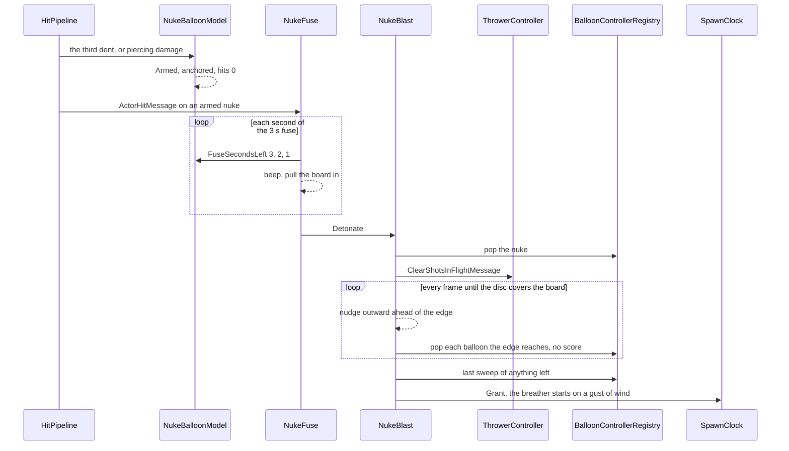

@page plan_nuke_balloon Nuke Balloon

# Nuke Balloon

> A fourth reward balloon: a **nuke**. It is plated in dull lead and bolted together, with a riveted danger
> placard on its face, a small LED counter and a status lamp that flares green. Shots bounce off it and dent
> it. The third dent, or any piercing damage, **arms** it. The lamp turns red, the counter runs down from 3
> with a beep each second, and the board leans in towards it. At zero it goes off. A blinding light floods the
> board behind a growing shock disc that pops every balloon and every shot in flight. A mushroom cloud rises
> where it stood. Then the spawn clock gives the breather a big clear earns, on a gust of wind. It is rare,
> and it comes when the player is in trouble: a full board, a fast clock, few hearts, or hearts lost one
> after another.

---

## Goals

1. **A rescue, placed by `RewardBalloonService`** and never by a level's mix, like the golden balloon, the
   heart balloon and the disco ball (`Plans/PLAN-RewardBalloons.md`, `Plans/PLAN-DiscoBalloon.md`). At most
   one on the board.
2. **Its odds follow trouble.** A tiny chance on any line, raised by four signals: the board's fill, the
   spawn clock's pressure, low hearts, and hearts lost in quick succession.
3. **It is heavy.** The shot's ordinary hit bounces off and dents it. The third dent arms it, and so does any
   `Piercing` damage at once (a pierce, a bomb's blast beside it, a laser beam).
4. **Armed, it counts down.** It stays where it is for a 3 s fuse. Its lamp turns red and its LED counts
   3, 2, 1 with a beep on each, while the balloons around it lean slowly in.
5. **At zero it clears the board.** Every balloon but the other rewards pops, scoring nothing, and every
   shot in flight dies. Then the spawn clock starts the breather a big clear earns.
6. **The spectacle.** The disco wave's growing disc, with light that blinds the board as it spreads. The
   disturbance field's strongest push. A nudge outward running just ahead of the disc. A mushroom cloud
   rising where the nuke stood. The owner flagged the cloud as the hard part.
7. **The bar the other rewards set.** Depth (the plated sphere's relief, a baked ground shadow), the scene
   light (lit by the time of day, like the golden balloon), and its own sounds.

## Decisions

These were open in the brief. Each is decided here, and each can be changed.

| Question | Decision | Why |
|---|---|---|
| Does it take hits like the golden balloon? | **Like the golden balloon, plus dents.** Piercing damage or a beam arms it at once. The shot's ordinary hit bounces off it and costs one of its hits (the catalogue entry's hit count, 3). The last one arms it | The nuke is a rescue. The player who needs it is losing, and that player rarely has a pierce. The measured disco ball shows this: the average bot left half of its balls unpopped because only a pierce breaks one. Dents keep the lead feel (shots bounce off) and give every player a way in. The tough balloon's crack overlay shows the dents for free |
| What does an armed nuke do when hit? | **It deflects every ball**, piercing or not, and takes no more damage. Item damage does nothing | It is a lead casing with a fuse running: nothing more can happen to it. A deflect bounces a piercing ball and keeps its pierce, so a pierce isn't wasted on it. It never absorbs, which would kill the ball |
| Does it move while armed? | **No.** It is anchored (`IBalanceAnchor`): the balancer, the wave-start roam and pressure shoves leave it in its slot | The counter has to be read where it is, and the blast's centre should not drift |
| What does "the whole board" clear? | **Every balloon except the other reward balloons.** Tough, tougher and unbreakable balloons, formations and bubble clusters all pop. A golden balloon, heart balloon or disco ball stays where it is. Grid actors (bushes, gatekeepers, deflectors, absorbers) stay | A reward the player hasn't collected yet shouldn't be destroyed by another reward. Grid actors are the level's terrain, not its threat |
| Do the cleared balloons score? | **No.** No score, no goal progress, no streak. Items on cleared balloons don't fire | The nuke buys time. It doesn't advance the level. Scoring a whole board would complete most of a level's goals, which is the disco ball's job. Firing every item on the board at once would be a second, uncontrolled blast |
| Which shots die? | **Every shot in flight**, through its normal death (pierce discharge, death sound). The ball waiting in the cannon is kept | "It will also clear any projectiles". The loaded ball is the player's next turn, not something on the board. The existing `ForceDestroyProjectileMessage` kills the loaded ball when none is in flight, so the nuke gets its own message that spares it |
| Order on a line | **The nuke first**, then the golden balloon, the disco ball and the heart | It is the rarest, and the most urgent |
| Party Favors (`IWeaponStats.RewardBalloonOdds`) | **Does not raise the nuke's chance** | The card is a reward for a build. The nuke follows trouble, and a strong build is rarely in trouble. If the card raised it, the nuke would come to the players who need it least |
| What stops a fuse? | **A level change, a game over or a run reset**, with no blast and no breather. A pause holds it: it runs on scaled time | The same rule as the blast. A level the shot completes during the fuse ends as any level does, and the level-up takes the board |

## How it fits

Almost everything has a precedent in the disco ball. The new pieces are the model, the odds, the fuse, the
blast, the breather grant, the cloud and the nuke's sound router.

| Piece | Where | What |
|---|---|---|
| `BalloonType.Nuke` | `Balloon/Type/BalloonType.cs` | Appended after `Disco`. The names are a telemetry wire contract, so the enum is append-only |
| `IsReward()` | `Shared/Extensions/BalloonTypeExtensions.cs` | Covers `Nuke`, so a level's pick list skips it |
| `NukeBalloonModel` | `Balloon/Model/` | A `PlatedBalloonModel` that is also `IHasDurability` and `IBalanceAnchor`. A `DirectHit` costs one hit and deflects. The last one, or `Piercing` or `Beam` damage, arms it: `Armed` turns true, its hits drop to 0, and from then on every `DirectHit` deflects and nothing else does anything. It also holds the fuse's display state, `FuseSecondsLeft`, which `NukeFuse` sets |
| `BalloonModelFactory` | `Balloon/Model/` | Maps `Nuke` |
| `GetImpactColorId` heavy list | `Shared/Extensions/BalloonModelExtensions.cs` | Adds `Nuke`, so its impact sparks are the heavy ones |
| `NukeOdds` | `Balloon/Reward/` | The nuke's chance on a line, from the four signals (*When it comes*). Plain C#, `IStartable` and `IRunResettable`. It hears `WaveDamageMessage` for the hearts lost |
| `NukeSchedule` in `RewardBalloonService` | `Balloon/Reward/` | Rolls the nuke first on each line, through `NukeOdds`. Tracks the one on the board through the leave callback, as for the others |
| `INukeOddsSettings`, `INukeBlastSettings` | `Configuration/Balloons/`, on `IBalloonsConfiguration` (`NukeOdds`, `NukeBlast`) | The nuke's numbers |
| `NukeFuse` (new) | `Balloon/Reward/` | Plain C#, `ITickable`, `IRunResettable`. Hears the hit that arms a nuke (any `ActorHitMessage` on a `NukeBalloonModel` that is now `Armed`). Counts its fuse down on scaled time, sets `FuseSecondsLeft`, publishes `NukeCountdownMessage` each second, and pulls the board in (*The fuse*). At zero it hands the nuke to `NukeBlast.Detonate` |
| `NukeBlast` | `Balloon/Reward/` | The detonation: pops the nuke, kills the shots in flight, then grows the disc that pops each balloon its edge reaches. A nudge runs ahead of the edge. Then a last sweep, then the breather. Plain C#, `ITickable`, `IRunResettable` |
| `IBalloonPopper` | `Balloon/Controller/` | `BalloonControllerRegistry.TryPopSingle`: a scoreless pop with its VFX, the path the game-over pop wave uses |
| `IBreatherGrant`, on `SpawnClock` | `Balloon/Spawner/` | `Grant()`: starts the breather now, whatever the cooldown |
| `BoardDisc` | `Balloon/Reward/` | The disc's shape and sweep, shared with `DiscoWave` |
| Messages (new) | `Shared/Messages/` | `NukeArmedMessage`, `NukeCountdownMessage` (seconds left), `NukeDetonatedMessage`, `NukeBreatherMessage`, all with the nuke's position. `ClearShotsInFlightMessage`, which `ThrowerController` answers by killing every shot in flight and sparing the loaded one |
| `NukeFuseView` (new) | `Balloon/Type/`, on the Nuke prefab | An `IBalloonViewBinding`. It pushes `Armed` and `FuseSecondsLeft` to the body's material (the LED digit and the lamp) and switches the rays behind it from green to red |
| `NukeBlastView`, `NukeCloudView` (new), `GrowingDiscView` | `Balloon/View/` | The disc (as `DiscoWaveView` draws the disco wave), the blinding light that follows it, and the mushroom cloud |
| `NukeSoundRouter` (new) | `Audio/Routing/` | Plays the armed alarm, the countdown beeps, the boom and the breather's wind from the messages above, as `DiscoSoundRouter` plays the disco wave |
| Solver | `Solver/` | `ShotBalloonSnapshot.ForNukeTarget` carries the hits left. The hit that arms a nuke deflects the shot and counts as `NukePops`, which is ranked. The clear comes 3 s later, after the simulated flight, so the solver does not clear the board |
| Spawn-balloon cheat, playtest bot | `Cheats/`, `Tools/playtest/` | The cheat can place a nuke. The bot counts nukes placed, and can turn them off (`--no-nuke`) for an A/B |

## When it comes

Through `RewardBalloonService`, rolled on each clock line while the level is played, and only for a type
the catalogue has an entry for. The numbers are `INukeOddsSettings`.

**The gates.**

- From `FromLevel` (4) on. Early levels rarely put a player in trouble, and the first sight of a nuke should
  come after the player has learned the board.
- Not while a nuke is on the board.
- At most `PerLevel` (1) a level.
- After one is placed, `CooldownLines` (150) lines pass before the next roll. Lines come every 2 s on the
  first level and every 0.55 s late in a run, so that is about two to five minutes.
- A won roll stays owed until placed, as for the other rewards. A new level drops it.
- Level `SureLevel` (10) always brings one, `SureAfterLines` (10) lines in so the board has filled: past the
  odds and the cooldown, so every run that gets that far sees a nuke. Not if one is already on the board, or
  the level has already had its `PerLevel`. 0 turns it off.

**The chance.** Each line rolls

`chance = BaseChance + (MaxChance - BaseChance) × urgency`

where `urgency` is the weighted sum of four signals, each 0 to 1, capped at 1:

| Signal | Reads | 0 at | 1 at | Weight |
|---|---|---|---|---|
| Fill | `IBoardFill.Occupancy` | `FillFrom` (0.7) | `FillFull` (0.95) | `FillWeight` (0.5) |
| Spawn rate | `ISpawnClock.Pressure` | no pressure | the clock at `PressureSpeedup` | `PressureWeight` (0.25) |
| Hearts | `PlayerNeed.HeartsNeed` | full hearts | the last heart | `HeartsWeight` (0.5) |
| Hearts lost in succession | the recent losses (below) | none | `LossesForFull` (2) | `LossWeight` (0.5) |

- **Recent losses.** Each `WaveDamageMessage` adds its `HeartsLost`. Each clock line keeps
  `LossKeptPerLine` (0.75) of the sum. One heart lost reads 0.5, fading over the next lines; two lost on
  lines close together read near 1. A run reset clears it.
- **The numbers.** `BaseChance` 0.0005 and `MaxChance` 0.04 per line. Out of trouble, a nuke comes about
  once in 2,000 lines, about an hour of play. A board 90% full on the last heart (urgency 1) rolls 4% a
  line, about one in 25 lines. Any two strong signals saturate it. These are starting values for the bot to
  measure.
- The pressure signal is the odd one: pressure builds only while the player is comfortable and the board is
  low. It is there because the owner asked for "high spawning rates", and its weight keeps it a nudge.

**Where it lands.** The reward goes to the front of its line (`BalloonSpawner.MoveRewardToFront`), so it
lands as long as any column takes a balloon. An almost-full board still takes it. A full board passes it
on, owed, to the next line with room.

## Arming it

- **The shot's ordinary hit** deflects and costs one of its hits: `BalloonDeflectedMessage`, the deflect
  nudge and stamp, and the tough balloon's cracks (the prefab keeps `ToughBalloonVariant`, which draws them
  for any balloon with durability, and the body shader dents a plate for each). The last hit arms it, and
  that shot bounces off as from any dent.
- **A piercing shot** plows it while it has more than one hit left and arms it at the shot's next wall, as
  the golden balloon pops there. With one hit left the pierce arms it on contact and bounces off, keeping
  its pierce.
- **A laser beam** (`DamageFlags.Beam`) and **a bomb's blast** beside it (`Piercing`) arm it at once.
- **Lightning and paint** do nothing (`HitOutcome.None`), as on the golden balloon.
- **A board clear or a level change** takes it away unarmed. Only arming starts the fuse.

Armed, it deflects every ball for the rest of the fuse. A ball can ricochet off it, so the deflect chain
counts those bounces (`DeflectChainController`). That is three seconds at most, and the shot dies at zero,
so it stays as it is.

## The fuse

`NukeFuseSettings.Seconds` (3). It starts on the hit that arms the nuke and runs on scaled time.

- **The counter.** `FuseSecondsLeft` reads 3 at arming, then 2, then 1. Each change publishes
  `NukeCountdownMessage`, and each one beeps (*Sound*). The LED on the body shows the digit (*The look*).
- **The lamp.** Unarmed, it pulses green, and the rays behind the nuke flare green with it. Armed, both turn
  red, and the lamp blinks once a second with the beep.
- **The pull.** Twice a second, every balloon within `PullRadius` (4 world units) of the nuke gets a
  single-actor nudge towards it (`NudgeType.Wave`, a negative distance). The nudge grows from
  `PullDistanceStart` (0.04) to `PullDistanceEnd` (0.16) over the fuse, so the board seems to lean in
  harder as the count runs down. A disturbance-field implosion stamp at the nuke (negative strength, as the
  bomb's first stamp) pulls the clouds, grass and specks in with it.
- **The end.** At zero, `NukeBlast.Detonate(nuke)`.

## The blast

`NukeBlast.Detonate` at the nuke's position:

1. **The nuke pops** through `IBalloonPopper` (its pop VFX, its slot freed, its leave callback run), and
   `NukeDetonatedMessage` goes out for the boom.
2. **The shots in flight die.** `ClearShotsInFlightMessage` makes `ThrowerController` kill every shot in flight
   through its normal death path. The loaded ball is kept.
3. **The push.** The disturbance field's strongest stamp at the nuke: a radius as wide as the board,
   `PushStrength` above the bomb's, ramped over the disc's time, so clouds and grass blow out across the
   whole scene.
4. **The disc.** `NukeBlast` grows a disc from there, as the disco wave does, in `Seconds` (1.0 s), fast
   first and slowing at the far edge. A balloon within `NudgeLead` (1.2) of the edge is nudged outward once
   (`NudgeType.Wave`), so the board flinches before the edge arrives. Each balloon the edge reaches:
   - pops through `IBalloonPopper`: its pop VFX play, its slot is freed, its leave callback runs, and no
     `ActorHitMessage` goes out. So nothing scores, no streak moves, and no item fires;
   - unless it is a reward balloon. Those were nudged ahead of the edge with the rest, and stay.
5. **The light.** A scene light registered at the nuke, its radius following the disc and its intensity
   rising to `LightIntensity` (the field's ceiling) and falling over `LightSeconds`. The disc's own inside
   burns white past the HDR bloom threshold, so the board goes blinding white as the disc spreads, then
   clears.
6. **The cloud.** `NukeCloudView` starts the mushroom cloud at the nuke's position (*The look*).
7. **The end.** When the time is up, a last sweep pops every balloon still on the board, so a line that
   landed during the blast is cleared too. Then `IBreatherGrant.Grant()`, and `NukeBreatherMessage` for the
   wind.

A level change, a run reset or a game over stops the blast where it is, without the breather. A pause holds
it: it runs on scaled time. A second nuke can't be on the board while one blast runs, but if a cheat places
one, the first blast finishes at once.

**The breather.** The same breather a big clear earns: the clock drops to `BreatherPace` (0.2) and eases back
over `BreatherSeconds` (11 s), then the cooldown (14 s) holds before another. A big clear would often start
it anyway, from the fall in occupancy, but not inside the cooldown of an earlier one. The grant starts it
whatever the cooldown. The sparse board's speedup still applies, so an empty board refills sooner than a full
one even in the breather. That is the existing rule for any big clear.

## The look

**The body: `Balloon/NukeBalloon.shader`**, a fork of `GoldenBalloon.shader` on a prefab built from the
golden balloon's. It keeps the golden balloon's depth and light: the sphere projection, the relief of
bevelled, tilted plates, the sky and floor reflection, and the scene light (`Include/SceneLight.cginc`). So
it is dull at noon and near black at night, with its rim still catching the light. Its ground shadow is the
prefab's baked shadow child, as the golden balloon's is.

- **Lead plating.** The golden balloon's hexagonal plates, bolted at the corners over a dark rubber skin,
  in dull lead: a broad, weak sheen and no glitter.
- **Dents.** Each dent sinks a growing share of the plates (`_DamageProgress`, which the prefab's
  `ToughBalloonVariant` pushes): a dented plate tips the other way and darkens.
- **The danger placard.** A round steel plate riveted to the face: a black radiation trefoil on yellow,
  inside a black ring, held by three rivets between the blades. It takes the sphere's light, a soft sheen
  and some wear.
- **The LED counter.** A small dark display below the placard with one red seven-segment digit, glowing
  past white so it blooms. Unarmed it shows a green heart. Armed it shows the seconds left, bright red.
- **The lamp.** A small domed lamp above the placard. Unarmed it pulses green. Armed it is red and blinks
  with each beep. Both are drawn by the body shader from `_FuseArmed` and `_FuseDigit`, which
  `NukeFuseView` pushes, and both shine `_FuseGlow` (3) times past white.
- **The seam light.** A thin line of light down the gaps between the plates, with a soft glow either side:
  HDR green while it waits, dim red once armed, flaring bright red on each count (`_FuseBeat`).
- The LED, the lamp and the seam light are the only parts of a balloon that bloom: every other balloon
  colour is capped at white (Plans/PLAN-HDR), so the shader adds them after the cap.
- **The flare.** God rays behind it (`GodRaysLook`, `NukeRays`), spinning like the other reward balloons'. One
  fan is green (palette `NukeRays`) and the other yellow (the material's second fan colour) while it waits; once
  armed the green fan turns red (palette `NukeArmedRays`).

**The blast: `Sprite/NukeBlast.shader`** on `NukeBlastView`: a quad sized to the disc each frame. A white
inside that floods the board and fades as the disc slows. A white-hot core at the nuke. A ragged orange
shock ring at the edge, and a scorch behind it, fading out at the end.

**The mushroom cloud: `Sprite/NukeCloud.shader`** on `NukeCloudView`, one square quad centred on the nuke
(`CloudReach`), over `CloudSeconds` (5 s). The game is seen from above, so the cloud is too: no stem, the
cap seen from over it. It is made of shapes, not a texture:

- the cap, a dome swelling over the blast, its edge broken into billows by the tileable noise, which flows
  outward from the middle as the top of the cloud rolls over its rim;
- its shadow, cast on the board away from the scene light;
- a ring of dust thrown along the ground, racing out past the cap and thinning.

The dome is lit from the scene light's side, and so is each lump of smoke on it. At first the cap is fire,
white-hot in the middle and orange at the edge (HDR, so it blooms), cooling to smoke. The smoke takes the
scene light, so night leaves it dark. It is smoke, not a solid: only the thickest heaps hide the board, the
thin edges and the folds let it show through, and light glows through the thin parts. Over its last stretch it
thins, spreads a little and erodes away through the noise, edges first, until nothing is left.

**Its pop.** The nuke's own pop at detonation uses the golden balloon's shatter for now. A `nuke_parts`
sheet cut from a capture of the balloon by `Tools/art/shatter` is a later polish.

**Sound.** All layered from clips already in the sound bank, as the other rewards' cues are.

| Cue | When | What |
|---|---|---|
| `BalloonDeflectNuke` | each dent | a dull metal clank, a semitone lower on each dent |
| `NukeArmed` | armed | a hard metallic click with a low alarm under it |
| `NukeCountdownBeep` | 3, 2, 1 | a short electronic beep, a step higher on each count |
| `BalloonPopNuke` | zero | a deep boom with a rolling tam-tam over it |
| `NukeBreatherWind` | the breather | a long gust of wind swelling in and fading |

## Open questions

1. **Dents or plated?** Decided as dents (3 hits). If the owner wants the golden balloon's rule exactly, set
   the catalogue entry's hit count very high, or make `NukeBalloonModel` deflect forever. The bot measures
   how often the nuke is armed either way.
2. **Should the cleared balloons count toward the goals?** Decided no. With yes, the nuke would end most
   levels on the spot.
3. **Items on cleared balloons.** Decided they vanish with their balloon. The alternative fires them, which
   is spectacular and chaotic.
4. **The wind on every breather?** Decided only on the nuke's, the moment the owner described. Any breather
   could have it.

## Phases

Each phase follows the per-phase review: implement, then review, curate and quick fixes, then the owner's
sign-off.

1. **Model and hit rule.** *Done.* `BalloonType.Nuke`, `IsReward`, the factory, `NukeBalloonModel`, the
   heavy impact colour, the solver snapshot.
2. **Spawning.** *Done.* The settings, `NukeOdds`, `NukeSchedule` and the service's order, the catalogue
   entry, the cheat, the bot's counts and `--no-nuke`.
3. **The blast and the breather.** *Done*, as an instant blast on the pop: `NukeBlast`, `IBreatherGrant`,
   `IBalloonPopper`, `BoardDisc`.
4. **The look.** *Done* for the body, the placard, the dents, the rays and the blast disc. Both shaders
   compile for Vulkan, GLES3, Metal and D3D.
5. **Sound.** *Done* for the clank and the boom.
6. **The fuse.** *Done.* Arming in the model (`Armed`, the deflect-only rule, `IBalanceAnchor`), `NukeFuse`, the
   messages, `NukeFuseView`, the LED and the lamp in the body shader, the green-to-red rays, the pull, the
   armed alarm and the beeps. The solver: arming deflects and counts, with no instant clear. Tests: each
   arming path, an armed nuke deflects every ball and takes no damage, it stays anchored, the count and its
   messages, a stop on level change, game over and reset.
7. **The detonation.** *Done.* `Detonate`, `ClearShotsInFlightMessage`, the push, the nudge ahead of the edge, the
   blinding light, the white disc, the breather's wind. Tests: the shots in flight die and the loaded one
   stays, the nudge comes before the pop, the light follows the disc and is released.
8. **The mushroom cloud.** *Done, as seen from above:* `NukeCloud.shader`, `NukeCloudView` and the `NukeCloud`
   material, first drawn side-on and redrawn top-down after the owner saw it. Recorded on a full board in the
   Editor at noon, with the nuke in the middle and in a corner; still to judge at night.
9. **Docs and measuring.** The READMEs. The playtest bot on several seeds with and without nukes
   (`--no-nuke`): how often one is placed, how often armed, hearts lost per level and game overs, and the
   level times.
