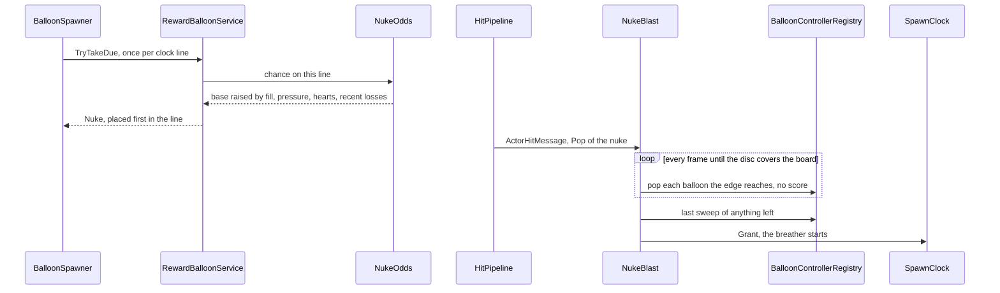

@page plan_nuke_balloon Nuke Balloon

# Nuke Balloon

> A fourth reward balloon: a **nuke**. It is plated in dull lead, bolted together, with a yellow radiation
> mark on its face and a red warning glow behind it. Shots bounce off it and dent it. The third dent, or any
> piercing damage, sets it off: a blast grows from it and pops every balloon on the board, and the spawn
> clock gives the breather a big clear earns. It is rare, and it comes when the player is in trouble: a full
> board, a fast clock, few hearts, or hearts lost one after another.

---

## Goals

1. **A rescue, placed by `RewardBalloonService`** and never by a level's mix, like the golden balloon, the
   heart balloon and the disco ball (`Plans/PLAN-RewardBalloons.md`, `Plans/PLAN-DiscoBalloon.md`). At most
   one on the board.
2. **Its odds follow trouble.** A tiny chance on any line, raised by four signals: the board's fill, the
   spawn clock's pressure, low hearts, and hearts lost in quick succession.
3. **It is heavy.** The shot's ordinary hit bounces off and dents it. It goes off on the third dent, or at
   once to any `Piercing` damage (a pierce, a bomb's blast beside it, a laser beam).
4. **Its pop clears the board.** A blast grows from it and pops every balloon it reaches, scoring nothing.
   When the blast ends, the spawn clock starts the breather a big clear earns.
5. **The look:** lead and gunmetal plating, rivets and bolts, a radiation trefoil, a slow red warning glow.
   It must read as heavy and dangerous next to the golden balloon's shine and the disco ball's mirrors.

## Decisions

These were open in the brief. Each is decided here, and each can be changed.

| Question | Decision | Why |
|---|---|---|
| Does it take hits like the golden balloon? | **Like the golden balloon, plus dents.** Piercing damage or a beam sets it off at once. The shot's ordinary hit bounces off it and costs one of its hits (the catalogue entry's hit count, 3). The last ordinary hit sets it off | The nuke is a rescue. The player who needs it is losing, and that player rarely has a pierce. The measured disco ball shows this: the average bot left half of its balls unpopped because only a pierce breaks one. Dents keep the lead feel (shots bounce off) and give every player a way in. The tough balloon's crack overlay shows the dents for free |
| What does "the whole board" clear? | **Every balloon except the other reward balloons.** Tough, tougher and unbreakable balloons, formations and bubble clusters all pop. A golden balloon, heart balloon or disco ball stays where it is. Grid actors (bushes, gatekeepers, deflectors, absorbers) stay | A reward the player hasn't collected yet shouldn't be destroyed by another reward. Grid actors are the level's terrain, not its threat |
| Do the cleared balloons score? | **No.** No score, no goal progress, no streak. Items on cleared balloons don't fire | The nuke buys time. It doesn't advance the level. Scoring a whole board would complete most of a level's goals, which is the disco ball's job. Firing every item on the board at once would be a second, uncontrolled blast |
| Order on a line | **The nuke first**, then the golden balloon, the disco ball and the heart | It is the rarest, and the most urgent |
| Party Favors (`IWeaponStats.RewardBalloonOdds`, still on another branch) | **Does not raise the nuke's chance** | The card is a reward for a build. The nuke follows trouble, and a strong build is rarely in trouble. If the card raised it, the nuke would come to the players who need it least. Revisit when the card lands |

## How it fits

Almost everything has a precedent in the disco ball. New code: the model, the odds, the blast and the
breather grant.

| Piece | Where | What |
|---|---|---|
| `BalloonType.Nuke` | `Balloon/Type/BalloonType.cs` | Appended after `Disco`. The names are a telemetry wire contract, so the enum is append-only |
| `IsReward()` | `Shared/Extensions/BalloonTypeExtensions.cs` | Covers `Nuke`, so a level's pick list skips it |
| `NukeBalloonModel` (new) | `Balloon/Model/` | A `PlatedBalloonModel` that is also `IHasDurability`. Piercing or `Beam` pops it. A `DirectHit` costs one hit and deflects, and the last one pops. Plain item damage is `HitOutcome.None`. `PlatedBalloonModel.DeflectsOrdinaryHit` becomes virtual so the nuke can say `HitsRemaining > 1`, as the tough balloon does; `IsTough` then makes a pierce plow it |
| `BalloonModelFactory` | `Balloon/Model/` | Maps `Nuke`. Lands before the catalogue entry (the factory throws for an unmapped type after `Placed` has run) |
| `GetImpactColorId` heavy list | `Shared/Extensions/BalloonModelExtensions.cs` | Adds `Nuke`, so its impact sparks are the heavy ones |
| `NukeOdds` (new) | `Balloon/Reward/` | The nuke's chance on a line, from the four signals (*When it comes*). Plain C#, `IStartable` and `IRunResettable`. It hears `WaveDamageMessage` for the hearts lost |
| `RewardBalloonService` | `Balloon/Reward/` | Rolls the nuke first on each line, through `NukeOdds`. Tracks the one on the board through the leave callback, as for the others |
| `IRewardBalloonSettings` / `RewardBalloonSettings` | `Configuration/Balloons/` | The nuke's numbers (*When it comes*) |
| `NukeBlast` (new) | `Balloon/Reward/` | The pop: a disc that grows from the nuke and pops each balloon its edge reaches, then a last sweep, then the breather. Plain C#, `ITickable`, `IRunResettable`. Reads the pop through `RewardBalloonPop.TryGet`, as `DiscoWave` does, so a board clear or a level change never sets it off |
| `IBreatherGrant` (new), on `SpawnClock` | `Balloon/Spawner/` | `Grant()`: starts the breather now, whatever the cooldown. The breather itself is unchanged: `BreatherSeconds` at `BreatherPace`, easing back, then the cooldown |
| `NukeBlastView` (new) | `Balloon/View/` | Draws the blast: a quad sized to the disc each frame, as `DiscoWaveView` draws the disco wave |
| Solver | `Solver/` | `ShotBalloonSnapshot.ForNukeTarget` carries the hits left. A simulated nuke pop removes every balloon the blast would, scoring nothing. `NukePops` is counted and ranked |
| Sound | `Audio/` | `BalloonDeflectNuke` (a dull clank) and `BalloonPopNuke` (a deep boom), layered from clips in the sound bank |
| Spawn-balloon cheat, playtest bot | `Cheats/`, `Tools/playtest/` | The cheat can place a nuke. The bot counts nukes placed and popped, and can turn them off (`--no-nuke`) for an A/B |

## When it comes

Through `RewardBalloonService`, rolled on each clock line while the level is played, and only for a type
the catalogue has an entry for.

**The gates.**

- From `NukeFromLevel` (4) on. Early levels rarely put a player in trouble, and the first sight of a nuke
  should come after the player has learned the board.
- Not while a nuke is on the board.
- At most one a level (`NukePerLevel`, 1).
- After one is placed, `NukeCooldownLines` (150) lines pass before the next roll. Lines come every 2 s on
  the first level and every 0.55 s late in a run, so that is about two to five minutes.
- A won roll stays owed until placed, as for the other rewards. A new level drops it.

**The chance.** Each line rolls

`chance = NukeBaseChance + (NukeMaxChance - NukeBaseChance) × urgency`

where `urgency` is the weighted sum of four signals, each 0 to 1, capped at 1:

| Signal | Reads | 0 at | 1 at | Weight |
|---|---|---|---|---|
| Fill | `IBoardFill.Occupancy` | `NukeFillFrom` (0.7) | `NukeFillFull` (0.95) | `NukeFillWeight` (0.5) |
| Spawn rate | `ISpawnClock.Pressure` | no pressure | the clock at `PressureSpeedup` | `NukePressureWeight` (0.25) |
| Hearts | `PlayerNeed.HeartsNeed` | full hearts | the last heart | `NukeHeartsWeight` (0.5) |
| Hearts lost in succession | the recent losses (below) | none | `NukeLossesForFull` (2) | `NukeLossWeight` (0.5) |

- **Recent losses.** Each `WaveDamageMessage` adds its `HeartsLost`. Each clock line keeps
  `NukeLossKeptPerLine` (0.75) of the sum. One heart lost reads 0.5, fading over the next lines; two lost
  on lines close together read near 1. A run reset clears it.
- **The numbers.** `NukeBaseChance` 0.0005 and `NukeMaxChance` 0.04 per line. Out of trouble, a nuke comes
  about once in 2,000 lines, about an hour of play. A board 90% full on the last heart (urgency 1) rolls
  4% a line, about one in 25 lines. Any two strong signals saturate it. These are starting values for the
  bot to measure (*Phases*, 6).
- The pressure signal is the odd one: pressure builds only while the player is comfortable and the board is
  low. It is there because the owner asked for "high spawning rates", and its weight keeps it a nudge.

**Where it lands.** The reward goes to the front of its line (`BalloonSpawner.MoveRewardToFront`), so it
lands as long as any column takes a balloon. An almost-full board still takes it. A full board passes it
on, owed, to the next line with room.

## Breaking it

- **The shot's ordinary hit** deflects and costs one of its hits: `BalloonDeflectedMessage`, the deflect
  nudge and stamp, and the tough balloon's cracks (the prefab keeps `ToughBalloonVariant`, which draws them
  for any balloon with durability). The last hit sets it off.
- **A piercing shot** plows it while it has more than one hit left, and it goes off at the shot's next wall,
  as the golden balloon does. With one hit left the pierce pops it on contact.
- **A laser beam** (`DamageFlags.Beam`) and **a bomb's blast** beside it (`Piercing`) set it off at once.
- **Lightning and paint** do nothing (`HitOutcome.None`), as on the golden balloon.
- **A board clear or a level change** takes it away with no blast: only a pop sets it off.

## The blast

When the nuke pops, `NukeBlast` grows a disc from where it was, as the disco wave does, in
`NukeBlastSettings.Seconds` (0.6 s), fast first and slowing at the far edge. Each balloon the edge reaches:

- pops through `BalloonControllerRegistry.TryPopSingle`, the path the game-over pop wave uses: its pop VFX
  play, its slot is freed, its leave callback runs, and no `ActorHitMessage` goes out. So nothing scores,
  no streak moves, and no item fires;
- unless it is a reward balloon. Those are nudged away from the blast (`NudgeType.Wave`) and stay.

Grid actors that can be nudged are nudged. When the time is up, a last sweep pops every balloon still on the
board, so a line that landed during the blast is cleared too. Then the blast calls `IBreatherGrant.Grant()`.

A level change, a run reset or a game over stops the blast where it is, without the breather. A pause holds
it: it runs on scaled time. A second nuke can't be on the board while one blast runs, but if a cheat places
one, the first blast finishes at once.

**The breather.** The same breather a big clear earns: the clock drops to `BreatherPace` (0.2) and eases back
over `BreatherSeconds` (11 s), then the cooldown (14 s) holds before another. A big clear would often start
it anyway, from the fall in occupancy, but not inside the cooldown of an earlier one. The grant starts it
whatever the cooldown. The sparse board's speedup still applies, so an empty board refills sooner than a full
one even in the breather. That is the existing rule for any big clear.

## The look

**The body: `Balloon/NukeBalloon.shader`**, built from `GoldenBalloon.shader`'s structure: the sphere
projection, the scene light (`Include/SceneLight.cginc`), and the knot, on a prefab built from the golden
balloon's.

- **Lead plating.** A dark grey-blue gunmetal albedo with a broad, weak specular (rough metal, not a mirror),
  and a faint noise for wear. It takes the scene light like the golden balloon, so it is dull at noon and
  near black at night, with its rim still catching the light.
- **Seams and bolts.** Two plate seams: a band around the equator and one meridian down the face. Small
  hemispherical bolt heads sit along both seams, each shaded as a little dome under the scene light, so they
  catch highlights as the balloon sways.
- **The danger mark.** A radiation trefoil on the face: three black blades around a black hub, on a yellow
  disc with a black ring. It is painted on the plating, so it takes the same light and the same wear.
- **The warning glow.** God rays behind it (`GodRaysLook` on a `NukeRays` material and palette entry): few,
  wide, red, and slow, breathing in and out, so it reads as a warning light, not as a reward's shine.

**The blast: `Sprite/NukeBlast.shader`** on `NukeBlastView`: a quad sized to the disc each frame, with a
white-hot core that fades fast, an orange shock ring at the edge, and smoke-dark falloff behind it, fading
out at the end. A `SceneLightFieldService.Flash` at the pop lights the board for a beat.

**Its pop.** The nuke shatters into lead plates: `PSVFX_NukePop`, the golden balloon's shatter drawing a
`nuke_parts` sheet cut from a capture of the balloon by `Tools/art/shatter`, lit through `Particle/SceneLit`.

**Sound.** `BalloonDeflectNuke`, a dull metal clank, lower on each dent. `BalloonPopNuke`, a deep boom with
the board-clear cue over it. Layered from clips already in the sound bank, as the other rewards' cues are.

## Open questions

1. **Dents or plated?** Decided as dents (3 hits). If the owner wants the golden balloon's rule exactly, set
   the catalogue entry's hit count very high, or make `NukeBalloonModel` deflect forever. The bot measures
   how often the nuke is popped either way.
2. **Should the cleared balloons count toward the goals?** Decided no. With yes, the nuke would end most
   levels on the spot.
3. **Items on cleared balloons.** Decided they vanish with their balloon. The alternative fires them, which
   is spectacular and chaotic.
4. **Party Favors.** Decided it leaves the nuke alone. Revisit when the card lands.

## Phases

Each phase follows the per-phase review: implement, then review, curate and quick fixes, then the owner's
sign-off.

1. **Model and hit rule.** `BalloonType.Nuke`, `IsReward`, the factory, `NukeBalloonModel`, the heavy
   impact colour, the solver snapshot (`ForNukeTarget`, hits left, `ShotRewardKind.Nuke`, `NukePops`,
   ranked after a heart that counts and before the disco ball). Tests for every hit path: shot, last dent,
   pierce, beam, bomb, lightning, paint.
2. **Spawning.** The settings, `NukeOdds`, the service's nuke rules and order, the catalogue entry, a
   placeholder prefab (the golden balloon's with a grey body), the prewarm, the cheat, the bot's counts and
   `--no-nuke`. Tests for each signal, the gates, the cooldown, the owed line, and the order.
3. **The blast and the breather.** `NukeBlast`, `IBreatherGrant`, a placeholder view, cancellation, and the
   solver's clear. Tests: every balloon but the rewards is gone, nothing scores, the last sweep, the cancel,
   the breather starts inside a cooldown.
4. **The look.** `NukeBalloon.shader`, the prefab, `NukeRays`, `NukeBlast.shader`, the shatter. Shaders
   need the Editor: `dotnet build` doesn't compile them. Checked with `Tools/stage/stage.py` at noon and at
   night beside a golden balloon and a disco ball.
5. **Sound.** The two cues, layered in `SoundBankConfiguration`.
6. **Docs and measuring.** The Reward README. The playtest bot on several seeds with and without nukes
   (`--no-nuke`): how often one is placed, how often popped, hearts lost per level and game overs, and the
   level times.
