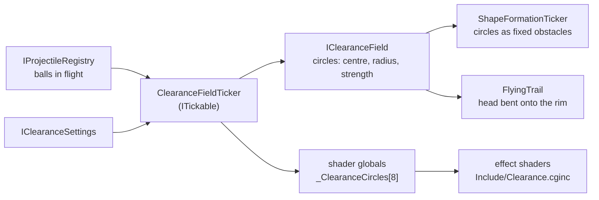

@page plan_pen_clearance Pen Clearance

# Pen Clearance

> Every ball in flight carries a constant clear circle. Score shapes slide around it, score trails bend
> round its rim, and the effects that draw over the ball (puff clouds, laser, lightning, the bomb burst,
> paint blobs) thin out inside it, so the player can always see what their ball is doing, however busy
> the board gets.
>
> **No changes until this plan is actioned.**

---

## Goals

The owner's idea, in their words: *"for the view to be able to visibilise what is happening with each pen,
we have circle packing already, having a constant sphere around each pen could make other circle orbit around
it so this part of screen stays easier to see, trails could avoid this area as a side effect as well, while
other effects could be smooth blended with alpha so they don't fully cover what is happening around the pen,
things like lighting, smoke from bombs, paint, etc."*

1. **A clearance circle per ball.** Each ball in flight carries a circle of one fixed world radius. It is the
   one shared fact every consumer below reads; none of them looks at the balls itself.
2. **Score shapes orbit it.** The BigScore formations already push apart from each other
   (`FormationOverlapResolver`). The circles join that packing as fixed obstacles, so a shape that blooms on
   the ball, or that a ball flies into, slides aside and around instead of sitting over it.
3. **Trails bend round it.** A score trail whose head enters a circle is carried along its rim, so the
   ribbon it leaves curves round the ball instead of crossing it.
4. **Effects thin out inside it.** Every effect that draws over the ball fades towards a floor alpha inside
   the circle, with a smooth edge. It stays visible, so nothing the player needs to know disappears, but it
   no longer buries the ball.

Non-goals: no change to gameplay, hits, or what any effect does. Nothing here changes a balloon's own
colour or paint state: only effects drawn over the board fade.

## What a "pen" is

A **pen is a ball in flight** (confirmed by the owner, 2026-11-15): the *Extra Pen* card is "+1 pen in
flight" (it raises `IWeaponStats.MaxBallsInFlight`), and *Thick Skin* is "+1 shield on every pen". The word
also names two drawing tools in the code, the trail heads that trace score shapes (`ShapeFormationTicker`)
and item range figures (`Item/Preview/`); this plan calls those *formation pens* and *range pens* where it
must name them.

The ball held in the thrower gets no circle: it sits below the board, where nothing draws over it.

## What can cover a ball

The game draws with the URP 2D renderer, by sorting layer, bottom to top: **Default < Balloons <
Projectile < PowerUps < GridActors < ScoreTrail < Sky < UI**. The ball is on **Projectile**, so only what
draws on PowerUps or above can cover it. That settles which effects matter:

| Effect | Layer | Covers the ball? | Size |
|---|---|---|---|
| Puff clouds (`Grid/PuffCloud.shader`) | GridActors | **Yes**, and the ball flies through them | Several slots |
| Laser (`Particle/Glow.shader`, `Sprite/SpriteShine.shader`) | PowerUps | **Yes** | A board-wide cross up to 3 units thick |
| Lightning (`Particle/Glow.shader` on LineRenderers) | PowerUps | **Yes** | Thin bolts across the board |
| Bomb burst (`PSVFX_BombRange`, built-in particle shader) | PowerUps | **Yes** | 2.5 to 4 units across |
| Paint blobs (`Paint/PaintBlob.shader`) and splash particles (built-in) | PowerUps | **Yes** | Local |
| Score trails and formation ink (TrailRenderer, built-in shader) | ScoreTrail | **Yes** | Thin streaks; formations up to board-wide |
| Bushes (`Grid/BushLeaf.shader`, `Grid/BushBranch.shader`, drawn by `Graphics.DrawMesh`) | none set | **Unknown**: check in the Frame Debugger | Several slots |
| Screen-space light overlay (`Display/ScreenSpaceLightOverlay.shader`) | Sky | Tints and darkens, never hides | Full screen |
| Smoke field, paper ink, god rays, the disco wave, paint drips, balloon pops, background | Default / Balloons | **No**, drawn under the ball | — |

So the **smoke field and paint drips can't bury the ball**: they draw under it (and under the balloons too).
What reads as "smoke from bombs" is the bomb's burst particles, `PSVFX_BombRange`, which are on PowerUps;
the bomb doesn't stamp the smoke field at all. "Paint" over the ball is the paint item's flying blobs and
splash particles. Those are what this plan fades.

Left alone:

- **The ball's own shield halo** (`Display/EMShieldField.shader`, Projectile layer). It belongs to a ball;
  another ball's circle would carve a hole in it.
- **Bloom** (post-processing) can spill a bright effect's glow over the ball. A per-shader mask can't reach
  it; fading the effect also fades its bloom, which is most of it.
- **UI text** (heads-ups, streak notices, the level-up popup): drawn by TextMesh Pro and UGUI, outside this
  approach, and short-lived.

## How it fits



### Clearance field

`Projectile/Clearance/` (new feature folder, with a README):

| Type | Layer | What it does |
|---|---|---|
| `IClearanceSettings` / `ClearanceSettings` | config SO | Radius, rim softness, fade in/out, effect floor alpha, formation push cap (table below) |
| `IClearanceField` | model (read-only) | `Count`, `CircleAt(i)` → centre (xy), radius, strength 0..1; `Deflect(Vector3)` for trails |
| `ClearanceField` | model | Fixed-capacity circle slots (8). Pure C#, no Unity objects, EditMode-tested |
| `ClearanceFieldTicker` | controller | `ITickable`, game scope: reads the registry's balls in flight each frame, writes the field, and pushes it into the shader globals (`Shader.SetGlobalVectorArray`), as `ShaderTimeService` and `SceneLightFieldService` push theirs |

**A circle's life.** A ball that launches gets a slot keyed by its `IProjectileModel`; its strength eases
from 0 to 1 over `FadeIn` (0.15 s), so a circle never pops in. While the ball flies, the circle follows it.
When the ball leaves the registry (it landed or retired), the circle stays where the ball was last seen and
eases to 0 over `FadeOut` (0.4 s): a ball's last pop is where most effects start, and a circle that
vanished on the frame the ball did would let them all close over that spot at once. The effective radius
is `Radius × strength`, so formations and trails also let go gently.

Eight slots: the cap is 3 balls, plus up to 3 Extra Pen cards, plus a couple still fading. When all eight
are busy, a new ball takes the weakest fading slot.

### Formations orbit the circle

`ShapeFormationTicker.ResolveOverlaps` already gathers every formation occupying space this tick and grows
each one's persistent `SeparationOffset` (see `Game/Score/README.md`, Overlap Resolution). After the
formation-against-formation pass, a second pure pass, `FormationOverlapResolver.ResolveAgainstFixed`, pushes
each moving formation out of every clearance circle:

- The circles never move for the packing (they follow the balls), so the formation takes the whole push.
- The push goes into the same `SeparationOffset`, so the existing relax brings the shape back onto its path
  to the bar once the ball has passed. That slide out and back is the "orbit".
- **The principal is pushed too.** Its `PrincipalPushDamping` steadies it against other formations,
  because the level-up camera follows it. A ball matters more, so the clearance pass gives every formation
  full weight. Once the level-up cinematic takes the principal it is `Paused`, and paused formations are
  never moved.
- The formation pass caps each frame's push at a share of the formation's radius. That is no use here: a
  shape still blooming from a point has almost no radius, and a ball at about 10 world units a second would
  cross a full-size shape before a radius-scaled push moved it. The clearance pass caps its push by a
  speed instead, `FormationPushSpeed` (world units a second, faster than a ball), so a shape slides out of
  the way smoothly at any frame rate, and one born on the ball slides off it while it blooms.

### Trails bend round the rim

The trails that fly a tween or follow path (`FlyingTrail.Setup`, `SetupBurst`, `SetupFollow`) set their
position absolutely each frame: DOTween writes `Lerp(start, end, ease(t))` in `Update`, and
`FlyingTrail.Update` does the same for a follow. So the bend can be stateless: in `LateUpdate`, after the
tween has moved it, a flying trail replaces its position with `IClearanceField.Deflect(position)`. The
ribbon records the bent position, so the curve round the ball is drawn into the trail itself.

`Deflect` (`ClearanceGeometry.Deflect`) pushes a point radially out of a circle. Its soft band lies just
outside the circle, out to radius × (1 + `RimSoftness`): everything inside that band's outer edge is
squeezed into the band, so a bent trail never enters the circle itself, while the effect fade's soft edge
lies just inside it, so a bent trail is never also faded. The map is smooth and monotonic and meets the
identity at the band's edge with a matching slope, so a trail beside a circle bends gently and one passing
through never snaps. Overlapping circles apply in turn.

Which trails bend: the one-per-point score trails (`ScoreTrailService`'s spawners). Which don't:

- **Formation pens** are placed by `ShapeFormationTicker` every frame, rigid in the shape's own frame, and
  never run a tween. The whole formation moves round the circle instead (above); bending each pen would
  shear the drawn figure.
- **Range pens** (`Item/Preview/HighlightTrail`, a separate class) draw where an item will strike. Bending
  them would draw the range wrong.
- **The heart trail** (`UI/Health/HeartTrailController`) is a pencil whose flight ends in a scribble across
  the doomed line; it marks that line, and a bend would move where the mark starts.
- **The level-up popup's fill trails** fly on the popup's canvas, not over the board.

The field reaches each trail through `TrailSpawner`, which hands it to every trail it spawns on a flight;
a spawner built without one (or with `BendTrails` off) hands over null, and that trail doesn't bend.

### Effects thin out inside the circle

A new shader include, `Assets/Shaders/BalloonParty/Include/Clearance.cginc` (guard
`BALLOONPARTY_CLEARANCE_INCLUDED`, a row in the shader README's include table):

```hlsl
float4 _ClearanceCircles[8]; // xy: world centre, z: radius (already x strength), w: strength
float  _ClearanceCount;
float  _ClearanceFloor;      // alpha left at the centre of a full-strength circle
float  _ClearanceSoftness;   // rim width as a share of the radius

// 1 outside every circle, falling smoothly to _ClearanceFloor at a circle's centre.
half ClearanceAlpha(float2 worldXY);
```

The loop runs to `_ClearanceCount` (usually 1 to 3), and with no ball in flight it costs one compare. Each
shader below includes it and multiplies its output by `ClearanceAlpha(worldPos.xy)`: the whole colour for
the premultiplied ones, alpha alone for straight alpha.

| Shader | Effects | Work |
|---|---|---|
| `Grid/PuffCloud.shader` | Puff clouds | World position already in the fragment; fade every return (body and shadow) |
| `Particle/Glow.shader` | Laser beams, lightning bolts | Add a world-position interpolator (`mul(unity_ObjectToWorld, v.vertex)`); it is world space already for LineRenderers |
| `Sprite/SpriteShine.shader` | Laser shine and shadow | Fade its output; check its other users first, and gate it behind a material toggle if any must not fade |
| `Paint/PaintBlob.shader` | Paint blobs | World position already in the fragment |
| New `Particle/ParticleClearance.shader` | Bomb burst, paint splash and drip particles, score trail ribbons | These use Unity's built-in legacy particle shader, which can't take the include. A small replacement that matches its look (texture × vertex colour, alpha blended) and fades; swapped onto their materials |
| `Grid/BushLeaf.shader`, `Grid/BushBranch.shader` | Bushes | **Only if** the Frame Debugger shows them drawing over the ball. The leaf shader needs one interpolator |

The floor is an alpha, not zero: a laser over the ball still reads as a laser, a cloud as a cloud, but the
ball shows through. 0.3 to start; tuned on the phone.

**The score trail ribbons** fade as a backstop. The formations and trails above keep most of them off the
ball. Where one still crosses it (a formation's ink while it is pushed off, a trail caught when a circle
sweeps onto it), the ribbon thins out rather than crossing over.

### Settings

| Setting | Default | Why |
|---|---|---|
| `Radius` | 0.6 world units | The ball's sprite is about 0.54 long, so 0.6 covers it and the balloon or two either side that it's about to hit. The board is 5.2 wide |
| `RimSoftness` | 0.4 (share of radius) | Width of the smooth edge, for the shaders and `Deflect` alike |
| `FadeIn` | 0.15 s | No circle pops in at launch |
| `FadeOut` | 0.4 s | The last pop's site stays clear while its effects start |
| `EffectFloorAlpha` | 0.3 | How much of an effect is left at the ball |
| `FormationPushSpeed` | 14 world units/s | How fast a formation slides out of a circle: faster than a ball (about 10 u/s), so one can't overrun a shape |
| `PushFormations` / `BendTrails` / `FadeEffects` | on | Each consumer can be switched off on its own, to compare in a playtest (`FadeEffects` off publishes no circles to the shaders) |

`ClearanceSettings` is a new SO under `Assets/Configuration/`, bound as `IClearanceSettings` in
`GameLifetimeScope` like the other effect settings.

## Testing

EditMode (`test-everything` decides the final list):

- `ClearanceField`: a ball launching eases in, a ball landing leaves a fading circle at its last position,
  the ninth circle takes the weakest fading slot, strength 0 frees a slot.
- `Deflect`: a point outside the rim doesn't move, a point inside ends on or beyond the rim, the output is
  continuous across the rim (no snap), a point exactly on a centre goes somewhere deterministic.
- `FormationOverlapResolver.ResolveAgainstFixed`: a formation over a circle is pushed out along the line
  between the centres, the push is capped per call, a circle of strength 0 pushes nothing.

In the Editor and on the phone: the shaders (`dotnet build` doesn't compile them), the look of the bend and
the orbit, the floor alpha, the replacement particle shader against the built-in one it replaces, and the
cost on the phone.

## Phases

| Phase | What | Check |
|---|---|---|
| 1 | Clearance field: settings, model, ticker and shader globals, README. Formations orbit the circles | EditMode tests; a Gizmo of the circles; in-Editor look at shapes near a ball |
| 2 | Trails bend round the rim (`Deflect`, `FlyingTrail.LateUpdate`, spawner hand-over) | EditMode tests; in-Editor look at score trails crossing a ball |
| 3 | Effects fade: `Clearance.cginc`, the shaders in the table, `ParticleClearance` and the material swaps; the bush check | In-Editor shader compile and a look at each effect over a ball |
| 4 | Phone build, tuning of radius, floor and push with the owner, sign-off | The owner's look on the phone |

Each phase goes through the review protocol (reviewer every phase; architect and test-everything on phase
1, which lays the foundation) before the next starts.

## Open questions

1. **Should the circle show?** This plan draws nothing for the circle itself: the clearance is felt through
   what moves and fades around it. A faint ring could come later if the owner wants one.

Settled: the owner's "lighting" meant lightning (2026-11-15), so the screen-space light overlay is left
alone.
