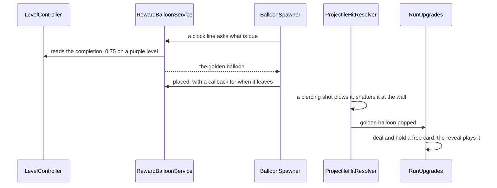

@page plan_reward_balloons Reward Balloons

# Reward Balloons

> Two rare balloons that pay the player instead of pressuring them. The **golden balloon** comes once
> to a purple level, late in it: plated in gold, it shrugs off every normal hit and item, and only a
> piercing shot pops it, for a free upgrade card. The **heart balloon** is a heart wrapped in
> bandages that gives a heart back; it comes to purple levels and to a player who is losing hearts.
>
> **No changes until this plan is actioned.**

---

## Goals

1. **Golden balloon.**
   - Only on purple (extra-colour) levels, once per level, placed when the level is about 75% done.
   - Normal hits do nothing: the shot bounces off it as off an unbreakable. Items do nothing either
     (bomb, laser, lightning, paint): a bomb beside it must not hand out the card.
   - A piercing shot pops it: a cruise-earned pierce or a Snipe lance. It is plowed and shatters at
     the shot's next wall bounce, as an unbreakable is.
   - Popped, it gives a **free upgrade card**, kept for the run, shown with the card reveal.
   - It looks metallic: gold plates wrapping the sphere, each catching the light on its own, with
     glitter where the speculars land.
2. **Heart balloon.**
   - A heart-shaped balloon with cloth ribbons wrapped over it like bandages.
   - Any pop gives back one heart, up to the maximum. It pops like a plain balloon (any hit, items too).
   - It comes to purple levels, and to any level while the player is missing hearts: the fewer left,
     the likelier. Never at full hearts.
3. Both are colourless: they never count toward a colour's goal, and never break or feed the streak.

## How it fits

| Piece | Where | What |
|---|---|---|
| `BalloonType.Golden`, `BalloonType.Heart` | `Balloon/Type/BalloonType.cs` | Appended at the end: the names are a telemetry wire contract, the values must stay dense. `SimpleGold` already names the gold-band plain balloon, hence `Golden` |
| `GoldenBalloonModel` | `Balloon/Model/` | A `BalloonModelBase` of its own, not an `UnbreakableBalloonModel` (that would pull it into formations and roaming). `EvaluateHit`: a hit with `Piercing` and `DirectHit` pops; any other projectile hit deflects; an item hit is `HitOutcome.None`. `IDeflectsShots`, `IResistsPaint`, colourless |
| `HeartBalloonModel` | `Balloon/Model/` | A colourless one-hit balloon, `IResistsPaint` |
| `IsTough` | `Shared/Extensions/BalloonModelExtensions.cs` | Covers the golden balloon, so a piercing shot plows it and the projectile's telegraph and sweep see it |
| `RewardBalloonService` | `Balloon/Reward/` | Plain C#. Asked once per clock line, it reads the level's completion and the hearts and says which balloon is due, if any. It tracks which one is on the board through the leave callback, re-arms the golden balloon on each new level, `IRunResettable`. It only offers a type the catalogue has an entry for |
| `IRewardBalloonRequests` | `Balloon/Reward/` | `TryTakeDue(out type)` and `Placed(type)`, which returns the callback for when the balloon leaves the board. `BalloonSpawner` asks before the reinforcements, so the balloon takes one of the line's places, outside the level's caps and counts, its own entry found with `FindEntry` and prewarmed to one. It deals first, so a crowded line drops something else; one that still had no room leaves the balloon due for the next line |
| `LevelCompletion` | `Game/Level/` | A 0–1 fraction computed from `ILevelProgress` when asked: each colour's confirmed points, capped at the requirement, over the requirement times the colours |
| `IPlayerHealth.Max` | `Game/Health/` | The heart cap, so the missing hearts and the heal agree on it |
| `BalloonTypeExtensions.IsReward` | `Shared/Extensions/` | Golden and Heart. The level's pick list skips them, so no level mix brings one |
| `IFreeCardGrant` | `Game/Upgrades/RunUpgrades.cs` | `GrantFreeCard()`: deals one dealable card on the run's seed, holds it, and publishes `UpgradeCardHeldMessage`, so the card reveal plays it. With every card at its limit there is nothing to give, and the golden balloon gives a heart instead |
| `PlayerHealthController` | `Game/Health/` | Heals one on a heart balloon's pop (`RewardBalloonPoppedMessage`) |
| `IRewardBalloonSettings` | `Configuration/Balloons/` | The tuning below, a block on `BalloonsConfiguration` |
| Shot solver | `Solver/` | `ShotBoardGather` builds a target for both (today it would see neither); the golden one deflects unless pierced, and is immune to the shared bomb and laser cores |

## Tuning (`IRewardBalloonSettings`)

| Setting | Start at | Meaning |
|---|---|---|
| `GoldenAtCompletion` | 0.75 | The level's completion that places the golden balloon on a purple level |
| `HeartChanceMissingOne` | 0.04 | Chance per line of a heart balloon while one heart is missing |
| `HeartChanceMissingTwo` | 0.12 | The same with two missing (one heart left) |
| `HeartChanceOnPurple` | 0.05 | Added on a purple level, if a heart is missing |
| `HeartCooldownLines` | 12 | Lines after a heart balloon before another can come |
| At most one of each on the board | | A second one waits until the first is gone |

Full hearts never roll one, so the heart balloon is help, not loot. A level ends with it unpopped and
it's gone with the board, like any balloon.

## The looks

- **Golden:** the unbreakable's sphere shading (`UnbreakableBalloon.shader`, the sphere state the
  variant pushes) as the base, with a gold plate layer: a cell pattern laid over the sphere, each
  plate tilted a little so its own specular comes and goes as the light moves, thin dark seams
  between them, and the glitter (`Include/Glitter.cginc`) gated by the specular so it sparkles only
  where the light catches. A new shader, not a retint: the plates are the point. Needs an in-editor
  look at noon and night.
- **Heart:** a heart-shaped balloon body (a new sprite, drawn by script under `Tools/art/` like the card
  icons) lit like the others (`SpriteDiffuse`), red, with two or three cream cloth strips wrapped
  across it, slightly frayed, a knot at one side. The strips sway a little with the balloon.

## Phases

1. **Reward hook.** `LevelCompletion`, `RewardBalloonService`, `IRewardBalloonRequests`,
   the spawner's consumption and prewarm, the settings. Tests for completion, the 75% trigger once
   per level and only on purple, the heart chance by missing hearts and the cooldown.
2. **Golden balloon.** Type, model, `IsTough`, item immunity, prefab with a placeholder gold retint
   of the unbreakable, `IFreeCardGrant` and the reveal, sound and pop colour, solver parity.
   `BalloonModelFactory` must map `Golden` before its catalogue entry goes in: it throws for an
   unmapped type, after `Placed`, which would leave the balloon counted on the board for the rest of
   the run. The spawn-balloon cheat lists every type, so it needs to route reward types through the
   service or leave them out. The card grant goes on the pop, never on the leave callback, which a
   board clear and a level change fire too. Tests
   for every hit path (projectile, pierce, bomb, laser, lightning, paint) and the grant.
3. **Golden look.** The gold-plate shader with specular-gated glitter, its material and prefab.
   In-editor check at noon and night, frames sent for sign-off.
4. **Heart balloon.** Type, model, the heal, the heart sprite and bandage strips, prefab, sound.
   Tests for the heal cap and that only a missing heart brings it.
5. **Docs and measure.** READMEs (Balloon, Type, Spawner, Upgrades, Health), the bots on a forced
   purple level and on a low-heart run, a device build.

Each phase follows the per-phase review: implement, architect, test-everything and reviewer, then
fixes, then sign-off.

## Open

- Whether the card reveal should say where the card came from ("golden balloon!") in a heads-up.
- Whether a heart balloon should also drift, to make catching it a small skill test; it sits still
  in this plan.
