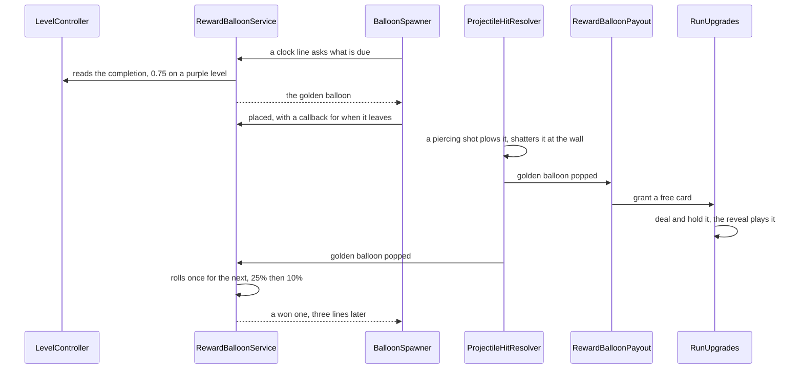

@page plan_reward_balloons Reward Balloons

# Reward Balloons

> Two rare balloons that pay the player instead of pressuring them. The **golden balloon** comes to a
> purple level, late in it, up to three a level: plated in gold, it shrugs off every normal hit and item,
> and only a piercing shot pops it, for a free upgrade card. The **heart balloon** is a heart wrapped in
> bandages that gives a heart back; it comes to purple levels on a schedule (an extra heart at full
> health) and to a player who is losing hearts.
>
> **No changes until this plan is actioned.**

---

## Goals

1. **Golden balloon.**
   - Only on purple (extra-colour) levels, placed when the level is about 75% done. Its pop rolls once for
     another (25%, then 10% for a third: three a level at most), which comes a few lines later. Never more
     than one on the board, and only a pop rolls: one a board clear takes brings no other.
   - Normal hits do nothing: the shot bounces off it as off an unbreakable. Items do nothing either
     (bomb, laser, lightning, paint): a bomb beside it must not hand out the card.
   - A piercing shot pops it: a cruise-earned pierce or a Snipe lance. It is plowed and shatters at
     the shot's next wall bounce, as an unbreakable is.
   - Popped, it gives a **free upgrade card**, kept for the run, shown with the card reveal.
   - It still looks like a balloon (body and knot, unlike the unbreakable's sphere), plated in metallic
     gold: plates wrapping it, each catching the light on its own, with glitter where the speculars land.
2. **Heart balloon.**
   - A heart-shaped balloon with cloth ribbons wrapped over it like bandages.
   - Any pop gives back one heart, up to the maximum. It pops like a plain balloon (any hit, items too).
   - On a purple level it comes on a schedule, at full hearts too: one at 30% completion, a 50% chance
     at 60% and a 25% chance at 90%, each rolled once and needing no pop of the one before. Popped there,
     it gives an extra heart past the maximum, with no design cap; a level-up refill keeps extras, a retry starts
     the hearts over. The roll while hurt is off there.
   - On any other level it comes while the player is missing hearts: the fewer left, the likelier. Never
     at full hearts.
3. Both are colourless: they never count toward a colour's goal, and never break or feed the streak.

## How it fits

| Piece | Where | What |
|---|---|---|
| `BalloonType.Golden`, `BalloonType.Heart` | `Balloon/Type/BalloonType.cs` | Appended at the end: the names are a telemetry wire contract, the values must stay dense. `SimpleGold` already names the gold-band plain balloon, hence `Golden` |
| `GoldenBalloonModel` | `Balloon/Model/` | A `BalloonModelBase` of its own, not an `UnbreakableBalloonModel` (that would pull it into formations and roaming). `EvaluateHit`: a hit with `Piercing` and `DirectHit` pops; any other projectile hit deflects; an item hit is `HitOutcome.None`. `IDeflectsShots`, `IResistsPaint`, colourless |
| `HeartBalloonModel` | `Balloon/Model/` | A colourless one-hit balloon, `IResistsPaint` |
| `IsTough` | `Shared/Extensions/BalloonModelExtensions.cs` | Covers the golden balloon, so a piercing shot plows it and the projectile's telegraph and sweep see it |
| `RewardBalloonService` | `Balloon/Reward/` | Plain C#. Asked once per clock line, it reads the level's completion and the hearts and says which balloon is due, if any. It tracks which one is on the board through the leave callback, rolls for another golden balloon on its pop (read from `ActorHitMessage`), starts the golden balloons over on each new level, `IRunResettable`. It only offers a type the catalogue has an entry for |
| `IRewardBalloonRequests` | `Balloon/Reward/` | `TryTakeDue(out type)` and `Placed(type)`, which returns the callback for when the balloon leaves the board. `BalloonSpawner` asks before the reinforcements, so the balloon takes one of the line's places, outside the level's caps and counts, its own entry found with `FindEntry` and prewarmed to one. It deals first, so a crowded line drops something else; one that still had no room leaves the balloon due for the next line |
| `LevelCompletion` | `Game/Level/` | A 0–1 fraction computed from `ILevelProgress` when asked: each colour's confirmed points, capped at the requirement, over the requirement times the colours |
| `IPlayerHealth.Max` | `Game/Health/` | The heart cap, so the missing hearts and the heal agree on it |
| `BalloonTypeExtensions.IsReward` | `Shared/Extensions/` | Golden and Heart. The level's pick list skips them, so no level mix brings one |
| `IFreeCardGrant` | `Game/Upgrades/RunUpgrades.cs` | `GrantFreeCard(noCardLeft)`: deals one dealable card on the level's seed, holds it, and publishes `UpgradeCardHeldMessage`, so the card reveal plays it. A retry of the level it was won on gives it back; won while the level-up hand is up, it waits for the pick. With every card at its limit, then or once the pick is held, it calls `noCardLeft`, and the golden balloon gives a heart instead |
| `RewardBalloonPayout` | `Balloon/Reward/` | Reads the reward balloons' pops from `ActorHitMessage` and pays them: the golden one's card (or heart), the heart balloon's heart |
| `IPlayerHealing` | `Game/Health/` | `Heal(amount)` on `PlayerHealthController`, up to `IPlayerHealth.Max` without trimming extras, and `HealPastMax(amount)` for a purple level's heart |
| `IRewardBalloonSettings` | `Configuration/Balloons/` | The tuning below, a block on `BalloonsConfiguration` |
| Shot solver | `Solver/` | `ShotBoardGather` builds a target for both (today it would see neither); the golden one deflects unless pierced, and is immune to the shared bomb and laser cores |

## Tuning (`IRewardBalloonSettings`)

| Setting | Start at | Meaning |
|---|---|---|
| `GoldenAtCompletion` | 0.75 | The level's completion that places the golden balloon on a purple level |
| `GoldenRepeatChances` | 0.25, 0.1 | The chance of the second and third golden balloon, each rolled once when the one before pops |
| `GoldenRepeatDelayLines` | 3 | Lines after a golden pop before the one it won comes |
| `HeartChanceMissingOne` | 0.04 | Chance per line of a heart balloon while one heart is missing |
| `HeartChanceMissingTwo` | 0.12 | The same with two missing (one heart left) |
| `PurpleHearts` | 0.3 sure, 0.6 at 50%, 0.9 at 25% | A purple level's heart balloons: each step's completion and its chance, rolled once |
| `HeartCooldownLines` | 12 | Lines after a heart balloon before another can come |
| At most one of each on the board | | A second one waits until the first is gone |

Off a purple level, full hearts never roll one, so the heart balloon is help, not loot. A purple level
brings its schedule regardless, as part of that level's reward. A level ends with it unpopped and it's gone
with the board, like any balloon.

## The looks

- **Golden:** a balloon, built from the tough balloon's prefab (body, knot, the shine sprites, the
  baked shadow), so it reads as one of the balloons and not as an unbreakable. Its body is
  `Balloon/GoldenBalloon.shader`: the tough balloon's sphere projection and scene light, plated in
  gold. The plates are even hexagons over the sphere, crowding toward the rim like tiles on a ball.
  They are even on purpose: irregular Voronoi plates read like the tough balloon's cracks. The plates
  are thick and stand apart: toward the rim each shows its side wall, each casts a shadow into the
  gaps, and the balloon's orange rubber shows at the bottom of the gaps, lit as one smooth sphere with its
  own gloss, so it reads as a balloon wearing the plates. Each plate is bevelled at its edges and held
  by two domed bolts, at its top and bottom corners, which gives it relief. Each is also tilted a little and wobbles slowly, so it shades, reflects the horizon and
  glints on its own as the light moves, and the glitter (`Include/Glitter.cginc`) is
  gated by the glint, so it sparkles only where the light catches. The knot is dark gold. Checked
  in the Editor at noon and at night.
- **Heart:** a heart-shaped balloon body, drawn by `Tools/art/make_heart_balloon.py` and lit like the
  others (`SpriteDiffuse`), red. Its volume is baked in: the heart is inflated from a height map, so
  each lobe rounds off and the cleft and the tip fall into shade. Two cream cloth strips wrap across
  it below the lobes, slightly frayed, tied in a knot on the right lobe; they are children of the
  sway pivot, so they sway with the balloon. Its highlight is its own: the round balloons' shine is an
  arc drawn for a circle and swung round the balloon's centre, which a heart's outline doesn't follow,
  so `Balloon/HeartShine.shader` lights the highlight from the heart's normals (baked from the same
  height map) toward the scene light. It lands on each lobe at noon and follows the light round,
  with the round shine's night response. Checked in the Editor at noon and at night.

## Phases

1. **Reward hook.** `LevelCompletion`, `RewardBalloonService`, `IRewardBalloonRequests`,
   the spawner's consumption and prewarm, the settings. Tests for completion, the 75% trigger once
   per level and only on purple, the heart chance by missing hearts and the cooldown.
2. **Golden balloon.** Type, model, `IsTough`, item immunity, a placeholder prefab (a gold retint
   of the unbreakable, replaced in phase 3), `IFreeCardGrant` and the reveal, sound and pop colour, solver parity.
   `BalloonModelFactory` must map `Golden` before its catalogue entry goes in: it throws for an
   unmapped type, after `Placed`, which would leave the balloon counted on the board for the rest of
   the run. The spawn-balloon cheat lists every type, so it needs to route reward types through the
   service or leave them out. The card grant goes on the pop, never on the leave callback, which a
   board clear and a level change fire too. Tests
   for every hit path (projectile, pierce, bomb, laser, lightning, paint) and the grant.
3. **Golden look.** The gold-plate shader with glint-gated glitter, its material, and the prefab
   rebuilt as a balloon from the tough balloon's.
   In-editor check at noon and night, frames sent for sign-off.
4. **Heart balloon.** Type, model, the heal, the heart sprite and bandage strips, prefab, sound.
   Tests for the heal cap and that only a missing heart brings it.
5. **Docs and measure.** READMEs (Balloon, Type, Spawner, Upgrades, Health), the bots on a forced
   purple level and on a low-heart run, a device build.

Each phase follows the per-phase review: implement, architect, test-everything and reviewer, then
fixes, then sign-off.

## Measured

The playtest bot's average player (`Tools/playtest/`, `--purple` and `--hearts`), in the Editor. It is
a model of a player, not a person, so these numbers are for comparing tunings.

| Session | Golden placed / popped | Heart placed / popped | How it went |
|---|---|---|---|
| The seed's first purple level (15), 3 hearts | 1 / 0 | 3 / 2 | Level 15 won in 102 s with 2 hearts lost, game over 18 s into level 16 |
| Its first purple level (13), 2 hearts | 1 / 0 | 2 / 1 | Game over on level 13 after 83 s |
| One heart from level 1, 7 minutes | 0 / 0 | 0 / 0 | The level-up refills had all 3 hearts back by level 3; no heart lost up to level 10 |

What it says:
- The heart balloon comes where it's meant to, on a hard level after mid-level losses, and the average
  player catches most of them (3 of 5).
- Early on, the level-up refill heals faster than a heart balloon arrives, so a low-heart start barely
  sees one. That's fine: by then the help isn't needed.
- The golden balloon arrives on time, but the average player never broke it: only a piercing shot does,
  and this player doesn't seek one out. Whether that's too hard for a casual player is open (below).

## Open

- Whether the golden balloon should be easier to break for a player who doesn't hunt pierces. The
  average bot left it standing on both purple levels it played.

- Whether the card reveal should say where the card came from ("golden balloon!") in a heads-up.
- Whether a heart balloon should also drift, to make catching it a small skill test; it sits still
  in this plan.
- Before a third reward balloon: give the reward prefabs their own empty `RewardBalloonVariant` (the golden
  one borrows the tough variant and the heart the simple one, both doing nothing there), and let
  `RewardBalloonPayout` keep one map of the balloons it has paid instead of a field per type.
