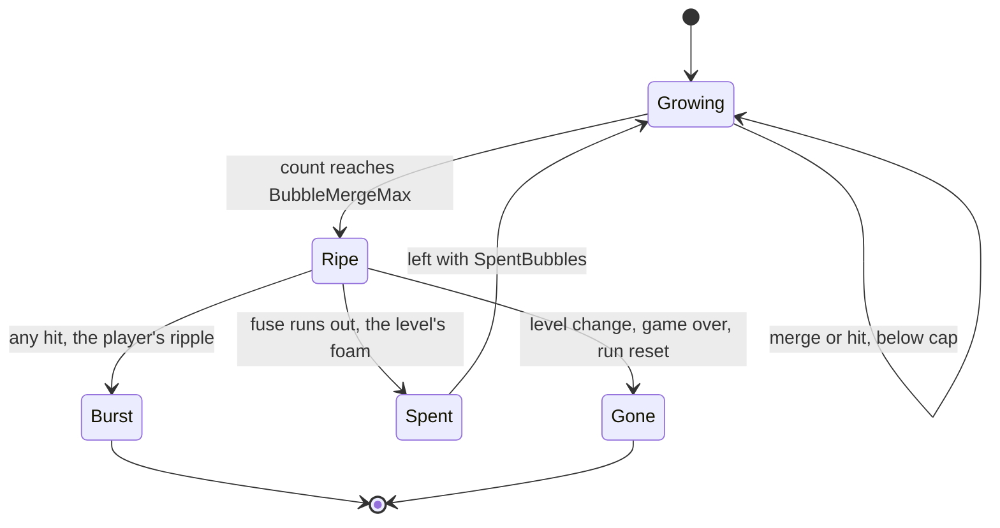
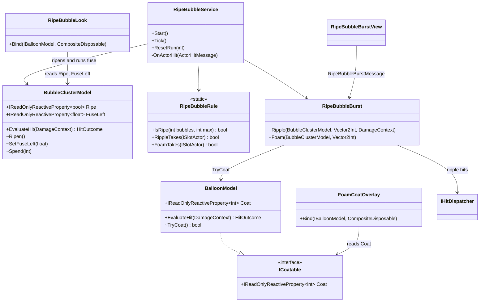
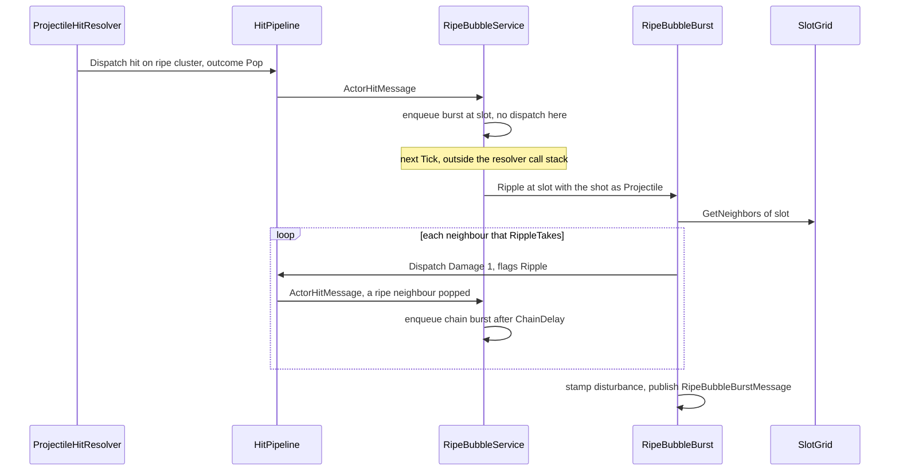

@page plan_ripe_bubble_cluster Ripe Bubble Cluster

# The ripe bubble cluster: a full cluster is a bomb with a fuse

> On water, a bubble cluster that reaches the cap of 5 becomes **ripe**. It swells, and a fuse starts.
> Popped before the fuse runs out, its burst is the player's: a ripple knocks a hit off every neighbour.
> Left alone, its burst is the level's: it sprays foam, and each neighbouring balloon gets a one-bubble
> coat that must be popped first and washes the shot's colour.
> Planned 2026-11-18. **Status: proposed. The decisions below are open; nothing is built.**

---

## Owner direction (2026-11-18)

"I'm trying to come up with an idea for the bubbles in water levels to make a mechanic after they reach
the cap of 5 but I cannot think of any, water levels are kinda boring now, as the only pressure is a more
compacted board from the bubbles."

Four ideas were put forward (a fused bomb, foam that spreads, a burst that shoves the board, a cluster
that swallows the shot). The owner chose the first: "I like 1".

Standing rule that shapes it: difficulty comes from danger to the player, never from a scoring penalty.

## What exists (verified 2026-11-18)

| Piece | Where | State |
|---|---|---|
| A cluster's count | `BubbleClusterModel` (`HitsRemaining`) | drops by the damage of each hit (`BalloonModelBase.EvaluateHit`); a surviving hit is `PassThrough`, scored, and breaks the streak |
| Merge | `BubbleMergeService`, `BubbleMergeRule` | wakes on `SlotGrid.MutationVersion`, a hit on a cluster, or its own last merge; a full cluster neither takes nor gives |
| The cap | `IBalloonsConfiguration.BubbleMergeMax` (5) | the only limit on a cluster's size |
| Spawn size | `BalloonSpawner` (`StartBubblesForLevel`) | 1 bubble, plus one every 15 levels, capped at `BubbleMergeMax`: a cluster would arrive full from level 61 |
| Time on the level | `ISpawnClock.SecondsOnLevel` | advances only while the spawn clock runs: holds through pause, the level-up cinematic, game over and a doomed shot's glide |
| Hits from code | `IHitDispatcher.Dispatch` into `HitPipeline` | synchronous: score and streak, then the balloon's controller, then the message |
| Neighbours | `SlotGrid.GetNeighbors` | the six hex neighbours, no allocation |
| Colour wash | `ProjectileHitResolver.ApplyColorChange` | a type check (`IWashesProjectileColor`), made after the hit is evaluated |
| Hearts | `BalloonSpawner` (`WaveDeficitCalculator`) | a clock line with no room costs hearts; a cluster only takes up room |
| A fuse on a model | `Balloon/Reward/NukeFuse` | a model-held fuse that follows its balloon when it moves and stops on level change, game over and run reset |
| A press on the water | `DisturbanceFieldService.Stamp` | any repelling stamp reaches the water surface through `ImpactEventBus` and `WaterImpactCollector` |
| Foam on the water | `WaterRippleBuffer` | made only by crests folding in the simulation: there is no way to drop foam at a point |

Two things in the code as it stands get in the way and are fixed by the plan:

- **The solver does not see clusters as targets.** `ShotBoardGather.TryBuildTargetSnapshot` skips actors
  that are not `IHasScore`, and `BubbleClusterModel` is not one. The playtest bot aims through the solver,
  so no water comparison can be trusted until this is fixed (phase 0). Found by reading; not yet run.
- **"How many hits until it pops" is read from `HitsRemaining` in four places** (`IsTough`, the resolver's
  one-hit check, `ShotBoardGather`, `ShotSimulator`). A ripe cluster and a coated balloon both break that
  reading, so it moves behind one extension.

## The mechanic

### Ripening and the fuse

A cluster is ripe when its count reaches `BubbleMergeMax`: the existing cap is the threshold, with no
second number. Ripening starts a fuse of `FuseSeconds` (6) on `ISpawnClock.SecondsOnLevel`, held as a
deadline.

The fuse is in seconds on the level clock, not in spawn lines. Lines arrive anywhere from 0.55 s to 1.7 s
apart, and their rate is multiplied by things the player cannot see (up to 8 times faster on a sparse
board, 3 times faster in flight, slower in a breather). The level clock holds through exactly the moments
a timed threat would be unfair: pause, the level-up cinematic, game over.

### Popped in time: the ripple

**A ripe cluster is fragile: any hit bursts the whole cluster.** A cluster loses one bubble a hit, so
without this the first hit on a ripe 5 would make it a 4 and the choice would be between two bad rules.
If that hit defused it, the ripple could only come from a one-shot pop (a pierce, a bomb, a laser) and
the reward would be out of reach. If it stayed ripe, the ripple would cost five hits and five streak
breaks. Fragile makes the answer one accurate shot.

The burst sends one hit to each of the six neighbours through `IHitDispatcher`, so scoring, items and
chains behave as for any other hit:

- Damage 1, a new flag `DamageFlags.Ripple` for audio and telemetry (no rule reads it), no `DirectHit`:
  it scores at the live multiplier but cannot climb the streak or trigger pop-spawns, like an item's pop.
- Reward balloons and balloons that deflect an ordinary hit (the unbreakable) are skipped.
- A ripe neighbour bursts in turn, after `ChainDelaySeconds` (0.12) so a chain reads as one.
- A ripple strips foam coats, so popping a ripe cluster cleans the foam round it.
- A burst scores the bubbles the cluster held.

### Fuse runs out: the foam

The cluster sprays foam and is **spent**: it drops to `SpentBubbles` (1) and stays, so the clump is still
there to merge and ripen again. Each neighbouring colourable balloon takes a **coat**:

- The first hit on a coated balloon removes the coat and passes through. The balloon is untouched.
- That contact washes the shot's stolen colour, as a cluster does.
- It scores nothing and does not touch the streak. The cost is the extra hit and the lost colour.
- A piercing or beam hit pops the balloon, coat and all.
- One coat at most. Unbreakables, reward balloons and other clusters take none: a coat that added a
  bubble to a cluster would ripen it and start the next fuse, foam breeding bombs.

## Architecture

State sits on the models. One small controller beside `BubbleMergeService` makes the decisions, woken the
same way. The merge service itself stays as it is: it has no state and no teardown, and the fuse has both.

| Type | Layer | What it does |
|---|---|---|
| `BubbleClusterModel` (new fields) | Model | `Ripe`, `FuseLeft`; while ripe, any damage pops it and it scores the count it held |
| `BalloonModel` (new field), `ICoatable` | Model | `Coat`; a coated balloon's first ordinary hit removes the coat and passes through |
| `RipeBubbleRule` | pure static | when a cluster is ripe, which neighbours a ripple hits, which take foam |
| `RipeBubbleService` | Controller (`IStartable`, `ITickable`, `IRunResettable`) | ripens clusters at the cap, runs each fuse, queues bursts, stops on level change, game over and run reset |
| `RipeBubbleBurst` | Controller | the ripple's hits and the foam's coats; stamps the water; publishes `RipeBubbleBurstMessage` |
| `RipeBubbleLook` | View, on the cluster prefab | swell, faster float, throb and tint from `Ripe` and `FuseLeft` |
| `FoamCoatOverlay` | View, on the colourable balloon prefabs | shows and pops the coat |
| `RipeBubbleBurstView` | View | the ripple ring, and foam bubbles hopping to each coated neighbour |

New messages: `BubbleRipenedMessage` and `RipeBubbleBurstMessage` (ripple or foam, and how many neighbours
it reached). A coat coming off needs none: it is already an `ActorHitMessage` with `PassThrough`.

Points that are easy to get wrong:

- **The ripple is never dispatched from inside a hit handler.** `ProjectileHitResolver` reads the shot's
  streak straight after its own dispatch to grant shields; a ripple nested inside that dispatch would
  change it underneath. The service queues the burst when it hears the hit and drains the queue in its
  own `Tick`, with an index loop, so a chain is picked up without recursion. At most 12 clusters exist
  (`MaxBubbles`) and each pops once, so a chain is bounded.
- **The service holds models, not slots,** and checks each tick that the model is still the one in its
  slot, as `NukeFuse` does, so a cluster the balancer moves keeps its fuse.
- **A ripe cluster is not anchored.** An anchored actor can seal a pocket off from the spawn lines.
- **The wash is read before the hit is evaluated.** After it, the coat is gone. One extension,
  `WashesProjectileColor`, answers for both a cluster and a coated balloon; the resolver and the solver's
  gather both use it. `BalloonModel` does not take the `IWashesProjectileColor` marker itself: the solver
  reads that marker as "resists paint".
- **A ripe cluster is not tough.** `IsTough` treats more than one hit remaining as plough-through and
  discharge at the wall; a piercing shot must burst a ripe cluster on contact.

### The coat: why it is state on the balloon

| Option | Verdict |
|---|---|
| A `Coat` count on `BalloonModel`, checked in its `EvaluateHit` | **Chosen.** The balloon keeps its identity: slot, registry handle, item, rainbow paint, type counts. One override, one overlay on the prefab |
| A coat on every balloon model, through the base class | Touches four models to coat actors that should take none |
| Swap the neighbour for a "coated" actor | Loses the item, the paint and the pool counts |
| A service that intercepts hits outside the model | Hits are evaluated inside the model by six or more callers; the check has to live there |

Nothing is saved mid-level and models are built new for each spawn, so ripe state and coats need no
reset or save work of their own.

## Presentation

- **Ripe:** the cluster shader's `_SpriteScale` for the swell (not the transform, which the wobble
  resets), `_FloatSpeed` for the faster float (with `_TimeOffset` rebased so the phase does not jump),
  a wobble punch once a second of fuse, and a tint toward a warning colour. No shader edit.
- **Ripple:** a new stamp profile in the disturbance settings; the water ripples through the path it
  already has. A growing ring over it (`GrowingDiscView` is a possible base).
- **Foam:** the bubble merge's hop (`BubbleMergeView`): pooled bubbles arcing to each coated neighbour.
- **Coat:** a child renderer on the colourable balloon prefabs using the soap bubble material with one
  bubble, scaled to enclose the balloon. No new shader; prefab edits.
- **Audio:** cues for ripen, burst and a coat coming off, in `CombatSoundRouter`.
- A digit counting the fuse down, and foam drawn on the water's surface, are both shader edits. Neither
  is in the plan.

All of it needs a look in the Editor.

## Settings

`IRipeBubbleSettings`, a block on `IBalloonsConfiguration` beside `BubbleMergeMax`.

| Setting | Default | Meaning |
|---|---|---|
| `FuseSeconds` | 6 | seconds of level clock from ripe to foam; 0 turns ripeness off |
| `ChainDelaySeconds` | 0.12 | wait before a ripe neighbour hit by a ripple bursts |
| `RippleDamage` | 1 | the hit each neighbour takes |
| `SpentBubbles` | 1 | what a cluster keeps once its fuse has run out |
| `CoatLayers` | 1 | the most coats a balloon holds |
| Look values | | swell scale, float speed-up, throb strength, warning tint |

No water-only switch is needed: clusters spawn only on water, and the board clears on every level change.

## Open decisions for the owner

Each has a recommendation; the plan above is written as if all are taken.

1. **A hit on a ripe cluster:** it bursts whole (recommended), or it un-ripens, or it stays ripe and
   needs all 5 hits.
2. **The fuse's clock:** seconds of level clock, 6 to start (recommended), or spawn lines.
3. **A cluster whose fuse ran out:** spent to 1 bubble and stays (recommended), or leaves the board, or
   re-arms at 5. Leaving trades five hits of cluster for at most six one-hit coats, which is close to
   no danger at all. Re-arming makes a foam fountain.
4. **Foam on a neighbouring cluster:** nothing (recommended), or one more bubble, which ripens clusters
   with foam and can run away.
5. **A ripple reaching a ripe neighbour:** it bursts too (recommended).
6. **A hit on a coat:** washes the colour and nothing else (recommended): no points, no streak break.
7. **Clusters arriving from the lines:** at most one below the cap (recommended), so a cluster always
   ripens through a merge and none arrives ripe from level 61.
8. **A ripe burst's score:** the 5 bubbles it held (recommended). Today a piercing pop of any cluster
   scores 1, less than chipping it down, which is a quirk worth fixing with it.

## Phases

Each phase can be played and checked on its own.

| Phase | What | Check | Risk |
|---|---|---|---|
| 0 | Clusters become `IHasScore`, so the solver sees them | the solver window shows clusters as targets | the bot's water baselines move |
| 1 | Ripe state, the fuse, the fragile burst, `IsTough`, the spawn cap, settings. Expiry only spends the cluster for now; the swell shows ripeness | ripe clusters swell, pop in one hit, shrink when the fuse runs out; the fuse holds through pause and level-up | whether 6 s is fair |
| 2 | The ripple: `DamageFlags.Ripple`, the queue, chains, the water stamp | a crowd round a ripe cluster is thinned; two ripe neighbours chain | score, streak and items firing through chained hits |
| 3 | The coat: `ICoatable`, the balloon's `EvaluateHit`, the resolver's wash and one-hit checks, foam on expiry, the overlay | an ignored ripe cluster leaves coated balloons that take two hits and wash the shot | it touches the resolver, the core hit path; prefab edits |
| 4 | The solver knows coats and ripe clusters; bot runs on water with and without ripeness | bot reports | the solver drifting from the game |
| 5 | Presentation: float, throb, tint, ring, foam hops, audio, telemetry counters | a look in the Editor | none beyond taste |

## Tests

- `RipeBubbleRule`: the ripe threshold; which neighbours a ripple hits and which take foam (rewards,
  deflectors, clusters, already coated); fuse left from the deadline.
- `BubbleClusterModel` when ripe: ordinary, piercing and indirect damage all pop it; it scores what it held.
- `BalloonModel` with a coat: an ordinary hit removes the coat and the balloon survives; piercing and beam
  pop it; indirect damage removes the coat.
- `RipeBubbleService`: ripens at the cap; the fuse fires foam once; stops on level change, game over and
  reset; follows a moved cluster; a burst heard during a dispatch is not dispatched inside it; two ripe
  neighbours each burst once.
- `ProjectileHitResolver`: a coated balloon washes the shot and does not count as a one-hit pop; a ripe
  cluster is not ploughed through.
- Existing: `BubbleClusterModelTests`, `ProjectileHitResolverTests`, the solver's `EffectBoardMirrorTests`.

## What to watch

A ripe cluster in the middle of a crowd cannot merge or move out of the way, so the fuse partly rewards
how the board happens to lie. One-hit bursts and a 6 s fuse should keep that fair; the bot runs in phase 4
are where to check it.
