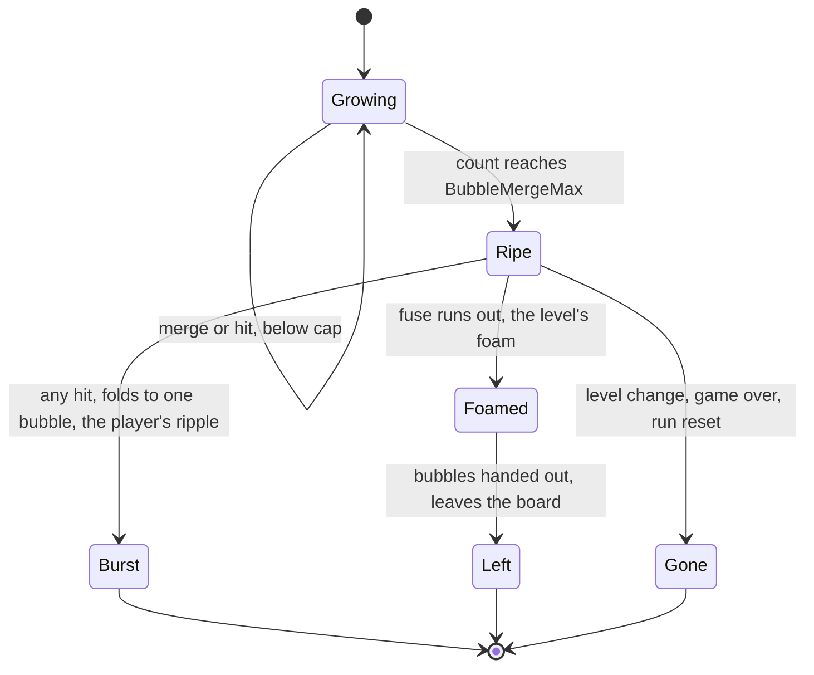
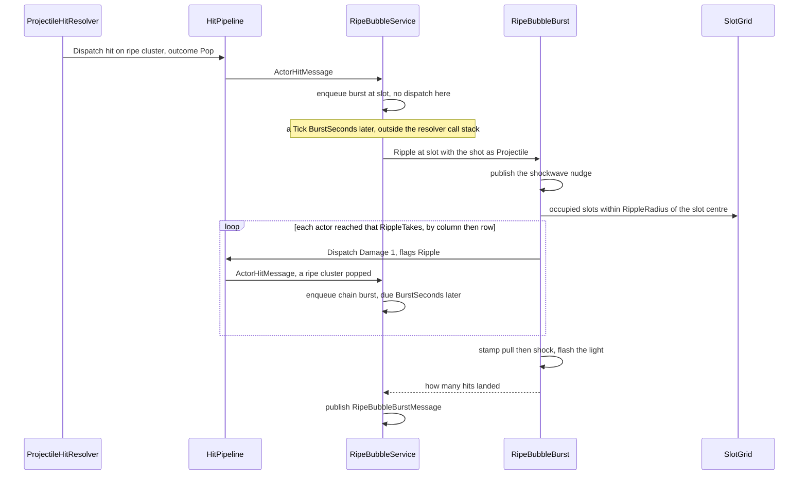

@page plan_ripe_bubble_cluster Ripe Bubble Cluster

# The ripe bubble cluster: a full cluster is a bomb with a fuse

> On water, a bubble cluster that reaches the cap of 6 becomes **ripe**. It swells, and a fuse starts.
> Popped before the fuse runs out, its burst is the player's: a small bomb, whose ripple knocks a hit off
> every balloon within its radius.
> Left alone, its burst is the level's: it hands its bubbles out as foam and leaves. Each neighbouring
> balloon gets a one-bubble coat that must be popped first and washes the shot's colour; neighbouring
> clusters get the bubbles left after that.
> Planned 2026-11-18; the owner settled the open decisions the same day, and the player's burst was
> reworked into a blast after it was played on a phone (decisions 13 to 17). **Status: building.**

---

## Owner direction (2026-11-18)

"I'm trying to come up with an idea for the bubbles in water levels to make a mechanic after they reach
the cap of 5 but I cannot think of any, water levels are kinda boring now, as the only pressure is a more
compacted board from the bubbles."

Four ideas were put forward (a fused bomb, foam that spreads, a burst that shoves the board, a cluster
that swallows the shot). The owner chose the first: "I like 1".

Standing rule that shapes it: difficulty comes from danger to the player, never from a scoring penalty.

On the two endings, once the first version was built: "Basically we could use the shader so when it
ripples basically goes from 6 to 1 in sequence forming a big single bubble and then pops. But for the
foam, it stays in warning color, and goes from 6 to zero, keeping the bubble division, giving its entries
to anything closer, until it runs out." Its two questions were answered the same day (decisions 10 and 11).

On the player's burst, after playing it on a phone:

- "the blast from the bubbles needs to be a lot stronger, even impactful with more particles maybe, and
  converting into one single bubble faster, it each bubble adding to the scale as a pulse out. the spinning
  is too slow compared to the shape of the spiral so it doesn't match"
- "maybe we could increase its radius a bit"
- "so it behaves like a bomb, just a smaller scale bomb"

This is about the hit ending only: the fuse-out ending, the foam's hand-out to the six neighbours, stays as
it was. Decisions 13 to 17 record what was built from it.

## What exists (verified 2026-11-18)

| Piece | Where | State |
|---|---|---|
| A cluster's count | `BubbleClusterModel` (`HitsRemaining`) | drops by the damage of each hit (`BalloonModelBase.EvaluateHit`); a surviving hit is `PassThrough`, scored, and breaks the streak |
| Merge | `BubbleMergeService`, `BubbleMergeRule` | wakes on `SlotGrid.MutationVersion`, a hit on a cluster, or its own last merge; a full cluster neither takes nor gives |
| The cap | `IBalloonsConfiguration.BubbleMergeMax` (5 when this was planned, 6 since: see the decisions) | the only limit on a cluster's size |
| Spawn size | `BalloonSpawner` (`StartBubblesForLevel`) | 1 bubble, plus one every 15 levels, capped at `BubbleMergeMax`: a cluster would arrive full from level 61 |
| Time on the level | `ISpawnClock.SecondsOnLevel` | advances only while the spawn clock runs: holds through pause, the level-up cinematic, game over and a doomed shot's glide |
| Hits from code | `IHitDispatcher.Dispatch` into `HitPipeline` | synchronous: score and streak, then the balloon's controller, then the message |
| Neighbours | `SlotGrid.GetNeighbors` | the six hex neighbours, no allocation |
| Colour wash | `ProjectileHitResolver.ApplyColorChange` | a type check (`IWashesProjectileColor`), made after the hit is evaluated |
| Hearts | `BalloonSpawner` (`WaveDeficitCalculator`) | a clock line with no room costs hearts; a cluster only takes up room |
| A fuse on a model | `Balloon/Reward/NukeFuse` | a model-held fuse that follows its balloon when it moves and stops on level change, game over and run reset |
| A press on the water | `DisturbanceFieldService.Stamp` | any repelling stamp reaches the water surface through `ImpactEventBus` and `WaterImpactCollector` |
| Foam on the water | `WaterRippleBuffer` | made only by crests folding in the simulation: there is no way to drop foam at a point |

Two things in the code as it stands get in the way and are fixed by the plan:

- **The solver does not see clusters as targets.** `ShotBoardGather.TryBuildTargetSnapshot` skips actors
  that are not `IHasScore`, and `BubbleClusterModel` is not one. The playtest bot aims through the solver,
  so no water comparison can be trusted until this is fixed (phase 0). Found by reading; not yet run.
- **"How many hits until it pops" is read from `HitsRemaining` in four places** (`IsTough`, the resolver's
  one-hit check, `ShotBoardGather`, `ShotSimulator`). A ripe cluster and a coated balloon both break that
  reading, so it moves behind one extension.

## The mechanic

### Ripening and the fuse

A cluster is ripe when its count reaches `BubbleMergeMax`: the existing cap is the threshold, with no
second number. Ripening starts a fuse of `FuseSeconds` (6) on `ISpawnClock.SecondsOnLevel`, held as a
deadline.

The fuse is in seconds on the level clock, not in spawn lines. Lines arrive anywhere from 0.55 s to 1.7 s
apart, and their rate is multiplied by things the player cannot see (up to 8 times faster on a sparse
board, 3 times faster in flight, slower in a breather). The level clock holds through exactly the moments
a timed threat would be unfair: pause, the level-up cinematic, game over.

### Popped in time: the ripple

**A ripe cluster is fragile: any hit bursts the whole cluster.** A cluster loses one bubble a hit, so
without this the first hit on a ripe 5 would make it a 4 and the choice would be between two bad rules.
If that hit defused it, the ripple could only come from a one-shot pop (a pierce, a bomb, a laser) and
the reward would be out of reach. If it stayed ripe, the ripple would cost five hits and five streak
breaks. Fragile makes the answer one accurate shot.

The burst is a small bomb (decision 13; this section first described a ripple into the six neighbours, which
it replaced). It sends one hit to every balloon on a slot whose centre lies within `RippleRadius` (1.35
world units) of the burst's slot centre, through `IHitDispatcher`, so scoring, items and chains behave as
for any other hit. Slots are 0.75 apart, so the radius takes the first ring at 0.75 and, of the next, the
six slots at 1.30 but not the six at 1.50: 12 slots on an open board. (The bomb item's kill radius is 1.25,
by collider overlap.) The reach is measured between slot centres, not by physics overlap and not from
where a balloon is drawn on its way to a slot, so it is the same on every run and the shot solver repeats it
exactly. One pure rule, `RipeBubbleRule.RippleReaches`, answers for the game and the solver.

- The ripple lands `BurstSeconds` (0.22) of level clock after the hit that popped the cluster. The cluster
  pops and scores at the hit, and its view spends that time folding its six bubbles into one big bubble
  and popping it; the ripple goes out as that bubble pops.
- The hits land column by column, then row by row: an order the solver can repeat.
- The cluster left its slot when it popped. A balloon the board has moved into that slot before the ripple
  lands stands in the middle of the blast and is hit like any other.
- Damage 1, a new flag `DamageFlags.Ripple`, no `DirectHit`. The ripple lands after the shot has flown
  on, so a ripple hit scores at the shot's streak as it stands and never changes it: it cannot climb it,
  break it, or restart it on the neighbour's colour. Without `DirectHit` it triggers no pop-spawn either.
- Reward balloons and balloons that deflect an ordinary hit (the unbreakable) are skipped.
- A ripe cluster inside the radius bursts in turn, `BurstSeconds` after the ripple popped it, folding first
  as the first one did, and ripples from its own slot, so a chain reads as a run of blasts.
- The wait is on the level clock, so a pause holds it. A burst still waiting when the level completes,
  the game ends or the run resets is dropped with the fuses: the cluster has already popped and scored,
  and only its ripple is lost. The pop that completes a level therefore ripples nothing.
- A ripple strips foam coats, so popping a ripe cluster cleans the foam round it.
- A burst scores the bubbles the cluster held.

### Fuse runs out: the foam

The cluster hands its bubbles out and leaves. `RipeBubbleBurst.PlanFoam` decides where each bubble goes
(`RipeBubbleRule.PlanHandout`), in this order:

1. A **coat** to each neighbouring plain balloon (`ICoatable`: the plain balloon and its silver, gold and
   rainbow skins, item carriers included), up to `CoatLayers`.
2. Then one bubble at a time to **neighbouring clusters** with room below `BubbleMergeMax`: one per
   cluster a round, in `HexCoordinates.HexNeighborIndices` order, until the bubbles or the room run out.
   A cluster this fills to the cap ripens on the next tick and starts its own fuse.
3. Any bubbles still left pop harmlessly.

`RipeBubbleBurst.HandOut` applies the plan. It only sets state: it dispatches no hit. The cluster then
leaves the board through `IBalloonPopper.TryLeave`: its slot is freed at once, with no pop, no hit and no
score, while its view stays for `FoamLeaveSeconds` to hand the bubbles out. It stays ripe to the end, so
it keeps its warning colour. Bubbles are only moved or lost, never made, so the board's bubbles only fall.

- The first hit on a coated balloon removes the coat and passes through. The balloon is untouched, and
  an item it carries stays with it: an item goes off only when its balloon pops.
- That contact washes the shot's stolen colour, as a cluster does.
- It scores nothing and does not touch the streak. The cost is the extra hit and the lost colour.
- A piercing or beam hit pops the balloon, coat and all. That contact does not wash: the coat went with
  the balloon, so the shot steals the balloon's colour as from any pop.
- One coat at most (`CoatLayers`, 1). Toughs, unbreakables, reward balloons and grid actors take
  nothing. Clusters take bubbles, never a coat.

## Architecture

State sits on the models. One small controller beside `BubbleMergeService` makes the decisions, woken the
same way. The merge service itself stays as it is: it has no state and no teardown, and the fuse has both.

```mermaid
classDiagram
    class ICoatable {
        <<interface>>
        +IReadOnlyReactiveProperty~int~ Coat
    }
    class BubbleClusterModel {
        +IReadOnlyReactiveProperty~bool~ Ripe
        +IReadOnlyReactiveProperty~float~ FuseLeft
        +EvaluateHit(DamageContext) HitOutcome
        ~Ripen()
        ~SetFuseLeft(float)
        ~SetBubbles(int)
    }
    class BalloonModel {
        +IReadOnlyReactiveProperty~int~ Coat
        +EvaluateHit(DamageContext) HitOutcome
        ~TryCoat(int maxLayers) bool
    }
    class RipeBubbleRule {
        <<static>>
        +IsRipe(int bubbles, int max) bool
        +Throbs(float before, float after, float fast) bool
        +WarnAmount(float left, float fuse) float
        +RippleReaches(Vector2 burst, Vector2 slot, float radius) bool
        +RippleTakes(ISlotActor) bool
        +FoamTakes(ISlotActor, int maxLayers) bool
        +PlanHandout(int bubbles, coatRoom, clusterRoom) int
        +FoldCount(float elapsed, float burst, int from) int
        +FoldPulse(float elapsed, float burst, int from, float strength) float
        +SpiralTurnRate(float turns, bool fast) float
        +ClusterSpin(float direction, float turns, bool fast) float
        +FoamShownCount(int bubbles, float elapsed, float step) int
    }
    class RipeBubbleService {
        +Start()
        +Tick()
        +ResetRun(int)
        -OnActorHit(ActorHitMessage)
    }
    class RipeBubbleBurst {
        +Ripple(Vector2Int, DamageContext) int
        +PlanFoam(Vector2Int, int bubbles) int
        +HandOut(BubbleClusterModel, int handout)
    }
    class IBalloonPopper {
        <<interface>>
        +TryLeave(IBalloonModel, float linger) bool
    }
    class IBalloonPopPrelude {
        <<interface>>
        +TryPlayPopPrelude(Action onDone) bool
    }
    class IRipeSpin {
        <<interface>>
        +float TurnDirection
    }
    class SoapBubbleClusterVariant {
        +Bind(IBalloonModel, CompositeDisposable)
    }
    class FoamCoatOverlay {
        +Create(Transform, SpriteRenderer, IRipeBubbleSettings)$
        +Show()
        +Hide()
        +PuffAndHide()
    }
    class BalloonView {
        +HoldCoat()
        +ReleaseCoat()
    }
    class RipeBubbleBurstView
    class SoapBubbleHop {
        <<static>>
        +Place(Transform, Vector3, Vector3, float, float, Vector3, float)$
    }
    BalloonModel ..|> ICoatable
    RipeBubbleService --> RipeBubbleRule
    RipeBubbleService --> RipeBubbleBurst
    RipeBubbleService --> BubbleClusterModel : ripens and runs fuse
    RipeBubbleBurst --> IHitDispatcher : ripple hits
    RipeBubbleBurst ..> NudgeMessage : shockwave before the hits
    RipeBubbleBurst --> DisturbanceFieldService : pull then shock
    RipeBubbleBurst --> SceneLightFieldService : flash
    RipeBubbleBurst --> BalloonModel : TryCoat
    RipeBubbleBurst --> BubbleClusterModel : one more bubble
    RipeBubbleBurst --> IBalloonPopper : the foamed cluster leaves
    SoapBubbleClusterVariant ..|> IBalloonPopPrelude
    SoapBubbleClusterVariant ..|> IRipeSpin
    RipeBubbleBurstView --> IRipeSpin : the arm turns with the cluster
    BalloonView --> IBalloonPopPrelude : asks before the pop
    SoapBubbleClusterVariant --> BubbleClusterModel : reads Ripe, FuseLeft
    BalloonView --> ICoatable : reads Coat
    BalloonView --> FoamCoatOverlay : creates on the first coat
    RipeBubbleService ..> RipeBubbleBurstView : RipeBubbleBurstMessage
    RipeBubbleBurstView --> BalloonView : holds and releases the coat
    RipeBubbleBurstView --> SoapBubbleHop
```

| Type | Layer | What it does |
|---|---|---|
| `BubbleClusterModel` (new fields) | Model | `Ripe`, `FuseLeft`; while ripe, any damage pops it and it scores the count it held |
| `BalloonModel` (new field), `ICoatable` | Model | `Coat`; a coated balloon's first ordinary hit removes the coat and passes through |
| `RipeBubbleRule` | pure static | when a cluster is ripe, how far a ripple reaches and whom it hits, which neighbours take a coat, where a foam's bubbles go, the fold's schedule with its pumps and the hand-out's, and the turn rate the spiral arm and the cluster share |
| `RipeBubbleService` | Controller (`IStartable`, `ITickable`, `IRunResettable`) | ripens clusters at the cap, runs each fuse, queues bursts `BurstSeconds` after their hit, hands a foamed cluster's bubbles out, stops on level change, game over and run reset |
| `RipeBubbleBurst` | Controller | the ripple's blast: its hits over the radius, the shockwave nudge, the pull and shock on the disturbance field and the flash; the foam's plan (`PlanFoam`) and hand-out (`HandOut`: coats, bubbles for clusters, then the cluster leaves, and a press on the water). The ripple returns how many hits landed; the plan is the foam's message |
| `IBalloonPopper.TryLeave`, `BalloonController.Leave` | Controller | takes a balloon out of play with no pop, hit or score, and returns its view to the pool after a linger |
| `IBalloonPopPrelude` | View seam | a view binding that plays before its balloon's pop; `BalloonView.TryPlayPopPrelude` asks each binding, and the controller presents the pop when the prelude ends |
| `SoapBubbleClusterVariant` | View, on the cluster prefab | swell, faster float, throb, tint and the spin that matches the spiral, from `Ripe` and `FuseLeft`; the fold with its pumps, as the cluster's `IBalloonPopPrelude` |
| `IRipeSpin` | View seam | the way round a ripe cluster turns, which its variant gives and the spiral arm follows |
| `FoamCoatOverlay` | View, made in code by `BalloonView` the first time its balloon is coated | a child sprite with the soap material showing one bubble round the balloon, shown while `Coat` is above 0 and hidden as the pop starts. It fits itself on every show from the body's local transforms up to the balloon's root, so the balloon's own world scale (a spawn tween, a pool at zero scale) never enters the fit |
| `SoapBubbleShader` | shared static | the soap bubble shader's property IDs and look defaults, the float rebase, a lone bubble's look and size, used by the cluster variant, the coat and the burst view |
| `RipeBubbleBurstView` | View | the spiral arm; the ripple's ring and the bubbles it throws, out to the blast's radius; and the foam's hand-out: a bubble at a time hopping to each taker or drifting off |
| `SoapBubbleHop`, `SoapBubbleSprites` | View helpers | the hop's arc and the pool of loose bubbles, shared by `BubbleMergeView` and `RipeBubbleBurstView` |

New messages: `BubbleRipenedMessage`, `RipeFuseBeatMessage` (each fast throb near the end of a fuse) and
`RipeBubbleBurstMessage`, built by `Ripple` or `Foam` (decision 14). A ripple's carries its centre, its
radius and how many hits landed, which is what the view and telemetry need for a blast. A foam's carries
which neighbours it coated, one bit per direction in the order `HexCoordinates.HexNeighborIndices` lists
them, and their count. A foam's message
also carries its plan in one `int`, four bits a bubble in the order they leave (a coat or a cluster and
its direction, or a leftover) and the count above them, so it allocates nothing. A coat coming off needs none: it is already an
`ActorHitMessage` with `PassThrough`, which `ActorHitMessageExtensions.TookCoat` tells apart from a resist.

Points that are easy to get wrong:

- **The ripple is never dispatched from inside a hit handler.** `ProjectileHitResolver` reads the shot's
  streak straight after its own dispatch to grant shields; a ripple nested inside that dispatch would
  change it underneath. The service queues the burst when it hears the hit and drains the queue in its
  own `Tick`, with an index loop, so a chain is picked up without recursion. At most 12 clusters exist
  (`MaxBubbles`) and each pops once, so a chain is bounded.
- **The service holds models, not slots,** and checks each tick that the model is still the one in its
  slot, as `NukeFuse` does, so a cluster the balancer moves keeps its fuse.
- **A ripe cluster is not anchored.** An anchored actor can seal a pocket off from the spawn lines.
- **The wash is read before the hit is evaluated.** After it, the coat is gone. One extension,
  `WashesProjectileColor`, answers for both a cluster and a coated balloon; the resolver uses it. The
  solver does not: a coat can come off mid-flight, so its gather keeps the coat count (`ICoatable`) and the
  marker apart, and decides the wash at each simulated contact. `BalloonModel` does not take the
  `IWashesProjectileColor` marker itself: the solver reads that marker as "resists paint".
- **A ripe cluster is not tough, nor is a coated balloon.** `IsTough` treats more than one hit remaining
  as plough-through and discharge at the wall; a piercing shot must burst a ripe cluster, and pop a coated
  balloon, on contact. So `HitsToPop` counts the coat (a coated one-hit balloon takes two ordinary hits, and
  is no clean sweep) and `IsTough` does not.
- **Only a pop releases an item.** `ItemActivator` used to fire on any hit on a carrier, which was the same
  thing while a plain balloon could not survive a hit. A coat makes it survive one.
- **The fold is a prelude, not a cluster case in the controller.** `BalloonController` asks its view for a
  pop prelude; with none, the pop is presented at once as before. With one, the balloon leaves the grid
  and the registry at once, and the pop is presented when the prelude calls back. The model popped at the
  hit, so the rules and the score never wait on the view.
- **The foam's message goes out before the models change,** so the burst view can hold what each taker
  shows (the coat, the cluster's count) until its bubble lands; the cluster's view is still at its slot.
- **A foamed cluster leaves, it does not pop.** `TryLeave` frees the slot with no hit, so nothing scores,
  nothing fires, and the merge service sees only a grid change.

### The coat: why it is state on the balloon

| Option | Verdict |
|---|---|
| A `Coat` count on `BalloonModel`, checked in its `EvaluateHit` | **Chosen.** The balloon keeps its identity: slot, registry handle, item, rainbow paint, type counts. One override, one overlay the view makes in code |
| A coat on every balloon model, through the base class | Touches four models to coat actors that should take none |
| Swap the neighbour for a "coated" actor | Loses the item, the paint and the pool counts |
| A service that intercepts hits outside the model | Hits are evaluated inside the model by six or more callers; the check has to live there |

Nothing is saved mid-level and models are built new for each spawn, so ripe state and coats need no
reset or save work of their own.

## Presentation

All of it is done from C# with the soap shader's existing properties; nothing here edits a shader.

- **Ripe** (`SoapBubbleClusterVariant`): the cluster swells to `SwellScale` over `SwellSeconds`. The swell is
  a factor the variant keeps, so a merge's wobble or a throb punches from the swollen size and settles back
  to it. The float runs `FloatSpeedup` times faster, with `_TimeOffset` rebased
  (`SoapBubbleShader.RebaseTimeOffset`) so the bubbles do not jump. The fuse throbs once a second, then
  twice a second in its last `ThrobFastSeconds` (`RipeBubbleRule.Throbs`), each a punch of
  `ThrobStrength`. The cluster fills with `WarnTint` (`RipeBubbleRule.WarnAmount`): `WarnStart` of the way
  the moment it ripens, so the player sees at once that it has turned, then evenly to full as the fuse runs
  out. It spins with its spiral arm (decision 17): at the arm's own turn rate and the same way round
  (`RipeBubbleRule.ClusterSpin`), slow from the ripening and a little faster from the first fast throb, its
  angle rebased as the float's offset is. The fill is the soap shader's flush (`_Flush`, set per renderer), the one shader
  addition of this plan besides the sixth layout: a clear film can't carry a tint, so the renderer's own
  colour showed nothing. Binding another model or despawning puts scale, flush, spin and float speed back.
- **Spiral:** a ripe cluster sheds soap bubbles from a point that turns round it
  (`RipeBubbleBurstView`), one every `SpiralInterval`; each flies straight out, growing, and fades at
  `SpiralReach`, so together they draw a spiral arm winding out of the cluster. The ripening and each beat
  of the fuse (`RipeFuseBeatMessage`, now sent for every throb with a `Fast` flag) feed the source a little
  longer than the wait for the next beat, so the arm is unbroken while the fuse runs and stops when the
  cluster bursts or leaves the board. The source follows the cluster's view, and its bubbles are placed from where
  the cluster is now, so the arm travels with a cluster the board moves. In the fuse's last seconds it
  sheds `SpiralFastSpeedup` times faster and turns `RipeBubbleRule.FastTurnSpeedup` (1.25) times faster, the
  cluster with it. The source turns `RipeBubbleRule.SpiralTurnRate` the way the cluster spins, which it reads
  from the cluster's variant (`IRipeSpin`), so the arm and the cluster go round as one.
  Owner, on the first version (a ring of five bubbles thrown on each throb): "the spiral doesn't read",
  with a picture of one arm of many bubbles growing outward; and "color shift early, so the user knows
  it's going to happen, the pulse a bit larger, so it reads as danger".
- **Fold** (`SoapBubbleClusterVariant`, the cluster's pop prelude, decision 16): the hit on a ripe cluster
  steps its shown count down a bubble at a time, 6 to 1, over `FoldShare` (0.75) of `BurstSeconds`: 0.22 s
  in all, a step every 33 ms, keeping the flush. A scale makes up for each smaller layout
  (`RipeBubbleRule.FoldScale`), so the bubbles draw together into one big bubble about the cluster's
  outline, and each step adds an even share of `FoldGrowth` (0.4). Each count shown, the six at the hit
  included, also kicks the scale out by `FoldPulse` (0.08) and settles by the next step
  (`RipeBubbleRule.FoldPulse`): six pumps, each peaking higher than the last, ending on one bubble 1.4
  times the cluster. It holds that size for the rest of `BurstSeconds`, then the pop plays as any
  balloon's does.
- **Ripple, a smaller bomb** (decision 15): what `BombItemHandler` does, each piece at a smaller scale with
  its own setting. `RipeBubbleBurst` sends a shockwave nudge of the whole board from the burst before its
  hits (`BlastNudgeOverrides`: 1.2 at the centre, falling off with distance), stamps the disturbance field
  with a brief inward pull and then the `BubbleRipple` profile's outward shock (the profile raised to
  radius 2.4, strength 6, over 0.12 s; the pull is its radius times `BlastImplosionRadiusScale` and minus
  its strength times `BlastImplosionStrengthScale`, over `BlastImplosionSeconds`), and flashes a neutral
  light (`SceneLightFieldService.Flash`). `RipeBubbleBurstView` draws the explosion from its pool of loose
  bubbles: the ring, one soap bubble in the coat's material under the balloons, growing from about the
  folded bubble's size to the blast's radius and fading over `RingSeconds`, and `BlastBubbles` (14) bubbles
  filled with the warning colour, thrown outward over the balloons, each along its own spoke, hard at first
  and slowing to a stop between 0.7 and 1 of the radius, growing as it goes and fading at the end of its
  `BlastBubbleSeconds`. The foam's press on the water keeps the numbers it had, under a stamp of its own,
  `BubbleFoam`.
- **Foam:** the cluster keeps its warning colour and empties a bubble at a time, every `FoamStepSeconds`
  (0.12), keeping the bubble division. Each bubble that leaves goes where the plan says: a coat hops to its
  balloon on the bubble merge's arc (`SoapBubbleHop`, timed by `IBubbleMergeCueSettings`) and the coat
  shows as it lands (`BalloonView.HoldCoat` until then); a cluster's bubble hops in as a merge's does, and
  the cluster's count, held until then, rises by one; a leftover drifts a little way out and puffs as a
  coat does. The cluster's view is hidden as its last bubble leaves.
- **Coat:** a child renderer `BalloonView` makes in code the first time its balloon is coated, using the
  soap bubble material with one bubble, centred on the body and scaled to `CoatScale` times its radius,
  sorted over the balloon and its item. A hit that takes it off puffs it away: it swells to
  `CoatPuffScale` and fades over `CoatPuffSeconds`. Binding, a pop and despawning hide it at once.
- **Audio** (`CombatSoundRouter`): every cue is the plain balloon pop, pitched and scaled, so it sits in
  the colour pops' key without moving the ambient one. Ripening is an octave up and quiet. Each fast throb
  is the disco wave's tick. The hit on a ripe cluster plays a fifth up at half volume in place of its pop,
  as the fold starts. The player's burst, a fourth down and loud, plays when the folded bubble pops and the
  ripple goes out, and the ripple's own pops play at their colours where the shot's ramp stands, without
  climbing it. Foam is an octave down and soft, once as the fuse runs out. A coat
  taken off is a light pop a fourth up, where any other pass-through or absorb plays the resist.
- **Telemetry** (per level, `GameplayMetricsService`): `clusters_ripened`, `ripple_bursts`,
  `ripple_neighbours_hit`, `fuses_run_out`, `coats_applied` and `coats_removed`. A coat hit counts as a
  coat removed, not as an absorb. `ripple_neighbours_hit` counts every hit a blast lands, which can pass
  six in one burst; the counter keeps its name.
- A digit counting the fuse down, and foam drawn on the water's surface, are both shader edits. Neither
  is in the plan.

All of it needs a look and a listen in the Editor.

## Settings

`IRipeBubbleSettings`, a block on `IBalloonsConfiguration` beside `BubbleMergeMax`.

| Setting | Default | Meaning |
|---|---|---|
| `FuseSeconds` | 6 | seconds of level clock from ripe to foam; 0 turns ripeness off |
| `BurstSeconds` | 0.22 | level clock from a ripe cluster's pop to its ripple, the fold's time; a chain waits as long at each link |
| `RippleDamage` | 1 | the hit each balloon in the blast takes |
| `RippleRadius` | 1.35 | how far the blast reaches, in world units between slot centres |
| `FoldGrowth`, `FoldPulse` | 0.4, 0.08 | how much bigger than the cluster the one bubble it folds into is, and how far each step of the fold kicks the scale out |
| `FoamStepSeconds` | 0.12 | the gap between the bubbles a foaming cluster hands out |
| `CoatLayers` | 1 | the most coats a balloon holds |
| `CoatMaterial`, `CoatSprite` | `SoapClusterMaterial`, the cluster prefab's sprite | what the coat is drawn with |
| `CoatScale` | 1.15 | the coat bubble's radius over the balloon body's |
| `SwellScale`, `SwellSeconds` | 1.12, 0.25 | a ripe cluster's size over its rest size, and how fast it gets there |
| `ThrobStrength`, `ThrobSeconds` | 0.22, 0.3 | each throb's punch and how long it takes to settle |
| `ThrobFastSeconds` | 2 | the end of the fuse that throbs twice a second, and is heard |
| `WarnTint`, `WarnStart` | (1, 0.55, 0.4), 0.35 | the colour a ripe cluster fills with, and how far it has filled the moment it ripens |
| `SpiralInterval`, `SpiralSeconds`, `SpiralReach` | 0.045, 1.4, 1.3 | seconds between the spiral's bubbles, how long each lives, how far it gets (slot spacings) |
| `SpiralTurnsPerSecond`, `SpiralFastSpeedup`, `SpiralBubbleRadius` | 1, 1.6, 0.14 | how fast the arm and the cluster turn, how much faster the arm sheds in the last seconds, a bubble's size at the arm's end |
| `FloatSpeedup` | 1.6 | a ripe cluster's float speed over its rest speed |
| `CoatPuffSeconds`, `CoatPuffScale` | 0.12, 1.3 | how long a coat taken off takes to puff away, and how big it gets |
| `RingSeconds` | 0.35 | how long the ripple's ring takes to spread to the blast's radius and fade |
| `BlastNudgeOverrides` | a shockwave of 1.2 over 0.35 s, falloff 1.2 | the outward shove of the board as a ripe cluster bursts (the bomb's is 3 over 0.4 s, falloff 0.75) |
| `BlastImplosionRadiusScale`, `BlastImplosionStrengthScale`, `BlastImplosionSeconds` | 1.4, 8, 0.05 | the inward pull before the shock, as multiples of the `BubbleRipple` profile's radius and strength, and how long it takes |
| `BlastLightRadius`, `BlastLightIntensity`, `BlastLightSeconds` | 5, 2, 0.3 | the flash: its radius in world units, its peak, how long it is held |
| `BlastBubbles`, `BlastBubbleSeconds`, `BlastBubbleRadius` | 14, 0.32, 0.2 | how many bubbles a burst throws, how long each takes to reach the edge and fade, its radius there in slot spacings |
| `RingSortingLayerName`, `RingSortingOrder` | `Balloons`, -1 | where the ring draws: under the balloons |

The foam's hops reuse `IBubbleMergeCueSettings` (`HopSeconds`, `ArcHeight`, `BubbleScale`,
`SortingOrderOffset`), so the two kinds of hopping bubble stay alike; they leave one per
`FoamStepSeconds` rather than the merge's `HopStagger`. The fold's share of `BurstSeconds` (`FoldShare`)
and the arm's quickening in the last seconds (`FastTurnSpeedup`) are constants in `RipeBubbleRule`; a
leftover's drift and how ragged a burst's throw is are constants in `RipeBubbleBurstView`; and the sounds'
pitches and volumes are constants in `CombatSoundRouter`. The stamps on the disturbance field are profiles
in `DisturbanceFieldSettings`: `BubbleRipple` (radius 2.4, strength 6, over 0.12 s) for the blast and
`BubbleFoam` (1.6, 6, 0.2 s, the numbers both endings shared before) for the foam.

No water-only switch is needed: clusters spawn only on water, and the board clears on every level change.

## Owner decisions (2026-11-18)

Eight decisions were put to the owner, each with a recommendation. The answer: "Go with your
recommendations, build the ripe cluster".

1. **A hit on a ripe cluster:** it bursts whole. (The other ways: it un-ripens, or it stays ripe and
   needs all 5 hits.)
2. **The fuse's clock:** seconds of level clock, 6 to start, not spawn lines.
3. *(Replaced by decision 10.)* **A cluster whose fuse ran out:** spent to 1 bubble and stays. Leaving the
   board would trade five hits of cluster for at most six one-hit coats, which is close to no danger at
   all; re-arming at the cap would make a foam fountain.
4. *(Replaced by decision 11.)* **Foam on a neighbouring cluster:** nothing. One more bubble would ripen
   clusters with foam and could run away.
5. **A ripple reaching a ripe neighbour:** it bursts too.
6. **A hit on a coat:** washes the colour and nothing else: no points, no streak break.
7. **Clusters arriving from the lines:** at most one below the cap, so a cluster always ripens through a
   merge and none arrives ripe from level 61.
8. **A ripe burst's score:** the bubbles it held (6, with the cap below). Before this a piercing pop of any cluster scored 1,
   less than chipping it down.
9. **The cap is 6, not 5** (the same day, after seeing it staged): "Cap the bubbles to 6, it makes more sense
   as it basically covers all its neighbors". A full cluster is a ring of six, one bubble toward each
   neighbouring slot (the shader's sixth layout), so the ripple and the foam reach exactly what the
   cluster shows it touches. Clusters arrive from the lines with at most 5. *(The ripple's half of this was
   replaced by decision 13: it now reaches past the six. The foam still goes to exactly those six.)*

The endings were then reworked on the owner's direction (quoted at the top), with two questions put to the
owner:

10. **May the cluster disappear after foaming?** "Yes". It hands every bubble out and leaves the board with
    no hit and no score, in its warning colour to the end. This replaces decision 3.
11. **Where do its bubbles go?** A suggestion was put: coats to the plain neighbours first, then one bubble
    at a time to neighbouring clusters up to the cap, then any left over pop harmlessly. The answer: "Go
    with your suggestion". This replaces decision 4. A cluster the foam fills ripens and starts its own
    fuse, but bubbles are only moved or lost, so the board's bubbles only fall.
12. **The ripple** follows the direction as it stands: the ripe cluster folds 6 to 1 into one big bubble
    and pops, and the ripple goes out then, `BurstSeconds` after the hit, for a chained burst too.

The player's burst was then reworked on the owner's direction after playing it on a phone (quoted at the
top): "so it behaves like a bomb, just a smaller scale bomb". The fuse-out ending was left as it was. These
five were decided for the owner from that direction and built; their numbers are for a look in the Editor
to settle.

13. **The blast is a radius, like a bomb's.** "maybe we could increase its radius a bit". The ripple hits
    every actor it could hit before (`RipeBubbleRule.RippleTakes` is unchanged) whose slot centre lies
    within `RippleRadius`, 1.35 world units, of the burst's slot centre: the first ring and six slots of
    the second, 12 on an open board. Slot centres, not physics overlap, so it is deterministic and the shot
    solver mirrors it exactly: one pure rule, `RipeBubbleRule.RippleReaches`, is called by the game and the
    solver. Damage stays `RippleDamage` (1) with `DamageFlags.Ripple`, not piercing, the scoring and streak
    rules are unchanged, and a ripe cluster inside the radius bursts and ripples from its own centre.
    **This replaces the six-neighbour ripple** of the first plan and of decision 9.
14. **The message** carries a blast, not neighbour bits: a ripple's `RipeBubbleBurstMessage` has the
    centre, the radius and how many hits landed, and allocates nothing. The foam's encoding (its coats by
    direction and its hand-out) is as it was. Telemetry counts what it counted, the hits that landed, and
    the sound router plays what it played.
15. **The blast's presentation is a smaller bomb.** "the blast from the bubbles needs to be a lot stronger,
    even impactful with more particles maybe". The pieces of `BombItemHandler`, each at a smaller scale
    with its own setting: an outward shockwave nudge, an inward pull then a stronger outward shock on the
    disturbance field, a flash of light, and soap bubbles thrown outward from the view's pool, with the ring
    reaching the blast's radius. No new art, and nothing allocated per burst in the burst or its view (the
    light service's `Flash` makes its own light object each time, as it does for the bomb).
16. **The fold is faster, and each bubble pumps the scale out.** "converting into one single bubble faster,
    it each bubble adding to the scale as a pulse out". `BurstSeconds` goes from 0.35 to 0.22, and each
    step of the fold adds to the cluster's scale as a quick outward pulse that settles, six pumps ending on
    one bubble bigger than before (1.4 times the cluster, from 1.1). The schedule is pure, in
    `RipeBubbleRule` (`FoldStepSeconds`, `FoldCount`, `FoldScale`, `FoldPulse`). `FoldGrowth` and
    `FoldPulse` became settings so they can be tuned without a build.
17. **The spin matches the spiral.** "the spinning is too slow compared to the shape of the spiral so it
    doesn't match". While ripe, the cluster turns at the angular speed of the arm it sheds and the same way
    round, in the slow phase and the fast one: both read `RipeBubbleRule.SpiralTurnRate`, the cluster
    changes pace on the same throb the arm does, and the arm takes its direction from the cluster
    (`IRipeSpin`). `SpinSpeedup`, a multiplier on the idle drift, was removed.

## Phases

Each phase can be played and checked on its own.

| Phase | What | Check | Risk |
|---|---|---|---|
| 0 | Clusters become `IHasScore`, so the solver sees them | the solver window shows clusters as targets | the bot's water baselines move |
| 1 | Ripe state, the fuse, the fragile burst, `IsTough`, the spawn cap, settings. Expiry only spends the cluster for now; the swell shows ripeness | ripe clusters swell, pop in one hit, shrink when the fuse runs out; the fuse holds through pause and level-up | whether 6 s is fair |
| 2 | The ripple: `DamageFlags.Ripple`, the queue, chains, the water stamp | a crowd round a ripe cluster is thinned; two ripe neighbours chain | score, streak and items firing through chained hits |
| 3 | The coat: `ICoatable`, the balloon's `EvaluateHit`, the resolver's wash and one-hit checks, foam on expiry, the overlay | an ignored ripe cluster leaves coated balloons that take two hits and wash the shot | it touches the resolver, the core hit path |
| 4 | The solver knows coats and ripe clusters; bot runs on water with and without ripeness | `RipeClusterMirrorTests`; bot reports | the solver drifting from the game. **Solver built**, its known gaps in the ShotSolver README; the bot runs are still to do |
| 5 | Presentation: float, throb, tint, ring, foam hops, coat puff, audio, telemetry counters | a look and a listen in the Editor. **Built**; not yet seen or heard | none beyond taste |
| 6 | The endings reworked (decisions 10 to 12): the fold and the delayed ripple, the foam's hand-out and the cluster leaving | a ripe pop folds into one bubble before its ring; an ignored one empties a bubble at a time into its neighbours and is gone. **Built**; not yet seen or heard | the pop prelude touches every pop's path; clusters fed by foam ripening in a run |
| 7 | The player's burst as a smaller bomb (decisions 13 to 17): the radius, the message, the blast's nudge, pull and shock, flash and thrown bubbles, the faster pumping fold, the spin that matches the spiral, and the solver's mirror of the radius | a ripe pop pumps into one big bubble in a fifth of a second and blasts two rings; the cluster and its arm turn as one. **Built**; compiled and unit-tested only, not yet seen or run | a blast of 12 slots is stronger than one of 6, so water levels get easier where clusters ripen: the bot runs of phase 4 now have to be made with it; every value of the blast's look |

## Tests

- `RipeBubbleRule`: the ripe threshold; how far a ripple reaches (the radius between slot centres, and the
  12 slots the shipped radius takes on the game's lattice), whom it hits and who takes foam (rewards,
  deflectors, clusters, already coated); fuse left from the deadline; the hand-out plan (coats first, then
  clusters a round at a time up to the cap, then leftovers); the fold's schedule, its growth a step at a
  time and its six pumps; the hand-out's schedule; the arm's turn rate, and the cluster's spin turning the
  drawn cluster with the arm, slow and fast, either way round.
- `SoapBubbleClusterVariant` (`RipeClusterSpinTests`): bound to a real cluster, it gives the shader the
  arm's rate from the ripening, steps up on the first fast throb, and goes back to its own drift when the
  cluster stops being ripe or the binding is dropped.
- `BubbleClusterModel` when ripe: ordinary, piercing and indirect damage all pop it; it scores what it held.
- `BalloonModel` with a coat: an ordinary hit removes the coat and the balloon survives; piercing and beam
  pop it; indirect damage removes the coat.
- `RipeBubbleService`: ripens at the cap; the fuse fires foam once; stops on level change, game over and
  reset; follows a moved cluster; a burst heard during a dispatch is not dispatched inside it; two ripe
  neighbours each burst once; the ripple waits `BurstSeconds`, a chain as long at each link, and game over
  during the wait drops it; the ripple reaches past the neighbours to every slot within its radius and
  leaves out a neighbour a smaller radius does not reach, hits column by column, bursts a ripe cluster that
  is inside the radius without being next door (which then ripples from its own slot), hits a balloon moved
  into the burst's own slot, and sends its shockwave before its hits; the foam coats six, or coats three and leaves three over, fills a cluster to
  the cap (which ripens a tick later), coats before it gives to clusters, gives a full cluster nothing,
  and the cluster leaves.
- `ProjectileHitResolver`: a coated balloon washes the shot and does not count as a one-hit pop; a ripe
  cluster is not ploughed through; a coated rainbow's coat hit carries no streak.
- `ItemActivator`: a coat hit on a carrier releases nothing; the pop releases the item.
- `FoamCoatOverlay`: the fit does not change with the balloon's world scale, survives a zero scale, and
  follows the body on every show.
- The solver: `RipeClusterMirrorTests` play the same shot through the game's score, streak, resolver and
  ripple and through `ShotSimulator`, and compare score, colour and streak: a blast past the neighbours, a
  chain through a ripe cluster inside the radius, a radius short of some neighbours, and the solver
  measuring between slot centres rather than where balloons are drawn.
- Presentation: the throb schedule and the warning curve (`RipeBubbleRuleTests`); the float rebase, the hop's
  path, the burst message's blast (centre, radius, hits landed), a foam's direction bits and its hand-out entries (`RipeBubblePresentationTests`); the
  fast beats the service announces; the router's cue for a coat hit, a resist, a ripple's pops and a ripe
  cluster's fold (`CombatSoundRouterTests`); a cluster leaving the board wakes the merge
  (`BubbleMergeServiceTests`); the
  six counters (`GameplayMetricsServiceTests`, `MetricCatalogFoldTests`).
- Existing: `BubbleClusterModelTests`, `ProjectileHitResolverTests`, the solver's `EffectBoardMirrorTests`.

## What to watch

A ripe cluster in the middle of a crowd cannot merge or move out of the way, so the fuse partly rewards
how the board happens to lie. One-hit bursts and a 6 s fuse should keep that fair; the bot runs in phase 4
are where to check it.

The blast now takes up to 12 slots where the ring took 6, and a chain reaches a ripe cluster two slots
away. That makes a ripe pop a bigger reward and water levels easier wherever clusters ripen. The owner's
balance target (difficulty picks up after level 10) has not been checked against it: the same bot runs,
with and without ripeness, are where to see what the wider blast did.
