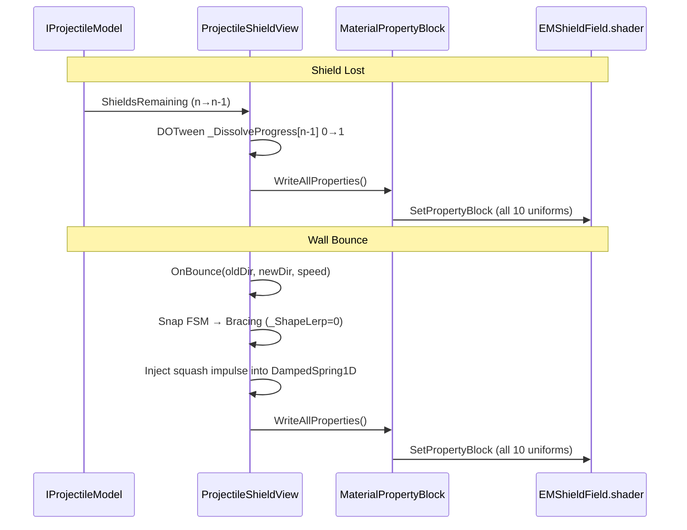

# Projectile

The projectile is the ball fired by the thrower. It travels in a straight line, bounces off walls, and pops balloons on contact.

## Gameplay

Each shot starts loaded on the thrower. When fired it moves freely across the screen, reflecting off the top, left, and right boundaries. Each bounce costs one shield. When shields are exhausted the projectile is destroyed, the grid rebalances, and the thrower reloads.

Cruise and Sweep both feed the projectile's tap system, and both are **runs** — each pays out only once the shot has strung enough of its own kind of segment together, and any segment of the other kind breaks the streak:

| | Cruise | Sweep |
|---|---|---|
| A qualifying segment | wall-to-wall with **no** balloon contact | popped at least one balloon, every contact on it a 1-HP one-shot kill, and the corridor behind it clear at the wall (backward circle-cast to `LastBouncePosition`) |
| Run counter | `ConsecutiveWallBounces` | `ConsecutiveSweeps` |
| Run length required | `CruiseWallBounceThreshold` | `SweepTapThreshold` |
| What breaks the run | any balloon contact | any wall reached without a clean clearing pass — including an empty traversal, which is cruise's business |

Sweep reuses Cruise's `SpeedGainPerTap` value, the same tap-beat easing, and the same piercing threshold. A deflect resets **both** runs (and the tap total) outright: `ProjectileView.OnBalloonDeflected` treats it as interrupting the whole flight.

**A wall hit mints at most one tap.** The two rules are two ways to *earn* one — never two. Both go through `ProjectileModelExtensions.TryGrantTap`, which stamps the `WallHitSequence` the resolver bumps on each surviving bounce and refuses a second claim on the same hit. It used to hold only because a pop cancelled the cruise in a third file — and was silently violated for armed shots, which collected both taps on one wall and compounded from there. While piercing both rules can now *legitimately* qualify on the same wall (a pop doesn't end an armed shot's cruise), so the refusal is a real first-come race with a harmless outcome: both claims are worth the same one tap. Note the currency is the *wall hit*, not the shield: shields only enter because the wall bounce is today the one place a shield is spent (`ProjectileMotionResolver` is the only `ShieldsRemaining` decrement).

**Taps never stop.** A wall hit is a wall hit, so an armed shot goes on earning them and goes on getting faster — the only thing that bounds it is the speed rail (see below). What piercing changes is *how* each tap's speed change is played:

- **Unarmed** taps play the **beat**: the shot dips to a standstill and winds back up to the new target (`CruiseTapCurve` / `CruiseTapEaseDuration`). That dip is how earning a tap reads, and it's deliberate.
- **Armed** taps play the **ramp** instead (`PierceArmRampCurve` / `PierceArmRampDuration`): the shot accelerates into the new target from the speed it is already travelling, no dip. The arming tap is the first of these; each later one simply re-anchors the ramp. Dipping an armed lance to a standstill every bounce reads as a hitch, not as power.

Each earned rung also fires `SpeedTapMintedMessage` (wall contact + the running tap count), which `CombatSoundRouter` plays as `GameSoundId.SpeedTap`. Authored as `MelodicMode.ScaleWalkUp`, the tap count *is* the scale degree, so the ladder is audible as a rising figure that restarts at the root with each new shot. The view publishes it by comparing the tap count across the whole wall-hit resolution, since the cruise tap is minted inside `Step` and the sweep tap after it returns — one message per rung either way, guaranteed by the per-wall mint guard.

Both are the same transition with different anchors (see the unified model below). On the solver's event timeline a ramp is a pure time cost, scaled by the speed gap it still has to close (`ShotCruiseConfig.ArmRampLagSeconds`).

Both are **one mechanism**, not two: a *speed transition* easing toward whatever speed the current tap count buys, differing only in where it starts (`ProjectileFlightState.SpeedTransitionKind`). A tap beat anchors at a standstill — that anchor *is* the beat, since `Lerp(0, target, curve)` is exactly "target × curve" — and an arm ramp anchors at the speed the shot was already travelling. So the ramp can never stall the shot (it blends two real speeds, and an unauthored or 0-start curve merely holds the arming speed), `0` duration disables either, and there is exactly one "how far into the current change" field rather than two that could disagree. `Flight.CurrentSpeed` carries the resolved speed for feedback that scales with velocity.

**`MaxSpeedMultiplier` is a safety rail, not a tuning knob** — and since taps accrue for the whole flight, it is what actually stops the shot. It clamps the **final** speed (buffs included, measured against unbuffed base) in both `ProjectileMotionResolver.ResolveFlightSpeed` and the solver's `CurrentSpeed`. Its job is purely that one fixed step must stay short enough to hit what it passes: at 8 base speed and a 0.02 timestep a step exceeds a balloon's chord (~0.875 wu) above ~×5.5 and the play area above ~×28, so ×5.5 is the meaningful bound. Velocity-scaled feedback normalizes against `ReachableTopSpeedMultiplier`, which is that rail.

On contact with a balloon the projectile absorbs that balloon's color. The shared `ColorStreakTracker` (`Game/Score/`) tracks consecutive same-color pops, but **shields are granted by items only** — see `ShieldItemHandler` and `ItemAssigner`. **`IRunConfig.StreakGrantsShields` gates this behavior**: when true (the old mode), a same-color streak of 2+ yields an additional shield per pop; when false (current), color streaks award no shields at all. The condition lives in `StreakShieldRule.GrantsShield`, called by both `ProjectileHitResolver` and the solver's `ShotSimulator`. Neighboring balloons nudge outward from the impact point using slot-based positions (logical grid positions, not visual transform positions) to ensure consistent nudge direction regardless of in-progress animations.

When a hit returns `HitOutcome.Absorb`, `ProjectileHitResolver` dispatches `ActorHitMessage(Absorb)`, sets `model.IsFree = false`, and returns `ProjectileHitVisual.Destroyed` — the view then calls `DestroyProjectile()`. `Absorb` is produced by `AbsorberActorModel` (always absorbs, killing the projectile) — no balloon model returns it; balloon hits resolve to `Pop`, `Deflect`, or `PassThrough`.

## Turn-based flow

A shot and the board's spawning run on separate tracks (see @ref arch_turn_pipeline):

1. **Projectile flight** — bounces, pops balloons, nudges neighbors. The board keeps settling during flight too: `BalloonBalancer.Tick` pulses a full rebalance every `IBalloonsConfiguration.FlightRebalanceInterval` all through play, gated on no lone doomed ball gliding its last-shield approach, not paused, and on `HasPossibleMove()` finding an actual gap to close.
2. **Projectile death** — publishes `BalanceBalloonsMessage` (fallback) and `ProjectileDestroyedMessage`.
3. **Spawn + balance (independent of the shot)** — `SpawnClock` requests one line per interval; for each, `BalloonSpawner` runs a pre-line `Balance()` pass, spawns the line, then publishes `BalanceBalloonsMessage`. A ball's death does not trigger it.

See @ref arch_balance_flow for the full balance algorithm and its entry points.

## Pooling

The projectile is **pooled, not destroyed**. A single instance is created via `ProjectilePoolChannel` on first load and reused across turns. On death the projectile publishes messages but does not self-destruct — `ThrowerController` returns it to the pool and immediately re-gets it.

- **`OnDespawned()`** — nulls model, resets glow, disables trail via `ProjectileTrail.Disable()`, resets shield view
- **`OnSpawned()`** — resets shield-shown flag; trail stays disabled until the projectile is fired

Trail management is handled by `ProjectileTrail`, a child component on the trail GameObject. It is **not** `IPoolable` — the projectile itself is pooled, so its children's lifecycle follows the parent. `ProjectileTrail` exposes `Enable()` / `Disable()`:

- **`Enable()`** — `async UniTaskVoid` that yields one frame (`UniTask.Yield(destroyCancellationToken)`), clears the trail, then re-enables emitting (prevents snap artifact from position change)
- **`Disable()`** — stops emitting and clears immediately

`ProjectileView` calls `Enable()` on the first `FixedUpdate` frame where `IsFree` is true (fired) and `Disable()` on death and despawn.

The shield field is hidden until the projectile is fired. `ProjectileShieldView` starts inactive on `Awake()` and is shown via `Show()` on the first `FixedUpdate` frame where `IsFree` is true.

## Shield Visuals

The projectile's shield appears as a glowing force field resembling magnetic field lines
wrapping around the ball. Each remaining shield adds a visible concentric layer (up to a
configured maximum). When a shield is gained, it appears with a wipe sweeping from the leading
tip to the tail. When lost, the outermost layer crumbles away (starting from the front).

While the ball is flying, the glow stretches into a comet shape with a tail trailing behind
it. As the ball nears a wall, the glow smoothly tucks into a circle, holds that round shape
through the bounce, then stretches back into the comet as it flies away. On impact, the circle
visually squashes against the surface — compressing along the wall normal and expanding
sideways — then springs back. This works for both flat wall bounces and angled deflector
bounces. The field also ripples faster the quicker the ball moves.

The field's halo also burns brighter as shields stack. With one shield it is as authored; each
further shield multiplies it by `GlowPerShield` more, up to `MaxGlow` (`ShieldGlow.For`, sent to
the shader as `_HdrBoost`). Past 1 the halo is brighter than white, so a big shield glows; see
@ref plan_hdr. Only the halo is boosted: the field lines keep the shot's palette colour, which stays
within 0–1. The brightening ramps in over the new layer's reveal and out over a lost layer's
dissolve.

A four-state cycle (Cruising → Closing → Bracing → Opening) drives the shape transition.
The game predicts how far the next wall is; when it falls below a threshold, closing begins.
On bounce, the shield force-snaps to circle regardless of the current state.

### Implementation

`ProjectileShieldView` feeds 10 uniforms to the `EMShieldField.shader` (a single-quad
procedural shader — one draw call). All uniforms — per-layer dissolve/reveal arrays, active
layers, color, velocity factor, noise scroll direction, shape lerp, noise intensity, squash
amount, and squash axis — are written to a single `MaterialPropertyBlock` and pushed through
`WriteAllProperties()`. Both tween callbacks and the per-frame `Update()` call this method,
which writes **every** property before calling `SetPropertyBlock`. This single-push pattern
prevents split-brain overwrites where one code path's push would erase properties written by
another. Configuration lives in `IShieldFieldSettings` (injected, not serialized on the view).

All VFX (gain/lose/bounce particles) are spawned via `ParticlePoolChannel` as world-space
particles — they are not children of the projectile and survive recycling independently.

### Event Flow

See @ref plan_em_shield_field for the full shader design and phase status.

## Pierce & Discharge Feel

A piercing shot doesn't pop the tough (`hits > 1`) balloons it plows through on contact — it carries them until it **discharges** at the next wall. (The plow-then-shatter mechanic itself — driven by cruise piercing and the Snipe item — is documented in `Item/README.md`; this section covers only how the projectile *sells* it.) Two lights carry the beat:

- **Telegraph** — while a tough balloon is ahead on the shot's current straight run, its carried scene light stretches into a capsule out to the wall that run ends at, through that tough, warning of the armored contact a moment before it lands. Once nothing tough is ahead, the light snaps back to a point following the shot. `ProjectileView.TryFindToughAhead` casts forward to the next wall and collects *every* balloon on the way. `PierceTelegraphScan.TrySelectNextTough` (plain C#, tested headless in `PierceTelegraphScanTests`) then picks the nearest tough the shot hasn't already plowed this run. Ordinary balloons in front never hide the line: the pierce pops them in passing, so they are not what the line warns of. Neither does the Snipe host the shot has just popped, so the line shows the moment a Snipe arms the lance with a tough ahead. The same per-frame result also drives the pierce spiral's fade-in.
- **Spark** — every tough actually plowed pops a brief Sparks-coloured flash at the strike point (`FlashPierceSpark`), fired synchronously from `OnTriggerEnter2D` — so a tight run of several toughs plowed in one physics step each still get their own flash instead of blurring into one.

Each wall a piercing shot reaches also publishes `PierceWallReachedMessage` (the shot, the wall contact, and `Discharged`: whether plowed toughs shattered at this wall), including the wall it dies on. It goes out after that wall's discharge has resolved, so a listener reading `IsPiercing` learns whether the lance carries on past it. `Discharged` comes from `ProjectileHitResolver.DischargePending`, which returns true only when something shattered; on the wall a shot dies on it is whether anything is pending for the death flush. The Snipe pencil line (`Item/Snipe/SnipeLanceLines`) pins the discharging run's end off it; it starts drawing earlier, on the run's first plow, read from `IProjectileFlightState.PendingPierceHitCount`.

The discharge itself plays a shared shockwave-and-slow-mo beat, owned by `Controller/PierceDischargeEffects` off the `PierceDischargedMessage` the discharge publishes: a `DisturbanceField` shockwave stamp (`StampSource.PierceDischarge`) at the shattered line, and a brief real-time slow-mo dip (`TimeScaleSource.PierceDischarge`; duration/scale from `IProjectileFlightConfig.PierceDischargeTimeScale`/`PierceDischargeTimeScaleDuration`) via a serial `CancellationTokenSource` — a discharge landing mid-dip restarts the dip cleanly instead of layering, and only the dip that runs to completion releases the claim. On a water level the lance parts the water for its whole flight, not at the discharge: every fixed step a piercing shot flies, `Controller/PierceWake` reports two blasts along the stretch it flew (a wide weak one, `PierceWakeWaveRadius`/`PierceWakeWaveStrength`, for a wave to both sides, and a narrow strong one, `PierceWakeHeartRadius`/`PierceWakeHeartStrength`, for a thin sliver of bare sand), so a wake grows behind it from where it was armed to the wall. At the wall where its charge ends (it shatters what it plowed there, or dies) the wall stamp every shot leaves (`StampSource.ProjectileImpact`, through `StampShieldLoss`) carries one small round blast (`PierceWallImpactRadius`/`Strength`/`Seconds`), a crater smaller than a bomb's that ends the wake; a lance that only bounces, still armed with nothing plowed, gets none, and the discharge's own stamp carries none, so one wall hit digs one crater. A cruise-earned pierce is the same state on the shot (`IsPiercing`) and leaves the same wake (`Scenario/README.md`, Water). The rainbow colour-bloom that plays on the same message is a separate effect owned by the Snipe item (`SnipeDischargeBloom`), not by the projectile.

The discharge fires at the **next wall bounce** after the shot plows at least one tough — every tough plowed on a single wall-to-wall segment is collected and shattered together when the shot hits the wall (`ProjectileMotionResolver.Step`, wall-discharge branch). If the shot dies at the wall (no shields), `DestroyProjectile` flushes pending hits as a safety net. Piercing persists indefinitely across empty-corridor walls (no toughs plowed = no discharge), so the buff only ends when the shot actually encounters a tough line. Until its discharge, a plowed balloon holds the slot it was struck in: the formations ask `ProjectileRegistryExtensions.AwaitsDischarge` (over `IProjectileFlightState.HasPendingPierceHit`) and move nothing plowed, so a snake splits at it (`Balloon/Formation/README.md`).

A meadow mushroom does not turn a piercing shot: a lance cuts the cap and flies on, so its run, its telegraph and the sweep below still end at walls alone (see [A lance cuts caps](#a-lance-cuts-caps)).

**Tunneling safety net** — at high cruise/pierce speeds the projectile can tunnel through balloons (Unity's `OnTriggerEnter2D` fires per-fixed-step and can skip thin colliders). On every wall bounce while piercing, `SweepPierceMisses` runs a `CircleCastAll` from the segment's start to the wall hit. Any tough balloon in the swept path that wasn't already registered via trigger is added to `PendingPierceHits` before the discharge resolves — guaranteeing every tough in the flight line is shattered.

## Mushroom bounce

On a meadow level the board has mushrooms: permanent bumpers a ball that is not a lance bounces off (`Plans/PLAN-MeadowMushrooms.md`). A lance bounces off none: see [A lance cuts caps](#a-lance-cuts-caps). A mushroom has no collider. Its bounce is worked out, like the walls': every fixed step, `ProjectileMotionResolver.Step` flies the step's stretch against the bumper circles before it looks at the walls. A **bumper circle** (`BumperCircle`, from `IBumperField`, which `Slots/Grid/MushroomBoard` implements) is the mushroom as the ball's centre meets it: the mushroom's radius plus the ball's. The circles act on the same point the walls do, the position `Step` is handed.

| What | How |
|---|---|
| Finding the contact | The whole stretch is swept (`Shared/BumperSweep`), from where the step starts to where it would end, so no speed carries the ball through a mushroom. The earliest entry wins, and the contact is the exact point the centre's path enters the circle, not where a step ended |
| The order at a contact | `MushroomChainRule.OnBounce` counts the bounce into the flight's chain (`ProjectileFlightState.MushroomChain`) and answers what it pays. Then the one bounce rule (`IBumperBounceRule`: the forgiving kick, or the mirror reflection when the settings turn the kick off) is asked which way the ball leaves. The ball turns, and what is left of the stretch is flown along the new direction, as `Deflect` carries a deflecting balloon's remainder |
| The bounce that arms | When `OnBounce` answers `Arm` the step ends on the mushroom: the ball has turned and what was left of the stretch is not flown. The ball is armed by whoever hears the step's bounces, after the step, so nothing the step did past that bounce could be flown as the lance the ball had just become: a wall there would be settled as an ordinary ball's, and a ball with no shield would die there and be armed dead. The next step flies from the bounce as the lance, at the lance's speed. It costs under one step's length of travel, once an arming. Nothing else pays: no charge is banked |
| No shield | A mushroom bounce spends no shield and is not a wall hit: no tap can belong to it. Walls end flights; mushrooms do not |
| The chain and the wall | The count is by wall of caps: `OnBounce` is told the wall the cap stands in (`BumperCircle.Wall`), and the wall hit last does not count again until another has been. A pop or a deflect leaves the count alone. A wall of the board clears it (`MushroomChainRule.OnWall`), in `Step`, right where the wall bounce is counted (`WallHitSequence`), on the same step |
| Several in one step | The stretch is flown bounce by bounce until its length is used, at most 8 bounces to a stretch. Past that the rest is flown untested and the next step picks the ball up |
| The mushroom being left | Is not tested again while the ball still flies the direction it left along (`ProjectileFlightState.LeavingBumperId`): starting on its circle, a line leaving close to the tangent would be read as entering it. Any turn ends that |
| A spent stretch | A stretch between two walls has at most `MaxBouncesPerStretch` (12) bounces. Past that `OnBounce` answers `PassThrough`: the ball is not turned, the bounce rule is not asked, and it flies on through every mushroom to a wall |
| A lance | A piercing shot is not bounced: it cuts the cap (below) |
| After a wall | The stretch a wall bounce flies back off the wall is swept too, in the same step. At speed it reaches a mushroom, and at the speed rail a step is over twice a mushroom wide. The stretch is rebuilt forward from the leg that met the wall: to the wall's crossing, the heading mirrored there, and on, for each wall of a corner (at most 4 walls). It is not walked back from where the step ended: after a corner the step's direction is the two walls' normals summed, not the direction of its last leg |
| A ball found inside a circle | Bounces at the point its line came in (a deflect off a balloon next to a mushroom can set it down there), and the distance it has flown since is carried along the new direction |
| The empty-corridor run | The shot's cruise ends at a mushroom it bounces off and its count of empty wall bounces starts again, as on any balloon contact. The taps it has earned stay. An armed shot bounces off none, so its run is not touched |

A step that bounced off a mushroom and met no wall has the outcome `BumperBounced`, and `WallContact` is then the last contact point. A step can also bounce off a mushroom and still reach a wall: the outcome is the wall's, and `ProjectileStep.BumperBounces` says how many mushrooms there were. Each bounce is a `BumperBounce` in `ProjectileMotionResolver.StepBumperBounces` (the mushroom's id and slot, the contact point, where that leg began, the directions in and out, the count after it, the reward, and whether it came after the step's wall), to be read straight after the step. That list is one for every ball and the next `Step` of any ball refills it, so the view copies it before it publishes anything about it.

A step that bounced off a wall carries two directions. `Direction` is where the ball goes next. `WallDirection` is how it left the wall, and the two differ only when a mushroom turned the ball again on the way back within the step. What is said of the wall bounce itself takes `WallDirection` (the shield's squash); cruise entry takes `Direction`. On every other step the two are equal, and they are always equal for a lance, which no mushroom turns.

### A lance cuts caps

A piercing ball, however it was armed (a chain of mushrooms, a Snipe pickup, the Sharpshooter card, its own cruise), does not bounce off a mushroom. It flies straight on and cuts every whole cap its path enters (the owner's rule, `Plans/PLAN-MeadowMushrooms.md`, decision J).

| What | How |
|---|---|
| Finding the caps | `ProjectileMotionResolver.CutCaps` sweeps the lance's whole stretch with the same swept test a bounce uses (`Shared/BumperSweep`), nearest cap first, as often as it finds one: before the walls, and on the stretch flown back off a wall while the ball is still piercing. Each cut takes a cap out of the field, which is what ends the sweep; a field that takes none out ends it too, with nothing cut and nothing announced |
| What a cut does to the flight | Nothing to its path. The ball is not turned, the step ends where it was going to, no shield is spent, and the chain is not asked: a cut is no hit and breaks no chain. A step that only cut caps has the outcome the walls gave it |
| What a cut banks | One plain lance charge for the shot, every cap, whatever armed the lance and with no limit (`Plans/PLAN-MeadowMushrooms.md`, decision K). `CutCaps` adds it to the flight's own counter, `Flight.BankedPierceCharges`, the one a Snipe picked up mid-pierce banks on, and counts the cut in `Flight.CapsCut`. It is spent as any banked charge is: at a wall where the pierce discharges (the lance plowed a tough balloon on the way there) `SpendPierce` keeps the shot a lance and `Item/Snipe/SnipeItemHandler` takes the charge and arms it afresh; a shot that dies at that wall takes its charges with it, and with no tough plowed no wall spends the pierce or a charge. **It is banked in the step, not by whoever hears of the cut:** the stretch is swept before its wall is settled, so a cap cut in the very step that reaches the discharge wall has already kept the lance armed there. What bounds a lance that keeps re-arming: every wall still costs a shield, lance or not, so a flight has one leg more than it has shields; and a cut cap is gone until it grows back, five beats later |
| What a cut does to the cap | `IBumperField.Cut` takes it out of the bumper field there and then, inside the step. From that moment it is no bumper for anything: the sweep that follows does not find it (so a cap is cut once), the next ball flies through where it stood, and the kick is handed the caps that are left, so it bends no ball toward a cut cap and lands none for one. The stem keeps the slot |
| The cap that armed the ball | Is the one the ball is leaving (`LeavingBumperId`), which no sweep tests while the ball flies the direction it left along. So the arming bounce is a bounce, and the cap that armed the ball is not cut by it on the way out; if the lance comes back to it off a wall, it is |
| A lance spent at a wall | Is an ordinary ball again from that wall on (it discharges there once it has plowed a tough balloon): on the stretch back off the wall the caps that are whole bounce it, in the same step |
| Telling the game | Each cut is a `CapCut` in `ProjectileMotionResolver.StepCapCuts` (the cap's id and slot, a point inside the cap on the line it splits along, the lance's direction, and `Charges`: how many caps the flight has cut with this one, which is which charge this cut banked), read straight after the step like the bounces. `ProjectileView.AnnounceCapCuts` copies them and publishes one `MushroomCutMessage` each, cause `Lance`, with that count. The point is where the lance's line passes nearest the cap's centre (the line carried on both ways, so for a lance that began its step inside the circle it can lie behind the ball); when the line passes outside the cap and only the ball's edge clipped it, the point is drawn in to 0.85 of the cap's radius, off the line the centre flew, so a sliver comes off |
| A ball leaving a cap another ball cuts | Still names that cap as the one it is leaving (`LeavingBumperId`), and nothing is found under that id: the caps that are whole bounce it as before, and when it comes back over the stem it flies through |
| A cap that grows back near a ball | The regrow waits while a ball's centre is inside the circle the cap is to have (`Item/README.md`), so a cap does not close round a ball. Were one to, the ball is one found inside a circle: it bounces at the point its line came in (above), and a lance there cuts the cap again |
| Growing back | Not the flight's business: `Item/Snipe/MushroomRegrowController` puts the cap back on the board's beat, five beats later (`Item/README.md`) |

Nothing that looks ahead of a lance counts a mushroom as in its way (`BumperLookahead.TryFindAhead` is told the ball is piercing and answers no): its last-shield glide is doomed through a mushroom, and its pierce telegraph runs to the wall.

**With no mushrooms on the board the step is what it always was.** `Step` asks the field for its circles, finds none, and goes down the walls-only path it had before: the same operations in the same order, nothing allocated. Two tests hold that. `ProjectileMotionResolverGoldenTests` flies five scripted shots (walls alone, a corner, a doomed last-shield glide, a cruise entry, a pierce discharge at a wall) and holds every step to numbers captured from the resolver as it stood before the mushrooms. `Step_WiredToAnEmptyBoard_IsBitForBitTheResolverBuiltWithoutABumperField` flies one shot through a resolver wired to an empty board and through one built without a field, and holds every step equal to the bit: the field's presence alone changes nothing.

`ProjectileView` does the rest, in `ResolveBumperBounces`:

- **Tells the game.** One `MushroomBouncedMessage` for each bounce, in order: the mushroom's slot and place in the chain, the contact point, the ball's incoming direction and speed, the count after the bounce, and the reward the chain rule answered. `MushroomChainController` (`Item/Snipe/`) pays the reward, and the mushroom's own view leans its cap away from the hit (`Slots/README.md`, *The mushroom on the board*). The messages are published from the view's own copy of the step's bounces.
- **Starts a new straight leg.** The Sweep rule's segment starts again at the bounce (`LastBouncePosition`, the segment's pops), as at a deflect, so its back-trace from the next wall runs along one straight line. The run of sweeps and the taps are kept.
- **Has nothing of a lance's to keep.** Only a ball that is not piercing bounces, so the tunnelling sweep (`SweepPierceMisses`) still runs wall to wall, the Snipe's pencil line turns at walls alone, and a lance's wake (`PierceWake`) is two straight stretches either side of a wall.
- **Plays no wall effect.** The shield's bounce squash plays; the wall's own bounce VFX, shield loss and stamps do not.

Everything in the view that looks ahead of a ball that is not a lance counts a mushroom as in its way, through one rule (`BumperLookahead.TryFindAhead`, which `TryFindBumperAhead` hands the board and the ball to). The ball's own flight takes a mushroom out of its way in two cases: the mushroom it is leaving, and every mushroom once its stretch has had its bounces. Both hold only on the leg from the ball to its first wall. A lookahead that traces on past a wall (the cruise check) says which leg it is asking about, and on every later leg the mushrooms are in the way: the wall clears the chain, so they bounce the ball again.

| Lookahead | With a mushroom ahead |
|---|---|
| The doomed last-shield glide (`IsPathClearAhead`, one segment) | The shot is not doomed: it will bounce, and the wall behind the mushroom is not certain death. Without this the glide would carry it through the mushroom |
| Cruise entry (`TryEnterCruise`, `IsPathClearAhead` over the threshold's segments) | The corridor is not empty: no cruise |
| The pierce telegraph (`TryFindToughAhead`) | Nothing: a lance cuts through, so the run it can plow on ends at the wall, as on a board without mushrooms |

The aim line (`Prediction/README.md`) and the shot solver (`Editor/ShotSolver/README.md`) bounce off the mushrooms by the same swept test and the same two rules, called in this order, and both run a lance straight through them: the line of a ball loaded as a lance, and of a ball from the corner where its chain arms it, turns at walls alone.

## Buffs (`Buffs/`)

A **projectile buff** is a temporary stat modifier on one ball following the
industry-standard *Flat / Additive / Multiplicative* stacking pattern:

\f[
\text{final} = \big(\text{base} + \sum \text{flat}\big) \times \big(1 + \sum \text{additive}\big) \times \prod \text{multiplicative}
\f]

Each buff carries four fields:
- **`ProjectileBuffId`** — which stat (`Speed`, `RainbowShield`, …).
- **`float Value`** — the numeric contribution.
- **`BuffModifierOp`** — `Flat`, `Additive`, or `Multiplicative` (determines aggregation lane).
- **`IProjectileBuffEndCondition`** — pluggable lifecycle (flips `Expired` when done).

Multiple buffs targeting the same stat stack correctly:
- All `Flat` values sum → added to base.
- All `Additive` values sum → applied as \f$\times (1 + \text{sum})\f$.
- All `Multiplicative` values multiply independently.

The two abstractions live in `Model/`, the service in `Buffs/`:

- **`ProjectileBuff`** (`Model/IProjectileBuff.cs`) — sealed class. Carries Id, Value, Op, EndCondition.
- **`BuffModifierOp`** (`Model/BuffModifierOp.cs`) — enum: `Flat`, `Additive`, `Multiplicative`.
- **`IProjectileBuffEndCondition`** (`Model/`) — the "when it ends" abstraction: exposes only `IReadOnlyReactiveProperty<bool> Expired`. An implementation encapsulates its own lifecycle logic and flips the bool once. `WallBounceEndCondition` (subscribes to `ShieldLostMessage`, ends on the first wall bounce of *its own* ball) is the only one today; a `Timer`/`PopCount`/... end-condition is a new implementer — no context, no switch, no change to any buff.
- **`IProjectileBuffs.Apply(ProjectileBuff)`** — the activation seam, injectable anywhere. Just takes the buff; the buff already carries its end-condition.
- **`ProjectileBuffService`** — `IStartable` owning storage + lifecycle: keeps buffs per ball: `Apply` names the ball (a buff for a ball no longer held or in flight is dropped), and a buff is dropped the first time its `EndCondition.Expired` fires or when `IProjectileRegistry.Retired` fires for its ball (after the ball's Destroyed dispatch, so every subscriber still sees its buffs). Knows nothing about any buff's effect or end-condition — it only observes the exposed signal. Publishes `ProjectileBuffGainedMessage` when a ball takes on a kind of buff it didn't hold (and the buff outlived its own `Apply`), so another buff of a kind already held stays quiet.

The model stores buffs in a plain list exposed via `HasBuff(ProjectileBuffId)` (read), `ComputeBuffedValue(id, baseValue)` (aggregated stat query), and `AddBuff`/`RemoveBuff` (write); a fresh `ProjectileModel` per throw resets them for free.

## How it works

- **`ProjectilePoolChannel`** — `InjectingPoolChannel<ProjectileView>` that creates projectiles via `IObjectResolver` injection from the parent container (no child scope on the prefab). Accessed through `PoolManager`.
- **`Controller/DeflectChainController`** — plain C# entry point. Counts each ball's deflects off balloons (`ActorHitMessage` with `HitOutcome.Deflect` and `DamageFlags.DirectHit`, so an item's blast doesn't count) in a `ProjectileTally`; a wall (`WallHitMessage`) breaks the run, pops don't. From the second deflect in a row it publishes `DeflectChainMessage` (the ricochet heads-up), and every `IRunConfig.DeflectChainShieldEvery` in a row (`DeflectChainRule`) it adds a shield to the ball, marks that `DeflectChainMessage` `PaidShield`, and publishes `ShieldGainedMessage` with source `Ricochet`, so the trail shows the shield while the heads-up credits the ricochet rather than a pickup. Grid deflector actors bend the ball in motion without a hit message, so only balloons that deflect (tough with hits left, unbreakable) count. The solver's flight simulation doesn't model the reward yet, so its best shot doesn't aim for ricochets.
- **`ProjectileTally`** — a running count per ball in the air (`Record`, `Forget`), shared by the deflect chain and the bounce heads-up's pickup count.
- **`Controller/ProjectileHitResolver`** — plain C# singleton owning the hit rules: calls `balloon.EvaluateHit(context)` for the pre-computed outcome, applies the colour-steal (projectile absorbs a popped balloon's color), increments the current-segment pop count for Sweep, tracks whether every segment contact was a 1HP one-shot, and applies the streak-shield rule (reads `ColorStreakTracker` immediately after dispatch — `IHitDispatcher` guarantees the score stage already ran). It dispatches the `ActorHitMessage` through `IHitDispatcher` and returns a `ProjectileHitVisual` for the view to play. Every contact carries `DamageFlags.DirectHit` — this is what marks the hit as projectile-struck (vs. AOE items) for `BalloonSpawner`'s pop-spawn roll — plus `Piercing` while the shot is piercing. When the projectile carries a `ProjectileBuff` with `ProjectileBuffId.RainbowShield` it also flags the hit `WildcardStreak` (colour-agnostic scoring) and rainbow-converts the two side neighbours of a pop based on the projectile direction; the buff itself does not force a non-piercing shot to plow through tough/unbreakable balloons.
- **`Controller/ShotPaintLedger`** — plain C# singleton: which balloons each shot painted rainbow itself (the disco ball's wave, `Balloon/Reward/DiscoWave`), keyed by model reference and dropped when the shot retires. `ProjectileHitResolver` asks it on a rainbow pop: one the shot painted itself is flagged `DamageFlags.OwnPaint` instead of `CarryStreak`/`DeferredStreak`, which scores at the streak as it stands, and grants no streak shield. Without it the shot that broke a disco ball would climb an uncapped streak on the board it just painted.
- **`Controller/ProjectileHitVisual`** — enum result of a resolve (`None`, `Recolored`, `Destroyed`) so the view knows which feedback to play without re-deriving the rules.
- **`Controller/ProjectileTapResolver`** — plain C# singleton owning the projectile's **speed economy** end to end: who may mint a tap (`TryGrantTap`, the single funnel both grant rules come through, enforcing one tap per wall hit), the Sweep run rule (`TryAwardSweepTap`, returning a `ProjectileSweepOutcome` so a caller can drive editor visuals), the speed a tap count buys including the safety rail (`ResolveSpeed`, which also publishes `Flight.CurrentSpeed`), and the reachable ceiling velocity-scaled feedback normalizes against. Physics never reaches in: the sweep's corridor probe arrives as a `PathTrace.SegmentBlocked` delegate, so the rule is headless-testable (`ProjectileTapResolverTests` needs no `GameObject`) and an analytic tracer can be substituted. `ProjectileMotionResolver` and `ProjectileView` both depend on it rather than duplicating any of it.
- **`Controller/ProjectileMotionResolver`** — plain C# singleton owning the flight rules: advances one fixed step, wall-bounces via `WallLimits`, decrements shields, and decides destroy-vs-continue, mutating the model's direction/shields. `ProjectileView.MoveAndBounce` just applies the returned `ProjectileStep` (transform, bounce VFX, `ShieldLostMessage`, disturbance stamp); `Deflect` reflects off the balloon's ANALYTIC contact normal — the travel ray is backtracked to its exact entry into the combined-radius contact circle (`TryComputeContactNormal`), since the trigger fires at a discrete fixed step up to ~0.16 wu inside the balloon and a radial normal there would displace the reflection by up to ~30° (the balloon's world collider radius rides `BalloonDeflectedMessage.SurfaceRadius`). The wall-discharge branch also lives here — at each surviving wall bounce it checks for pending tough plows and, if any exist, spends the pierce via `ProjectileModelExtensions.SpendPierce`: a banked Snipe charge (see `Item/README.md`) re-arms the lance in place so `IsPiercing` never dips, otherwise the pierce ends. Either way the cruise that fed it ends, so a re-armed lance restarts from base speed (see [Pierce & Discharge Feel](#pierce--discharge-feel)). Because the flag can survive a discharge, `ProjectileView` triggers the shatter off the wall bounce itself rather than off the flag. Headless-testable — see `ProjectileMotionResolverTests`.
- **`ProjectileRegistryExtensions`** — the lone-ball rule for effects that reach beyond one ball: `DoomedShotFliesAlone` is true only while exactly one ball flies and it is on its last shield. The doomed slow-mo (`ProjectileDoomedTimeScaleController`), the spawn clock's line hold and the balancer freeze all gate on it, so with several balls up, one ball's last breath never slows or freezes the game under the others.
- **`Controller/PierceDischargeEffects`** — plain C# `IStartable`/`IDisposable` singleton subscribing to `PierceDischargedMessage`; plays the shockwave stamp and slow-mo dip described in [Pierce & Discharge Feel](#pierce--discharge-feel).
- **`Controller/PierceTelegraphScan`** — pure static helper behind the pierce telegraph: given the balloons a forward cast crossed (`PierceCastCandidate`: model, distance, position), returns the nearest tough not yet plowed this run. `IsPlowed` is also what `ProjectileView`'s tunneling sweep uses to skip toughs already pending. See [Pierce & Discharge Feel](#pierce--discharge-feel).
- **`Controller/ProjectileStep`** — result of one advance (`Moved` / `Bounced` / `Destroyed` / `BumperBounced` + resulting position and direction, the direction off the wall where a mushroom turned the ball again afterwards, and how many mushrooms the step bounced off) that the view presents without re-deriving the rules. `Controller/BumperBounce` is one of those bounces. See [Mushroom bounce](#mushroom-bounce).
- **`Controller/BumperLookahead`** — the one rule for whether a mushroom is in the way of a straight run ahead of a ball, pure and static so it is tested without a view: what the ball's own flight excuses (the mushroom being left, a spent stretch) holds on its first leg only.
- **`IProjectileModel`** — read-only interface exposing `IReadOnlyReactiveProperty<string> ColorName`, `IReadOnlyReactiveProperty<int> ShieldsRemaining`, read-only plain properties (`Direction`, `Speed`, `IsFree`, `LastHitBalloon`), `HasBuff(ProjectileBuffId)`, and `ComputeBuffedValue(id, baseValue)` (see [Buffs](#buffs-buffs)). Used by shield UI and views that only observe state.
- **`IWriteableProjectileModel`** — mutable interface extending `IProjectileModel`; re-declares reactive properties as `ReactiveProperty<T>` (via `new` keyword), adds setters, and adds `AddBuff`/`RemoveBuff`. Used by `ProjectileView`, `ThrowerController`, the buff service, and cheats that mutate state.
- **`ProjectileModel`** — concrete class implementing `IWriteableProjectileModel`. Only referenced at creation sites (`ThrowerController.LoadProjectile`).
- **`IProjectileRegistry` / `IProjectileRegistryWriter` / `ProjectileRegistry`** — game-scope singleton that answers "which balls exist and where" for systems without a reference to the view. It holds the ball held in the thrower (`Loaded`), the balls in flight oldest first (`InFlightCount`, `InFlightAt`, `InFlightPositionAt`, `IsInFlight`), the latest one in flight (`TryGetLatestInFlight`, what single-target readers such as the level-up camera follow), and `ShotOrCurrent(ball)` (the ball an effect should land on: the named ball while it is alive, never swapped for another; with no ball named, the latest in flight, else the held one). Never cache the last-loaded ball as "the" ball — a fresh one can load while earlier ones still fly. Up to `IProjectileFlightConfig.MaxBallsInFlight` balls fly at once (see Rapid fire in `Thrower/README.md`).

  **Land, then Retire.** A ball leaves in two steps. *Land*: it stops being loaded or in flight, so every query already sees it gone. *Retire*: after that, `Retired` fires once and every per-ball store (`FlightStatsService`, `ColorStreakTracker`, `ProjectileBuffService`, `ActiveProjectilePierce`, `WallBounceEndCondition`, the sound routers) drops that ball's state. Splitting them lets subscribers of `ProjectileDestroyedMessage` see the ball as gone (`IsAlive` false) yet still read its stats, buffs and streak. Two writers share the job: a ball that dies lands itself right before `ProjectileView` publishes `ProjectileDestroyedMessage` and retires itself right after; the thrower handles every other exit (game over, reset, board clear, a held ball replaced, a ball un-fired at level-up), landing and retiring together, with no Destroyed published. `Load` / `Launch` / `Unlaunch` are the thrower's too. Every projectile message and `DamageContext` carries the ball (`IProjectileModel`), so a handler uses the ball its message names, not whatever is loaded now. A late item reward (Shield/Snipe activate a frame after the pop) goes to `ShotOrCurrent`, so it is not lost when the popping ball has already gone.
- **`ProjectileView`** — MonoBehaviour implementing `IPoolable`. Drives manual movement in `FixedUpdate` (skipped while `PauseService.IsAnyPaused`), checks bounds against `IProjectileFlightConfig.LimitsClockwise`, reflects direction and clamps position on bounce. Handles `OnTriggerEnter2D` — resolves the `BalloonView` via `GetComponent<BalloonView>()` on the collider (O(1) when the collider lives on the same GameObject as `BalloonView`) and hands the collision to `ProjectileHitResolver`, playing the returned `ProjectileHitVisual`. On each surviving wall hit it also evaluates Sweep beside the existing Cruise entry check: if the segment popped at least one balloon, never touched a >1HP balloon on that leg, and the backward circle-cast to `LastBouncePosition` is now clear, it awards a Sweep tap using the shared Cruise tap value and restarts the same tap-beat ease, then resets the segment state for the next leg. Publishes `ProjectileDestroyedMessage` and `BalanceBalloonsMessage` when shields reach zero, and `ShieldLostMessage` on each shield-spending wall bounce. Calls `_shieldView.OnBounce(oldDir, newDir, speed)` on wall bounces and balloon deflects to drive the shield field's squash dynamics. Neighbor nudging happens on the balloon side via `NudgeService`.
- **`ProjectileTrail`** — child MonoBehaviour on the trail GameObject. `Enable()`/`Disable()` manage `TrailRenderer` emitting state using `async UniTaskVoid` with `destroyCancellationToken`. Not `IPoolable` — lifecycle follows the pooled projectile parent.
- **`ProjectileShieldView`** — MonoBehaviour on the projectile prefab. Drives the `EMShieldField` shader via `MaterialPropertyBlock`: subscribes to `ShieldsRemaining` (reveal wipe on gain, noise dissolve on loss) and `ColorName` (tint) via UniRx. Per-frame `Update` steps the noise-scroll spring (`DampedSpring2D`) and squash spring (`DampedSpring1D`), runs the morph FSM, computes velocity-driven uniforms, and pushes all properties through the unified `WriteAllProperties()` method; tween callbacks use the same method, ensuring every `SetPropertyBlock` call writes the full property set. `OnBounce(oldDir, newDir, speed)` force-snaps to Bracing (circle), computes the impact normal as `normalize(newDir - oldDir)`, transforms it to local UV space, and injects a speed-scaled impulse into the squash spring. Spawns gain/lose/bounce VFX via `ParticlePoolChannel`.

## Interactions

- **ThrowerController** — gets/returns projectile via `PoolManager` + `ProjectilePoolChannel`; binds to a fresh `ProjectileModel` and registers it with `IProjectileRegistryWriter`; loads the next ball as soon as a shot leaves
- **SlotGrid** — queried for neighbor models to animate the nudge
- **BalloonView / BalloonModel** — collision target; color and stability state updated on hit
- **BalanceBalloonsMessage** — published on projectile death so the grid rebalances
- **ProjectileDestroyedMessage** — published on death; the thrower scales that ball away (the next one already loaded when the shot left)
- **PoolManager** — provides `ParticlePoolChannel` for VFX and `ProjectilePoolChannel` for projectile lifecycle
- **IProjectileFlightConfig** — provides `LimitsClockwise`, `ProjectileSpeed`, `ProjectileStartingShields`, and the cruise/sweep/pierce tuning; **IProjectileVisualConfig** — provides glow, spiral, flash, and death-presentation tuning
- **DisturbanceFieldService** — `ProjectileView` injects the shared disturbance field and calls `Stamp()` in `MoveAndBounce()` after position update, using the `Projectile` stamp profile from `DisturbanceFieldSettings`. On the first free frame it also emits the muzzle-exit force (`EmitFireBurst`): a cone of `ProjectileFire` stamps marched along the fire heading — count = that profile's `Interval` (repurposed), spaced by `Spacing` (\f$\text{length} \approx \text{Spacing} \times \text{count}\f$; 0 = Radius), with the radius growing (`RadiusGrowth`) and strength fading (`StrengthFalloff`) toward the far end (`0/0` = a uniform line) — tagged the reserved `Projectile` palette colour, with specks seeded along the same line first (`SpeckSpawnRequestMessage`, `SpeckSource.ProjectileFire`) so the stamps agitate them. Only the muzzle stamp reports impact (one bush-rustle per shot). It also publishes `ProjectileFiredMessage`. Creates visible wakes through Puff clouds. `Controller/PierceDischargeEffects` stamps the same field with `StampSource.PierceDischarge` when a piercing shot's plowed toughs discharge (see [Pierce & Discharge Feel](#pierce--discharge-feel))
- **TimeScaleService** (`Shared/Pause/`) — `Controller/PierceDischargeEffects` claims a brief real-time slow-mo dip under `TimeScaleSource.PierceDischarge` on each pierce discharge

- **SceneLightFieldService** — `ProjectileView` registers a small `Light` (radius/intensity from the `Scene Light` serialized fields) on the **first free frame** (when the shot fires, alongside the muzzle burst — it's dark while still held at the thrower), updates its `Position` to the transform each `Update`, and disposes the registration in `OnDespawned`. Its `PaletteIndex` follows the shot's colour (`UpdateGlowColor` sets it via `IGamePalette.IndexOfColor`), falling back to the `Sparks` palette entry while colourless — so the bullet casts a coloured point light into the scene-light field. This same light is the one that stretches into the pierce telegraph capsule (see [Pierce & Discharge Feel](#pierce--discharge-feel)); the shield-loss and pierce-spark flashes register short-lived lights of their own.

## Editor Gizmos

- **Sweep counting gizmo** (`ProjectileView`, `#if UNITY_EDITOR`) — visualizes the current sweep RUN toward `SweepTapThreshold`. Tracking starts on the first clean clearing pass, drawing a wire sphere at each subsequent wall hit and linking them into a polyline, with a faint tail from the last marker to the shot's live position. Markers are **red** while the run is still short of the threshold and **blue** once it is reached. Because the line is the run, it clears the moment the run breaks (a wall reached without a clean pass, or a deflect) as well as on despawn/spawn — otherwise it would draw a continuous clearing streak the rule never required.
