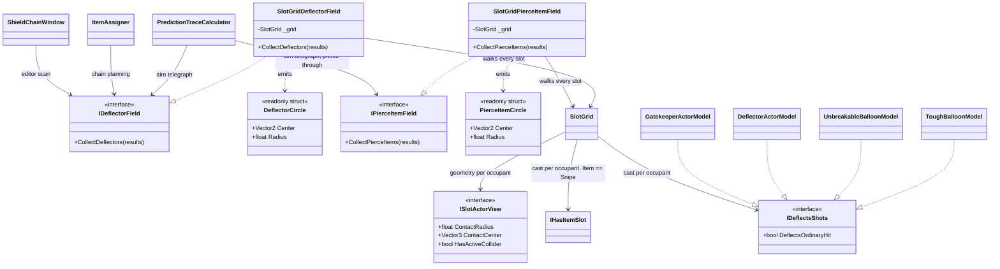

# Slots

The grid that holds all actors in play. Actors are anything that can occupy a slot — balloons today, static obstacles and spawners in the future.

## Actor abstraction

Every grid occupant is an `ISlotActor`. The grid never speaks directly in balloon types.

### Core interfaces

| Interface | Purpose |
|---|---|
| `ISlotActor` | Read-only grid contract — `SlotIndex : Vector2Int`, `Kind : SlotActorKind` |
| `IWriteableSlotActor` | Writable counterpart — adds `new Vector2Int SlotIndex { get; set; }` |
| `IDynamicSlotActor` | Extends `ISlotActor` — redefines `SlotIndex` as a reactive `new IReadOnlyReactiveProperty<Vector2Int>` and adds `IReadOnlyReactiveProperty<bool> IsStable`. Actors that can move or be in a transitioning state implement this. Static actors do NOT. |
| `IWriteableDynamicSlotActor` | Extends both `IDynamicSlotActor` and `IWriteableSlotActor` — adds writable `new ReactiveProperty<Vector2Int> SlotIndex` and `new ReactiveProperty<bool> IsStable` |
| `ISlotActorView` | View contract — `transform`, `TweenTracker`, `ActorKind`, `RotationPivot` (the transform an effect should rotate when tilting the actor, so lighting-baked children keep a consistent light direction), and the contact geometry the aim telegraph and shot solver read uniformly across every actor family: `ContactRadius`/`ContactCenter` (the collider's own radius and centre, not the pivot) and `HasActiveCollider` (false while a pooled view is mid-despawn) |
| `SlotActorKind` | Enum — `Dynamic` (balancer can relocate, contributes weight) or `Static` (fixed, contributes weight, balancer skips) |

### Capability interfaces

Optional traits actors can advertise to consumers:

| Interface | Meaning |
|---|---|
| `IHasColor` | Actor has a read-only reactive color identity (string) — consumed by views and item VFX for tinting |
| `IPaintable` | Extends `IHasColor` — actor's color can be overwritten by the Paint item. Exposes `ReactiveProperty<string> Color`. Actors that don't implement this are immune to paint |
| `IHasScore` | Actor awards score when destroyed |
| `IHasScoreColor` | Score attribution contract — `ResolveScoreAttribution(in DamageContext, IReadOnlyList<string> incompleteColors, IList<ScoreAttribution>)` called once by `ScoreController` at destruction. `incompleteColors` lists the palette colors still short of the level threshold, so scatter implementers (Tough, BubbleCluster) confine their random split to those bars. Implementations append `(colorId, points, breaksStreak, isPrimary)` entries. Consumed **only** by `ScoreController`; views never read it |
| `IHasNudge` | Actor participates in the nudge force system |
| `IHitable` | Actor participates in the hit system — `EvaluateHit(DamageContext)` returns a `HitOutcome` and is responsible for mutating any internal state (e.g. decrementing health). Takes a `DamageContext` containing `Damage` (int), `DamageFlags`, and `SourceColorId` (the color of the hitting projectile — read by `ResolveScoreAttribution` implementations that attribute score to the source rather than the actor's own color, e.g. `UnbreakableBalloonModel`). `Piercing` forces an immediate `Pop` regardless of `HitsRemaining` |
| `IHasDurability` | Extends `IHitable` — actor also tracks `HitsRemaining`. Removal is determined by `HitsRemaining.Value <= 0` after `EvaluateHit` returns |
| `IDeflectsShots` | `bool DeflectsOrdinaryHit { get; }` — whether the next ordinary (non-piercing, 1-damage) hit would bounce rather than pass through or pop. Asked by the aim telegraph and the shield planner, both of which need the answer without spending durability the way `EvaluateHit` does. A capability rather than a base-class rule because deflecting spans families — two balloon types and two static archetypes — so `SlotGridDeflectorField` can ask the grid for it without knowing what kind of actor answered |
| `IHasItemSlot` | Actor can host an item — extends `IHasColor` (item visuals always tint to the host color). Exposes `IReadOnlyReactiveProperty<ItemType> Item` |
| `IPassThrough` | Actor's slot can be crossed by animation paths (spawn entry, balance moves). Actors that do NOT implement this block traversal; rerouting is deferred to a future phase. |
| `IWashesProjectileColor` | Marker — a projectile that contacts this actor has its stolen colour reset to none, like a fresh launch (the soap-bubble cluster). The resolver asks `BalloonModelExtensions.WashesProjectileColor`, which also answers yes for a coated balloon; a plain balloon never takes this marker itself, because the solver reads it as "resists paint" |
| `ICoatable` | `IReadOnlyReactiveProperty<int> Coat` — layers of foam a ripe bubble cluster handed the actor when its fuse ran out (only `BalloonModel` implements it). While it has any, an ordinary hit takes one off and passes through, leaving the actor untouched and scoring nothing; a piercing or beam hit pops it, coat and all. Its contact washes the shot's colour |



### Hit types

`DamageContext` wraps damage with optional flags:

| Type | Description |
|---|---|
| `DamageContext` | Readonly struct — `int Damage` + `DamageFlags Flags` + `string SourceColorId`. Default `Flags = DamageFlags.Normal`, `SourceColorId = ""`. `SourceColorId` carries the palette color name of the projectile or item responsible for the hit — used by `UnbreakableBalloonModel` for score attribution to the source color |
| `DamageFlags` | `[Flags]` enum — `Normal = 0`; `Piercing = 1 << 0` bypasses `HitsRemaining` and forces `Pop`; `WildcardStreak = 1 << 1` marks a colour-agnostic streak (a rainbow-buffed shot keeps the streak climbing regardless of colour); `DirectHit = 1 << 2` marks a hit the projectile itself struck, as opposed to AOE/item damage (gates `BalloonSpawner`'s pop-spawn roll and `SnipeItemHandler`'s lance activation); `1 << 3` is unused (it banked a colourless shot's rainbow pops until a colour came; those now climb at once, as `CarryStreak`); `Ripple = 1 << 7` marks a hit from a ripe bubble cluster's ripple (`RipeBubbleBurst`): it lands after the pop that set it off, so `ScoreController` scores it at the shot's streak as it stands and changes nothing (no climb, no break, no restart on the neighbour's colour); it never comes with `DirectHit` |

Paintability is expressed purely through types: a `BalloonModel` implements `IPaintable`; a `ToughBalloonModel` does not — no runtime flag needed.

**Rainbow ("all colours") is a colour, not a flag.** A rainbow balloon carries the reserved id `GamePalette.RainbowColorId` in its `IHasColor.Color` — there is no separate `IsRainbow` capability. Detect it with `IGamePalette.IsRainbow(colorId)`; branch behaviour on that (score wildcard, colour-steal skip, banded material) rather than reading an arbitrary spawn colour. Paint converts a target simply by recolouring it to the wildcard id.

`IHitable` vs `IHasDurability`:

| Actor | Implements | `EvaluateHit` behaviour |
|---|---|---|
| `BalloonModel` (soft) | `IHasDurability`, `IHasScoreColor` | `PassThrough` on survival, `Pop` on death; decrements `HitsRemaining`. `Piercing` flag → `Pop` immediately. No score attribution when `HitsRemaining > 0` after hit |
| `ToughBalloonModel` | `IHasDurability`, `IHasScoreColor`, `IDeflectsShots` | `Deflect` on survival, `Pop` on death; decrements `HitsRemaining`. `Piercing` flag → `Pop` immediately. Score scattered across the still-incomplete color bars on pop. `DeflectsOrdinaryHit` is `HitsRemaining.Value > 1` — the last hit pops rather than bouncing |
| `UnbreakableBalloonModel` *(Phase 7.5)* | `IHitable`, `IHasScoreColor`, `IDeflectsShots` | Always `Deflect`; no `HitsRemaining`. `Piercing` forces `Pop`. Score attributed to source (projectile) color on pop. `DeflectsOrdinaryHit` is always `true` |
| `BubbleClusterModel` | `IHasDurability`, `IHasScore`, `IHasScoreColor` | `PassThrough` on survival, `Pop` on death; decrements `HitsRemaining` (bubble count). While ripe (at the merge cap with its fuse running) any hit pops the whole cluster. Each hit scores the bubbles it held before it, scattered across the still-incomplete color bars, aggregated one entry per color (never one per point of damage); `BreaksStreak = true` on all attributions |
| `DeflectorActorModel` *(Phase 8.2b)* | `IHitable`, `IDeflectsShots` | Always `Deflect`; no `HitsRemaining`; not a balloon. `DeflectsOrdinaryHit` is always `true` |
| `AbsorberActorModel` *(Phase 8.2b)* | `IHitable` only | Always `Absorb`; kills the projectile |
| `GatekeeperActorModel` *(Phase 8.2c)* | `IHasDurability`, `IDeflectsShots` | `Deflect` on survival, `Pop` on death; decrements `HitsRemaining`. Blocks a column until destroyed. `DeflectsOrdinaryHit` is `HitsRemaining.Value > 1` |
| `StaticActorModel` | neither | No collider — not part of the hit pipeline |
| `PuffObstacleModel` | neither | Structural obstacle; `IPassThrough` — animation paths can cross it. `IClusterableSlotActor` — gains `ClusterId` linking to a visual `SlotCluster`. |

## Contents

| File / Folder | What it does |
|---|---|
| `Grid/` | `SlotGrid`, `SlotGridChangedEvent`, `SlotGridView`, `BalancePathHolder`, `GridBalanceQuery`, `MoveWeightEvaluator`, `HexCoordinates`, `ShoveVector`, `SlotGridDeflectorField` (walks the grid for every `IDeflectsShots` occupant, so the aim telegraph and the shield planner see statics and balloons alike), `SlotGridPierceItemField` (same walk, for every `IHasItemSlot` hosting a pierce-arming item — the aim telegraph's own use, so it knows where to stop drawing deflections), `ShotWall` (whether the balloons no ordinary shot gets through for good — unbreakables and deflectors, not the tough ones that wear down — link the first column to the last along hex neighbours; the unbreakables' formations, snakes and roams try each move on it and refuse one that would close such a wall), `IShieldSlotPreference` (the balance-weight seam `Item/Shield/ShieldSlotPreference` implements), `MushroomBoard` (the meadow's mushrooms as the ball meets them: one bumper circle per cap on the grid, with its id and its wall; see [Mushroom placement](#mushroom-placement)) — core grid data structure, balance heuristics/transit tracking, and hex-coordinate math (namespace `BalloonParty.Slots.Grid`) |
| `Actor/` | Core actor interfaces, spawner, hit controller, slot selection strategies, and scenario/ambient support — `ISlotActor`, `IWriteableSlotActor`, `IDynamicSlotActor`, `IWriteableDynamicSlotActor`, `ISlotActorView`, `SlotActorKind`, `StaticActorModel`, `StaticActorSpawner`, `GridActorHitController`, `ISlotSelectionStrategy`, `RandomSlotSelectionStrategy`, `ClusterSlotSelectionStrategy`, `WallSlotSelectionStrategy` (the mushrooms' slots, with `MushroomWallCatalogue`, `MushroomWallLayout`, `MushroomWallPicker`, `MushroomPlacementLimits`, `IMushroomPlacementSource` and `MushroomPlacementSource`; see [Mushroom placement](#mushroom-placement)), `SlotPlacementMode`, `IBalanceInfluence`, `IBalanceBiasSource` (the neighbour read-set — color id + an opaque type tag — the shared bias formulas in `Shared/Extensions/BalanceBiasExtensions` need; implemented by `BalloonModelBase`), `BalanceBiasKind`, `IPreBalanceRelocatable`, `IBalanceAnchor` (an actor pinned where it is: the balance race, the wave-start roam, pressure shoves and the shot solver all leave it in its slot — set by unbreakables and toughs in formation, by an armed nuke, and by any balloon a cover formation holds), `ITransitionOutgoingContent`, `ScenarioContentRoot` — plus `SpeckField`/`SpeckProfile`, a GPU-simulated ambient dust/pollen field that listens to `ActorHitMessage` (balloon pops) and explicit spawn-request messages to burst specks at the hit point (namespace `BalloonParty.Slots.Actor`) |
| `Actor/Cluster/` | Generic slot-cluster infrastructure — `SlotClusterRegistry<TModel>` (hex-adjacency flood-fill, merge/split, publishes `SlotClusterChangedEvent`), `SlotCluster`, `IClusterableSlotActor`, `ISlotClusterSource`, `ClusterView`, `ClusterViewController<TModel, TView, TSettings>`, `IClusterViewSettings` (namespace `BalloonParty.Slots.Actor.Cluster`) |
| `Actor/Archetype/` | Concrete grid actor models and the Puff/Bush cluster visual systems — see [Archetype README](Actor/Archetype/README.md) (namespace `BalloonParty.Slots.Actor.Archetype`) |
| `Capabilities/` | Optional capability interfaces — `IHasColor`, `IPaintable`, `IResistsPaint`, `IHasScore`, `IHasScoreColor`, `IHasNudge`, `IHasItemSlot`, `IHitable`, `IHasDurability`, `IDeflectsShots`, `IPassThrough`, `IHasDeflectStamp`, `IWashesProjectileColor`, `ICoatable`, `HitOutcome`, `DamageContext`, `DamageFlags`, `ScoreAttribution`, `ScoreAttributions` — plus the pressure-cascade pair `IPressureMovable`/`PressureResponse`, which lets a balance push shove, or relocate, a blocking actor instead of stopping at it (namespace `BalloonParty.Slots.Capabilities`) |
| `Spawner/` | Spawner coordination — `IGridSpawner`, `SpawnStage`, `GridSpawnerCoordinator` (namespace `BalloonParty.Slots.Spawner`) |

`IShieldSlotPreference` living here while `Item/Shield/` implements it is this codebase's cleanest example of dependency inversion: `MoveWeightEvaluator` depends on an interface beside it in `Slots`, never on the item layer, so the shot solver's board mirror can leave the preference null instead of being taught about a bias it has no thrower to measure from.

## How it works

The grid is a two-dimensional space of slots arranged in a staggered pattern (odd rows offset by half a column). Each slot is either empty or occupied by an actor model and its view. `SlotGrid` itself only converts a slot coordinate into a world position (`IndexToWorldPosition`); balance queries — which slots are unbalanced (missing support from below) and what the best empty slot is for an actor to move into — live on `GridBalanceQuery`.

`GridBalanceQuery.IsUnbalanced` flags a slot missing support from below. `GridBalanceQuery.OptimalNextEmptySlot` delegates to `MoveWeightEvaluator.OptimalBalanceMove`, which uses a recursive weight algorithm to decide between two candidate slots (directly above and diagonally above). The weight of a candidate = count of occupied slots in the tree above it. Higher weight = more support = preferred. On tie, the diagonal candidate wins (via `>=` comparison).

`Place` guards against double-occupation — if a slot is already occupied, the placement is rejected with an exception.

`BottomEmptySlotPerColumn` returns the lowest empty row index per column — used by `BalloonSpawner` when finding spawn targets for a new line.

`AllEmptySlots` yields every empty slot across the full grid — used by `StaticActorSpawner`.

`IsTraversable(col, row)` returns true if the slot is empty or the occupant implements `IPassThrough` — used by `ComputePath` to build spawn animation waypoints.

`ComputePath(source, target)` returns world-space waypoints along the straight-line grid path between two slot indices. Either endpoint may be outside grid bounds. Non-traversable in-bounds slots and in-transit balance slots log a diagnostic (`Log.Info`, stripped from release builds — spawn-burst storms can hit this path often enough to matter at 120 Hz); rerouting is deferred.

## Balance Path Holder

`BalancePathHolder` tracks grid slots that are in-transit due to balance animations. When the balancer relocates a balloon from slot A to slot B, both A and B are reserved as in-transit under that actor. This lets `ComputePath` flag when a spawn animation path crosses a slot that a balance animation is currently traversing — even if the grid data already reflects the post-balance state.

Transit slots are tracked per-actor and released via `Release(actor)` when the balance animation's `OnComplete` fires. This means transit data persists across multiple balance passes — a second balance triggered after spawning does not erase transit from the first balance's still-running animations.

## Spawner Coordination

`GridSpawnerCoordinator` owns the sequencing of all grid population. Individual spawners (`StaticActorSpawner`, `BalloonSpawner`) implement `IGridSpawner` and declare their priority via `SpawnStage`. The coordinator:

1. **Waits** on an injected `NavigationReadyGate(Game)` — nothing spawns until the game scene is fully active. (The gate reads an injected `INavigation`, so it's unit-testable without touching the static `Navigation`.) A reset that repopulated the board first (a run resumed on the game-over screen, then retried, resets before the game has ever shown) cancels this held spawn, so the board is laid once.
2. **Groups** all registered spawners by `SpawnStage`, sorted ascending.
3. **Runs** each group with `UniTask.WhenAll` (parallel within a stage) before advancing to the next stage.

```
NavigationReadyGate opens
        │
        ▼
SpawnStage.StaticActors (0)  ──→  StaticActorSpawner.SpawnAsync
        │
        ▼
SpawnStage.DynamicActors (50) ──→  (future GridSpawner)
        │
        ▼
SpawnStage.BalloonActors (100) ──→  BalloonSpawner.SpawnAsync
```

Spawners are injected as `IEnumerable<IGridSpawner>` via VContainer's collection injection — each registered with `.As<IGridSpawner>()` in `GameLifetimeScope`.

`StaticActorSpawner.Start()` registers the pool immediately (synchronous, runs at scene start before the gate opens). `BalloonSpawner.Start()` starts pre-warming pools asynchronously and stores the task; `SpawnAsync` awaits it before populating the grid — so pre-warm and navigation wait overlap rather than serialize.

## Interactions

- **BalloonSpawner** — calls `Balance()` once before all line spawns so existing balloons consolidate upward first; then calls `Place` for each new balloon into remaining empty slots; uses `ComputePath` for spawn animation waypoints; publishes `BalanceBalloonsMessage` after spawning for a final settling pass
- **StaticActorSpawner** — iterates `GridActorConfiguration.Entries`, spawns the per-type count resolved for the active level (`IActiveLevelParameters.Current.TryGetGridActorGate` returns a `ResolvedGridActorGate`, read via `gate.Count` — absent types are gated out), selects slots via the entry's `ISlotSelectionStrategy`, and calls `Place` per slot. It places in three stages whatever order the configuration lists its entries in: the mushrooms, then the clouds (`Puff`), then everything else; see [Mushroom placement](#mushroom-placement)
- **BalloonController** — calls `Remove` when a balloon is popped; subscribes to `ActorHitMessage`
- **BalloonBalancer** — reads occupancy to find gaps; skips `Static` actors (or actors that are not `IDynamicSlotActor`); calls `Remove` + `Place` to relocate dynamic actors; uses `ViewAt` to reach views for animation. `Balance()` is `internal` for synchronous pre-spawn consolidation
- **NudgeService** — uses `GetNeighbors` and `IndexToWorldPosition` to direct nudge animations; filters by `IHasNudge`
- **PaintItemHandler** — buckets paintable slots to the nearest of the splash's covering blobs (not hex neighbors); casts `At()` result to `IPaintable` for painting
- **ISlotGridConfig** — provides `SlotsSize`, `SlotSeparation`, `SlotsOffset` for grid construction and position calculations

## Slot Selection Strategies

`ISlotSelectionStrategy` abstracts how `StaticActorSpawner` picks which empty slots an actor type should occupy. Each `GridActorPrefabEntry` declares a `SlotPlacementMode` enum that maps to a strategy. Strategies are lazily cached — one instance per mode.

| Strategy | Mode | Behaviour |
|---|---|---|
| `RandomSlotSelectionStrategy` | `Random` | Shuffles all empty slots and picks the first N. Default for actor types with no spatial preference. |
| `WallSlotSelectionStrategy` | none: the spawner uses it for every `GridActorType.Mushroom` entry, whatever the entry's mode | Picks a layout of walls from the baked catalogue for the slots that are free and returns its caps, wall by wall. The count it is asked for is walls. One wall fewer, or none, when no layout of that many fits. See [Mushroom placement](#mushroom-placement). |
| `ClusterSlotSelectionStrategy` | `Cluster` | Seeds a cluster at a random slot, then greedily expands into hex neighbors. Each cluster is capped at `MaxPerCluster` slots (from the level pacing gate, `ResolvedGridActorGate.MaxPerCluster`). When a cluster is full or has no more neighbors, the next seed is biased toward the opposite side of the grid — maximising the minimum distance to all previous cluster centroids. Produces multiple small, spatially distributed clusters. |

## Mushroom placement

A meadow level's mushrooms stand in **walls**: one to three caps in neighbouring slots, in a line along a row or along either diagonal of the slot lattice, two to four walls a level (`Plans/PLAN-MeadowMushrooms.md`, *Walls with a kick as built*). A ball that bounces from one wall to another three times in a flight, without touching a wall of the board, is paid the Snipe lance; a lance bounces off none of them and cuts the caps in its way, which grow back ([A lance cuts the cap](#the-mushroom-on-the-board)). Where the walls stand is not worked out when a level is dealt: it is picked from a catalogue of layouts baked ahead of time, each kept for what it measured.

| Type | What it is |
|---|---|
| `MushroomWallLayout`, `MushroomWallCap` | One way a level's mushrooms stand: the caps, wall by wall, each with its slot and its wall, and what the layout measured when it was baked (the aim angles that arm the lance, and the widest unbroken run of them) |
| `MushroomWallCatalogue` | The layouts, by how many walls they have: 18 of 2 walls, 64 of 3 and 45 of 4. The bake keeps up to 64 of a count, and every board that qualifies where fewer do. The entries are in `MushroomWallCatalogue.Generated.cs`, written by the baker and never by hand, with the line of numbers they were baked with (`BakedWith`) |
| `MushroomWallPicker` | Picks a level's layout: the seed chooses where in the catalogue's list to start, and the first layout from there whose slots are all free and allowed is the one. With none of the walls asked for it tries one wall fewer, down to `MinCount` (2), then answers none and logs a warning. It flies nothing and allocates nothing: the most a deal walks is 127 entries of at most 7 caps |
| `WallSlotSelectionStrategy` | The spawner's strategy for the Mushroom entry: hands the picker the free slots, the level's seed and the rows kept clear, answers with the caps' slots wall by wall, and says which wall each belongs to (`WallOf`) and which slots are next to a cap (`IsBesideACap`) |
| `MushroomPlacementLimits`, `MushroomLayoutBand`, `MushroomCannonClearance` | What a layout keeps to, authored on `IMushroomSettings.Placement` (`Configuration/GridActors/`): the walls (2 to 4), the caps (4 to 7), the spacing, the columns and rows kept clear, the band a layout must measure inside to be in the catalogue (`Band`), and the room it must leave the cannon (`Cannon`) |

**What every layout keeps to by its shape.**

| Rule | What it means here |
|---|---|
| Two to four walls | The count a level asks for is its place in its meadow stretch: 2 on the first level, 4 on the last (`LevelGenerator.MushroomWallsFor`; the level's `GridActorType.Mushroom` gate counts walls, not caps) |
| A wall is a line of neighbouring slots | One to three caps (`LongestWall`), each a slot's width (0.75) from the next, along a row or a diagonal. Their contact circles overlap, so the ball cannot pass between two caps of one wall |
| Four to seven caps in all | `MinCaps` and `MaxCaps`. A wall of one cap is used only where a board cannot be filled without it: two walls are 2 or 3 caps each, three are 2, 2 and 2 or 3, 2 and 2, four are 2, 2, 2 and 1. `MaxCapsFor(walls)` is the most a level of that many walls may hold (6, 7, 7), which is what the level generator takes from the slots the caps share with the bushes |
| Walls stand apart | The nearest caps of two walls are `MinSpacing` or more apart, centre to centre (1.9 world units as shipped, two and a half slots), like the bumpers of a pinball table. Slots stand on a lattice, so two of them are 0.75, 1.3, 1.5, 1.98, 2.25 or 2.6 apart and so on, and a spacing of 1.9 puts two walls 1.98 or more apart. The spacing is never read as less than two contact radii and a margin (`MinSeparation`, 0.9 as shipped; the two together are `EffectiveMinSpacing`), so a ball always passes between two walls. A spacing of 0 or less reads as the shipped one (`DefaultMinSpacing`) |
| No edge columns, no rows the spawner needs | No cap in the kept-clear columns and rows (1 column each side, 1 row at the top, 2 at the bottom; `Allows`). In the game the bottom rows are those or the balloon spawner's own free rows, whichever is more: the picker skips a layout with a cap there |
| The cannon keeps its room | The owner's rule: the cannon's area is not blocked. No cap's centre stands nearer than `Cannon.MinDistance` (3.25) to the point the cannon turns about at rest, which on this board leaves the lowest row a cap may stand in empty: its slots are 2.66 to 2.96 from the pivot, and those of the row above 3.31 to 3.55. And a ball's first straight leg from the muzzle meets a cap within `Cannon.NearRange` (4) on no more than `Cannon.MaxShadowShare` (a fifth) of the aim angles, so no wall stands side-on across the cannon's view, while a cap low by a side wall or a wall seen end-on takes few angles and may stand. It is asked when a layout is baked (`MushroomWallBaker.CannonViewOf`, on a board with nothing else on it), not when one is dealt: every layout in the catalogue keeps it |

**What a layout is kept for.** Flown from every angle the thrower can aim at (511, a third of a degree apart), on a board with nothing else on it and the one shield a ball starts with, a layout must arm the lance on 7 to 16 in 100 of the angles, in a widest unbroken run of 2 degrees or more, on at least 20 angles (`MushroomLayoutBand.Accepts`). Shapes are not judged. Walls that send the ball to each other (facing walls, lanes, funnels opening toward the cannon) are the ones that measure inside the band; a wall above another, or a funnel opening away, does not. Of the boards that leave the cannon its room, about one of two walls in ten is inside it, four of three walls in five, two of four walls in five (the rest of those arm too often).

**The bake.** `MushroomWallBaker` (`Editor/`, `Tools > BalloonParty > Bake Mushroom Wall Catalogue`) draws candidate boards to the limits with a seeded generator, turns away the ones that crowd the cannon, flies each of the rest with the shot simulator (`Solver/`), keeps the ones inside the band with room to spare (`ArmingMarginAngles`, 8 arming angles at each end of the share, and `WindowMarginAngles`, 2 angles of window over its floor), picks up to 64 of each count that differ by two caps or more, and writes the generated file. The room is there because a layout does not measure the same on every runtime: a ball that grazes a cap on one misses it on another. Between the runtime the catalogue was baked on and the Editor's, a layout measured up to 3 arming angles apart and no angle of window; the tests allow an entry 4 and 1, and the game on a device runs on a third runtime no test flies on. The board is small enough that the bake sees every board there is (2452, 3828 and 3468 of 2, 3 and 4 walls). Of those, 1284, 818 and 326 leave the cannon its room, and 18, 305 and 45 of them are inside the band with the bake's room: a full 64 exists only for three walls, and the 18 and the 45 are every board of two and of four that qualifies. `MushroomAimGridTests` flies every entry again and holds `BakedWith` against what ships, so the catalogue has to be baked again after a change to the board, the cannon, the aim grid or a mushroom setting; `MushroomSettings.Validate` says when the catalogue has no layout for a count the settings ask for.

### From the catalogue to the board

A mushroom cap is a static actor like a bush: a `MushroomBumperModel` (`Actor/Archetype/`) stands in its slot for the whole level, is never hit, and is moved by nothing (the balance race, the wave-start roam and pressure shoves only move dynamic actors). It is not `IPassThrough`, so a rising balloon stops under it, as under a bush. It has no collider: the ball's bounce is worked out against circles (`Projectile/README.md`, *Mushroom bounce*).

| Step | Who | What happens |
|---|---|---|
| 1 | `StaticActorSpawner` | Places a level's static actors in three stages, whatever order `GridActorConfiguration` lists them in: the mushrooms, then the clouds, then everything else. The clouds and the bushes are placed with the engine's own random numbers, which a retry does not replay; the walls go first, on a board with nothing on it, so the pick depends on the level's seed alone and a retry stands them where they stood. The Mushroom gate's count is walls; the strategy answers with their caps |
| 2 | `WallSlotSelectionStrategy` | Hands `MushroomWallPicker` the slots still empty, the grid's size, the walls asked for, the level's layout seed and the placement limits |
| 3 | `IMushroomPlacementSource` | Says what the grid cannot: the layout seed (`MushroomPlacementSource` mixes the level's own seed with the run's, so a retry stands the mushrooms where they stood and a new run rolls a new layout; the level is `IActiveLevelParameters.Level`, the one the parameters carrying the walls' count were resolved for) and the rows the balloon spawner keeps free at the bottom (`IBalloonsConfiguration.PopSpawnFreeRows`). The picker is given those rows or the settings' own `BottomRowsKeptClear`, whichever is more: a cap there would close its column. With the shipped two rows every layout fits an empty board |
| 4 | `StaticActorSpawner` | Places one `MushroomBumperModel` per cap, with its place in the layout (`ChainIndex`, the cap's id) and its wall (`Wall`). When no layout of the walls asked for fits, the level has one wall fewer, or none |
| 5 | `WallSlotSelectionStrategy.IsBesideACap` | Whatever the spawner places after the mushrooms (the clouds, the bushes) does not get a slot next to a cap, where a bush would read as one more piece of a wall. A bush may stand between two walls: the ball flies over bushes, so what a layout measured holds whatever stands there |
| 6 | `MushroomBoard` (`Grid/`) | Reads the whole caps off the grid as `IBumperField` (`Shared/`), leaving out the ones a lance has cut until they grow back: one `BumperCircle` each, its id the cap's `ChainIndex`, its wall the cap's `Wall`, its centre the slot's world position at rest, its radius the cap's plus the ball's, kept in the order of the ids. Rebuilt when the grid has changed since it was last read (`SlotGrid.MutationVersion`) or the ball's radius has; reading it on an unchanged board costs two comparisons and allocates nothing |

**What makes them appear.** The spawner only places the types `GridActorConfiguration` lists. Its `Mushroom` entry names the `Mushroom` prefab (`Assets/Prefabs/Grid/Mushroom/`), a `MushroomView` with no collider; the entry's placement mode is not read. `Tools > BalloonParty > Meadow > Build Mushroom Prefab` (`Editor/MushroomPrefabBuilder`) builds the prefab and adds the entry. The tests still place models with no view, through an entry that has no prefab.

### The mushroom on the board

`MushroomView` (`Actor/Archetype/`) is the mushroom's view: a `GridActorView`, pooled by `StaticActorSpawner` like the bushes' slots. It has one renderer, a quad on the `BalloonParty/Grid/Mushroom` shader, which draws the mushroom as the board is seen, from above, with its shadow, from the quad's own position, and reads no texture (`Shaders/BalloonParty/README.md`). At rest what shows is the cap, a disc that is exactly the circle the ball bounces off; the stem stands under it. Nothing about it is painted or baked.

| Step | Who | What happens |
|---|---|---|
| 1 | `ProjectileView` | Publishes `MushroomBouncedMessage` for each bounce: the slot, the ball's direction coming in, its speed, and what the chain rule paid |
| 2 | `MushroomView` | Hears it, and when the view the grid holds at that slot is itself, pushes its `MushroomCapSpring` along the ball's way in and switches itself on. The bounce that armed the lance also swells the cap |
| 3 | `MushroomCapSpring` | A `DampedSpring2D` for the lean and a `DampedSpring1D` for the swell, both underdamped and both pulled back to rest: the cap leans away from the hit and wobbles back along the same line. A faster ball leans it further, up to `MaxLean`, where hits that pile up are held |
| 4 | `MushroomView.Update` | Steps the spring by the frame's game time and hands the shader `_Lean` and `_Pulse` through a `MaterialPropertyBlock`. The shader moves the cap's middle off its foot by the lean and tips the cap into it, which narrows it along the lean and uncovers the stem on the side the ball came from: the stem shows only while the cap wobbles. The shadow is drawn from the same lean, so it follows the cap |
| 5 | `MushroomView` | Once the spring is still it is set exactly to rest and the view switches itself off (`enabled = false`), so a resting mushroom has no `Update`. Going back to the pool resets the spring, drops the subscription and leaves the view off |

The spring is stepped in steps of at most 1/120 s, so a slow frame wobbles as a fast one does; a frame longer than eight of them loses the time over that. All of its numbers are `IMushroomSettings.Lean` (`MushroomLeanTuning`, in `Actor/`): the reach of a lean and of a swell are authored as the furthest the cap gets, and the push that sends it there is worked out from the spring's frequency and damping (`KickPerReach`), so retuning the wobble leaves the reach alone. The view also pushes `_Radius` (`IMushroomSettings.Radius`), so the body is drawn the size the ball bounces off, and a `_Seed` counted up from one view to the next, which turns the spots about the cap and keeps two mushrooms out of one batch (the shader draws in the quad's own space, which a batch has none of). It is counted, not rolled: a roll would move the run's seeded random on.

**A lance cuts the cap.** A Snipe lance does not bounce off a mushroom: it cuts the cap off and flies on, the stem stays, and the cap grows back later (the owner's rule; `Plans/PLAN-MeadowMushrooms.md`, *The lance cuts caps: the rule as built* and *the view*). The board's side is `MushroomBoard`: `Cut` takes a cap out of `Bumpers` there and then and remembers its model with the beats it has to wait (`IMushroomSettings.RegrowBeats`, 5), so nothing bounces off it, counts it or is kicked toward it, while the model stays in its slot and the slot stays taken; a rebuild leaves a cut cap out, and one whose model has left the grid is forgotten, so a level's end, a retry and a reset leave nothing cut. The board keeps no clock: `Item/Snipe/MushroomRegrowController` tells it each of the board's beats (`CountBeat`) and puts a cap back when it is due and no ball is in its way (`Regrow`), on the fifth beat after the cut. Cutting, counting and regrowing allocate nothing, and while nothing is cut asking costs one comparison. The view's side:

**A blast takes caps off too.** A bomb blows the cap off each mushroom in the six slots round its own, where it would break an unbreakable, and sways the other mushrooms its blast reaches; a nuke blows off every cap, each as its edge arrives (`Item/Bomb/MushroomBlast`, `Item/README.md`; the plan's *Blasts take caps off: the rule as built*). For the board a blown cap is a cut one: the same `Cut`, the same wait, the same regrow. What differs is the message: `MushroomCutMessage.Cause` is `Blast`, its point is the cap's centre and its direction the way the cap is blown, and a mushroom that only sways gets `MushroomSwayedMessage`. The steps below are a lance's cut as the view draws it today; the look of a blown cap and of the sway is still to be built, and until it is the view draws a blown cap as a cut through its middle.

| Step | Who | What happens |
|---|---|---|
| 1 | `ProjectileView` | Publishes `MushroomCutMessage` for each cap the resolver cut on the step (`ProjectileMotionResolver.StepCapCuts`): the slot, a world point of the lance's path inside the cap, the lance's direction, and `Charges`, the flight's count of caps cut with this one (each banked the shot a lance charge, decision K; nothing in the view shows it yet). The cap has already left the bumper field |
| 2 | `MushroomView.Cut` | When the view the grid holds at that slot is itself and its cap is not already cut: takes the cut's line into its own space, keeps the lean the cap had at that moment (the pieces are pieces of the cap as it stood), stops the spring, starts its `MushroomCutTimeline` and switches itself on. From now `IsCut` is true and a `Hit` does nothing |
| 3 | `MushroomCutTimeline` | The two pieces part to either side of the line, carried a little along the lance's way and turned, quickly at first; after the first three tenths they also drop: they shrink, their shadows close in under them, and they fade over the end. 0.6 seconds in all |
| 4 | `MushroomView` | Hands the shader the timeline's values each frame. Once the pieces are gone it switches itself off on a bare stem, which costs nothing a frame however long it stands |
| 5 | The rule | Publishes `MushroomRegrownMessage` for the slot |
| 6 | `MushroomView.Regrow` | The cap pops back from nothing in 0.35 seconds, a tenth past its size and back to it, and the view switches itself off whole. `IsCut` is false from the regrow's start |

The timeline is worked out from the time passed, not carried from frame to frame, so a slow frame shows the same fall and it ends exactly at rest. Its numbers are `IMushroomSettings.Cut` (`MushroomCutTuning`, in `Actor/`). Back in the pool, and on every spawn, the cap is whole. A slot's centre and the lance's line are all the view needs: an edge clip takes a sliver off, a cut through the middle halves the cap. A cap cut as it pops back is cut at the size it had, so its pieces do not start full size.

**A blast takes the cap off whole, or sways it.** A bomb blows the cap off each mushroom next to it and a nuke off every one (`Item/Bomb/MushroomBlast`; the plan's *Blasts take caps off*). The cap's `MushroomCutMessage` then has the cause `Blast`, and `MushroomView.BlowOff` throws it away from the blast in one piece: thrown 0.9 world units in 1.1 seconds, lifted (drawn larger, its shadow further off), turning, landing, shrinking and fading, with the stem and its roots left as after a cut (`MushroomCutTimeline.Blow`, tuned by `IMushroomSettings.Cut.Blown`, a `MushroomThrowTuning`). The caps a bomb's blast reaches without taking them get a `MushroomSwayedMessage`, and `MushroomView.Sway` pushes the same spring a ball's hit pushes, away from the blast, by `Lean.SwayLean` (0.15) times the message's strength: the cap leans away and swings back toward the blast. A sway pays nothing, and a bare stem does not sway. At night the warts on a cap glow past white and bloom.

**An idle cap breathes and rocks.** So that the mushrooms are not lost among the balloons, the bushes and the smoke, a cap nothing has touched is never still (the plan's *An idle cap*). It swells and settles every 2.6 seconds, by 8% of its radius at the most and only ever outward, so it is never drawn smaller than the circle the ball bounces off; its shadow moves off as it swells, its warts spread, and at night their glow rises and falls with it. Each mushroom is at its own point of the breath by where it stands, so the caps of a wall breathe nearly together and a breath runs across the board. And it rocks in the disturbance field (`Shared/Disturbance`), the one the grass and the bush leaves answer: a ball flying close past, a pop beside it or a far blast's wave leans the cap the way the field is pushed and the lean swings until the field lets go, a second or so, never further than 0.065 (a cannon shot's hit leans it 0.14). None of it is a rule: the collider, the kick, the aim line and the solver know nothing of it. And none of it is `MushroomView`'s work: the view hands the shader three vectors from `IMushroomSettings.Idle` (`MushroomIdleTuning`) once, when it is spawned, and stays switched off while its cap is at rest, so an idle mushroom costs the CPU what it did. A cap's place in the breath's wave is the point of the ground it stands on, so the wave does not run fast or slow while an ascent carries the board. The quad the mushroom is drawn on takes its size from `Actor/MushroomQuadRoom`, which adds up the most a cap can need at once; the builder uses it and a test holds the built quad to it. A hit's lean, a blast's sway, a cut and the regrow play over the breath; a bare stem neither breathes nor rocks, and a cap growing back picks the breath up as it grows.

**A mushroom lets spores go.** A hit puffs a small cone of smoke and a few green to blue specks out of the cap's far rim, the way the ball was going, more for a faster ball and nothing for a soft touch; a lance's cut a little more, along the lance's way; a blast a wide burst from where the cap sat, a moment after, with the flying cap trailing a few specks (the plan's *A puff of spores*). `MushroomSporeRouter` (`Actor/Archetype/`, an entry point) hears `MushroomBouncedMessage` and `MushroomCutMessage` and asks `MushroomSporePlanner` what each is worth: the planner keeps a mushroom quiet for 0.4 seconds after a hit's puff and shares one budget across the board, so a rally is a few puffs and a nuke's seven caps are not a fog. The smoke goes to the smoke field (`Scenario/SmokeFieldService`, the `MushroomSpores` source), which lights, drifts and fades it as its own (a hit's puff is gone in about a second); the specks go to the view (`MushroomView.EmitSpores`), which emits them into the `Spores` particle system its prefab carries. The numbers are `IMushroomSettings.Spores` (`MushroomSporeTuning`, in `Actor/`).

**What a bare stem is.** The cut stalk seen from above, drawn by the same shader: fibres out from a darker middle, an uneven rim where the cap tore away, a skirt of gill remnants, quiet enough to sit in the grass since nothing bounces off it. Roots run out from its foot over the ground and fork as they go, to just inside where the cap's rim was, so a whole cap hides them; a hard knock shows a tip or two past the stem's foot. Both are turned by the mushroom's seed, so the stems of a wall differ. A falling piece hides the stem and the roots until its edge has drawn back off them.

The mushroom sits in the scene as a bush does. Its layer is `Grid`, which the GI's scene capture reads, so it occludes and bounces light as its neighbours do. It draws at the bottom of the `Balloons` sorting layer (order -10): a mushroom grows from the ground, so a balloon that overlaps a knocked cap, the balloons' shadows, a pop's burst, the ball and a lance's line all draw over it and over the shadow it casts. Its shadow lies down-light of it, as far as a balloon's baked shadow lies from a balloon, swings away from a local light and fades with the light. Through a mist reveal the mushroom and its shadow fade with the meadow (`GroundSceneryAt`), as the bushes do.
