# The GI light buffer

The GI light buffer is how a balloon's shadow and its colour reach what stands around it. From every texel
of a small texture, a shader looks along the light: toward it, for how much stands in the way (the
*shadow*), and around, for the colours near it (the *bounce*). A quad the size of the screen then multiplies
the frame by it. [How a frame is made](frame-composition.md) shows where it sits among the other maps; this
page takes it apart.

The pictures are of a staged board: the sky at dusk, ten unbreakables standing in two rings, one round a
golden balloon, with coloured balloons above them and a disco ball at their side. The light comes from the
lower left. Each picture is the middle of the board, 3.4 world units across.

| Without the light | With it | What the light does, three times stronger | The bounce (colour) | The shadow (alpha) |
|---|---|---|---|---|
| 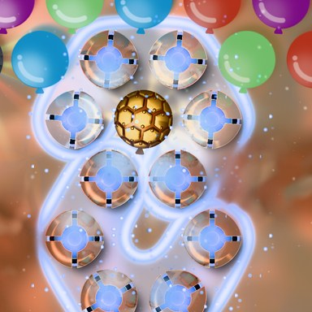 | 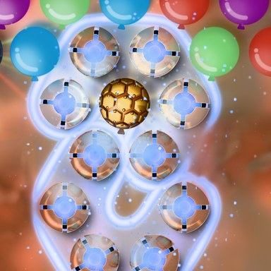 | 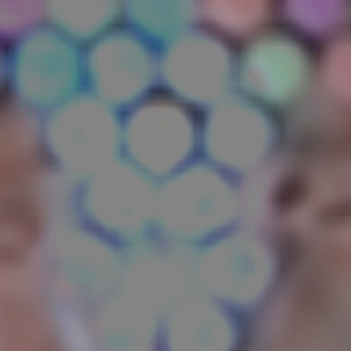 | 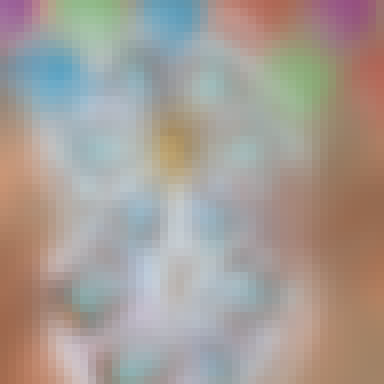 | 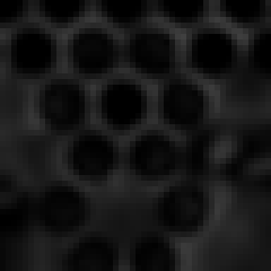 |

In *what the light does*, mid grey is a pixel the light leaves as it is: darker is shadow, a colour is a tint.

## What it reads

It reads the scene capture: the board drawn again, small, by a camera of its own. Its colour is what is
there; its alpha is *coverage*, how much of the texel a sprite covers (open sky is 0). The capture is 154 x
274 for a 1080 x 1920 screen (`SceneCaptureDownscale` 7), and it has a mip chain: each level is half the size
of the one before, every texel the average of four in the level below. A tap that reads a higher level still
costs one fetch, but averages a wider square: level 3 averages 8 x 8 texels of the capture.

| Level | 0 | 1 | 2 | 3 | 4 | 5 |
|---|---|---|---|---|---|---|
| Size | 154 x 274 | 77 x 137 | 38 x 68 | 19 x 34 | 9 x 17 | 4 x 8 |
| Colour | 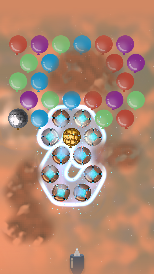 | 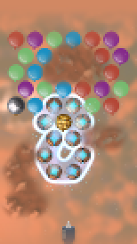 | 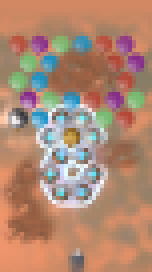 | 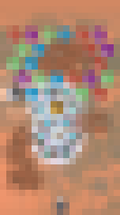 | 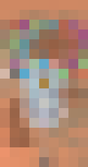 | 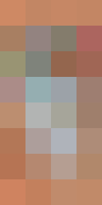 |
| Coverage | 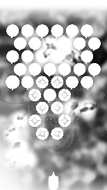 | 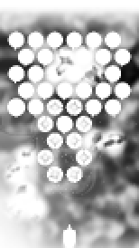 | 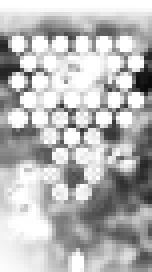 | 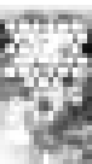 | 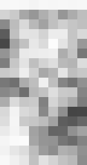 | 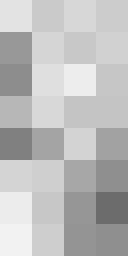 |

The buffer is 77 x 137, half the capture's size (`SmearDownscale` 2). It is worked out again each time the
capture refreshes, from the capture of the frame before.

## The march

For each texel of the buffer the shader takes the light's direction there from the light field: the time
of day's light, turned by any local light nearby (a blast, for one). Then it steps along it. A step is
`SmearDistance` / 8, so 0.081 world units; the first tap sits `TapStart` steps out (1.215), each next one a
step further, eight taps in all, the last 0.67 world units away. Each tap counts `TapDecay` (0.65) times as
much as the one before it: the first counts 1, the eighth 0.05, so what stands close matters most.

Each tap also reads a higher mip level than the one before: the level is a *spread* times log2 of the tap's
number. So a far tap averages a wider square of the capture than a near one, and the eight squares together
fill a cone that widens from the texel, not a thin line. Nothing between two taps is missed, and what stands
far away comes in soft.

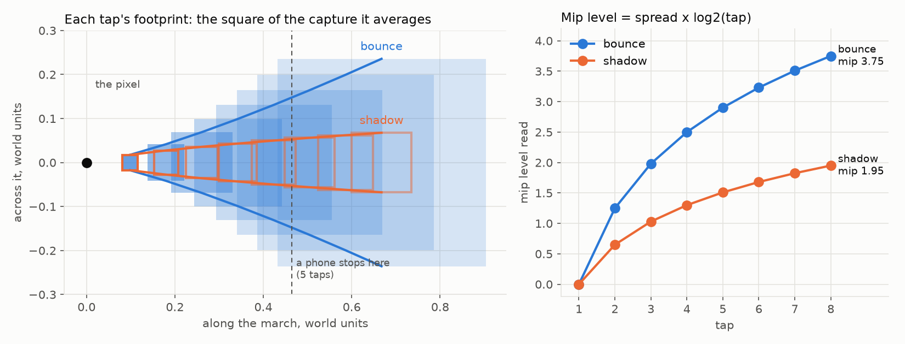

The shadow's spread is `ShadowMipSpread` (0.65): its last tap reads level 1.95, a square about 4 texels
(0.14 world units) across. The bounce's is `MipSpread` (1.25): its last tap reads level 3.75, about 13 texels
(0.47 world units), most of a balloon.

Where the taps land, for the texel at the empty middle of the lower ring (the light's direction is the
evening light's here; the field turns it near a local light):

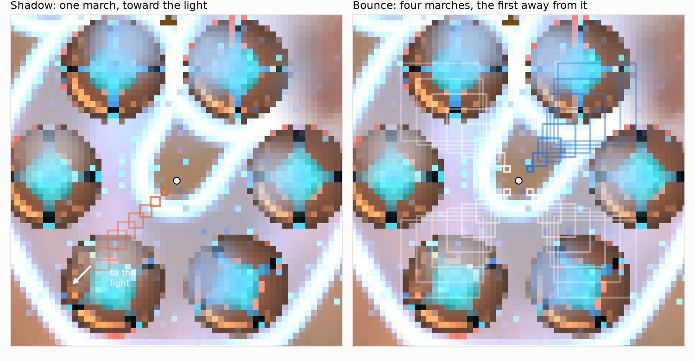

### The shadow

The shadow has one march, toward the light. Each tap reads coverage, and their weighted average is how much
stands between the texel and the light. Two masks then take away what should not be in shadow:

- **The texel's own coverage.** The shadow is multiplied by what the capture leaves uncovered at the texel
  itself, so it falls on what is open: all of it on the backdrop, part of it on a puff cloud the level deals
  (the capture draws those see-through), none on a balloon. A balloon gets no shadow from its own body nor
  from another balloon in front of it, since coverage can't tell the two apart. Inside a sprite the shader
  skips the march.
- **The surface under it.** In the sky, a shadow is something the backdrop's clouds receive (the background
  field). The shadow is multiplied by their density there, as much as `CloudShadowGate` says (0.66): at 1
  the shadow falls only on them, at 0 everywhere. On the meadow the grass is such a surface everywhere, so
  there the gate takes nothing away.

| Coverage | The shadow, gate 0 | The backdrop's clouds | The shadow, gate 0.66 (the game's) | The shadow, gate 1 |
|---|---|---|---|---|
| 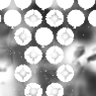 | 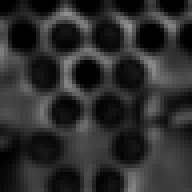 | 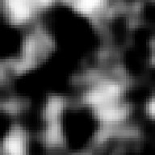 | 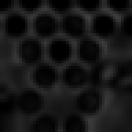 | 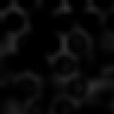 |

### The bounce

The bounce has four marches, a quarter turn apart, all turned with the light: the first away from it, then
its two sides, then toward it. The first one leads because what stands on the far side from the light turns
its lit face to the texel, as a wall in the sun throws its colour on the ground in front of it. Each tap
reads colour. The first march counts in full, the other three by `SecondaryBounceWeight` (0.5). What comes
out is the colour round the texel, leaning toward what stands away from the light.

### The soften

A second pass sets each texel to the average of the nine round it. It takes out the streaks the marches leave,
and the quad, which stretches the small buffer over the whole screen, reads it filtered.

## Laid over the frame

The quad lies over all of play and under the HUD. It multiplies the frame by twice its own colour, so mid
grey leaves a pixel as it is.

- **Shadow** turns the multiplier from white toward `ShadowTint` (a dark grey) by the shadow times
  `ShadowStrength` (0.385), deeper where the light field is brighter than the scene's light and lighter
  where it is dimmer. With the night mode on, the strength also follows the time of day (`ShadowStrengthOverAngle`).
- **Bounce** adds the buffer's colour less the *ambient*, times `BounceStrength` (0.25) and the light's
  strength there. The ambient is the sky's clear colour (on the meadow, the lit grass's), so open sky adds
  nothing: a balloon brighter than the sky lifts what is near it in its own hue, a darker one darkens it.
- **The cap.** The lift is held under what would take the brightest balloon past the start of the bloom, so
  by day only what glows of itself blooms. At night, with the balloons dimmer, the bounce has more room.

## The settings

They are on `SceneLightFieldSettings` (`Assets/Configuration/SceneLightFieldSettings.asset`), read as
`IScreenSpaceLightSettings`, and tune live in Play mode. Each below is shown at a lower value, the game's,
and a higher one, on the same board. The ones that move the shadow were taken with the cloud gate at 0, so
the whole shadow shows.

**`ShadowMipSpread`**: how fast the shadow's cone widens. Low, every tap reads single texels and the shadow
keeps a sharp edge; high, it blurs into a soft dark between the balloons.

| | 0.01 | 0.65 (the game's) | 2 |
|---|---|---|---|
| What the light does | 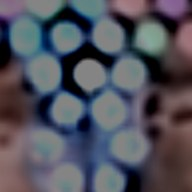 |  | 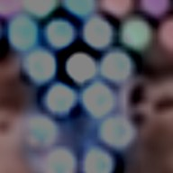 |
| Shadow | 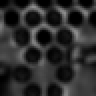 |  | 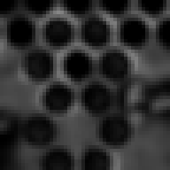 |

**`SmearDistance`**: how far the marches reach. Short, the shadow hugs each balloon and the bounce is close
to a blurred picture of the board; long, the shadow reaches further and the bounce washes out toward the
average colour round it.

| | 0.3 | 0.65 (the game's) | 1.5 |
|---|---|---|---|
| What the light does | 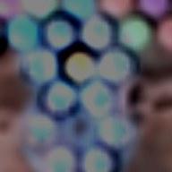 |  | 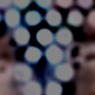 |
| Shadow | 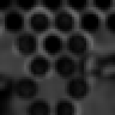 |  | 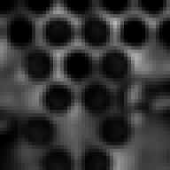 |
| Bounce | 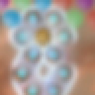 |  | 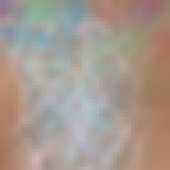 |

**`TapDecay`**: how quickly far taps stop counting. Low, only the nearest taps matter, much as a short
reach does; high, the far taps count nearly as much as the near ones, and both the shadow and the bounce
spread.

| | 0.35 | 0.65 (the game's) | 0.95 |
|---|---|---|---|
| What the light does | 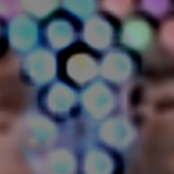 | 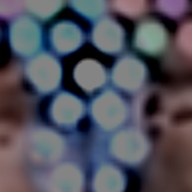 | 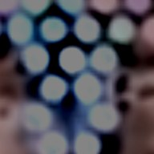 |
| Shadow | 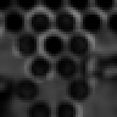 | 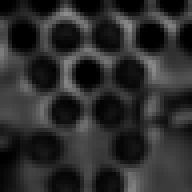 |  |
| Bounce | 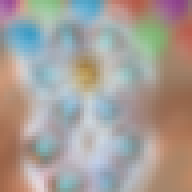 |  | 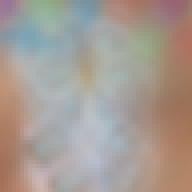 |

**`TapStart`**: how many steps out the first tap sits. At 0 the first tap reads the texel itself, so the
bounce is mostly the texel's own colour and a balloon tints its own patch; further out, the bounce comes from
the neighbours, and the shadow from further along the light.

| | 0 | 1.215 (the game's) | 3 |
|---|---|---|---|
| What the light does | 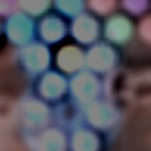 |  | 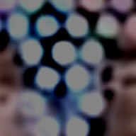 |
| Shadow | 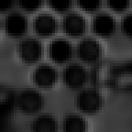 |  | 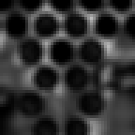 |
| Bounce | 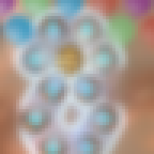 | 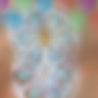 | 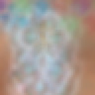 |

**`MipSpread`**: how fast the bounce's cone widens. At 0 the bounce is eight sharp samples a march, and the
rings' outline stays in it; high, it is a soft wash.

| | 0 | 1.25 (the game's) | 3 |
|---|---|---|---|
| What the light does | 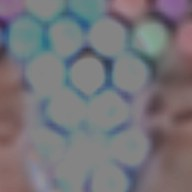 | 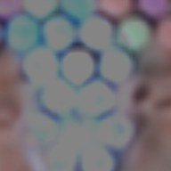 |  |
| Bounce |  |  |  |

**`SecondaryBounceWeight`**: how much the three other marches count beside the first. At 0 only the march
away from the light gathers, and the bounce is the board shifted along the light; at 1 all four count the
same, and colour gathers evenly round each texel.

| | 0 | 0.5 (the game's) | 1 |
|---|---|---|---|
| What the light does |  |  |  |
| Bounce |  |  |  |

**`ShadowStrength`** and **`BounceStrength`** only weigh the buffer as the quad lays it on, so the buffer is
the same at every value. At a bounce strength of 1 the lift reaches the cap nearly everywhere: the light
lifts the whole patch evenly and the shadow is lost under it.

| | 0 | The game's (0.385, 0.25) | 1 |
|---|---|---|---|
| `ShadowStrength` |  |  |  |
| `BounceStrength` |  |  |  |

## On a phone

A phone build runs a lighter buffer (`_LOW_QUALITY_SMEAR`): five taps a march instead of eight, and two
bounce marches, the one away from the light and one side, instead of four. That is 16 fetches a texel
instead of 41. The bounce leans further to one side, and the shadow reaches 0.42 world units instead of 0.67.

| | The Editor | A phone |
|---|---|---|
| What the light does |  |  |
| Shadow |  |  |
| Bounce |  |  |

## Where it lives

| Part | File |
|---|---|
| The two passes, the march and the soften | `Assets/Shaders/BalloonParty/Display/ScreenSpaceLightSmear.shader` |
| The quad that lays it on | `Assets/Shaders/BalloonParty/Display/ScreenSpaceLightOverlay.shader` |
| The service that runs them | `Assets/Source/Display/ScreenSpaceLightService.cs` |
| The capture it reads | `Assets/Source/Display/SceneCaptureService.cs` |
| The design, as a diagram | `Assets/Source/Diagrams/arch_screen_space_light.md` |

The board was staged with [`Tools/stage`](../Tools/stage), each setting changed in Play mode and put back
after.
