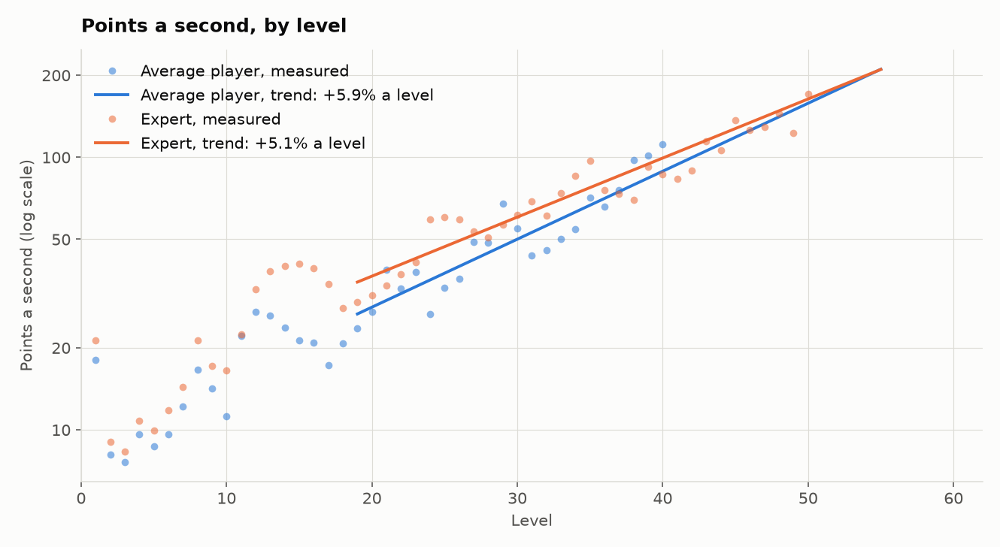
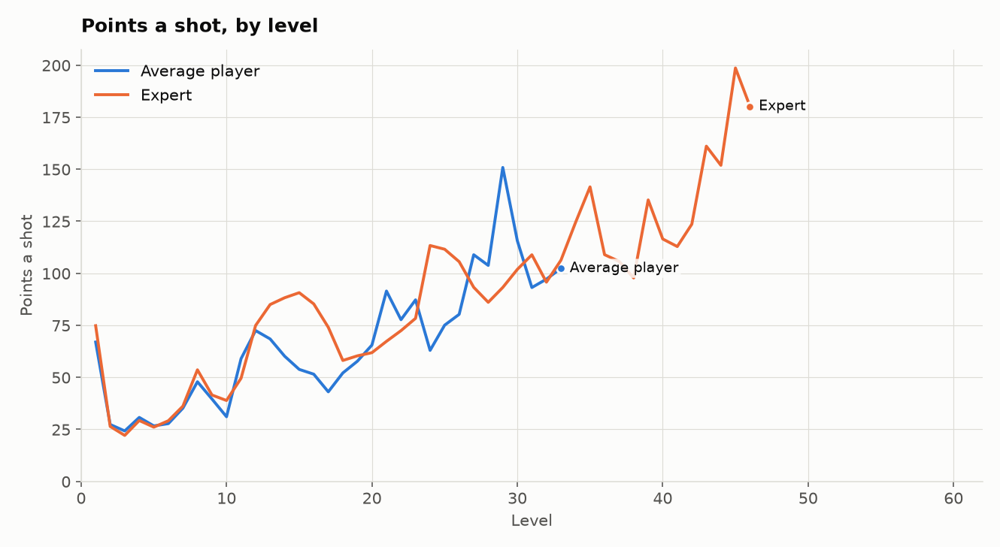
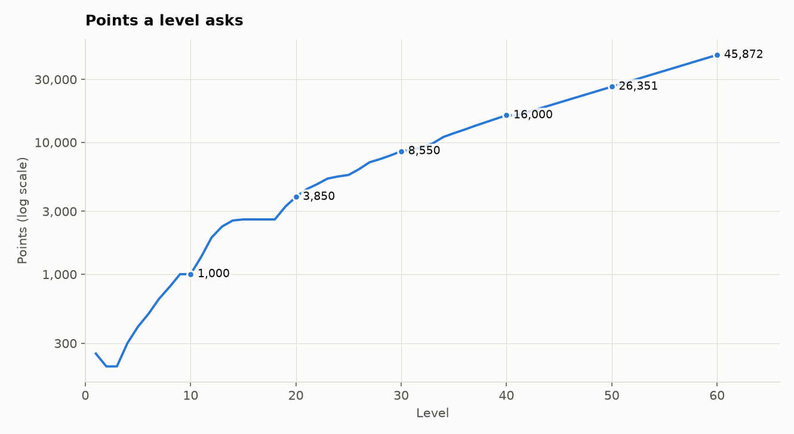
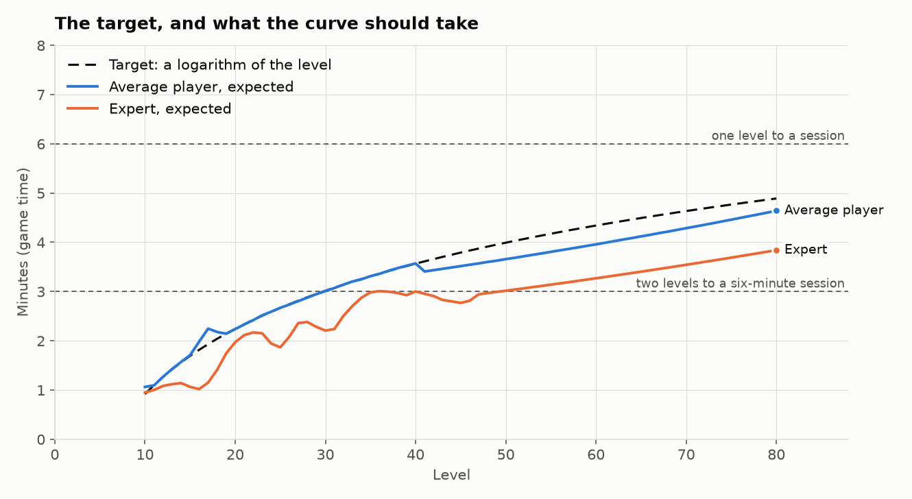
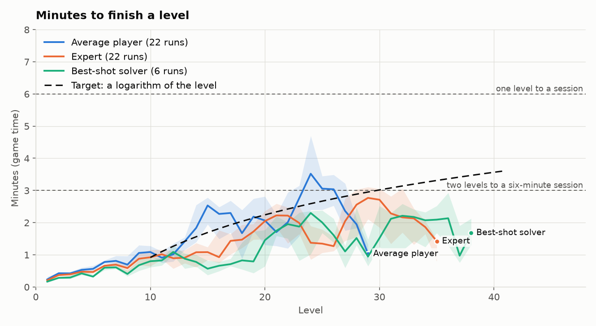
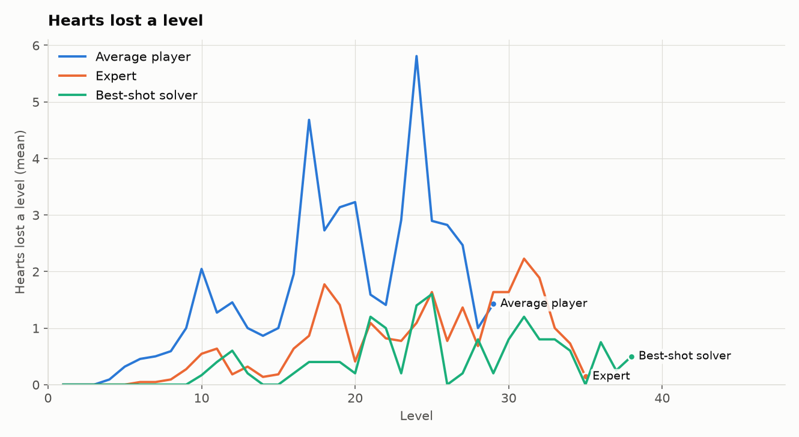

# How long a level takes

How many points a level asks for, and why. The numbers on this page come from bots playing on a tablet, and
every chart and table is redone by a script from data kept in the repository ([Redoing it](#redoing-it)).

## The target

A session is about six minutes: a bathroom break, a short commute. Early on several levels fit in one. Past
level 20 two still fit, and from there it slowly closes toward one level a session.

As a curve, a level's time is a logarithm of its number: it climbs quickly at first and ever more slowly
after. Two points pin it down.

| Level | Time | Why there |
|---|---|---|
| 10 | 55 s | Where the early levels leave off |
| 25 | 2 min 40 s | Two levels to a session, with a little to spare |

## What sets a level's length

A level ends when every colour's bar is full, so its length is the points it asks divided by how fast the
player scores. And scoring speeds up with the level: points a second grow 5 to 6% a level from level 19 on,
for an average player and an expert alike.



Nearly all of that is points a shot. The pace of shooting barely moves, from 0.41 shots a second at level 20
to 0.50 at level 40.



So the points a level asks must grow about as fast as scoring does just to hold its length still, and a
little faster to follow the target.

Not measured: how much of the rise comes from upgrades, from items on the board, or from streaks. The runs
record points and shots, not pops.

## The curve

Each level from 10 on asks for its target time multiplied by the average player's points a second at that
level, and never fewer than the level before. The curve is in
`Assets/Configuration/LevelPacingConfiguration.asset`.



| Level | Target | Points asked | Levels in 6 min, expected |
|---|---|---|---|
| 10 | 0:55 | 1,000 | 4.8 |
| 15 | 1:42 | 2,600 | 3.1 |
| 20 | 2:14 | 3,850 | 2.5 |
| 25 | 2:40 | 5,650 | 2.1 |
| 30 | 3:01 | 8,550 | 1.9 |
| 35 | 3:19 | 11,700 | 1.7 |
| 40 | 3:34 | 16,000 | 1.6 |
| 45 | 3:47 | 19,972 | 1.6 |
| 50 | 3:59 | 26,351 | 1.6 |
| 55 | 4:10 | 34,767 | 1.5 |
| 60 | 4:20 | 45,872 | 1.4 |

- Levels 1 to 9 are set by hand, a control point each.
- Levels 10 to 40 have a fitted control point each.
- Past level 40 the tail grows 5.7% a level.
- In play each colour's share is rounded down to 50, so a level's total can be a little under these.

What that should take each player:



## Measured



| Levels | Target | Average player | Its middle half | Levels in 6 min | Expert | Best-shot solver | Hearts the average player loses a level |
|---|---|---|---|---|---|---|---|
| 1–5 |  | 26 s | 21–31 s | 9.4 | 24 s | 18 s | 0.1 |
| 6–10 |  | 52 s | 44–65 s | 5.6 | 42 s | 36 s | 0.9 |
| 11–15 | 85 s | 82 s | 57–124 s | 3.8 | 60 s | 50 s | 1.1 |
| 16–20 | 122 s | 131 s | 88–150 s | 2.5 | 93 s | 42 s | 3.1 |
| 21–25 | 150 s | 157 s | 90–199 s | 2.1 | 113 s | 113 s | 2.9 |
| 26–30 | 173 s | 133 s | 98–191 s | 2.5 | 139 s | 81 s | 2.1 |
| 31–35 | 192 s |  |  |  | 121 s | 126 s |  |
| 36–40 | 208 s |  |  |  |  | 101 s |  |

- **Through level 25** the average player is within ten seconds of the target.
- **Levels 26 to 30** read short because only the fastest runs are in them: in 50 minutes the average runs
  end between levels 23 and 30.
- **The expert** runs about a third under the target from level 26.

### How it is measured

- **Players.** Three bots from `Tools/playtest`: a model of an average player, the same model with an
  expert's aim and reactions, and the best-shot solver, which plays the best shot it can find every time.
- **Runs.** Always from level 1, so a run arrives at level 30 with the upgrades a player would have by then.
  A level's time runs from its first moment to the next level's, retries included.
- **Where.** A Lenovo Legion tablet, six copies of the game side by side, 50 minutes a run
  (`Tools/playtest/device_copies.py`).
- **How many.** 50 runs on this curve for the times (22 average, 22 expert, 6 best-shot solver); 101 runs in
  all for the points a second, which do not depend on the curve played.

A bot is not a person. The numbers say whether the curve follows its target; they do not say what a level
takes a given player.

## What is open

- **Deep levels.** Past level 30 the average player is unmeasured, and past 40 the curve is a trend carried
  on. Runs of 100 minutes are the next measurement.
- **The trend.** The curve is fitted to 4.9% a level, read from 51 runs. With all 101 runs in, the average
  player's trend reads 5.9%. The next fit takes that up, once the long runs say which is nearer.
- **Danger.** Nothing gets more dangerous deep in a run. Hearts lost a level peak at levels 16 to 25 and fall
  after, and the expert loses at most twice in a 50-minute run. Making the game harder there is a job for the
  board, not for the points: more points only make a level longer.



## Redoing it

```bash
python3 Tools/playtest/device_copies.py ...                                  # a sweep on the tablet
python3 Tools/balance/level_balance.py collect "Logs/playtest/*from1-fit*"   # its runs, into Docs/balance/data/
python3 Tools/balance/level_balance.py fit --apply                           # refit, and write the asset
python3 Tools/balance/level_balance.py charts                                # every chart on this page
python3 Tools/balance/level_balance.py report                                # every table on this page
```

`Tools/balance/README.md` says what each step reads and writes.
