# BalloonParty

[](https://github.com/jose-villegas/BalloonParty/actions/workflows/style-audit.yml)
[](https://jose-villegas.github.io/BalloonParty/)

A colorful arcade balloon-popper built with **Unity 6**. Fire bouncing balls into a hex grid, pop
streaks of one colour for multipliers, and keep the board from filling up.

<video src="https://github.com/jose-villegas/BalloonParty/raw/main/video.mp4" controls width="100%"></video>

- **Pressure.** Each turn packs the grid tighter. Balloons that no longer fit drain your hearts, and at
  zero the run ends.
- **Levels.** Each level brings new balloons and threats: puff clouds, bushes, armour. A level-up offers a
  pick of upgrades for the rest of the run.
- **Runs.** A lost run can be retried from the level it reached, and one left midway is offered as Continue
  at the next launch.

## Scenarios

The run moves through Sky, Meadow and Water under a day that turns to night, and now and then a level is a
bonus, drawn on a page of paper. Top row: morning. Bottom row: night.

| Sky | Meadow | Water | Bonus level |
|---|---|---|---|
| 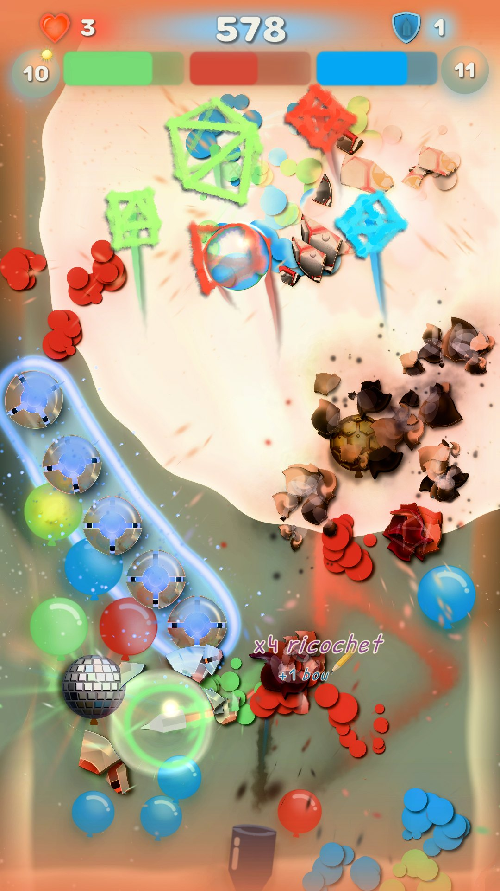 | 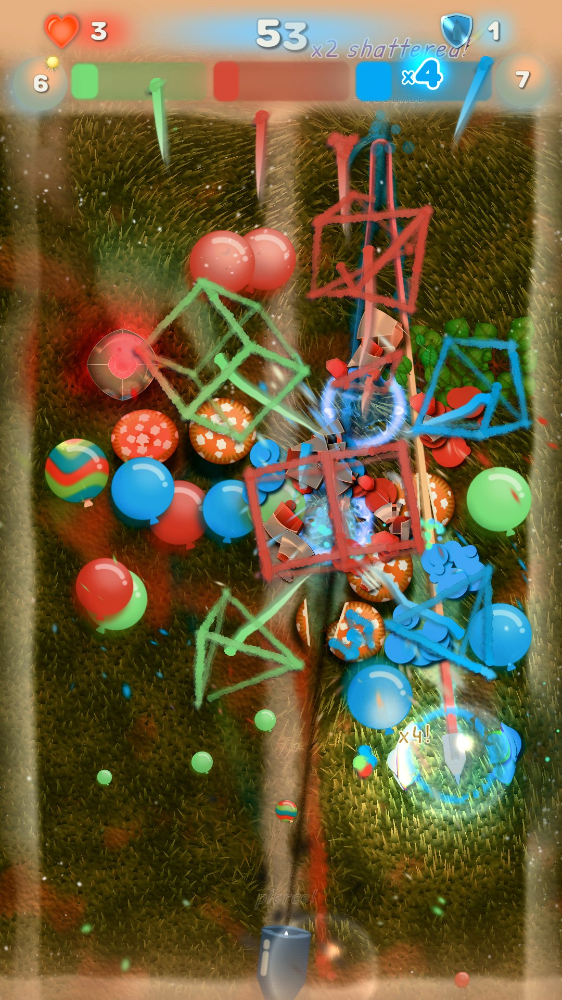 | 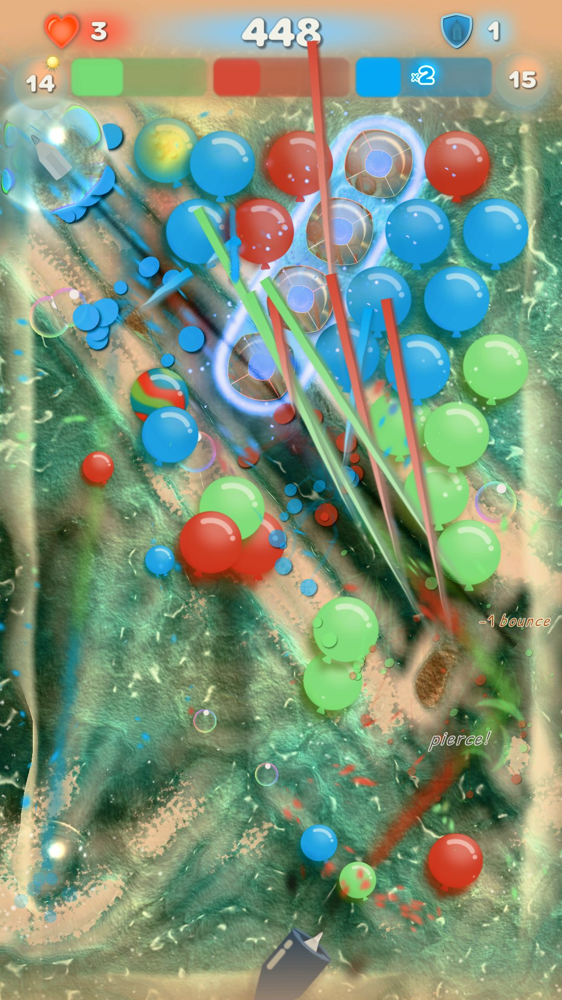 | 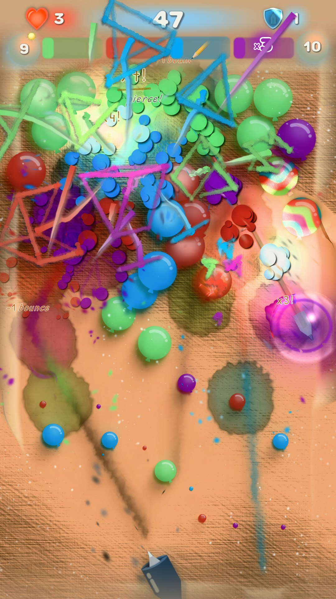 |
| 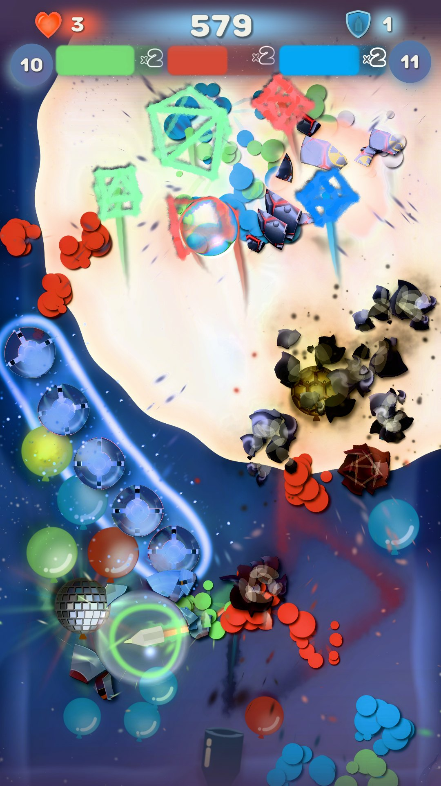 | 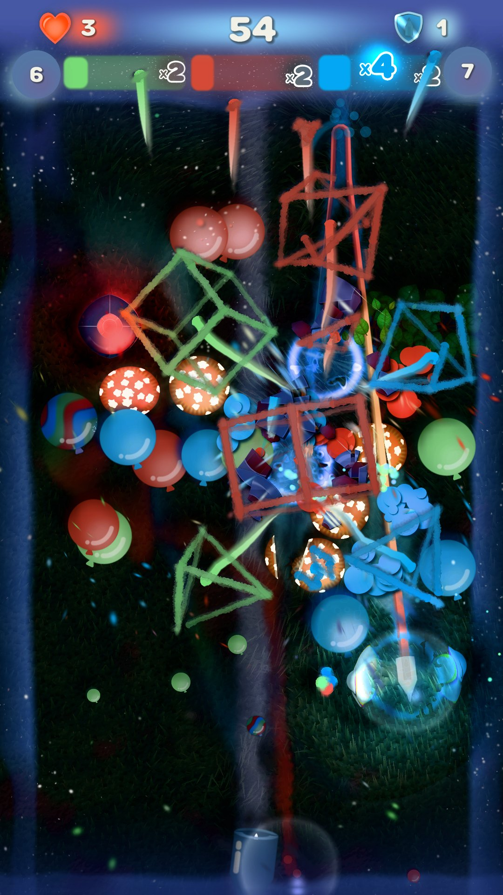 | 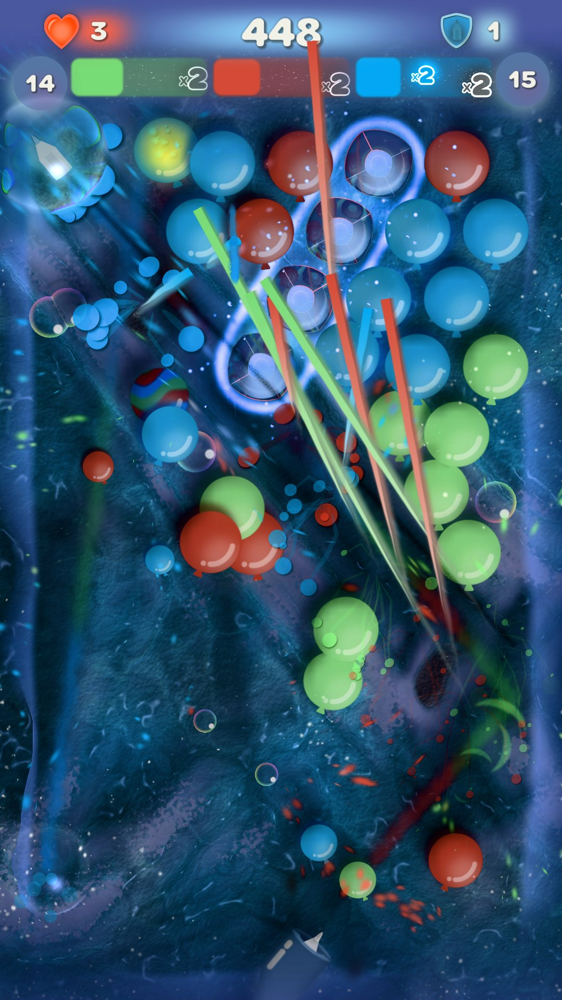 | 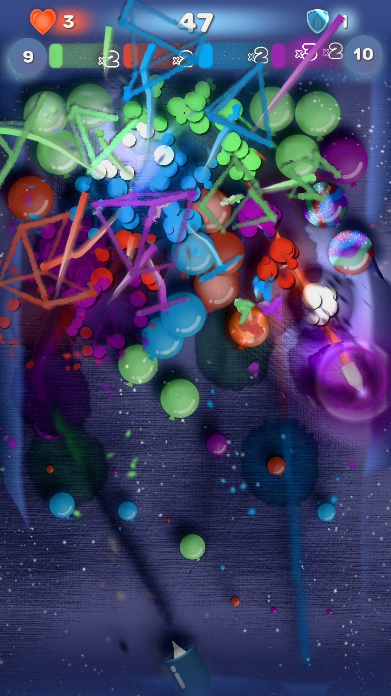 |

- **Meadow.** Walls of mushroom caps work as pinball bumpers. A ball that bounces off three walls in one
  flight becomes the Snipe's lance, which cuts the caps it flies through.
- **Water.** Soap bubbles rise with the lines and merge into clusters.
- **Bonus level.** One colour more, purple, and no threats. Its lines come faster and bring more items and
  gift balloons.

## Items

Balloons carry items that go off when popped.

| Bomb | Laser | Lightning |
|---|---|---|
| 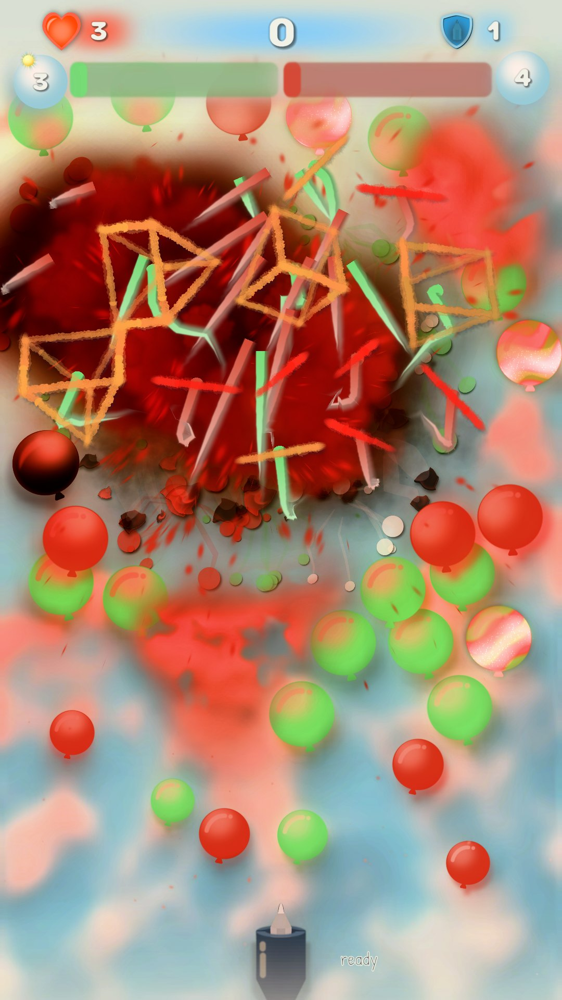 | 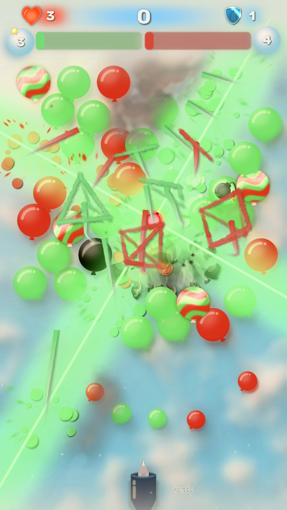 | 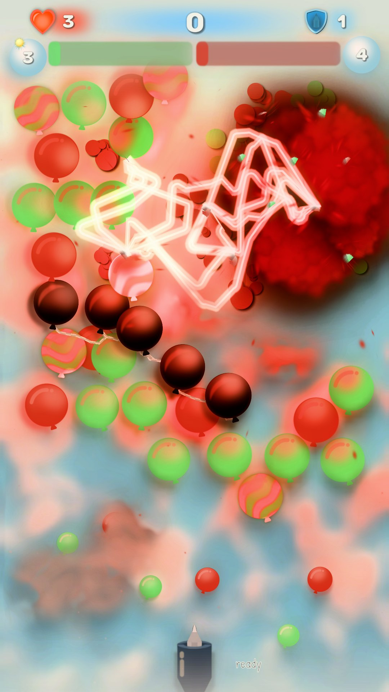 |
| A blast around it | A beam across the board | Jumps from balloon to balloon |
| **Paint** | **Shield** | **Snipe** |
| 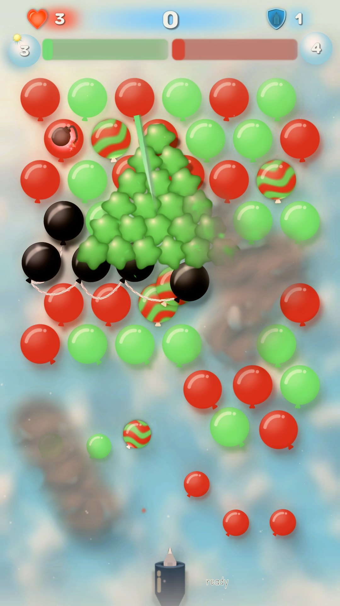 | 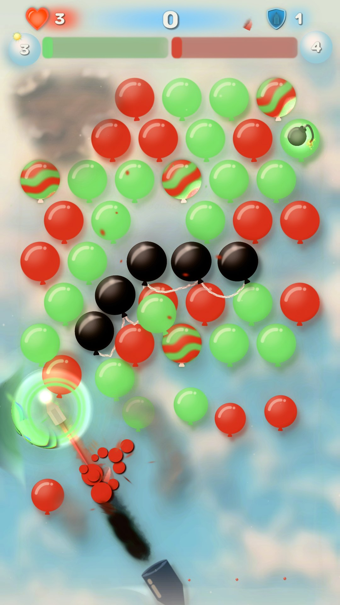 | 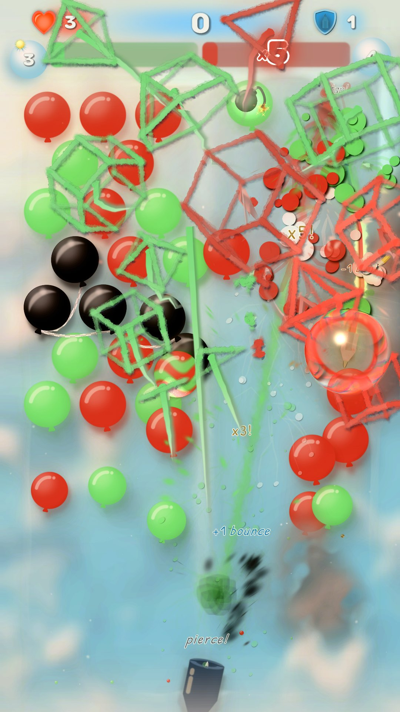 |
| Turns its neighbours one colour | Arms the next ball with a shield | Arms the next ball to pierce |

## Gift balloons

Four balloons belong to no level's mix: each comes rarely and is worth going for.

| Golden | Heart | Disco ball | Nuke |
|---|---|---|---|
| 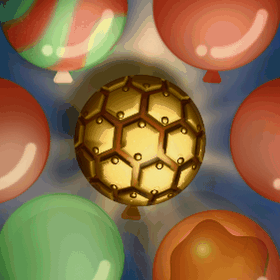 |  | 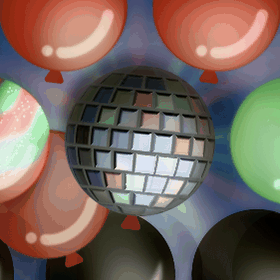 | 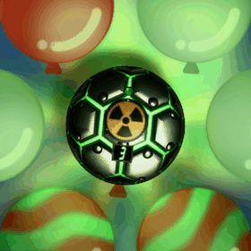 |
| Pays a free upgrade | Gives a heart back | Paints the board rainbow | Clears the board |

- **Golden** and **disco** are plated: a plain shot bounces off, and only a pierce, a blast or a beam breaks
  them. A rainbow balloon carries on a streak of any colour.
- **The nuke** is a rescue, likelier the more trouble you are in: three hits arm it, and after a count of
  three it goes off.

These pictures are retaken by a script ([`Tools/readme_shots/`](Tools/readme_shots)): a bot plays each
scenario, and its still is the moment with the most balloons popping at once.

## How a frame is made

**[How a frame is made](Docs/frame-composition.md)** takes one frame apart: the maps the game fills in
before it draws, the order it draws in, and how a balloon gets its highlight and its shadow from the light.

| The shot | The backdrop | + the balloons | + effects and light |
|---|---|---|---|
| 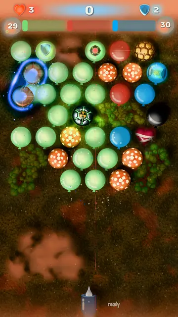 | 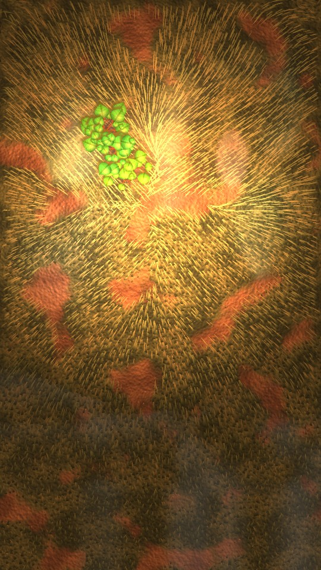 | 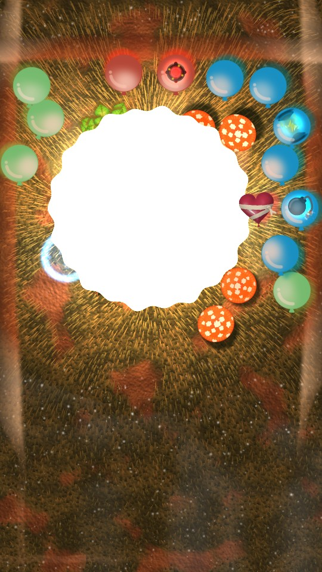 | 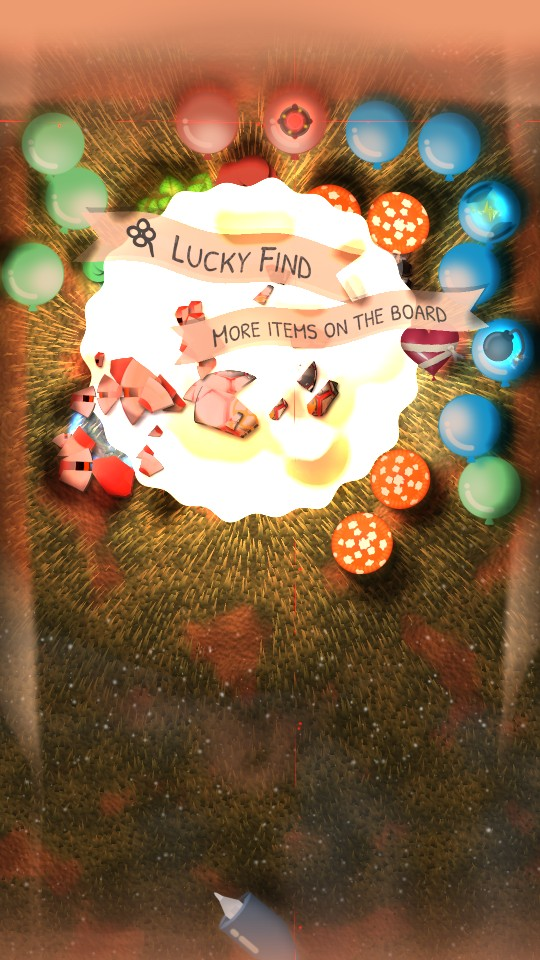 |

## Releases

🎮 **[Latest Release](https://github.com/jose-villegas/BalloonParty/releases/latest)** —
Play the most recent stable build.

## Documentation

| Where | What |
|---|---|
| [Docs site](https://jose-villegas.github.io/BalloonParty/) | Code style guide, architecture diagrams, design plans and the API reference, generated by Doxygen on every push to `main` |
| [`Docs/frame-composition.md`](Docs/frame-composition.md) | How a frame is made |
| [`Assets/Source/README.md`](Assets/Source/README.md) | The authoritative code style & architecture guide |
| [`Assets/Source/ARCHITECTURE.md`](Assets/Source/ARCHITECTURE.md) | Index of the architecture diagram pages |
| Per-folder `README.md` | Every feature folder documents its own mechanics and contracts |
| [`Assets/Source/Plans/`](Assets/Source/Plans) | Working design plans for current and upcoming features |

Build the docs locally (requires `doxygen` + `graphviz`):

```bash
Tools/generate-docs.sh   # renders Docs/diagrams/*.dot → SVG, runs Doxygen, opens the result
```

## Architecture

**MVC, enforced at the type level:** Models are plain C# with `ReactiveProperty<T>`;
Views are the only `MonoBehaviour`s and the only layer touching Unity APIs; Controllers
are plain C# registered in VContainer (`IStartable` / `ITickable`). Configuration lives
in ScriptableObjects consumed through read-only interfaces. Cross-system communication is
message-based.

| Library | Role |
|---|---|
| [VContainer](https://vcontainer.hadashikick.jp/) | Dependency injection, lifetime scopes |
| [UniRx](https://github.com/neuecc/UniRx) | Reactive state |
| [MessagePipe](https://github.com/Cysharp/MessagePipe) | Pub/sub messaging |
| [UniTask](https://github.com/Cysharp/UniTask) | Async/await (no coroutines) |
| [DOTween](http://dotween.demigiant.com/) | Tweening |
| [NaughtyAttributes](https://github.com/dbrizov/NaughtyAttributes) | Inspector utilities |
| [TextMeshPro](https://docs.unity3d.com/Packages/com.unity.textmeshpro@latest) | UI text rendering |

## Development

Open with **Unity 6000.6.3f1** (see `ProjectSettings/ProjectVersion.txt`).

The conventions in the style guide are **machine-enforced**: a pre-commit hook and CI run
the same audit (member/method ordering, Allman braces, comment policy, banned APIs such
as coroutines and direct `Time.timeScale` writes, and more).

```bash
# Compile without opening Unity
dotnet build BalloonParty.Runtime.csproj -nologo -clp:ErrorsOnly

# Style audit (what the pre-commit hook runs)
python3 Tools/style_audit.py            # full scan
python3 Tools/style_audit.py --fix      # auto-fix the mechanical rules
python3 Tools/test_style_audit.py       # the audit's own test suite
```

Tests live in `Assets/Tests/` (EditMode + PlayMode), run through Unity's Test Runner.

## Project structure

All gameplay code lives in [`Assets/Source/`](Assets/Source) (asmdef
`BalloonParty.Runtime`), organized by feature — `Balloon/`, `Projectile/`, `Slots/`,
`Item/`, `Game/` (score, run, health, cinematics), `UI/`, `Shared/` — with editor tooling
in `Assets/Source/Editor/` and config assets in `Assets/Configuration/`.
